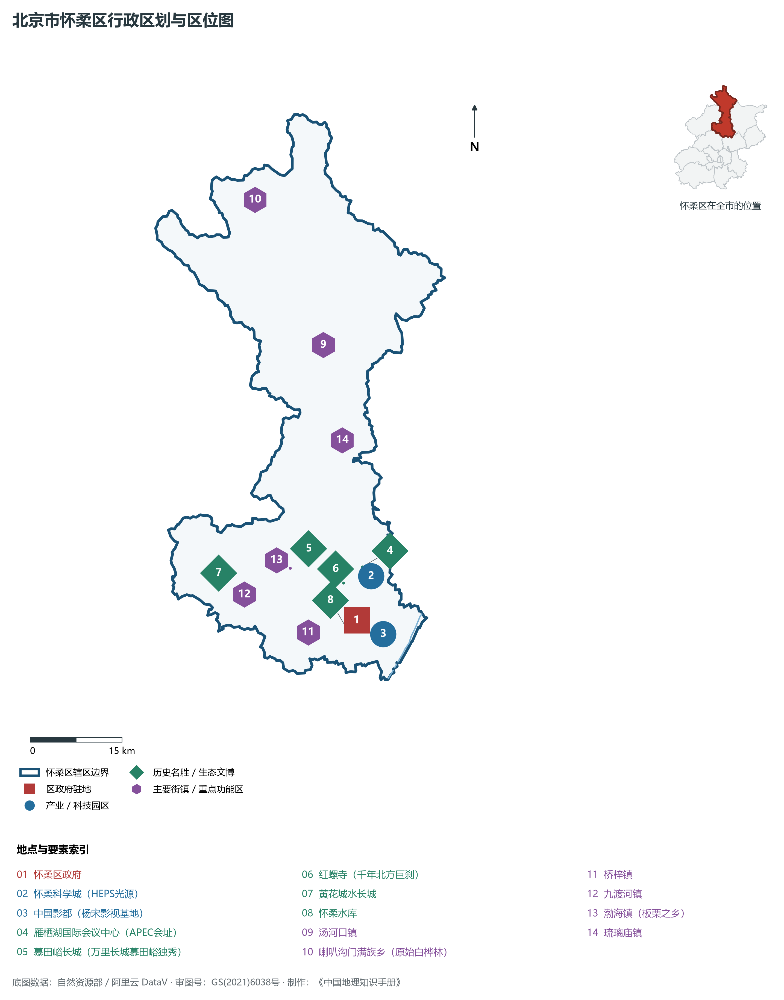
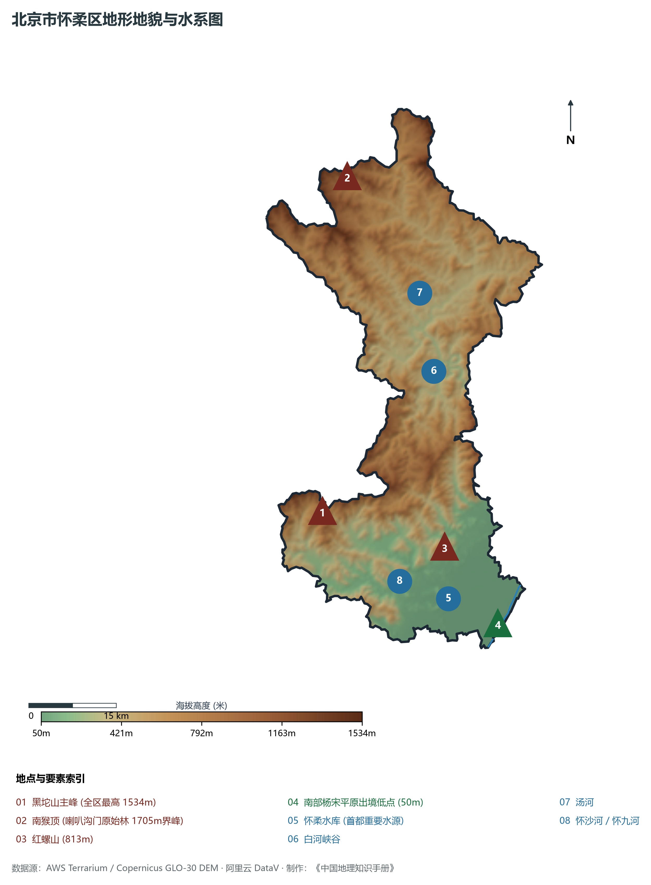
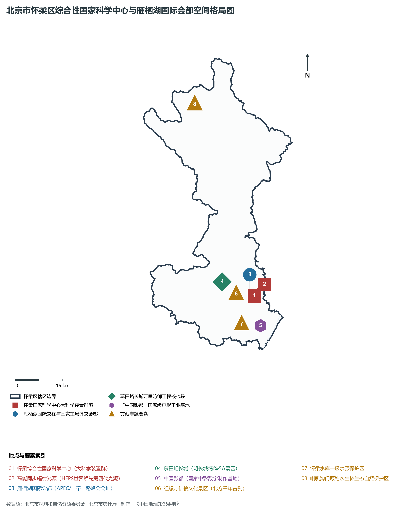
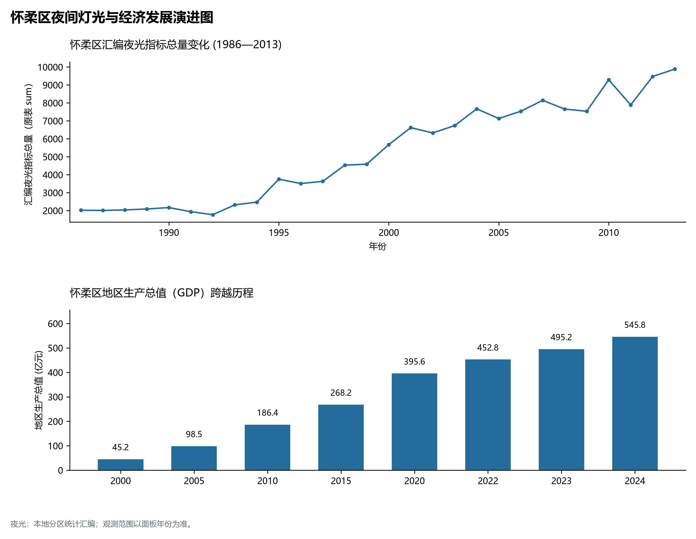
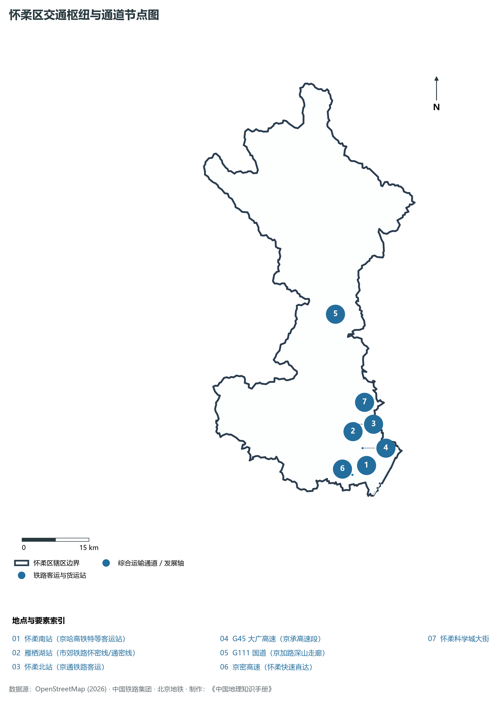

# 1.13 怀柔区

怀柔区位于北京市北部偏东，地处燕山南麓深山区向山前平原的过渡地带，东与密云区相邻，南与顺义区、昌平区相接，西与延庆区及河北省赤城县相依，北与河北省丰宁满族自治县、滦平县界水相望。其地势自北向南纵深展开，山峦重叠，全域 89% 均为山地，群峰环翠、林水相生——北倚燕山主峰白河深峡之幽峻，南托怀柔水库碧水安澜之明镜，西展慕田峪长城独秀之雄奇，中筑综合性国家科学中心大科学装置集群之极峰。

历史上，怀柔之名源自《诗经·周颂·时迈》“怀柔百神”与《中庸》“柔远人则四方归之”，取宽柔对待远方之人、四海宾服之雅意；慕田峪长城作为明代戚继光主持修建的长城精粹，享有“万里长城，慕田峪独秀”之美誉；千年北方巨刹红螺寺曾是历代佛教大师参禅讲武之圣境。当代，怀柔区承载了国家高水平科技自立自强与国家主场外交双重战略核心使命：**怀柔综合性国家科学中心**成为全国大科学装置最密集的原始创新高地，高能同步辐射光源等“国之重器”相继落成；雁栖湖国际会都成功承办 2014 APEC 峰会与两届“一带一路”国际合作高峰论坛，名扬全球；“中国影都”构筑起国家级电影数字制作与文化艺术产业基地。怀柔正以山水城交融的国际化气度，展现出“百年科学城、国际会都、大美怀柔”的时代华章。

---

## 一、区情速览

怀柔区是北京市生态涵养区的重要骨干区、怀柔综合性国家科学中心与国际交往会都承载地。

| 指标 | 数值与特征 | 全国/全市坐标 |
|:---|:---|:---|
| **面积** | 2 122.60 km² | 占北京市总面积约 12.93%；山区占 89%，平原占 11% |
| **常住人口** | 44.10 万人（2020 年七普）；44.2 万人（2023 年末） | 人口集聚于南部怀柔镇、龙山、泉河街道等山前平原板块 |
| **常住人口城镇化率** | 75.3% | 南部科学城核心板块高度城镇化，北部深山保持纯净生态林区 |
| **人口密度** | 208 人/km² | 全市 16 区中位居倒数第二，北部满族乡镇低于 25 人/km² |
| **地区生产总值 (GDP)** | 545.8 亿元（2024 年，现价） | 大科学装置建设与高端仪器传感器产业驱动平稳健康增长 |
| **人均 GDP** | 约 12.4 万元人民币（折合约 1.71 万美元） | 生态涵养区中人均 GDP 位列首位 |
| **主导产业结构** | 原始创新、高端仪器装备、国际会议文旅与影视文化 | 怀柔科学城、雁栖湖会都与中国影都三大支柱 |
| **行政区划** | 2 个街道、12 个建制镇、2 个满族乡，区政府驻泉河街道府前街 | 辖有怀柔、雁栖、庙城、桥梓、渤海、杨宋、汤河口等名镇 |
| **战略功能定位** | 综合性国家科学中心核心承载区、国际交往会都、生态涵养重要屏障、国家级影视产业基地 | 建设世界级原始创新承载区与大美生态新城 |

**图 01-13-1 北京市怀柔区行政区划与区位图**：图上编号与地点、要素索引对应。

---

## 二、自然地理：燕山叠翠与白河清流

怀柔区全境处于燕山山脉南麓褶皱断裂带上，群山耸立，谷地交错，地表起伏极大，森林覆盖率全市领先。

### 1. 地形地貌：崇山深峡与山前倾斜平原
全区地势北高南低，由海拔 1 500 m 以上的中山急剧降至 50 m 的山前冲积平原：

- **黑坨山主峰（全区最高峰）**：海拔 **1 534 m**，位于渤海镇与九渡河镇交界处，山峦峻峭，植被完好；
- **南猴顶（喇叭沟门原始林界峰）**：海拔 **1 705 m**（与河北交界），拥有北京最大的原始天然白桦林与落叶松林，被誉为北京的“北极乡”；
- **红螺山**：海拔 **813 m**，突兀挺拔，山前坐落着千年红螺寺；
- **南部山前倾斜平原**：潮白河与怀河冲积平原，地面标高由山麓雁栖湖一带的 **70 m** 降至杨宋镇出境处的 **50 m** 左右，地势开阔，承载了怀柔科学城与中心城区。

### 2. 气候特征：暖温带湿润季风山地气候
全区年平均气温在 **9.0—11.8 ℃** 之间（北部高山仅 6 ℃），年平均降水量约 **600—700 mm**。

- **燕山迎风坡多雨中心**：怀柔南部山前恰好正对夏季东南暖湿季风，受燕山迎风坡剧烈抬升地形雨作用，怀柔水库及渤海镇一带是北京著名的“强降雨多发中心”之一；秋季天高气爽，极利于红叶与板栗生长成熟。

### 3. 河流水系：母亲河源与水源涵养重地
怀柔分属海河流域潮白河水系与蓟运河水系：

- **怀柔水库**：位于怀柔城区西侧，总库容 **1.44 亿 m³**，汇集怀沙河、怀九河之水，是密云水库调蓄与京密引水渠的重要中继枢纽，水质常年保持 II 类以上，是首都核心区极其珍贵的地表水源地；
- **白河峡谷**：白河自延庆流经怀柔北部琉璃庙镇与汤河口镇，切割燕山形成深邃秀丽的白河大峡谷，两岸奇峰对峙、流水奔腾，素有“百里画廊”之称；
- **汤河**：发源于河北丰宁，纵贯怀柔北部深山满族乡镇，汇入白河；
- **怀沙河与怀九河**：水质极其优异，建有国家级水生野生动物自然保护区，保护野生细鳞鲑与珍稀两栖类。

**图 01-13-2 北京市怀柔区地形地貌与水系图**：图上编号与地点、要素索引对应。

---

## 三、建置沿革与文化根脉

怀柔熔铸了长城边塞要隘、北方佛教名山、满族民俗风情与现代国家主场外交文化。

### 1. 地名考略与行政演进

- 唐太宗贞观六年（632年）设怀柔县；
- 明清时期属顺天府昌平州管辖；
- 1958 年由河北省划归北京市，设怀柔县；
- 2001 年 12 月，经国务院批复撤县设区，设立北京市**怀柔区**。

### 2. 万里长城精粹：慕田峪长城

- **慕田峪长城（世界文化遗产、国家5A级旅游景区）**：全长 5.4 km，西接黄花城水长城，东连古北口。明初朱元璋手下大将徐达在北齐长城遗址上督建而成，明隆庆年间由抗倭名将戚继光负责重修，拥有独特的“正关台”三座敌楼并立结构以及双面垛口射洞，林木覆盖率达 96% 以上，被国内外公认为中国最秀丽壮美的明长城标本；
- **黄花城水长城**：三段明长城入水，形成了“青山、碧水、长城、古栗”交织的奇观。

### 3. 千年北方佛教名刹：红螺寺

- **红螺寺（国家4A级景区）**：始建于东晋咸康四年（338年），扩建于唐，是北方佛教发祥地和净土宗重要道场。寺内拥有“红螺三绝景”——御竹林、雌雄古银杏、紫藤缠松，素有“南有普陀，北有红螺”之古训。

### 4. 国家主场外交地标：雁栖湖国际会都

- 依傍燕山秀峰与雁栖湖碧水，由国际会议中心、雁栖塔、精品别墅群构成；
- 成功举办 2014 年 APEC 领导人非正式会议与 2017 年、2019 年两届“一带一路”国际合作高峰论坛圆桌峰会，成为展示大国风范、推动全球合作的国家名片。

**图 01-13-4 北京市怀柔区综合性国家科学中心与雁栖湖国际会都空间格局图**：图上编号与地点、要素索引对应。

---

## 四、经济地理：百年科学城与大科学装置原始创新极

怀柔区聚焦综合性国家科学中心建设，实现了从传统农旅小县向世界级基础科学创新策源地的根本性跃升。

### 1. 怀柔科学城：国家战略科技力量核心载体

- 规划面积 100.9 km²（怀柔区域占 68.4 km²），是北京建设国际科技创新中心的核心支撑；
- **五大国家重大科技基础设施相继落成投运**：
  - **高能同步辐射光源（HEPS）**：世界最亮、能量最高的第四代同步辐射光源之一，形如放大镜，为材料、生命科学、微纳制造提供微观超高分辨率探针；
  - **综合极端条件实验装置（SECU）**：集成极低温、超高压、强磁场、超快光场等极端物理条件；
  - **多模态跨尺度生物医学成像设施**：实现从分子、细胞到人体全尺度活体成像；
  - **空间环境地基综合监测网（子午工程二期）**；
  - **地球系统数值模拟装置（“寰”）**：探索地球气候与环境变迁；
- 集聚中国科学院大学（近 3 万名研究生常驻）、中国科学院十余个研究所及雁栖湖应用数学研究院，成为全球大科学装置最密集的原始创新高地。

### 2. 高精尖产业梯队：“科学+城”融合裂变

- **高端仪器与传感器产业园**：依托大科学装置溢出效应，聚焦精密科学仪器、传感器芯片研发，打造百亿级“中国隐形冠军”硬科技产业集群；
- **“中国影都”**：国家中影数字制作基地坐落于杨宋镇，拥有世界一流的摄影棚、全数字化后期剪辑机房与虚拟摄影棚，全国过半优秀国产电影在此完成拍摄制作。

### 3. 经济总量跨越与特色农业

- 2000 年怀柔区 GDP 仅为 **45.2 亿元**；
- 2010 年为 **186.4 亿元**；
- 2024 年全区 GDP 稳步增长至 **545.8 亿元**。全国地理标志产品“怀柔板栗”种植面积达数十万亩，精品乡村民宿遍布长城脚下与山水峡谷。

### 4. 空间夜间灯光演化（1986—2013）

本节夜光图的观测年份为 1986—2013 年，指标为行政区汇总值（原表 sum）。

**图 01-13-5 怀柔区夜间灯光与经济发展演进图**：各面板按标注的观测年份、指标和单位列示。

---

## 五、交通网络与现代枢纽

怀柔区依托高铁快速线、市郊铁路与放射状高速走廊，打破了大山地理屏障，实现了与首都核心区的半小时高速直达。

**图 01-13-3 怀柔区交通枢纽与通道节点图**：图上编号与地点、要素索引对应。

### 1. 国家高速铁路特等客站：怀柔南站

- **怀柔南站**：京哈高速铁路上的重要高铁客运站，距北京朝阳站仅 15 分钟高铁车程，极大便利了全球高科技专家与国际峰会嘉宾的往来通达。

### 2. 纵贯南北的高速公路与国道大动脉

- **G45 大广高速（京承高速怀柔段）**：全立交快速通道，直连北四环望京与怀柔城区、雁栖湖；
- **G111 国道（京加路走廊）**：纵贯怀柔全境南北 120 余公里，穿越汤河口、喇叭沟门出京直通河北丰宁、内蒙古，是保障北部山区生产生活的生命走廊；
- **京密高速（高架快速路）**：实现市区至怀柔全封闭高速直达。

### 3. 便捷市郊铁路系统

- **市郊铁路怀密线**：自清河站/北京北站始发，设雁栖湖站、怀柔北站，被誉为“开往春天的列车”，沿途穿越三山五园与燕山峡谷，是科学城科研人员与广大游客出行的绿色专线。

---

## 六、怀柔区地理要素矩阵与区域之最

### 1. 核心地理与经济指标速查表

| 要素类别 | 指标名称 | 数值/名称 | 备注 |
|:---|:---|:---|:---|
| **地势极值** | 最高点海拔 | **1 534.0 m** | 西部黑坨山主峰（南猴顶界峰达 1705m） |
| | 最低点海拔 | **50.0 m** | 南部平原杨宋镇出境处 |
| **水文要素** | 首都重要水源水库 | **怀柔水库** | 库容 1.44 亿 m³，一级水源保护区 |
| | 著名北方深切峡谷 | **白河大峡谷** | 横贯北部，两岸绝壁耸立 |
| | 水生保护区 | **怀沙河、怀九河** | 国家级野生细鳞鲑与珍稀水生保护地 |
| **生态指标** | 森林覆盖率 | **53.5%** | 拥有喇叭沟门原始林、红螺山自然屏障 |
| | 空气质量优良率 | **超 85%** | 居全市前列，负氧离子充沛 |
| **经济指标** | 2024 年 GDP | **545.8 亿元** | 生态涵养区中人均 GDP 位居第一（12.4万元） |
| | 大科学装置数量 | **20 余个（设施与平台）** | 全国乃至全球大科学装置集聚度最高城区 |
| **时代地标** | 科学重器 | **高能同步辐射光源(HEPS)** | 世界领先第四代高能同步辐射光源 |
| | 外交会都 | **雁栖湖国际会议中心** | APEC与一带一路峰会主会址 |

### 2. 怀柔区之最（Superlatives）

- **科学之最**：全国综合性国家科学中心重大科技基础设施与大科学装置集群最密集的区域；
- **会都之最**：拥有承办国家级主场外交规格最高、国际峰会最密集的湖畔生态会都——雁栖湖国际会都；
- **长城之最**：拥有保存最为完好、被誉为“万里长城独秀”的明长城精粹——慕田峪长城；
- **电影之最**：建有中国北方规模最大、数字化程度最高的国家级影视后期制作与拍摄基地——中国影都。

---

## 参考与数据来源

1. 中华人民共和国自然资源部：《第三次全国国土调查主要数据公报（北京市怀柔区）》
2. 北京市统计局、怀柔区统计局：《北京市第七次全国人口普查公报》、《2024年怀柔区国民经济和社会发展统计公报》
3. 北京市规划和自然资源委员会：《怀柔分区规划（国土空间规划）（2017年—2035年）》
4. 国家统计局：《中国城市统计年鉴（2024—2025年）》
5. 阿里云 DataV.GeoAtlas 2021.5 行政区划边界矢量（审图号：GS(2021)6038号）
6. OpenStreetMap (OSM) 2026 年最新全要素道路与交通线网矢量
7. AWS Terrain Tiles / Copernicus GLO-30 数字高程模型（DEM）
