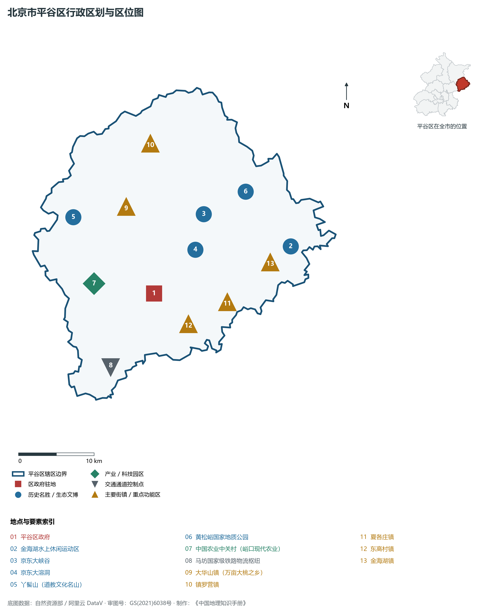
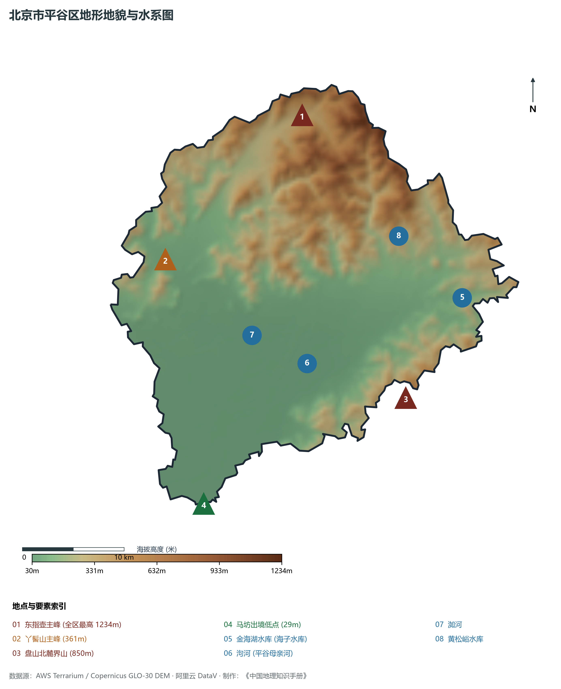
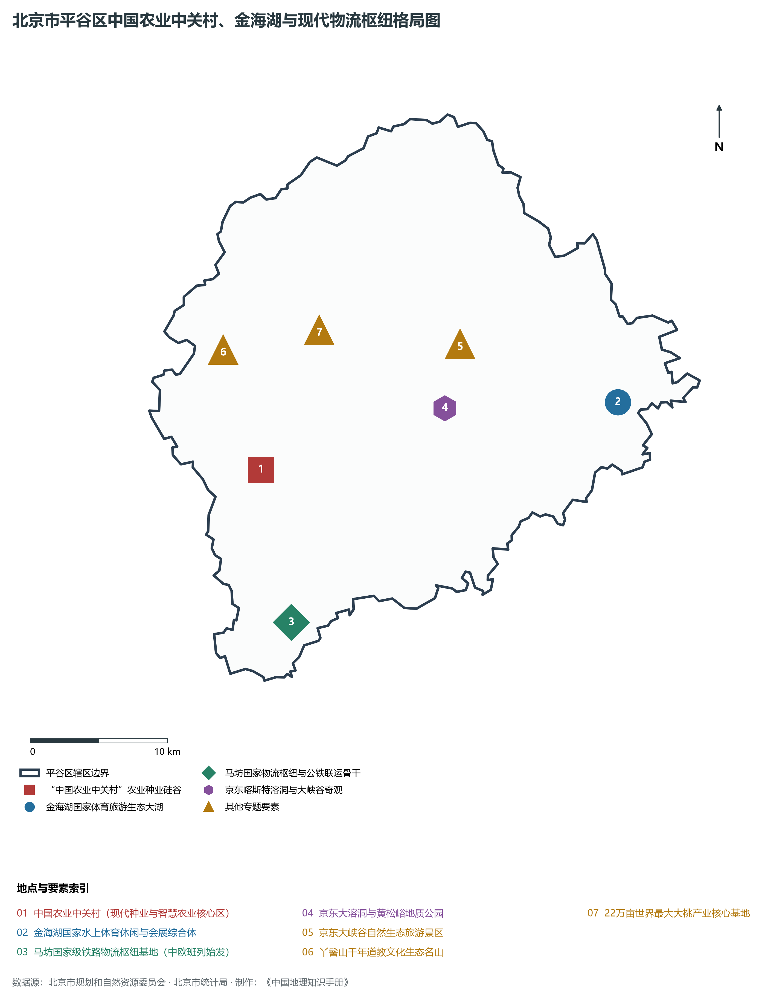
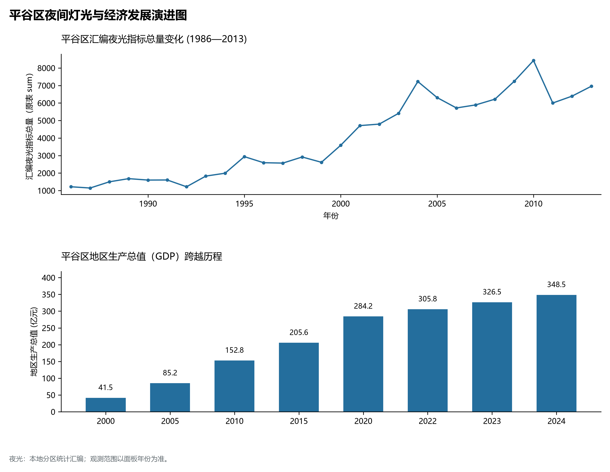
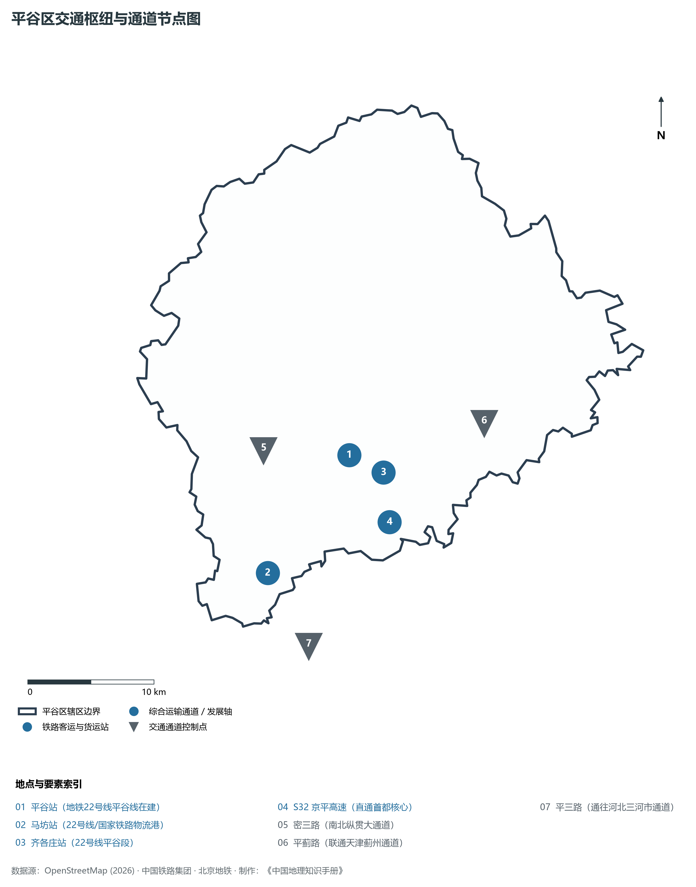

# 1.14 平谷区

平谷区位于北京市极东部，地处燕山山脉南麓与华北大平原交界地带，东与天津市蓟州区接壤，南与河北省三河市毗邻，西与顺义区、通州区相连，北与密云区及河北省兴隆县交界。其三面环山、中抱平川，地理形态宛如一只朝阳迎春的金色锦桃——北倚东指壶之雄峻叠嶂，南敞泃河两岸沃土良畴，东挽金海湖碧波万顷之秀美，西连马坊国际物流枢纽之通衢。

历史上，平谷上宅文化遗址将北京人类文明的火种前推至七千年前的新石器时代早期；汉代设平峪县，明清沿称平谷，因“三面环山、中平如谷”而得名；丫髻山千年道教香火享有“金顶香汛”之誉；京东大溶洞展现了十五亿年岩溶地质的造化神功。当代，平谷区立足首都生态涵养区功能定位，走出了一条独具特色的绿色高质量发展之路：以峪口为核心打造“中国农业中关村”，成为国家现代农业与智慧种业技术创新的“农业硅谷”；拥有 22 万亩世界最大连片优质桃园，“平谷大桃”驰名中外；马坊国家级铁路物流枢纽常态化开行“北京号”中欧班列，构筑起绿色公铁联运的现代物流新港。平谷正以昂扬姿态，建设国家生态文明示范区与乡村振兴首善之区。

---

## 一、区情速览

平谷区是北京市生态涵养区的重要组成部分，是国家级现代农业科技创新与京津冀东部物流中枢。

| 指标 | 数值与特征 | 全国/全市坐标 |
|:---|:---|:---|
| **面积** | 950.00 km² | 占北京市总面积约 5.79%；山区半山区占 67%，平原占 33% |
| **常住人口** | 45.73 万人（2020 年七普）；45.6 万人（2023 年末） | 聚居于平谷城区、马坊新城及沿泃河各平原镇街 |
| **常住人口城镇化率** | 64.3% | 平原核心区城镇化水平较高，山区保持传统林果村落 |
| **人口密度** | 481 人/km² | 城区达 3 500 人/km²，北部深山区镇街低于 100 人/km² |
| **地区生产总值 (GDP)** | 348.5 亿元（2024 年，现价） | 农业高科技、现代物流与高端休闲文旅协同并进 |
| **人均 GDP** | 约 7.6 万元人民币（折合超 1.05 万美元） | 绿色生态产业效益持续显现 |
| **主导产业结构** | 现代农业中关村、现代物流港与生态休闲旅游 | 拥有全国知名的大桃产业与国家级种业阵列 |
| **行政区划** | 2 个街道、14 个建制镇、2 个乡，区政府驻滨河街道府前街 | 辖有峪口、马坊、金海湖、大华山、夏各庄、东高村等名镇 |
| **战略功能定位** | 国家农业科技创新港（农业中关村）、国家物流枢纽、国家全域旅游示范区、生态涵养区 | 建设国家乡村振兴与生态经济示范样板 |

**图 01-14-1 北京市平谷区行政区划与区位图**：图上编号与地点、要素索引对应。

---

## 二、自然地理：三面崇山与泃洳平川

平谷区地形独具特色，地处燕山余脉南麓的断陷构造盆地之中，地貌自北向南、自东北向西南倾斜。

### 1. 地形地貌：群峰环抱与冲积平原
全区山地、丘陵和平原各具其态，海拔介于 **30—1 234 m** 之间：

- **北部深山区**：属于燕山山脉军都山东段，山势挺拔险峻：
  - **东指壶主峰（全区最高峰）**：海拔 **1 234 m**，位于镇罗营镇与河北兴隆交界处，山高林密，云遮雾障，为平谷屋脊；
  - **丫髻山**：海拔 **361 m**，双峰并立形如古代道童发髻，为京东著名秀峰；
  - **盘山北麓界山**：海拔约 850 m，与天津蓟州名山盘山一脉相承；
- **中部山间平原（平谷盆地）**：地面标高在 **40—60 m** 之间，由泃河、洳河泛滥冲积而成，土地深厚肥沃，为万亩桃林与现代农业提供了优越的耕作条件；
- **全区地势最低处**：西南平原马坊出境处，地面标高仅 **29—30 m**。

### 2. 气候特征：温和季风与山间暖谷盆地效应
属于暖温带半湿润大陆性季风气候。全区年平均气温在 **11.5—12.2 ℃** 之间，年平均降水量约 **600—650 mm**。

- **“平谷暖谷”独特小气候**：由于西北、北面、东北三面高山阻挡了冬季塞北冷空气直扑，夏季南来暖湿气流在此受山坡阻滞积聚，加之日照充足、昼夜温差大（达 12—15 ℃），使得平谷大桃糖分积累极其丰富，品质冠绝北方。

### 3. 河流水系：泃洳汇流与金海大湖
平谷区属于海河流域蓟运河水系：

- **金海湖水库（海子水库）**：位于平谷城区以东 15 km 的金海湖镇，水面面积达 **6.5 km²**，总库容 **1.2 亿 m³**，是北京市第三大水库。三面环山、水域辽阔，成功举办世界休闲大会，是北方著名的水上运动与休闲康养胜地；
- **泃河**：平谷的“母亲河”，发源于河北兴隆，流经金海湖穿过平谷城区南部向西流去，全长 206 km（境内 52 km）；
- **洳河**：平谷第二大河，发源于北部山区，纵贯平谷盆地中部，于平谷城南汇入泃河；
- **黄松峪水库**：位于黄松峪地质公园内，高峡出平湖，水质清冽。

**图 01-14-2 北京市平谷区地形地貌与水系图**：图上编号与地点、要素索引对应。

---

## 三、建置沿革与文化根脉

平谷文脉跨越七千年，凝聚了远古上宅文明、古洞地质造化、皇家道教名山与英雄抗战历史。

### 1. 地名考略与行政演进

- 汉高祖十二年（公元前195年）置平峪县；
- 金大定二十七年（1187年）改名**平谷县**，历代沿袭；
- 1958 年由河北省划归北京市；
- 2001 年 12 月经国务院批复撤县设区，设立北京市**平谷区**。

### 2. 新石器古人类源头：上宅文化

- **上宅文化遗址（全国重点文物保护单位）**：位于金海湖镇，距今约 7 500—6 000 年，出土了大量磨制石器、彩陶与精美的“石猴”、“鸟首形陶器”，将北京地区的新石器农耕文明起源提前了上千年，被称为北京远古农业文化的金色摇篮。

### 3. 京东地质与道教奇观

- **京东大溶洞与黄松峪地质公园**：发育于中元古代蓟县系白云岩中，距今已有 15 亿年历史，被称为“天下第一古洞”，洞内石笋、石幔千姿百态，常年恒温 18 ℃；
- **京东大峡谷**：峡谷深邃、飞瀑流泉，怪石嶙峋；
- **丫髻山（北方道教胜地）**：始建于唐代，繁盛于明清，清代康熙、乾隆历代帝王多次驾临，进香题碑，被誉为“近畿福地”。

### 4. 22 万亩大桃之乡

- 平谷区自 1980 年代起大力培育林果经济，历经数十年科学改良，构建起早、中、晚熟配套的白凤、蟠桃、油桃等数百个名优大桃品种体系，年产量达数亿公斤，获得国家地理标志产品保护与中欧地理标志协定互认。

**图 01-14-4 北京市平谷区中国农业中关村、金海湖与现代物流枢纽格局图**：图上编号与地点、要素索引对应。

---

## 四、经济地理：农业科技硅谷与现代公铁物流港

平谷区紧扣“高大尚”（农业高科技、物流大流量、休闲新时尚）战略指引，实现了区域经济能级的绿色质变。

### 1. “中国农业中关村”：现代种业与智慧农业策源地

- 规划以峪口镇为核心，汇聚中国农业大学、中国农科院等顶尖科研力量；
- 建设**国家现代农业未来科学城**与现代种业创新中心，在蛋鸡、肉鸡、生猪等现代种业领域拥有多项拥有完全自主知识产权的“中国芯”，沃德系列高产蛋鸡占领全国四成以上市场，打破国外种源垄断；
- 建设国家农业科技园区、智慧温室大棚与无人化果园，打造全国现代农业科技创新策源地。

### 2. 马坊国家物流枢纽：首都公铁联运第一港

- 坐落于平谷西南部马坊镇，拥有国家级铁路货运编组站与保税物流中心（B型）；
- 常态化开行“北京号”中欧班列，直达俄罗斯莫斯科、白俄罗斯明斯克等欧洲腹地，打通了首都连接欧亚大陆的陆上外贸大动脉；
- 重点布局农副产品冷链物流、快消品分拨，成为保障首都日常民生运转不可或缺的现代智慧物流中枢。

### 3. 经济总量跨越与休闲新时尚

- 2000 年平谷区 GDP 仅为 **41.5 亿元**；
- 2010 年为 **152.8 亿元**；
- 2024 年全区 GDP 稳步增长至 **348.5 亿元**。金海湖成功举办世界休闲大会后，打造了草地露营、帆船体验、山地越野等文旅新业态，年吸引京津冀高端休闲游客超千万人次。

### 4. 空间夜间灯光演化（1986—2013）

本节夜光图的观测年份为 1986—2013 年，指标为行政区汇总值（原表 sum）。

- 2002 年撤县设区后增至 5 800；

**图 01-14-5 平谷区夜间灯光与经济发展演进图**：各面板按标注的观测年份、指标和单位列示。

---

## 五、交通网络与现代枢纽

平谷区地处京津冀协同发展东北节点，正全力推进轨道快线与高等级公路建设，全面融入首都半小时生活圈。

**图 01-14-3 平谷区交通枢纽与通道节点图**：图上编号与地点、要素索引对应。

### 1. 区域轨道快线：地铁 22 号线（平谷线，在建）

- 作为北京第一条跨省市的区域轨道交通快线，全长约 81.2 km，设计最高时速达 160 km/h；
- 自平谷新城始发，经马坊、跨河北燕郊、穿城市副中心直通朝阳区东大桥，开通后平谷至副中心通勤仅需 32 分钟，至 CBD 仅需 45 分钟，彻底重塑平谷地缘区位格局。

### 2. 高等级公路网骨架

- **S32 京平高速**：贯穿平谷南部的全封闭高速动脉，西接首都机场南线与东六环，东连天津蓟州与蓟平高速，是京津冀东部走廊最畅通的高速公路之一；
- **密三路**：连接密云水库与河北三河的南北纵贯大干线；
- **平蓟路与平三路**：连接天津蓟州盘山与河北廊坊北三县的重要省际通衢。

### 3. 国家铁路货运支线：马坊公铁枢纽

- 拥有专用铁路集装箱货场，与京哈铁路干线紧密连通，担当首都公铁联运绿色货运的主骨架。

---

## 六、平谷区地理要素矩阵与区域之最

### 1. 核心地理与经济指标速查表

| 要素类别 | 指标名称 | 数值/名称 | 备注 |
|:---|:---|:---|:---|
| **地势极值** | 最高点海拔 | **1 234.0 m** | 北部东指壶主峰 |
| | 最低点海拔 | **30.0 m** | 西南马坊出境平原处 |
| **水文要素** | 著名大湖水库 | **金海湖（海子水库）** | 水面面积 6.5 km²，北京市第三大水库 |
| | 母亲河水系 | **泃河与洳河** | 境内长 52 km，海河流域蓟运河水系 |
| **生态指标** | 森林覆盖率 | **67.3%** | 居全市前茅，拥有黄松峪国家地质公园 |
| | 林木绿化率 | **71.5%** | 山峦苍翠，林果飘香 |
| **经济指标** | 2024 年 GDP | **348.5 亿元** | 现代农业中关村与现代物流加速崛起 |
| | 大桃产业种植面积 | **22 万亩** | 全球最大连片桃园，年产大桃数亿斤 |
| **农业科技** | 国家种业成果 | **自主培育沃德系列蛋鸡** | 占全国商品蛋鸡市场四成份额 |
| | 班列枢纽 | **“北京号”中欧班列始发站** | 马坊铁路物流港常态化开行 |

### 2. 平谷区之最（Superlatives）

- **桃园之最**：拥有全球集中连片面积最大的优质大桃生产基地（22 万亩），被誉为“中国大桃之乡”；
- **农业科技之最**：全北京市唯一的国家级现代种业与智慧农业科创策源地——中国农业中关村；
- **物流之最**：北京市唯一常态化开行中欧班列并具备公铁多式联运功能的铁路现代物流枢纽（马坊站）；
- **地质之最**：拥有北京地区形成年代最古老（距今 15 亿年）的石灰岩岩溶奇观——京东大溶洞。

---

## 参考与数据来源

1. 中华人民共和国自然资源部：《第三次全国国土调查主要数据公报（北京市平谷区）》
2. 北京市统计局、平谷区统计局：《北京市第七次全国人口普查公报》、《2024年平谷区国民经济和社会发展统计公报》
3. 北京市规划和自然资源委员会：《平谷分区规划（国土空间规划）（2017年—2035年）》
4. 国家统计局：《中国城市统计年鉴（2024—2025年）》
5. 阿里云 DataV.GeoAtlas 2021.5 行政区划边界矢量（审图号：GS(2021)6038号）
6. OpenStreetMap (OSM) 2026 年最新全要素道路与交通线网矢量
7. AWS Terrain Tiles / Copernicus GLO-30 数字高程模型（DEM）
