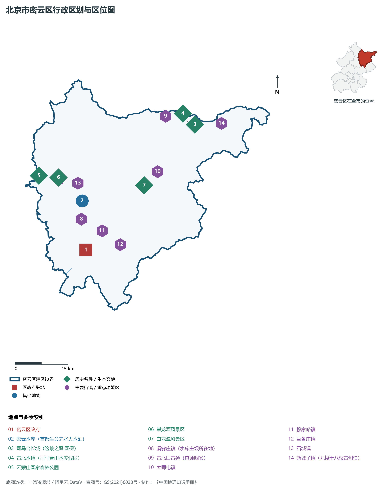
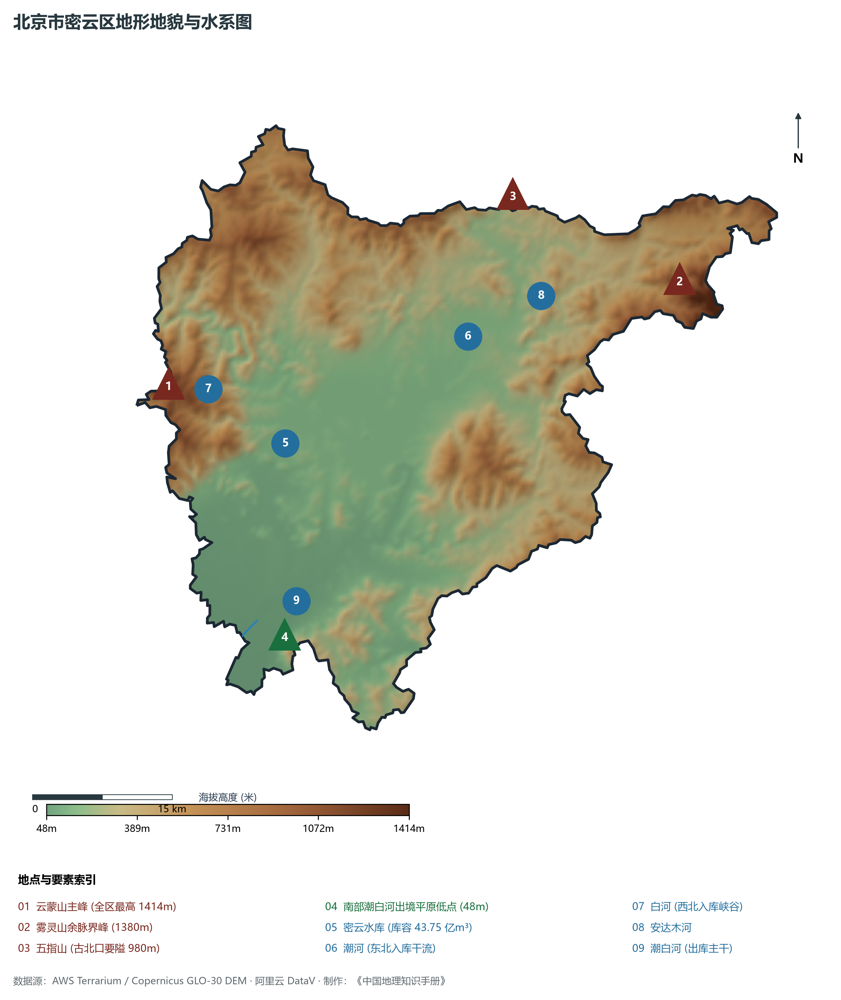
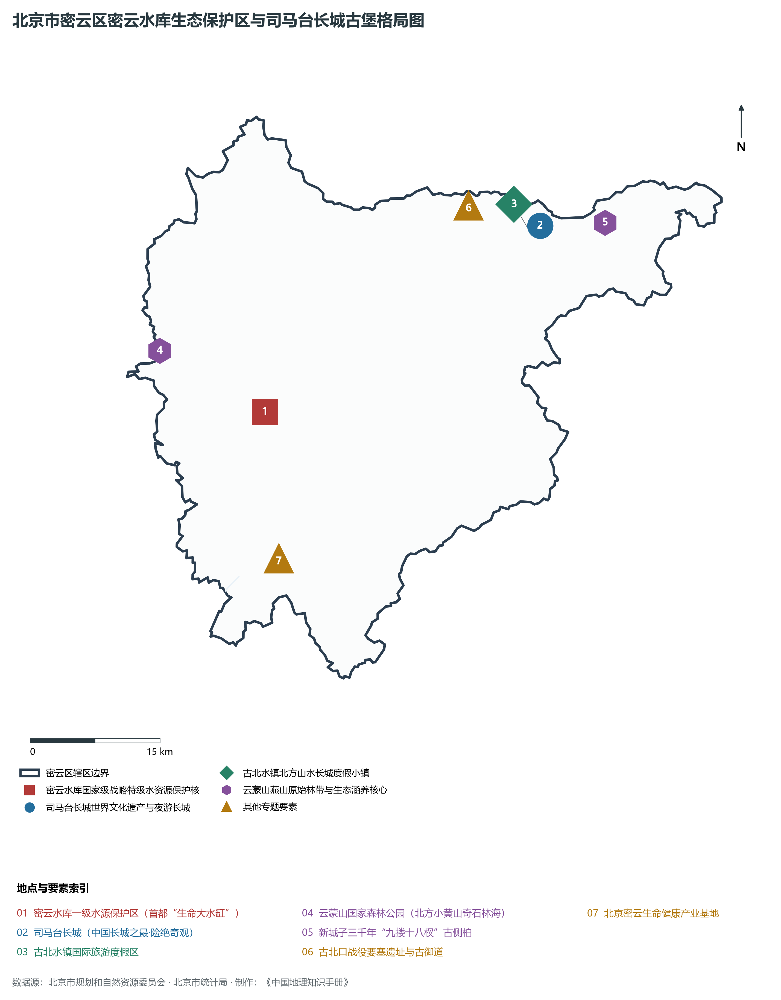
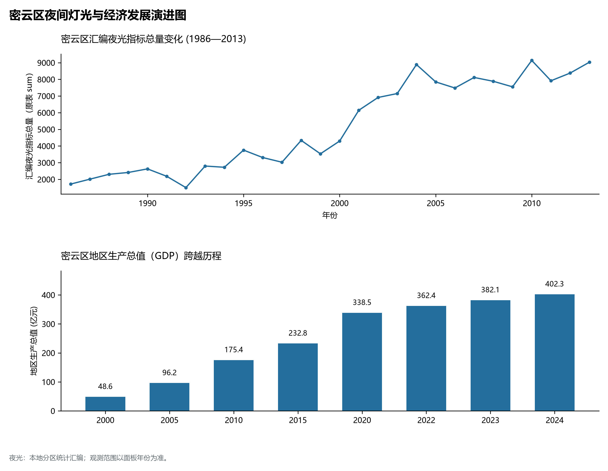
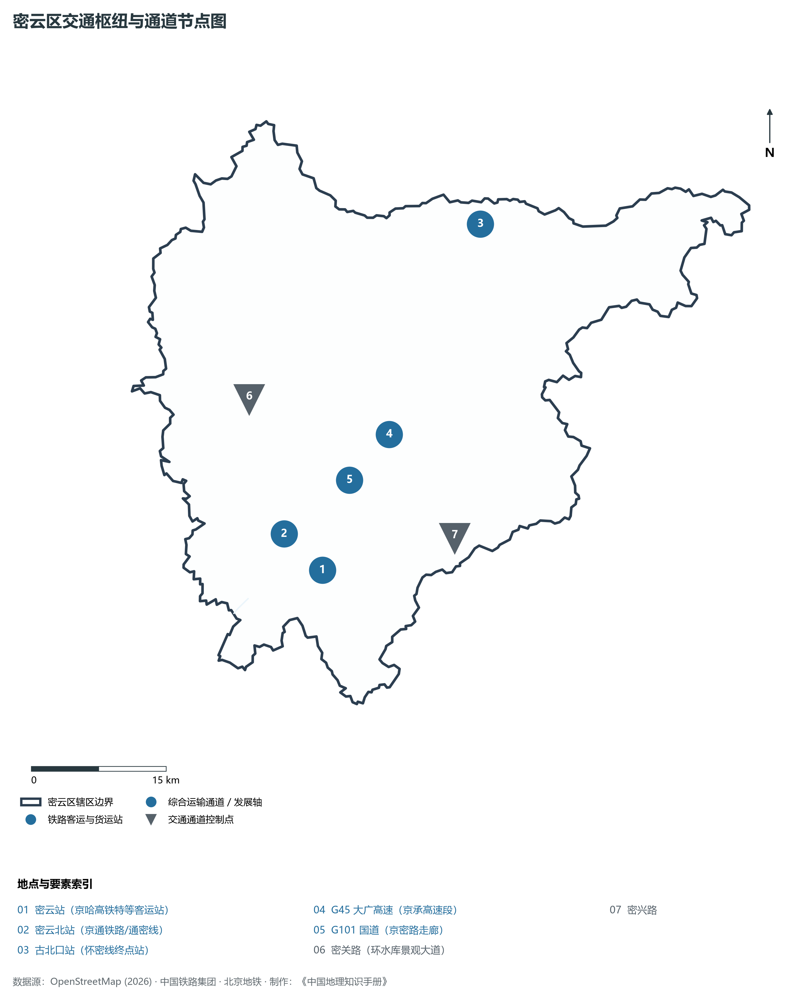

# 1.15 密云区

密云区位于北京市东北部，地处燕山山脉腹地南侧，东与河北省承德市兴隆县、滦平县接壤，南与平谷区、顺义区相连，西与怀柔区相邻，北与河北省滦平县相接。其辖域雄阔宏大，行政面积达 **2 229.45 km²**，是全北京市土地面积最大的市辖区。其地势群山环抱、众水分流，犹如一只展翅回首的苍鹰——北枕司马台古北口长城之天险，西倚云蒙山北方黄山之奇秀，中托华北最大人工湖密云水库之碧波，南展潮白河平原林海之锦绣。

历史上，密云因境内密云山（今云蒙山）“高耸入云、密云深锁”而得名；古北口自古为“京师锁钥、燕蓟咽喉”，是长城防御体系与满汉商贾往来的北方总门户；司马台长城险绝雄奇，被长城专家誉为“中国长城之最”。当代，密云区是首都名副其实最重要的**“生命大水缸”**：总库容 **43.75 亿 m³** 的密云水库常年保持 30 亿立方米优质蓄水，滋养了两千多万首都人民；密云人民为了保水护水作出巨大历史奉献，坚定走绿水青山就是金山银山的生态优先之路；古北水镇崛起为闻名海内外的北方山水微度假胜地，中关村密云园布局生命健康与绿色智造。密云以全市第一的广袤版图与极致纯净的生态底色，成为首都生态文明建设最厚重的压舱基石。

---

## 一、区情速览

密云区是北京市土地面积最大、水资源战略储备最丰富的生态涵养核心区。

| 指标 | 数值与特征 | 全国/全市坐标 |
|:---|:---|:---|
| **面积** | 2 229.45 km² | 占北京市总面积约 13.59%；全市 16 区中面积位居第一 |
| **常住人口** | 52.77 万人（2020 年七普）；52.9 万人（2023 年末） | 聚居于南部密云新城及潮白河两岸平原组团 |
| **常住人口城镇化率** | 68.5% | 密云主城区城镇化成熟，水库周边及北部深山严格实行人口减量 |
| **人口密度** | 237 人/km² | 全市人口密度极低区域之一，水库一级保护区实现全封闭管理 |
| **地区生产总值 (GDP)** | 402.3 亿元（2024 年，现价） | 生态农业、文旅康养与生命健康产业高质量平稳发展 |
| **人均 GDP** | 约 7.6 万元人民币（折合约 1.05 万美元） | 生态价值转化效益持续显现 |
| **主导产业结构** | 生态农业、文旅休闲度假与现代生命健康 | 守水保水为第一天职，严禁高耗能污染工业 |
| **行政区划** | 2 个街道、17 个建制镇、1 个乡，区政府驻鼓楼街道鼓楼西大街 | 辖有溪翁庄、古北口、太师屯、穆家峪、石城、新城子等名镇 |
| **战略功能定位** | 首都最重要的水源保护地及国家生态涵养区、绿水青山就是金山银山典范区 | 全力守住密云水库这一无价之宝 |

**图 01-15-1 北京市密云区行政区划与区位图**：图上编号与地点、要素索引对应。

---

## 二、自然地理：燕山群嶂与首都生命之水

密云区地处燕山山脉向华北平原跌落的盆地汇水断褶带，周围群山环抱，中部发育出巨大的山间冲积汇水盆地。

### 1. 地形地貌：崇山叠嶂与中央盆地
全区地势东北、西北高，中部低，呈向南敞开的马蹄形盆地，海拔跨越 **48—1 414 m**：

- **西北部云蒙山脉**：属于燕山花岗岩侵入岩地貌，奇峰突兀，悬崖千仞：
  - **云蒙山主峰（全区最高峰）**：海拔 **1 414 m**，以险峰、怪石、飞瀑、奇松著称，素有“北方小黄山”之美称；
  - **黑龙潭峡谷**：全长 4 km，落差 220 m，十八个潭池如珍珠散落，飞瀑如练；
- **东北部山地**：雾灵山余脉界峰海拔 **1 380 m**，古北口五指山海拔 980 m，扼守关隘；
- **中部汇水盆地（密云水库所在地）**：四周山岭汇流，地面标高由山口 **150 m** 降至水库坝下 **60 m**；
- **南部潮白河冲积平原**：地势平缓，全区最低点位于南部河南寨镇潮白河出境处，海拔 **48 m**。

### 2. 气候特征：温和湿润与大水库冷岛湖泊效应
属于暖温带半湿润大陆性季风气候。全区年平均气温在 **10.8—11.5 ℃** 之间，年平均降水量约 **620—680 mm**。

- **密云水库大面积水体效应**：水面面积近 190 km² 的密云水库如同巨大的“水空调”，使库区周边夏季气温比北京市区低 3—5 ℃，形成局部湖陆风环流，湿润凉爽；燕山迎风坡在汛期易形成暴雨中心，水库防洪调度作用极为关键。

### 3. 河流水系：华北最大人工湖与潮白二水
密云是海河流域潮白河水系的心脏所在：

- **密云水库（华北第一大水库）**：始建于 1958 年 9 月，由周恩来总理亲自选址审定，全长数十万人民群众奋战两年建成，最大蓄水量 **43.75 亿 m³**。水库承纳潮河与白河两大干流，水质常年优于国家 II 类标准，建有白河主坝与潮河主坝，被习近平总书记誉为首都“无价之宝”；
- **潮河与白河**：潮河自东北入库，白河自西北白河大峡谷奔腾入库；两河在水库下游河槽村汇合后始称**潮白河**，南流滋养顺义与通州；
- **安达木河**：流经古北水镇，注入密云水库，水质清澈见底。

**图 01-15-2 北京市密云区地形地貌与水系图**：图上编号与地点、要素索引对应。

---

## 三、建置沿革与文化根脉

密云大地钟灵毓秀，积淀了长城要塞军事文化、千年古御道、水库建设奉献精神与古树传奇。

### 1. 地名考略与行政演进

- 秦置渔阳郡（郡治在今十里堡统军庄一带），陈胜吴广起义名句“谪戍渔阳”即源于此；
- 北魏始置密云县，因境内密云山常年云雾缭绕而得名；
- 1958 年由河北省划归北京市；
- 2015 年 11 月经国务院批复撤县设区，正式定名北京市**密云区**。

### 2. 中国长城之最：司马台长城

- **司马台长城（世界文化遗产、全国重点文物保护单位）**：全长 5.7 km，依极其陡峭险绝的山脊顺势修建，共有敌楼 35 座。其中“望京楼”海拔 986 m，登高可遥望百公里外北京城之万家灯火；长城建筑专家罗哲文先生赞誉：“中国长城是世界之最，司马台长城是中国长城之最”；它是中国唯一保留明代原貌的古长城，被列为全球必游长城胜境。

### 3. 京师锁钥与古北水镇

- **古北口古镇**：山势如两门对峙，自古有“地扼襟喉通朔漠，天留锁钥枕雄关”之称。自汉至明清，这里爆发了无数次阻击战，留存有关帝庙、杨令公祠、古御道遗址；1933 年长城抗战中，中国守军在古北口同日寇血战两个多月，写下了民族壮歌；
- **古北水镇国际旅游度假区**：背靠司马台长城，利用鸳鸯湖天然水系，匠心营造出山水城交融、青砖灰瓦古香古色的北方长城度假小镇，夜游长城与无人机孔明灯秀名扬天下；
- **新城子三千年“九搂十八杈”古侧柏**：树龄已逾三千年，树干需九个成年人合抱，枝繁叶茂，被评为北京“古树之王”。

**图 01-15-4 北京市密云区密云水库生态保护区与司马台长城古堡格局图**：图上编号与地点、要素索引对应。

---

## 四、经济地理：绿水青山典范与生命健康智造

密云区坚决守护密云水库生命之水，走出了一条生态涵养、绿色高新与富民增收协调发展的特色道路。

### 1. 守水保水：“无价之宝”的守护奇迹

- 实施最严格的水资源全封闭管理，建设 300 余公里环库围网，实现水库一级保护区全封闭无人化；
- 组建数千人的“保水网格员”队伍，全面退耕禁渔、关停所有可能污染水体的工矿企业，实现上游来水、库区水质常年保持国家 II 类水质，确保“一库碧水抚慰首都”；
- 创新开展生态产品总值（GEP）核算机制，让绿水青山真正产生持久生态经济价值。

### 2. 古北水镇与全域高端文旅旗舰

- 古北水镇累计投资超百亿元，年接待海内外游客达数百万人次，成为华北地区最具吸引力的综合旅游目的地之一；
- 带动周边溪翁庄“水库鱼一条街”、石城长城民宿集群、新城子苹果采摘等特色乡村旅游，打造京华“大美密云”全域旅游示范标杆。

### 3. 中关村密云园与生命健康产业

- 依托密云优质水源与清新空气本底，大力培育以**生物医药、精准医疗、现代中药、天然健康食品**为核心的生命健康产业集群，聚集康辰药业、北陆药业等骨干企业。

### 4. 空间夜间灯光演化（1986—2013）

本节夜光图的观测年份为 1986—2013 年，指标为行政区汇总值（原表 sum）。

**图 01-15-5 密云区夜间灯光与经济发展演进图**：各面板按标注的观测年份、指标和单位列示。

---

## 五、交通网络与现代枢纽

密云区依托京哈高速铁路、京承高速公路与市郊铁路，构筑起东北出京的重要立体快速交通走廊。

**图 01-15-3 密云区交通枢纽与通道节点图**：图上编号与地点、要素索引对应。

### 1. 国家高铁特等枢纽：密云站

- **密云站**：京哈高速铁路（京沈段）上的现代化特等高铁客运站，站房设计取“密云水库碧波”之意象。高铁列车 20 余分钟即可一站直达北京朝阳站，极大拉近了生态涵养区与中心城区的时空距离。

### 2. 畅达东北的大动脉与环库大道

- **G45 大广高速（京承高速密云段）**：全立交高速通衢，自南向北贯通密云城区、太师屯直通古北水镇，是通往承德避暑山庄与东北各省的旅游与经济命脉；
- **G101 国道（京密路走廊）**：历史悠久的平原客货主干道；
- **密关路（环水库景观大道）**：沿密云水库西岸蜿蜒穿行，山环水绕、林荫覆盖，是北京最具诗意与景致的自驾骑行画廊。

### 3. 绿色市郊铁路系统

- **市郊铁路通密线与怀密线**：设密云北站、古北口站，为市民通勤与长城水镇度假提供了绿色轨道通道。

---

## 六、密云区地理要素矩阵与区域之最

### 1. 核心地理与经济指标速查表

| 要素类别 | 指标名称 | 数值/名称 | 备注 |
|:---|:---|:---|:---|
| **地势极值** | 最高点海拔 | **1 414.0 m** | 西北部云蒙山主峰（北方小黄山） |
| | 最低点海拔 | **48.0 m** | 南部平原河南寨潮白河出境处 |
| **水文要素** | 首都战略蓄水池 | **密云水库** | 库容 43.75 亿 m³，华北最大人工湖 |
| | 母亲河汇流 | **潮河与白河** | 入库后下泄汇成潮白河 |
| **生态指标** | 森林覆盖率 | **68.5%** | 居全市前茅，拥有云蒙山国家森林公园 |
| | 水库水质 | **优于国家 II 类标准** | 首都最纯净的地表生命水源 |
| **经济指标** | 2024 年 GDP | **402.3 亿元** | 坚决不考核 GDP 增速，生态产品价值高 |
| | 全区土地面积 | **2 229.45 km²** | 全市 16 区中面积第一大区 |
| **文化遗产** | 长城之最 | **司马台长城** | 唯一保留明代原貌古长城，全球风景之冠 |
| | 树王之宝 | **九搂十八杈古侧柏** | 树龄逾三千年，北京第一古树名木 |

### 2. 密云区之最（Superlatives）

- **面积之最**：全北京市幅员最辽阔、管辖土地面积最大的市辖区（2 229.45 平方公里）；
- **水源之最**：拥有华北地区蓄水量最大、首都最重要的饮用水生命大水缸——密云水库（43.75 亿立方米）；
- **长城之最**：拥有被誉为“中国长城之最”的世界文化遗产——司马台长城；
- **古树之最**：拥有北京树龄最古老（三千余年）、需九人合抱的古树之王——九搂十八杈古侧柏。

---

## 参考与数据来源

1. 中华人民共和国自然资源部：《第三次全国国土调查主要数据公报（北京市密云区）》
2. 北京市统计局、密云区统计局：《北京市第七次全国人口普查公报》、《2024年密云区国民经济和社会发展统计公报》
3. 北京市规划和自然资源委员会：《密云分区规划（国土空间规划）（2017年—2035年）》
4. 国家统计局：《中国城市统计年鉴（2024—2025年）》
5. 阿里云 DataV.GeoAtlas 2021.5 行政区划边界矢量（审图号：GS(2021)6038号）
6. OpenStreetMap (OSM) 2026 年最新全要素道路与交通线网矢量
7. AWS Terrain Tiles / Copernicus GLO-30 数字高程模型（DEM）
