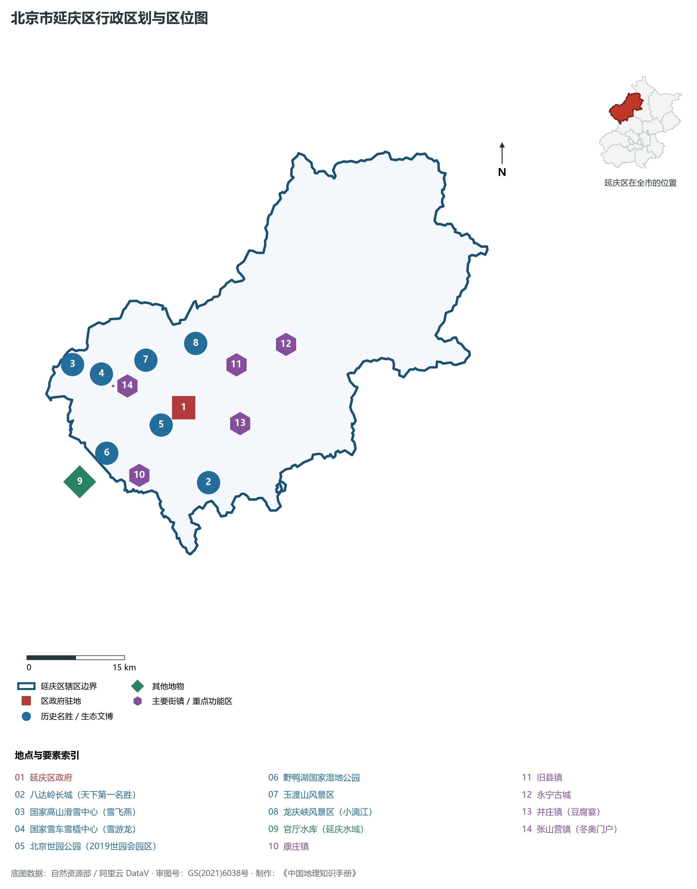
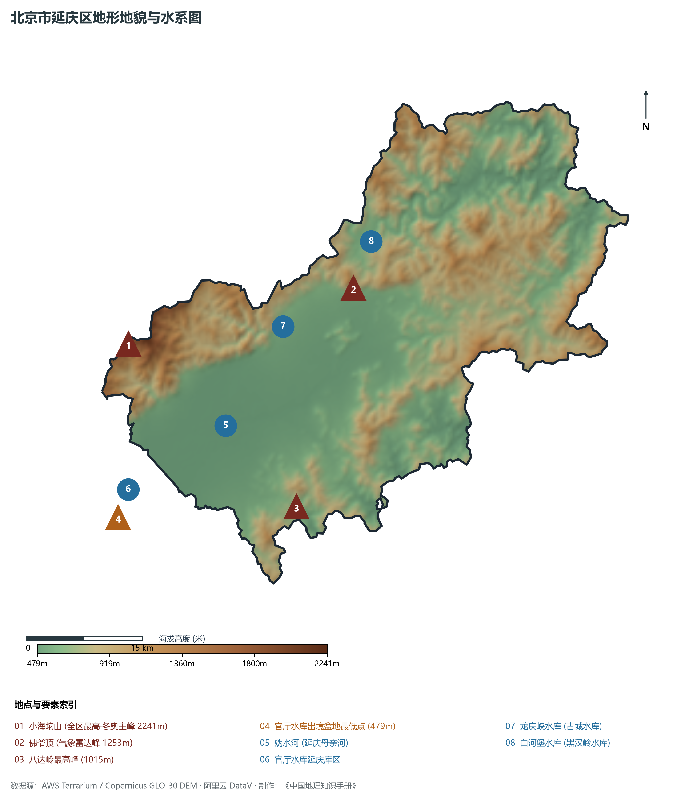
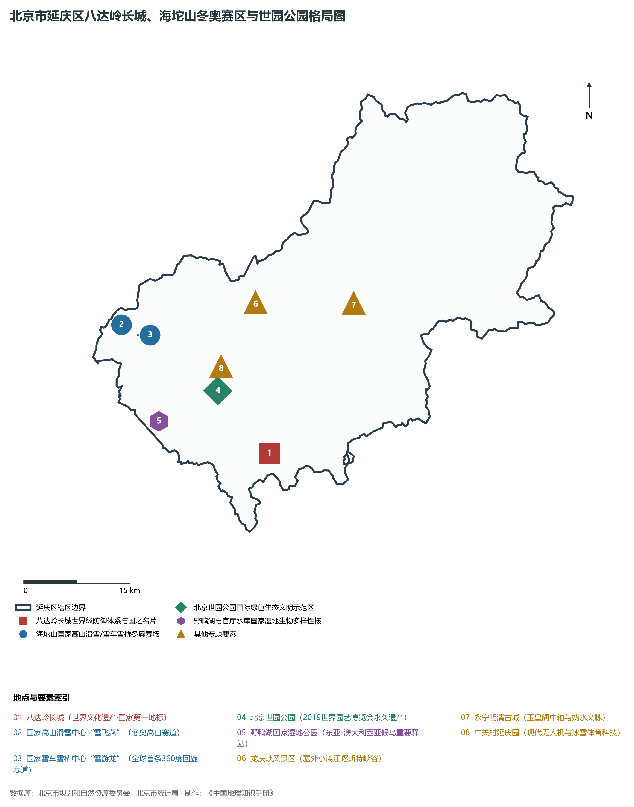
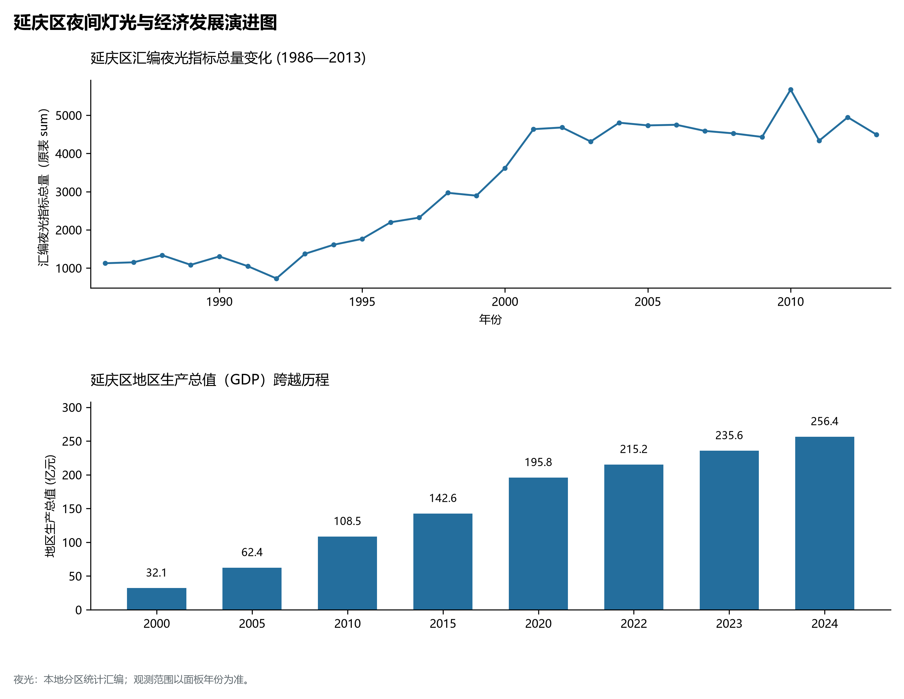
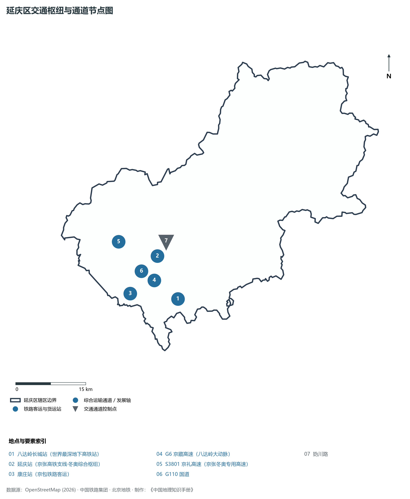

# 1.16 延庆区

延庆区位于北京市西北部，地处燕山与太行山脉交界的崇山峻岭之中，东南与昌平区相连，西与河北省怀来县接壤，南与门头沟区相靠，北与河北省赤城县界峰相分。其平均海拔超 500 米，四周被群山屏障紧密环抱，形成气象独特、凉爽宜人的延庆断陷山间盆地——西揽官厅水库万顷碧波之浩瀚，南扼八达岭长城天下第一雄关之尊崇，北峙海坨山冬奥高山赛场之凌霄，中展妫水河滨水世园公园之画卷。

历史上，延庆自唐设妫川县，元代建延庆州；八达岭长城自明代起便为拱卫京畿第一道铜墙铁壁，毛泽东主席挥毫写下“不到长城非好汉”，成为新中国对外文化交往中最耀眼的第一金名片；永宁古城玉皇阁回荡着明清塞上茶马互市的晨钟暮鼓。当代，延庆区创造了全球瞩目的“双盛会”绿色跨越奇迹：成功举办 **2019 年中国北京世界园艺博览会**，留下长城脚下永不落幕的绿色生态典范；卓越承办 **2022 年北京冬奥会海坨山冬奥赛区**，“雪飞燕”、“雪游龙”两大世界顶尖雪上场馆闪耀全球；世界最深地下高铁站八达岭长城站让百年京张重焕青春。延庆以全区全域森林覆盖与清新微气候，获评全国首批国家生态文明建设示范区，成为首都名副其实的“后花园”与冰雪体育科技新高地。

---

## 一、区情速览

延庆区是北京市生态涵养区的重要骨干区、首批国家全域旅游示范区与世界级冰雪体育旅游胜地。

| 指标 | 数值与特征 | 全国/全市坐标 |
|:---|:---|:---|
| **面积** | 1 993.75 km² | 占北京市总面积约 12.15%；山区占 72.8%，盆地平原水面占 27.2% |
| **常住人口** | 34.57 万人（2020 年七普）；34.6 万人（2023 年末） | 全市 16 区中常住人口最少，人口高度集聚于延庆新城盆地 |
| **常住人口城镇化率** | 61.2% | 延庆镇、百泉、香水园城镇化成熟，外围广阔深山保持生态林草格局 |
| **人口密度** | 173 人/km² | 全市 16 区中人口密度最低，空气质量常年位居全市各区前列 |
| **地区生产总值 (GDP)** | 256.4 亿元（2024 年，现价） | 坚决不以 GDP 论英雄，冰雪文旅、现代无人机与现代园艺产值倍增 |
| **人均 GDP** | 约 7.4 万元人民币（折合约 1.02 万美元） | 生态与双奥绿色资产转化效能强劲 |
| **主导产业结构** | 冰雪体育科技、生态文旅休闲、现代园艺与低空经济 | 冬奥场馆遗产、世园公园与八达岭长城三大王牌 |
| **行政区划** | 3 个街道、11 个建制镇、4 个乡，区政府驻儒林街道湖北西路 | 辖有延庆、康庄、张山营、八达岭、永宁、旧县、井庄等名镇 |
| **战略功能定位** | 生态涵养重要屏障、国际文化体育旅游休闲名区、绿色发展聚绿成金示范区 | 打造长城、世园、冬奥三张世界级金名片 |

**图 01-16-1 北京市延庆区行政区划与区位图**：图上编号与地点、要素索引对应。

---

## 二、自然地理：海坨凌霄与妫川高盆

延庆区坐落于著名的延庆断陷盆地（又称妫川盆地）中，是北京境内唯一的高海拔山间盆地，群山环抱，平均海拔超过 500 米。

### 1. 地形地貌：崇山深峡与山间平盆
全区地形呈四周高山耸立、中部低平的高原微盆地构造，海拔介于 **479—2 241 m** 之间：

- **北部海坨山脉（燕山余脉）**：山体陡峭险峻，基岩多为坚硬的古花岗岩：
  - **小海坨山（北京冬奥主峰、全区最高峰）**：海拔 **2 241 m**，仅次于门头沟东灵山，为北京市第二高峰。山顶常年气温极低，冬季积雪深厚，素有“海坨戴雪”之胜景；
  - **佛爷顶**：海拔 **1 253 m**，建有北京市最高的气象雷达观测站；
- **南部八达岭军都山脊**：八达岭最高峰海拔 **1 015 m**，长城盘旋于悬崖峭壁之间；
- **中部妫川盆地平原**：地面标高在 **490—550 m** 之间，地表平坦，受妫水河滋养；
- **全区地势最低处**：官厅水库延庆库区出境处，地面标高仍达 **479 m**。因此，延庆全区最低点比北京市区中心高出 400 余米！

### 2. 气候特征：温带冷凉季风气候与“夏都”微环境
延庆被誉为北京的“夏都”，其独特高盆地形塑造了冷凉宜人的气候：

- **年平均气温偏低**：全区年平均气温仅约 **8.8—9.5 ℃**（海坨山顶年均温低于 0 ℃），较北京平原市区常年低 3—4 ℃，夏季无酷暑，极其凉爽；
- **冬长夏短与冰雪期长**：冬季寒冷漫长，冰冻期长达 4 个多月，为海坨山举办高山滑雪与雪车雪橇赛提供了世界顶级的天然冰雪气候条件；全区年降水量约 **450—520 mm**。

### 3. 河流水系：妫水润城与野鸭湖湿地
延庆分属海河流域永定河水系与潮白河水系：

- **妫水河（延庆的“母亲河”）**：发源于延庆东部群山，横贯延庆盆地东西全境长达数十公里，注入官厅水库，两岸湿地水草丰茂，世园公园与夏都公园沿河而建；
- **官厅水库（延庆库区）**：华北最早兴建的大型水库之一，延庆辖区内水面达数十平方公里，波光浩渺；
- **野鸭湖国家湿地公园**：位于官厅水库延庆入湖口，总面积近 4 000 公顷，是北京面积最大的湿地自然保护区，也是东亚-澳大利西亚全球候鸟迁徙的重要“国际中继驿站”；
- **龙庆峡与白河堡水库**：龙庆峡古城水库镶嵌于险峻岩溶峡谷中，峡谷幽深，被誉为“塞外小漓江”；白河堡水库总库容 9 000 万 m³，是北京市海拔最高的大型水库。

**图 01-16-2 北京市延庆区地形地貌与水系图**：图上编号与地点、要素索引对应。

---

## 三、建置沿革与文化根脉

延庆融汇了万里长城国之名片、双奥冬奥雪上传奇、绿色世园文明与千古塞外古堡文化。

### 1. 地名考略与行政演进

- 唐贞观八年（634年）析幽州置妫州；唐天宝年间设妫川县；
- 元仁宗延祐三年（1316年）升为**延庆州**；
- 1958 年由河北省划归北京市，设延庆县；
- 2015 年 11 月经国务院批复撤县设区，定名北京市**延庆区**。

### 2. 万里长城国之名片：八达岭长城

- **八达岭长城（首批世界文化遗产、国家5A级旅游景区）**：明代长城保存最为完好、最具代表性的一段，扼居庸关北口之险，“路从此分，四通八达，故名八达岭”；
- 全长达 7.6 km，高大雄伟，依险峻山脊蜿蜒翻滚。毛泽东主席写下“不到长城非好汉”，邓小平同志题词“爱我中华，修我长城”；先后接待了美国总统尼克松、英国女王伊丽莎白二世等 500 多位外国国家元首和首脑，成为中华民族坚韧不拔精神与新中国外交第一金名片。

### 3. 双奥雪上最高峰：国家高山滑雪与雪车雪橇中心

- **国家高山滑雪中心（“雪飞燕”）**：建于 2 198 米海坨山巅，依山顺势建设了 7 条奥运标准雪道，最大垂直落差达 900 米，坡度极陡，被誉为“冬奥皇冠上的明珠”；
- **国家雪车雪橇中心（“雪游龙”）**：建有全球首条 360 度回旋下沉式赛道，全长 1.9 km，宛如一条白色巨龙盘旋在海坨山谷，展现了世界极限工程营建与冰雪科技的奇迹。

### 4. 2019 世界园艺博览会永久遗产：北京世园公园

- 占地 500 公顷，依托妫水河展开，中国馆、国际馆、植物馆造型现代飘逸，完美阐释了“让园艺融入自然，让自然感动心灵”的生态文明理念。

**图 01-16-4 北京市延庆区八达岭长城、海坨山冬奥赛区与世园公园格局图**：图上编号与地点、要素索引对应。

---

## 四、经济地理：绿色聚绿成金与冰雪低空高新技术

延庆区坚持生态立区，探索出以冰雪体育科技、全域高端文旅、现代无人机为代表的绿色经济高质量发展模式。

### 1. 后冬奥时代冰雪经济与高端文旅

- 海坨山冬奥园区实现四季全季候运营，冬季成为滑雪发烧友的高山挑战胜地，夏季变身为高山露营、避暑徒步的天堂；
- 依托八达岭长城、古崖居、玉渡山、龙庆峡冰灯节，打造高端精品民宿“延庆人家”，民宿集群规模位居全市各区前列。

### 2. 中关村延庆园：现代无人机与低空经济第一极

- 拥有华北地区罕见的真高 3 000 米以下、覆盖全域 374 平方公里的**广阔低空开放飞行空域**；
- 建设国家级无人机产业综合示范区，吸引航天时代飞鹏、清航装备等近百家工业级无人机、eVTOL（电动垂直起降飞行器）研发企业入驻，涵盖林业防扑火、应急救援、高空巡检各领域，打造北京低空经济新高地。

### 3. 经济总量跨越与特色精品农业

- 2000 年延庆区 GDP 为 **32.1 亿元**；
- 2010 年为 **108.5 亿元**；
- 2024 年全区 GDP 稳步提升至 **256.4 亿元**。冷凉气候培育出国光苹果、优质杂粮、延庆有机蔬菜等特色地理标志农产品。

### 4. 空间夜间灯光演化（1986—2013）

本节夜光图的观测年份为 1986—2013 年，指标为行政区汇总值（原表 sum）。

**图 01-16-5 延庆区夜间灯光与经济发展演进图**：各面板按标注的观测年份、指标和单位列示。

---

## 五、交通网络与现代枢纽

延庆区依托世界最深地下高铁站、绿色冬奥高速走廊与骨干国道，彻底打破了八达岭军都山天然险阻。

**图 01-16-3 延庆区交通枢纽与通道节点图**：图上编号与地点、要素索引对应。

### 1. 世界高铁工程奇迹：八达岭长城地下高铁站

- **八达岭长城站**：京张高铁上的标志性客运站，是目前**全球埋深最大（地下 102 米）、地下建筑面积最大（3.6 万 m²）的地下高铁车站**；
- 紧贴八达岭长城核心保护区地下穿行，采用世界领先的精准微震爆破技术建成；站内设有提升高度达 62 米的国内最长斜行电梯，乘高铁自北京清河站出发仅需 19 分钟即可直达长城脚下，实现了古代长城与现代高科技高铁的历史相拥。

### 2. 双奥绿色高速公路走廊

- **S3801 京礼高速（兴延+延崇段）**：全立交绿色智能高速公路，穿山越岭直通冬奥海坨山赛区与张家口崇礼，设置有世园、冬奥专属出入口；
- **G6 京藏高速**：翻越八达岭的传统进出塞外国家级高速公路；
- **G110 国道与妫川路**：构筑起延庆盆地内部通达各镇的公路通衢。

---

## 六、延庆区地理要素矩阵与区域之最

### 1. 核心地理与经济指标速查表

| 要素类别 | 指标名称 | 数值/名称 | 备注 |
|:---|:---|:---|:---|
| **地势极值** | 最高点海拔 | **2 241.0 m** | 小海坨山主峰（全北京市第二高峰） |
| | 最低点海拔 | **479.0 m** | 官厅水库出境盆地处（全市最低点中最高） |
| **水文要素** | 母亲河水系 | **妫水河** | 横贯延庆盆地东西全境，注入官厅水库 |
| | 最大天然湿地 | **野鸭湖国家湿地公园** | 面积近 4 000 公顷，国际候鸟中继站 |
| | 高山喀斯特峡谷 | **龙庆峡（古城水库）** | 塞外小漓江，两岸喀斯特绝壁 |
| **生态指标** | 森林覆盖率 | **61.8%** | 首批国家生态文明建设示范区 |
| | 空气质量优良天数 | **超 85%** | 全市生态涵养与空气纯净度第一名梯队 |
| **经济指标** | 2024 年 GDP | **256.4 亿元** | 现代无人机与冰雪体育科技特色鲜明 |
| | 低空飞行空域 | **真高 3 000 米以下** | 374 km² 独立空域，北京低空经济领头羊 |
| **时代地标** | 世界文化遗产 | **八达岭长城** | 万里长城代表作，国之外交第一名片 |
| | 冬奥雪上遗产 | **海坨山高山滑雪中心/雪车雪橇中心** | “雪飞燕”落差 900 米、“雪游龙”360度赛道 |
| | 地下工程奇迹 | **八达岭长城站** | 全球埋深最大地下高铁站（深 102 米） |

### 2. 延庆区之最（Superlatives）

- **长城之最**：拥有全世界知名度最高、接待海内外元首和政要最多的中国长城第一地标——八达岭长城；
- **高铁之最**：拥有全球埋深最深（地下 102 米）、地下洞室跨度最大的地下高铁站——京张高铁八达岭长城站；
- **冰雪之最**：拥有国内垂直落差最大（900 米）、符合冬奥最高标准的高山滑雪竞赛场馆——国家高山滑雪中心“雪飞燕”；
- **低空之最**：全北京市低空空域最为广阔、无人机产业集聚度最高的低空经济创新基地；
- **海拔之最**：全北京市全域平均海拔最高（超 500 米）、全域最低点海拔最高（479 米）的避暑山间盆地。

---

## 参考与数据来源

1. 中华人民共和国自然资源部：《第三次全国国土调查主要数据公报（北京市延庆区）》
2. 北京市统计局、延庆区统计局：《北京市第七次全国人口普查公报》、《2024年延庆区国民经济和社会发展统计公报》
3. 北京市规划和自然资源委员会：《延庆分区规划（国土空间规划）（2017年—2035年）》
4. 国家统计局：《中国城市统计年鉴（2024—2025年）》
5. 阿里云 DataV.GeoAtlas 2021.5 行政区划边界矢量（审图号：GS(2021)6038号）
6. OpenStreetMap (OSM) 2026 年最新全要素道路与交通线网矢量
7. AWS Terrain Tiles / Copernicus GLO-30 数字高程模型（DEM）
