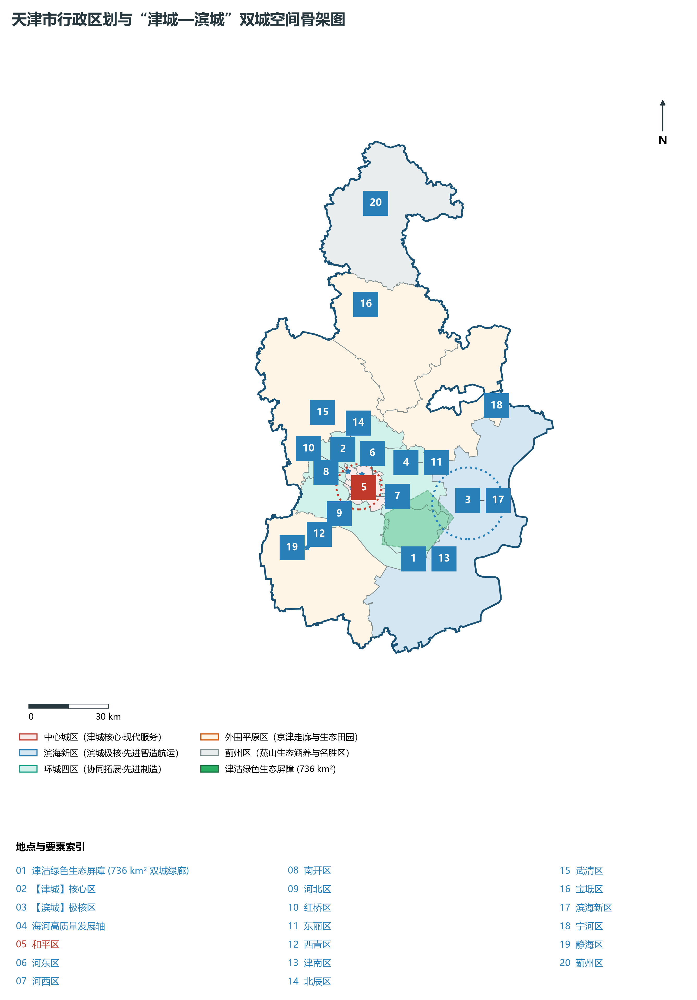
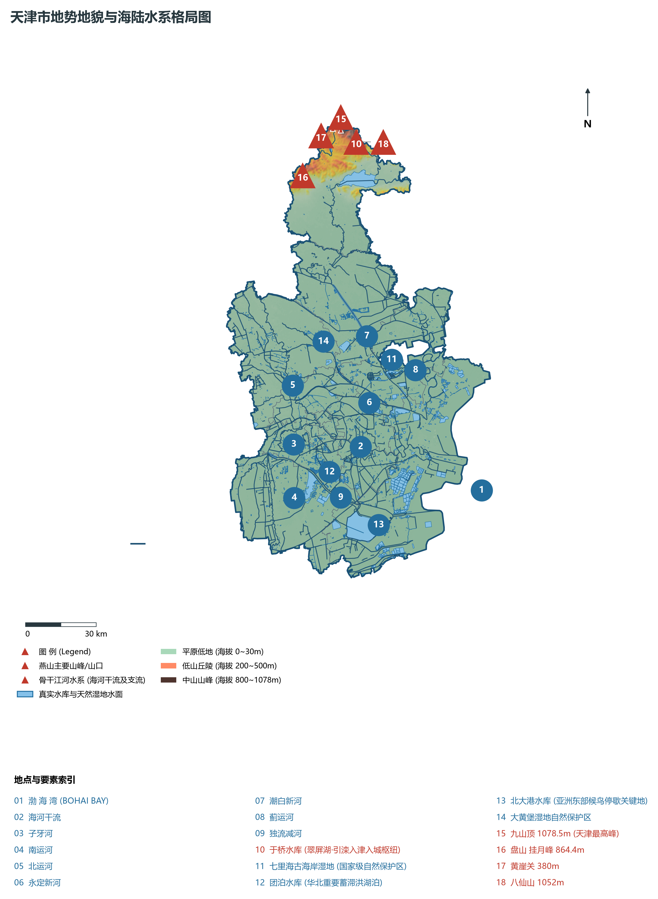
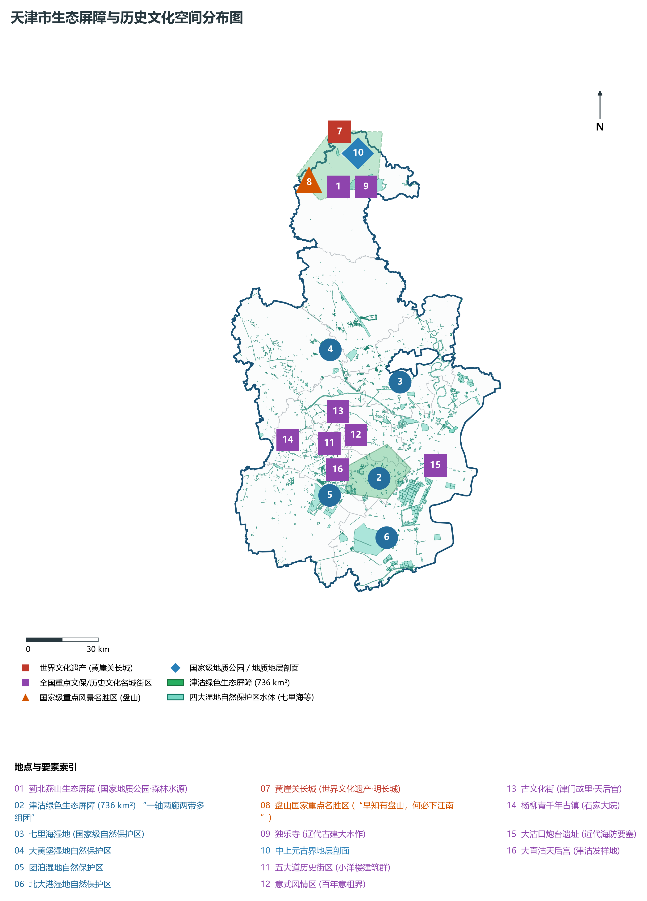
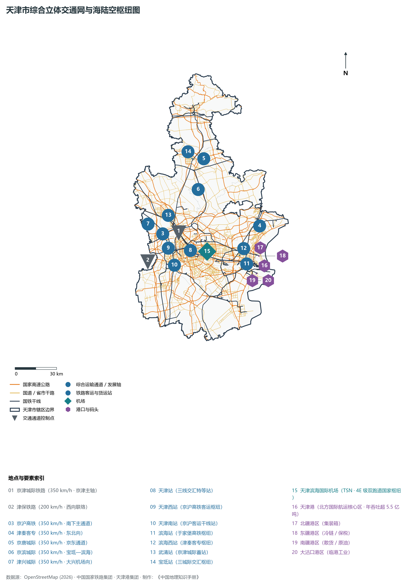
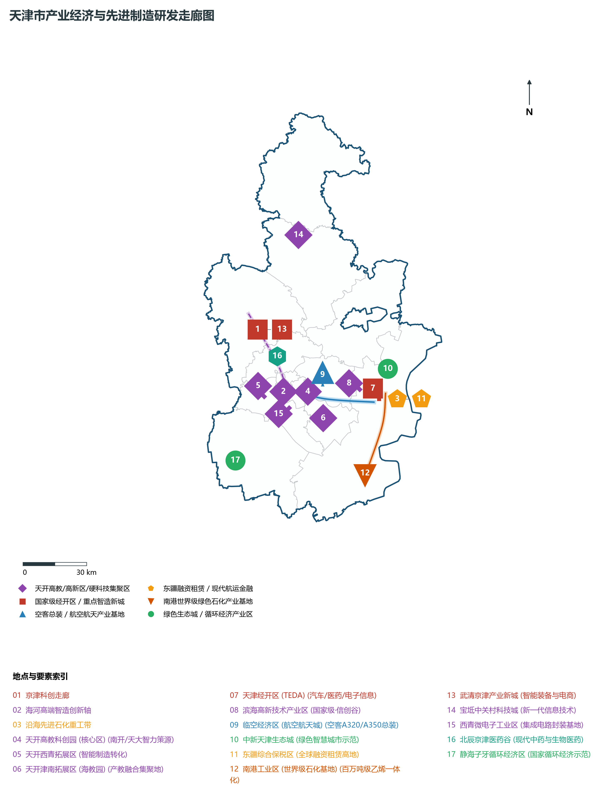

# 第二章 天津市地理统揽与“津城—滨城”双城空间格局

天津，中华人民共和国省级行政区、直辖市、国家中心城市、首批沿海开放城市。地处华北大平原东北部、海河流域下游、东临渤海、北依燕山，地理坐标介于东经 116°43′—118°04′、北纬 38°34′—40°15′ 之间。其西距北京 120 km，自古为拱卫京畿之要塞、沟通南北漕运之咽喉，被誉为“畿辅门户、海门咽喉”。

天津是退海成陆与江河交汇孕育的伟大地理奇迹。海河五大支流在此百川归海，造就了深厚的冲积海积平原与三道闻名世界的古贝壳堤。明永乐二年（1404年）正式建卫，得名“天子经由之渡口”，是我国古代唯一有确切设立年份记录的城市。近代开埠之后，天津一跃成为北方最大的工商业与金融中心、洋务运动策源地以及中西多元文化碰撞交融的前沿窗口。

当代天津，全域土地面积 **11 966.45 km²**，下辖 16 个市辖区，常住人口超 **1 364 万人**，地区生产总值（GDP）超 **1.76 万亿元**。在京津冀协同发展国家重大战略指引下，天津紧扣“一基地三区”（全国先进制造研发基地、北方国际航运核心区、金融创新运营示范区、改革开放先行区）核心定位，坚定构建“津城”（中心城区）与“滨城”（滨海新区）双城空间骨架，中间筑牢 736 km² 津沽绿色生态屏障，探索出一条港产城深度融合、先进制造业与现代服务业双轮驱动、人与自然和谐共生的高质量发展新路。

---

## 一、市情速览与全域基础指标

天津市地域空间南北狭长、东西偏窄，北枕燕山余脉，南纳沧州平原，东向展开广阔渤海湾，地势西北高、东南低。

| 核心指标 | 全市数值与空间分布 | 全国/战略定位 |
|:---|:---|:---|
| **行政区划面积** | 11 966.45 km² | 平原面积 11 140 km² (占 93.1%)，低山丘陵 826 km² (占 6.9%，主要分布于蓟州) |
| **常住人口** | 1 364.5 万人 (2024 年末) | 核心六区 378.2 万人，环城四区 396.4 万人，滨海新区 208.5 万人，外围五区 381.4 万人 |
| **常住人口城镇化率** | 85.5% | 核心六区达到 100%，居全国省级行政区前列 |
| **人口密度** | 1 140 人/km² | 和平区超 2.3 万人/km²，蓟州区与外围生态区约 380—520 人/km² |
| **地区生产总值 (GDP)** | 17 638.2 亿元 (2024 年，现价) | 稳居北方前列，先进制造业增加值占规模以上工业比重超 34% |
| **人均 GDP** | 约 12.93 万元人民币 (折合超 1.8 万美元) | 持续位列全国省区市前列，迈入高收入发展阶段 |
| **产业三次结构** | 1.3 : 36.1 : 62.6 | 工业底蕴厚重，服务业能级充沛，“1+3+4”现代产业体系加速成型 |
| **行政架构** | 16 个市辖区，下辖 124 个街道、125 个镇、4 个乡 | 市级行政机关驻河西区友谊路，滨海新区享有副省级经济社会管理权限 |
| **战略发展总定位** | “一基地三区”与京津冀海上门户 | 全国先进制造研发基地、北方国际航运核心区、金融创新运营示范区、改革开放先行区 |

**图 02-00-2 天津市行政区划与“津城—滨城”双城空间骨架图**：图上编号与地点、要素索引对应。

---

## 二、自然地理基底：退海成陆、古贝壳堤与山海平原

天津的自然地貌演化是华北平原晚第四纪以来海陆巨变的地学教科书，构成了“北枕燕山、中铺平原、东拥大海、洼淀棋布”的复合地理风貌。

### 1. 退海成陆沧桑历程与古贝壳堤地学奇观
地质历史时期，渤海湾海水曾深达今天津市区以西。随着黄河、海河水系携带巨量泥沙持续填幼沉积，海岸线以平均每年数百米的速度向东退缩，形成独特的退海成陆海积平原：

- **世界三大古贝壳堤之一**：在滨海新区与津南区境内，清晰发育着三道与现代海岸线平行分布的第四纪贝壳堤，由海洋潮汐与波浪搬运贝壳遗骸堆聚而成：
  - **第三道贝壳堤（最古老堤）**：距今约 5 000—3 800 年，分布于津南区双桥、白塘口至黄骅一带，见证了大禹治水时代的古渤海湾岸线；
  - **第二道贝壳堤**：距今约 2 500—1 500 年，分布于泥沽、海头、歧口一线，反映了战国秦汉时期的海岸位置；
  - **第一道贝壳堤（最年轻堤）**：距今约 1 000—600 年，分布于驴驹河、邓善沽至高沙岭一带，标志着宋元时期的海陆分界。
- 贝壳堤不仅是不可再生的国家级古海岸地质自然保护区，更是破解中国东部第四纪海平面升降、古气候变化与华北大平原发育机制的“地学活化石”。

### 2. 三大地貌单元与剧烈高程落差
全域地貌按成因与形态自北向南分为三大单元：

1. **蓟北低山丘陵区（燕山南翼）**：占全市总面积仅 6.9%，但地形陡峭险峻。全域最高峰为蓟州区东北部的**九山顶**，海拔达 **1 078.5 m**；八仙山主峰（1 052 m）、盘山挂月峰（864.4 m）奇峰耸立，分布着太古宙、元古宙出露极其完整的古老基底变质岩系与砂砾岩；
2. **冲积扇前缘倾斜平原区**：主要分布于宝坻、武清、北辰北部，为潮白河、蓟运河等山前冲积扇末端，海拔 10—30 m，土质肥沃，排水良好；
3. **海积冲积滨海极低平原区**：涵盖中心城区、环城各区、静海、宁河与滨海新区绝大部分，海拔普遍在 **2—5 m** 之间，局部地势低洼成淀（如团泊洼、北大港、七里海），地下潜水位高，分布有深厚粉砂黏土层与滨海盐渍化土。

**图 02-00-1 天津市地势地貌与海陆水系格局图**：图上编号与地点、要素索引对应。

### 3. 气候特征：暖温带半湿润大陆性季风气候
天津地处中纬度亚欧大陆东岸，四季分明，冷暖交替剧烈：

- **春季（3—5 月）**：冷暖空气频繁交汇，回温迅猛，风大干旱，蒸发强烈，土壤返盐现象显著；
- **夏季（6—8 月）**：受西太平洋副热带高压西伸北跳影响，暖湿多雨，高温高湿。全市多年平均降水量约为 **550—680 mm**，其中 75% 以上集中于 7、8 月，常伴有局地强对流暴雨，蓟北山区因地形抬升效应易形成全域降水中心；
- **秋季（9—10 月）**：秋高气爽，天高云淡，气温适中，是天津港航与旅游观光的最佳季节；
- **冬季（11—次年 2 月）**：受蒙古高压与极地干冷气团主导，寒冷少雪，多西北风，渤海沿岸及内河常有结冰期约 2—3 个月。

---

## 三、水文水系与“九河下梢天津卫”

“九河下梢天津卫，三道浮桥两道关”。海河流域是中国七大水系之一，在地理学上呈极其罕见的“向心扇状”汇水结构，而天津正处于这柄巨扇的扇柄汇流交织核心。

### 1. 海河五大支流汇流与干流走向
海河流域总面积达 31.8 万 km²，其北支、西支、南支共五大干级河流，在天津市区**三岔河口**（今红桥区与河北区交界）汇合聚集成海河干流：

1. **北运河**：自北京通州南下，经河北香河、天津武清流至三岔河口汇流；
2. **永定河**：自官厅水库出西山，流经京冀平原，经永定新河与海河干流排水分流；
3. **大清河**：汇集拒马河、白洋淀诸水，自西向东奔流至天津西青注入子牙河；
4. **子牙河**：汇集太行山东麓滏阳河与滹沱河，经静海、西青在三岔河口与南运河交汇；
5. **南运河**：古卫河与御河下游，自山东临清经河北沧州北上，至三岔河口注入海河。

海河干流自三岔河口起，穿过天津市中心核心城区，向东辗转曲折蜿蜒 **72 km**，经津南区、滨海新区，在大沽口注入渤海。历史上，海河洪汛期“上游万水奔涌，下游咽喉狭窄”，极易引发洪涝巨灾。建国后通过开挖**独流减河、永定新河、潮白新河、子牙新河**等骨干排洪河道，形成了“各奔入海、分洪泄秀”的现代化排洪防潮综合水网体系。

### 2. 水库洼淀与四大战略湿地
天津地势平坦低洼，历史上形成了广袤丰美的天然湖沼湿地，构成了京津冀重要的水鸟迁徙通道与生态水质净化库：

- **于桥水库（翠屏湖）**：坐落于蓟州区泃河与黎河交汇处，总库容 **15.59 亿 m³**，水面开阔，是国家级引滦入津工程的大型调蓄水库，也是天津城市核心水源重地；
- **七里海古海岸与湿地自然保护区**：位于宁河区境内，总面积超 230 km²，是我国北方罕见的大型古海岸潟湖湿地，芦苇荡与水鸟群落栖息面积达数万亩；
- **北大港湿地自然保护区**：位于滨海新区南部，总面积 348.87 km²，被列入国际重要湿地名录，是东亚—澳大利西亚候鸟迁徙线上极其关键的能量补给“五星级驿站”，东方白鹳、丹顶鹤、白琵鹭等珍稀鸟类在此群聚繁衍；
- **团泊湿地自然保护区**：位于静海区东部，素有“华北明珠”之称，水域辽阔，是候鸟南迁北归的天然乐园；
- **大黄堡湿地自然保护区**：位于武清区东部，水绿相生，涵养着京津之间的地下水生态。

### 3. 国家跨流域战略调水工程
天津水资源天然匮乏，人均水资源占有量长期不足全国平均水平的 1/10：

- **引滦入津工程**：1983 年建成的划时代水利工程，引河北滦河潘家口、大黑汀水库之水，穿越燕山引水隧洞注入蓟州于桥水库，再沿暗渠流送至市区，彻底终结了天津数百万市民饮用苦咸苦碱海潮水的辛酸历史；
- **南水北调中线工程**：长江水跨越一千余公里进入天津外环线调蓄水库，年供水量超 10 亿 m³，实现“引滦”与“引江”双水源互联互通、联合调度，为超大城市水安全构筑起坚不可摧的战略生命线。

---

## 四、建置沿革与“天子津渡”营建史

天津的历史是一部在水陆码头与漕运粮赋中崛起的城市演进史。其因水而生、因运而兴、因港而盛，在中国近代史上扮演了极具开拓性与转折性的枢纽角色。

### 1. 从“直沽寨”到“天津卫”

- **金元时期（运河重镇崛起）**：金大定十二年（1172年）在三岔河口设“直沽寨”作为军粮转运所；元至元十九年（1282年）元朝开通海运漕粮，直沽成为南北海运与运河内河接驳的转运中心，延祐三年（1316年）正式改置为“海津镇”，成为漕粮北上大都的枢纽码头；
- **明代建卫（城市确立诞生）**：建文二年（1400年），燕王朱棣自此渡河南下发动“靖难之役”，夺取帝位后改元永乐。永乐二年十一月二十一日（公元 1404 年 12 月 23 日），朱棣敕令在此筑城设卫，正式赐名**“天津卫”**，意为“天子经由之渡口”。天津成为中国古代历史长河中唯一拥有精确建城公历诞辰记录的大型城市；
- **明清演进**：清顺治九年改卫设县，雍正九年（1731年）升为天津府，下辖六县一州；同治九年（1870年）李鸿章出任直隶总督兼北洋通商大臣，常驻天津长达二十余载，天津成为清末洋务运动与现代化军事、实业、外交的实际中心。

### 2. 近代开埠与多元文化交汇的“万国建筑博览会”

- **九国租界沧桑**：1860 年《北京条约》签订后天津辟为通商口岸。自 1860 年至 1902 年间，英、法、美、德、日、俄、意、奥、比九个列强国家相继在海河沿岸划定租界，租界总面积达 **2.4 万余亩**，超原天津老城面积的 8 倍；
- **近代第一与工业先声**：在洋务运动与民族实业推动下，天津开创了无数中国近代“第一”：第一条自建干线铁路（唐胥铁路延展至天津）、第一所现代公立大学（北洋大学堂，今天津大学）、第一家近代机器铸币厂、第一支现代警察部队、第一张官方公报（《大公报》发源地）、第一座大型有轨电车系统；
- **近代历史建筑瑰宝**：
  - **五大道历史文化街区**：和平区保存有英、意、法、德等不同时期建筑风格的欧式花园洋房与名人故居逾 2 000 栋，汇聚了中国近代政治家、实业家、军阀与学者的百年沧桑，享有“万国建筑博览会”之誉；
  - **意式风情区**：河北区海河意租界原址，是意大利本土之外亚洲唯一保存完整的大型意大利传统建筑群落，梁启超饮冰室书斋便坐落于此；
  - **解放北路金融街**：被誉为近代“东方华尔街”，汇聚了汇丰、花旗、中法实业、横滨正金等数十座近代古典主义金融大楼。

---

## 五、“津城—滨城”双城空间骨架与 736 km² 津沽绿色生态屏障

面对单中心超大城市的“摊大饼”式空间承载瓶颈，天津在全国率先跳脱传统路径，确立了具有战略远瞻性的**“津城—滨城”双城空间结构**，以生态留白重塑人与自然的和谐边界。

### 1. “一轴两带、双城协同”空间骨架

- **“津城”核心区（现代高端服务与文化策源）**：以和平、河东、河西、南开、河北、红桥六区为核心，东丽、西青、津南、北辰四区为协同拓展圈。重点强化行政服务、科技创新策源、现代金融、商贸消费、高等教育与医疗文化功能，展现“沽水流霞、欧陆风情、津派文化”的现代都市魅力；
- **“滨城”极核区（现代智造与世界一流航运枢纽）**：以滨海新区 2 270 km² 空间为载体，涵盖 TEDA 经开区、保税区、高新区、东疆港、生态城、南港工业区等主力板块。重点集聚先进制造研发、北方国际航运中枢、跨境金融与海洋经济，打造高质量发展新引擎；
- **海河高质量发展轴**：依托海河干流，将“津城”与“滨城”有机串联，沿河布局科技创新园区、数字经济核心、亲水文旅带，构筑支撑双城互动共荣的“黄金主动脉”。

### 2. 736 km² 津沽绿色生态屏障构筑的生态奇迹
为防止“津城”与“滨城”无序连片蔓延，天津市人大立法在两城之间划定了占地 **736 km²** 的津沽绿色生态屏障区（面积相当于全市建成区总和）：

- **“一轴两廊两带多组团”生态骨架**：
  - 严格划定“三分区”管控：核心保水绿化区（严禁任何非农开发）、生态修复拓展区、综合协调控制区；
  - 拆除原集聚的数千家“散乱污”作坊与低端工业厂房，实施大规模造林绿化、湿地修复与水系连通；
  - 目前全区林木绿化率已突破 **30%**，形成海河绿芯、津南绿屏、东丽生态湖群等大批万亩森林湿地公园；
- 这道 736 km² 巨型生态“绿肺”，不仅有效切断了城市热岛效应与工业烟气蔓延，更为京津冀东南部构建了一座吐纳清新海风、维系微气候稳定的超级绿色屏障。

**图 02-00-5 天津市生态屏障与历史文化空间分布图**：图上编号与地点、要素索引对应。

---

## 六、综合立体交通枢纽网络与海陆空新格局

天津凭借“海港+空港+高铁+高速”四位一体的综合交通枢纽底盘，成为全国综合立体交通网规划纲要中明确的世界级国际性综合交通枢纽城市。

**图 02-00-3 天津市综合立体交通网与海陆空枢纽图**：图上编号与地点、要素索引对应。

### 1. 天津港——世界级人工深水大港与智慧绿色标杆
天津港是京津冀海上门户、中蒙俄经济走廊东部起点、“一带一路”海陆交汇核心支点：

- **港口能级与吞吐规模**：坐落于渤海湾西岸，拥有航道等级水深达 -22 米，具备 30 万吨级原油巨轮和世界最大 2.4 万标箱超大型集装箱船舶全天候进出港能力。年货物吞吐量超 **5.5 亿吨**，位居全球前十；集装箱年吞吐量突破 **2 218 万标箱**，同全球 180 多个国家和地区的 500 多个港口保持常态集装箱班轮贸易往来；
- **四大港区专业化分工**：
  - **北疆港区**：传统集装箱运输核心区，现代化码头堆场密布；
  - **东疆港区**：中国北方最大的综合保税区与冷链物流中枢，汽车进出口与邮轮母港集聚地；
  - **南疆港区**：以煤炭、矿石、原油、液化天然气（LNG）等大型大宗散货为主的国家级战略能源储备转运港；
  - **大沽口港区**：配套临港重型装备制造、海洋工程与绿色化工的大型专用工业港区；
- **全球首个“智慧零碳”码头**：在北疆 C 段码头实现了全部大型装卸设备由绿色电能驱动，依托 5G+北斗高精度导航实现无人集卡车队自动调度作业，成为国际航运界绿色化、无人化转型的代表性标杆。

### 2. “轨道上的京津冀”超级骨干网络
天津是我国高速铁路网密度最高、通达度最强的城市之一，形成多向放射格局：

- **京津城际铁路（我国第一条高标准客专）**：2008 年北京奥运前夕开通，设计时速 **350 km/h**，实现北京南至天津站仅需 **30 分钟**，开启了我国高铁商业运营的新纪元；随后延伸至滨海站（于家堡），实现双城核心区直通；
- **京沪高铁与津秦客专**：京沪高铁横穿西青设天津南站，津秦客专沟通滨海与东北辽东走廊；
- **京唐、京滨与津兴城际**：京唐城际串联宝坻与唐山，京滨城际引出至滨海国际机场，津兴城际自天津西站直达北京大兴国际机场（仅需 36 分钟），实现双城双机场高效联动。

### 3. 天津滨海国际机场（TSN）国家航空物流枢纽

- 坐落于东丽区，飞行区等级达到最高 **4E 级**，建有 2 座航站楼、2 条宽体客机独立平行跑道；
- 战略定位于**我国北方国际航空物流中心**，国内及国际货邮吞吐量位居华北前茅，深度承接首都机场货运功能疏解；地下垂直无缝衔接地铁 2 号线与京滨城际高铁，构建“空铁一体”综合客运枢纽。

---

## 七、产业经济布局与先进制造研发基地

作为中国近代工业的重要发祥地，天津历经百年工业化洗礼，拥有全国最齐全的工业门类（拥有联合国产业分类全部 41 个工业大类中的 39 个）。在新时代，天津正紧紧咬定**“全国先进制造研发基地”**国家战略定位，加快发展新质生产力，形成“海河智造轴、京津协同带、沿海石化重工群”的宏大产业格局。

**图 02-00-4 天津市产业经济与先进制造研发走廊图**：图上编号与地点、要素索引对应。

### 1. 产业引擎与高端研发走廊

1. **天开高教科创园（城市智力策源“第一极”）**：以南开大学、天津大学为智力源头，在南开区环天南大区域建立核心区，在西青区、津南区设立拓展区，探索科技成果转化、天使资本入驻与前沿概念验证全链条，成为推动“科技创新在津落地转化为现实生产力”的超级孵化母体；
2. **滨海高新区与“中国信创谷”**：汇集飞腾嵌入式与服务器 CPU、麒麟操作系统（国产 OS 市场份额超 70%）、中科曙光超级计算机、三六零网络安全平台、南大通用数据库等领军力量，构建起全国自主可控信息技术产业生态体系的最强高地；
3. **空客天津总装线与航空航天产业群**：坐落于滨海国际机场临空区，拥有欧洲本土以外设立的**首条空中客车 A320 系列单通道飞机总装线**以及 **A350 宽体客机完成和交付中心**，累计向全球各大航司交付飞机数百架；带动航天长征五号火箭大火箭总装基地、直升机研发制造基地等国之重器在津扎根成链；
4. **东疆综合保税区（全球融资租赁之都）**：创新探索离岸租赁、保税租赁与海关跨关区监管，成为全球仅次于爱尔兰的**第二大飞机租赁集聚中心**，国际标准船舶海工租赁资产规模占全国半壁江山，是名副其实的中国离岸海关与金融创新试验田；
5. **南港工业区（世界级绿色循环石化基地）**：位于滨海新区极南端海滨，中石化 120 万吨/年乙烯、渤化轻烃综合利用等超千亿元大型石化一体化项目在此投产，全面实现传统炼化向高端合成材料、特种化学品与绿色氢能产业链跃升。

---

## 八、宏观经济地理演变与全域夜间灯光时空跃升（1986—2013）

本地汇编的 1986—2013 年夜光指标，是观测天津从传统内河工商业老城走向世界级沿海双核巨型都会最直观、最客观的地理见证。

| 年份节点 | 汇编夜光指标总量（sum） | 像元加权均值（sum/count） | 空间集聚特征 |
|:---|:---:|:---:|:---|
| **1986 年** | 44,226.22 | 0.6160 | **老城单核圈层集聚**：灯光紧贴和平、河东、南开核心六区，外围滨海塘沽、大港呈零星孤立弱光斑 |
| **1995 年** | 94,464.18 | 1.3157 | **沿海河轴向延伸初显**：天津开发区（TEDA）设立起步，沿京津塘高速与海河向东蔓延，灯光倍增 |
| **2005 年** | 188,094.35 | 2.6197 | **滨海新区国家战略获批**：“津滨双核”呼之欲出，塘沽、大港、汉沽联袂点亮，环城工业园起步 |
| **2013 年** | 383,800.81 | 5.3454 | **空间集聚与双城发展**：滨海新区跃升为全域最强发光板块（独占全域 32.8% 灯光总和），核心六区的原表均值高于多数外围区 |
| **2024 年** | — | — | **“津城—滨城”双核辉映、中部屏障绿荫相间**：环城各区工业走廊全域高亮，与北京城市副中心廊坊廊带深度交融 |

### 1. 空间夜间灯光的三个历史演变阶段

1. **1986—1995 年（老城单极孕育期）**：
   在改革开放初期，高强度城市灯光紧紧收拢在和平劝业场、小白楼、南开鼓楼老街周边。1986 年六个核心区的汇编夜光指标总量占全市 26.33%。广大外围县区（蓟县、宝坻、武清、静海、宁河）地表广阔灰暗，城市空间呈极其典型的单中心圈层收缩结构；
2. **1996—2006 年（海河走廊与沿海开发破土期）**：
   随着国家级天津经济技术开发区（泰达 TEDA）展现强大的外资磁吸力，以及京津塘高速公路通车，夜间灯光呈现出显著的“两头强、中间串”的哑铃状萌芽。沿海港口区（北疆、东疆、南疆）工业夜光快速增强，塘沽与开发区夜光连成一片；
3. **2007—2013 年（“双核引领、廊道成网、绿屏守中”的现代化新格局）**：
   2006 年滨海新区纳入国家发展战略后，城市空间发生历史性重构。2013 年汇编表显示，**滨海新区（adcode: 120116）夜光总量达到 126 073**，占全市比重接近三分之一；东丽区（40 709）、西青区（38 679）、北辰区（27 765）、津南区（24 621）四区依托汽车装备、电子信息园区等产业承载，灯光呈连片密集网状扩展。2013 年和平区的原表 mean 为 62.22；各区均值与全市加权均值采用不同的汇总尺度。在两城之间，736 km² 绿色生态屏障区保持着珍贵的深暗低光环境，实现了城市高能级繁华与大自然静谧的有机共存。

---

## 参考文献与权威数据来源

1. 中华人民共和国自然资源部：《第三次全国国土调查主要数据公报（天津市）》
2. 中华人民共和国国家统计局：《中国城市统计年鉴（1987—2025年）》、《第七次全国人口普查公报》
3. 天津市统计局、国家统计局天津调查总队：《2024年天津市国民经济和社会发展统计公报》、《2024年天津统计年鉴》
4. 天津市人民政府：《天津市国土空间总体规划（2021—2035年）》
5. 阿里云 DataV.GeoAtlas 2021.5 行政区划基础空间数据（审图号：GS(2021)6038号）
6. 中国科学院地理科学与资源研究所 / NOAA-NGDC DMSP-OLS & NPP-VIIRS 连续校准夜间灯光遥感长时间序列数据集（1986—2013）
7. AWS Terrain Tiles / Copernicus GLO-30 全球数字高程模型（30米分辨率 DEM）
8. 天津市水务局：《天津市水资源公报（2023—2024年）》
