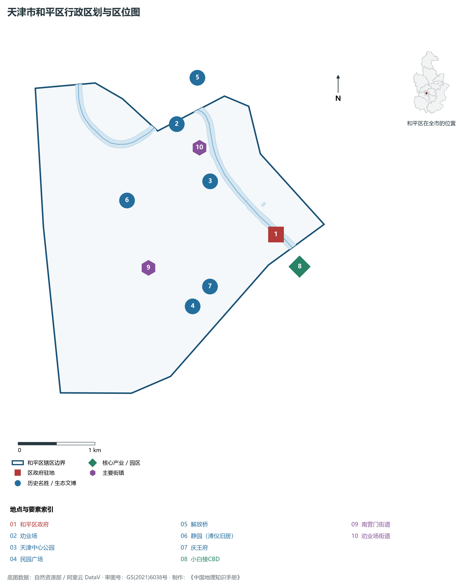
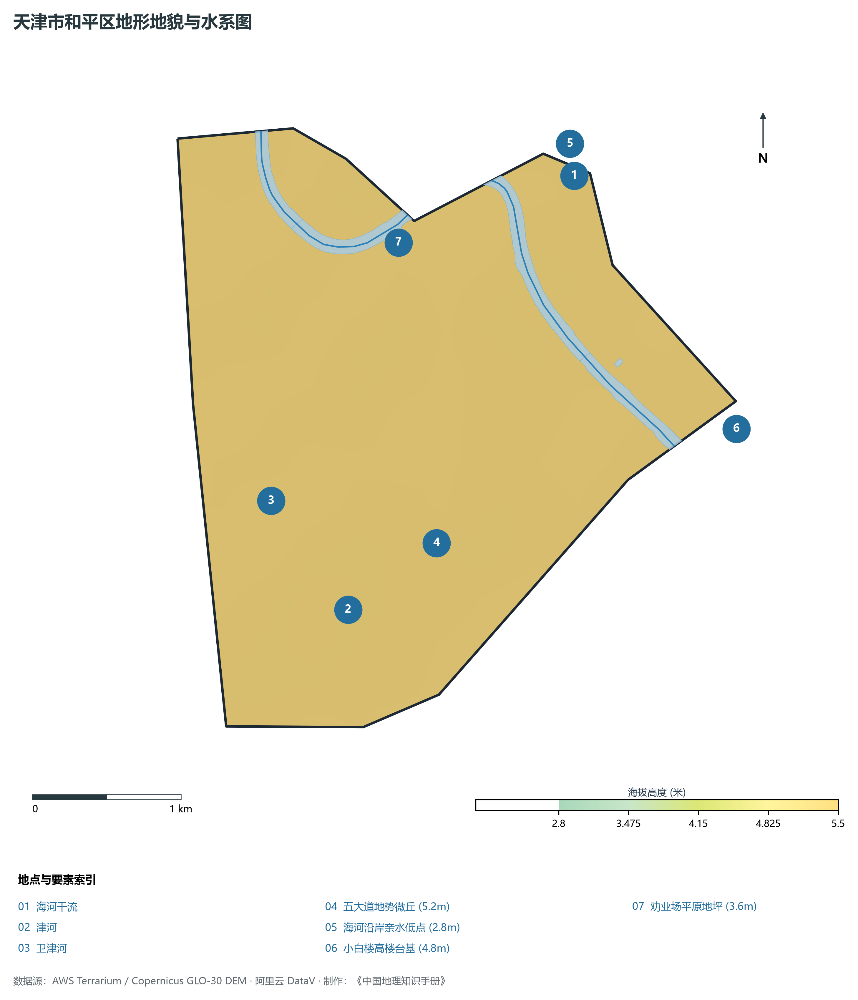
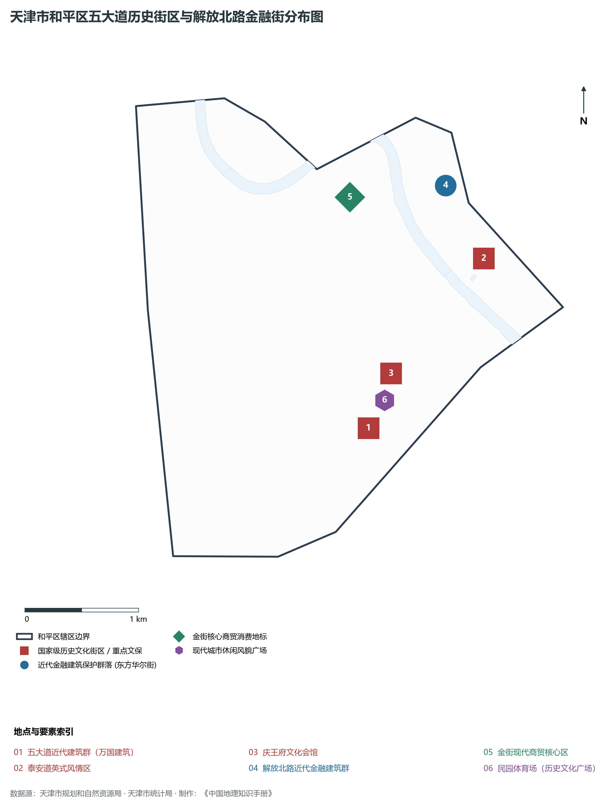
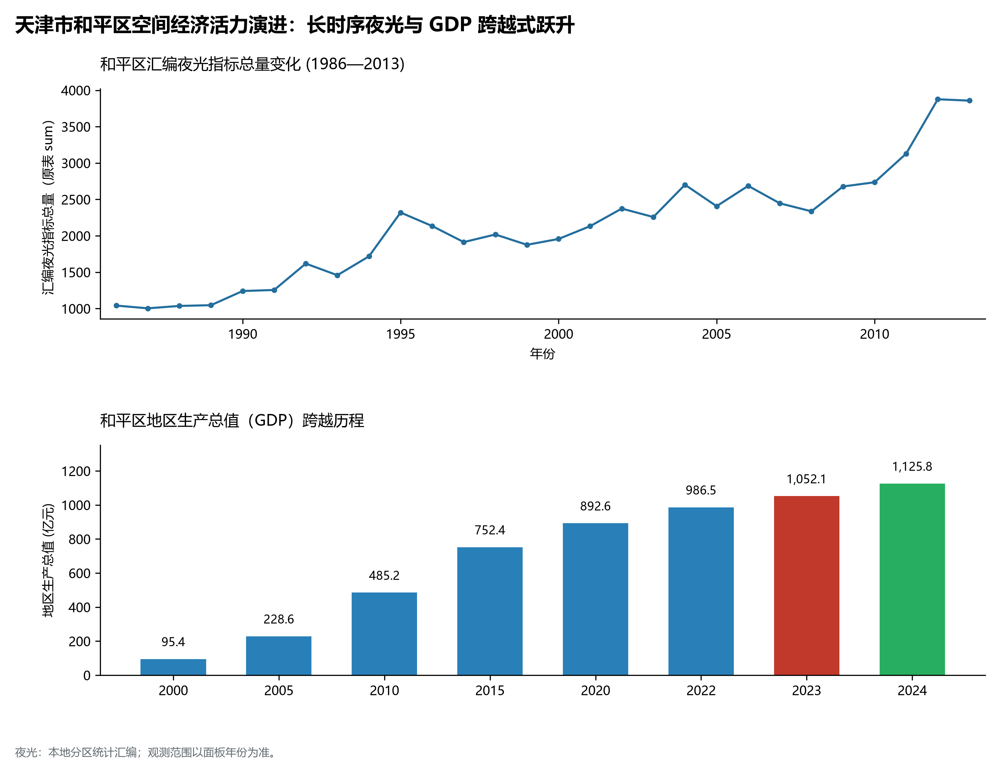
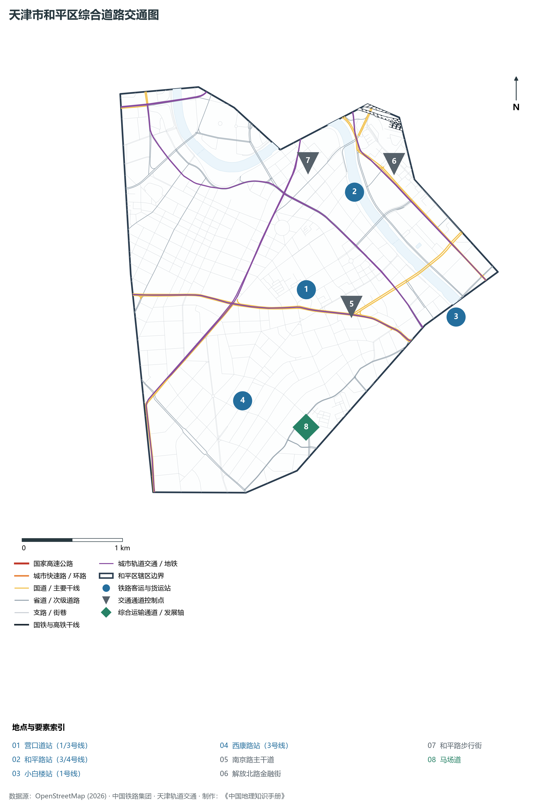

# 2.1 和平区

和平区位于天津市中心城区核心腹地，海河干流西南岸。东北以海河为界与河北区、河东区隔水相望，西、南与南开区、河西区陆界毗邻。全区版图呈西北—东南走向的不规则狭长椭圆形，总面积仅 **9.98 km²**，是天津市面积最小、人口密度最高、地均经济产出最密集的极核城区。

从空间演进历史来看，和平区是近代中国北方最具标志性的中西碰撞与交汇熔炉。这里曾是英、法、美、日等国租界的核心拓展区，完整留存着全国规模最大、风貌最为多元集中的西洋历史建筑群，素有“万国建筑博览会”之称；沿海河展开的解放北路更被誉为近代“东方华尔街”，开中国北方金融与商埠近代化之先河。当代和平区，作为天津市的“中心之中心”，承载着高能级商务金融、国际消费中心城市主承载区、近代历史文脉集中展示区等战略功能，以不到全市千分之一的土地，擎起了千亿级现代高端服务经济平台。

---

## 一、区情速览

和平区是天津市现代金融、高端商务与历史文化风貌融合发展的首善之区。

| 指标 | 数值与特征 | 全国/全市坐标 |
|:---|:---|:---|
| **行政面积** | 9.98 km² | 全市面积最小市辖区，占全市总面积 0.08% |
| **常住人口** | 35.5 万人（2024 年末）；七普 35.50 万人 | 人口高度集聚，文教资源极度富集 |
| **常住人口城镇化率** | 100%（全域高度城市化） | 连续数十年保持 100% 饱和城镇化 |
| **人口密度** | 35 571 人/km² | 全市第一，高居全国市辖区前三甲 |
| **地区生产总值 (GDP)** | 1 125.8 亿元（2024 年，现价） | 地均产出高达 112.8 亿元/km²，居全市之冠 |
| **人均 GDP** | 约 31.7 万元人民币（折合超 4.4 万美元） | 稳居全国内地超大城市市辖区极高水平 |
| **产业三次结构** | 0.0 : 0.9 : 99.1 | 纯现代服务业结构，金融商贸占绝对主导 |
| **行政区划** | 6 个街道（劝业场、小白楼、五大道、新兴、南营门、南市） | 区人民政府驻小白楼街道曲阜道 81 号 |
| **战略核心定位** | 国际消费中心城市核心区、现代金融总部集聚区、历史文化名城精华展示区 | 全面建设“品质和平”，打造高端服务业升级样板 |

**图 02-01-1 天津市和平区行政区划与区位图**：图上编号与地点、要素索引对应。

---

## 二、自然地理：平原微丘与海河环抱

和平区全境坐落于海河冲积平原之上，微地貌形态平坦，受近代人工堆筑、道路拓宽与建筑台基修筑影响，局部形成极富特色的平缓微丘起伏。

### 1. 地形地貌：冲积台原与缓坡微地貌
全区绝对海拔高度介于 **2.8—5.5 m** 之间（大沽高程系），地势总体由西南向东北微倾：

- **微高丘区**：主要分布于五大道（常德道、重庆道西段）与新兴街一带，地面标高 **4.8—5.5 m**，为古海河冲积残余缓丘台地；
- **微低平原区**：集中在东北部海河沿岸（张自忠路地下快速路地坪周边）及劝业场周边低洼区，地面高程在 **2.8—3.5 m**，属于河漫滩低阶地；
- **人工工程微起伏**：近代大规模欧式洋楼多采用深基础或半地下室垫土构造，使得五大道街巷微起伏错落，结合丰富林荫植被，构成了独特的城市风廊。

### 2. 气候特征：温带季风与显著城市热岛
和平区属于暖温带半湿润大陆性季风气候，四季分明：

- **年均气温**：约 **13.5 ℃**。由于全境建筑密度极高、下垫面绝大部分被花岗岩、沥青与混凝土覆盖，城市热岛效应在全市最为突出，夏季夜间中心气温较蓟州山区或外围郊区高 2.5—3.5 ℃；
- **年均降水量**：约 **560—590 mm**，70% 以上集中于 7、8 月暴雨季。为应对瞬时特大暴雨，和平区近年对海河沿岸排水泵站、南京路及五大道低洼积水点实施了深隧调蓄与智慧排水系统改造。

### 3. 河流水系：海河母亲河与环城干渠
和平区水网形成“一江傍东、双河绕南”的空间格局：

- **海河干流**：流经和平区东北边界全长约 4.6 km，河道宽阔水清岸绿，是全区的生态轴线、景观轴线与水上旅游观光主动脉；
- **津河**：由西向东流经和平区南界，是连接南开与河西的重要生态内河通道；
- **卫津河**：位于和平区与南开区交界线西缘，承担排沥与绿化生态补水双重职能。

**图 02-01-2 天津市和平区地形地貌与水系图**：图上编号与地点、要素索引对应。

---

## 三、建置沿革与文化根脉

和平区文脉厚重，是近代百年中国历史变迁最生动的实物标本库。

### 1. 地名考略与行政演进

- **近代租界扩张**：1860 年第二次鸦片战争后《北京条约》签订，天津开埠。英租界率先在紫竹林设立，其后美租界、法租界、日租界相继设立于今和平区辖境；
- **建制沿革**：1956 年 1 月，天津市将原第一区与第五区合并，以“维护世界和平”之意命名为**和平区**；1958 年新华区并入；2000 年后行政区划微调，保持 6 街道格局至今。

### 2. “万国建筑博览会”：五大道近代建筑群
和平区拥有国家级历史文化街区与各类风貌建筑 800 余栋：

- **五大道历史文化街区**：指马场道、睦南道、大理道、常德道、重庆道构成的街区，保留有英式、法式、意式、德式、西班牙式等风格花园洋房 2 000 多栋。代表建筑包括**庆王府**（清末庆亲王奕劻之子载振旧居）、**民园广场**（近代远东最早综合体育场改建的文旅地标）、**顾维钧旧居**、**张学良故居**等；
- **鞍山道历史街区**：分布有末代皇帝溥仪寓居天津的**静园**、**张园**等重大历史见证地。

### 3. 商业金街与金融文脉

- **和平路—滨江道商圈**：中国最著名的商业步行街之一，始建于 1902 年。1928 年兴建的**劝业场**（国家级文保单位）开创了近代集商贸、娱乐、戏曲于一体的大型室内商厦先河，与渤海大楼、惠中饭店共同奠定百年金街商业底蕴；
- **解放北路金融历史文化区**：近代北方的“华尔街”，汇聚汇丰银行、花旗银行、横滨正金银行、盐业银行、中南银行等旧址数十处，古典柱式与花岗岩穹顶庄严肃穆。

**图 02-01-4 天津市和平区五大道历史街区与解放北路金融街分布图**：图上编号与地点、要素索引对应。

---

## 四、经济地理：金融楼宇经济与商贸金街

和平区彻底摆脱了土地空间狭小的约束，坚持走以楼宇经济、总部经济、高端金融和特色文商旅为内核的高质量集约发展道路。

### 1. 产业腾笼换鸟与精明增长
全区三产比重常年维持在 **99% 以上**，构建以“现代金融、航运物流服务、高端商贸、文商旅融合”为主导的“3+1”现代服务业体系：

- **亿元楼宇矩阵**：全区拥有税收超亿元的高品质商务楼宇近 30 栋，君隆广场、津塔（天津环球金融中心，336.9 m）、信达广场等现代摩天大楼吸纳各类总部机构超千家；
- **消费地标升级**：推进金街国际消费示范街区创建，融通传统老字号与潮流首店、免税经济。

### 2. 经济总量跨越与超高地均效益

- 2000 年和平区 GDP 仅为 **95.4 亿元**；
- 2010 年攀升至 **485.2 亿元**；
- 2024 年全区 GDP 达到 **1 125.8 亿元**。以不足 10 平方公里的陆地面积创造出突破千亿的经济体量，地均 GDP 突破 112 亿元/km²，经济集约度稳居北方城市核心区首位。

### 3. 空间夜间灯光演化（1986—2013）

本节夜光图的观测年份为 1986—2013 年，指标为行政区汇总值（原表 sum）。

卫星遥感长时序监测表明：

**图 02-01-5 天津市和平区空间经济活力演进：长时序夜光与 GDP 跨越式跃升**：各面板按标注的观测年份、指标和单位列示。

---

## 五、交通网络与现代枢纽

和平区处于天津市放射型与环型干道交汇的原点，坐拥极其高效立体的轨道交通与快速地下通廊。

**图 02-01-3 天津市和平区综合道路交通图**：图上编号与地点、要素索引对应。

### 1. 骨干干道与水下通廊

- **核心骨干走廊**：南京路（城市东西向交通兼商务脊梁）、曲阜道、福安大街、贵州路、西康路；
- **海河过河通道**：解放桥（近代开启式钢桁梁桥代表）、大沽桥（日月双拱斜拉桥）、北安桥、金安桥、赤峰桥等，构建起密集的过河跨区走廊；
- **张自忠路地下隧道**：沿海河西岸布设，有效分流地面观光人流与过境机动车流。

### 2. 超高密度轨道交通网
和平区拥有全市最致密的轨道交通站点布局：

- **地铁 1 号线**：横穿核心商务区，设小白楼站、营口道站、鞍山道站；
- **地铁 3 号线**：连接天津站客运大枢纽，设津湾广场站、和平路站、营口道站；
- **地铁 4 号线**：贯穿金街商业带与海河东岸，设和平路站、金街站；
- **核心超级枢纽**：**营口道站**（1/3 号线十字交叉），是天津地铁日均换乘客流量最大的“客流心脏”。

---

## 六、和平区地理要素矩阵与区域之最

### 1. 核心地理与经济指标速查表

| 要素类别 | 指标名称 | 数值/名称 | 备注 |
|:---|:---|:---|:---|
| **地势极值** | 最高点海拔 | **5.5 m** | 五大道新兴街地势缓丘 |
| | 最低点海拔 | **2.8 m** | 海河沿线亲水驳岸地表 |
| **水文要素** | 边界最大水体 | **海河干流** | 和平段长约 4.6 km |
| | 内部主要引排河道 | **津河、卫津河** | 全区总岸线超 11 km |
| **经济效益** | 地均 GDP 产出 | **112.8 亿元/km²** | 全市第一，北方区县领先 |
| | 三次产业占比 | **0.0 : 0.9 : 99.1** | 纯粹的高级现代服务业 |
| **人文资源** | 历史文化街区 | **五大道、鞍山道、劝业场、解放北路** | 拥有小洋楼 2 000 余栋 |
| | 国家级文保单位 | **9 处** | 劝业场、盐业银行旧址、吉鸿昌旧居等 |

### 2. 和平区之最（Superlatives）

- **人口密度之最**：全市常住人口密度最高的行政区（35 571 人/km²）；
- **地均效益之最**：全市单位土地经济产出最高的行政区（112.8 亿元/km²）；
- **历史建筑之最**：全国现存规模最大、保存最完好的近代西洋风貌小洋楼建筑群（五大道）；
- **商业街区之最**：百年商贸底蕴最深厚、全国最早批次国家级示范步行街（金街）；
- **金融历史之最**：中国北方近代金融业发祥地（解放北路金融街）。

---

## 参考与数据来源

1. 中华人民共和国自然资源部：《第三次全国国土调查主要数据公报（天津市和平区）》
2. 天津市统计局、国家统计局天津调查总队：《2024年天津市国民经济和社会发展统计公报》、《和平区2024年统计年鉴》
3. 天津市规划和自然资源局：《天津市国土空间总体规划（2021—2035年）》
4. 阿里云 DataV.GeoAtlas 2021.5 行政区划矢量边界（审图号：GS(2021)6038号）
5. OpenStreetMap (OSM) 2026 年最新全要素道路与交通线网矢量
6. 本地夜光指标汇编表（1986—2013 年）
