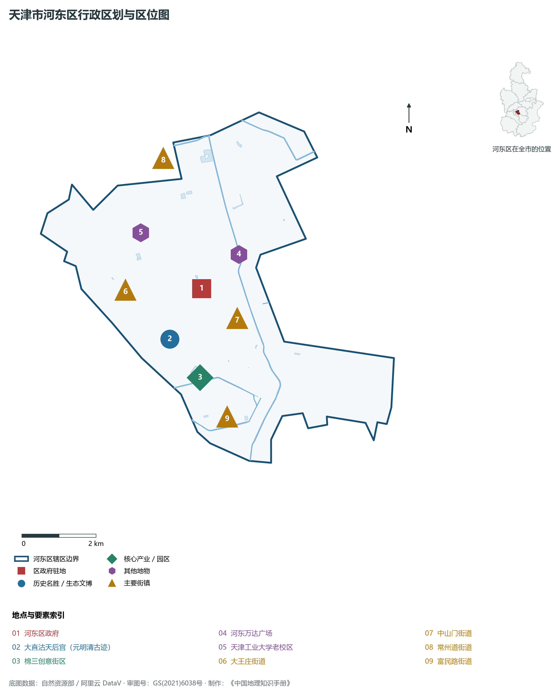
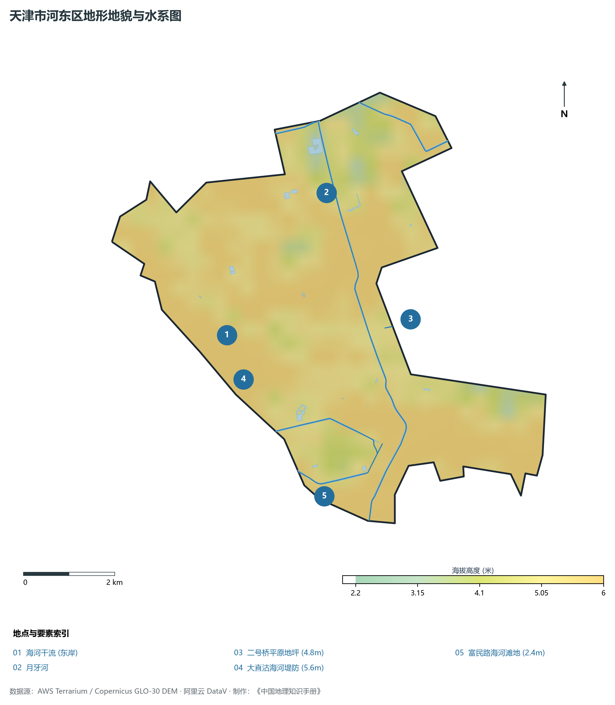
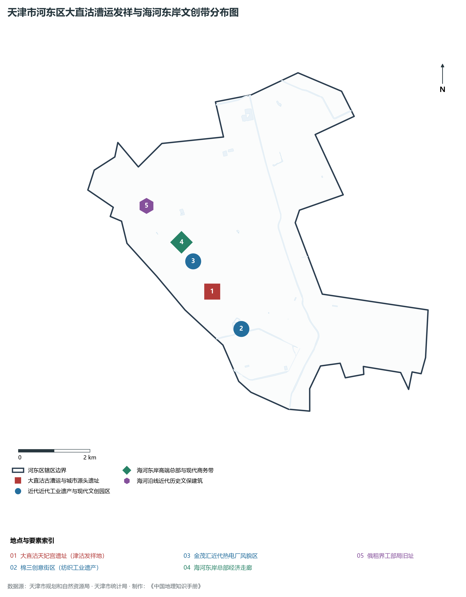
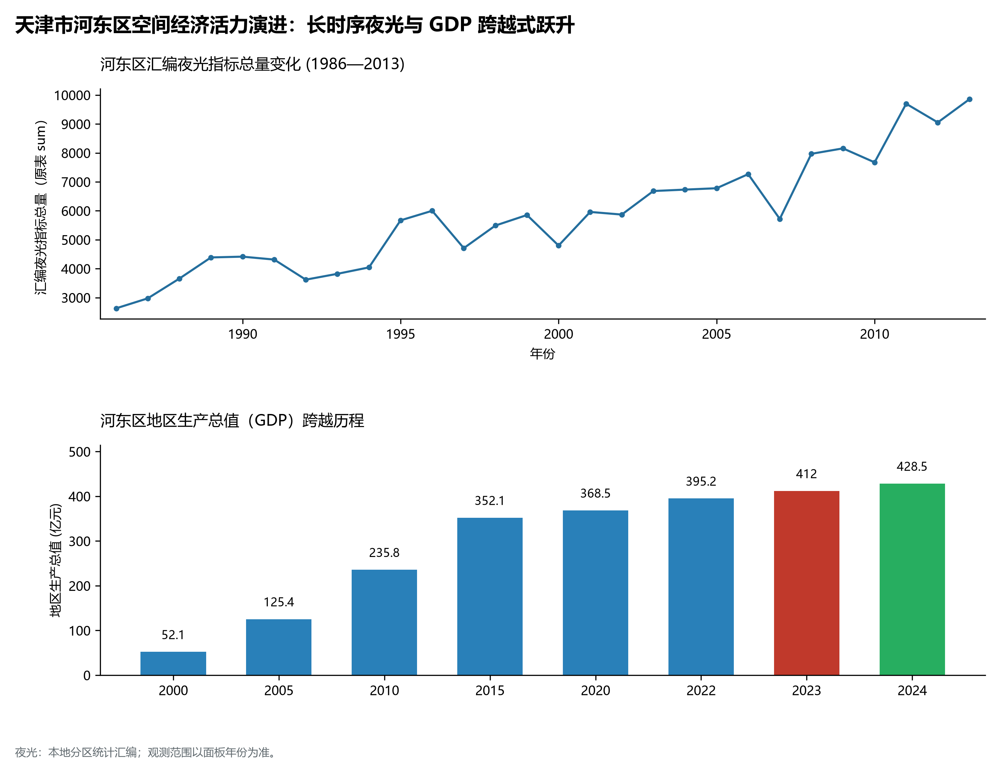
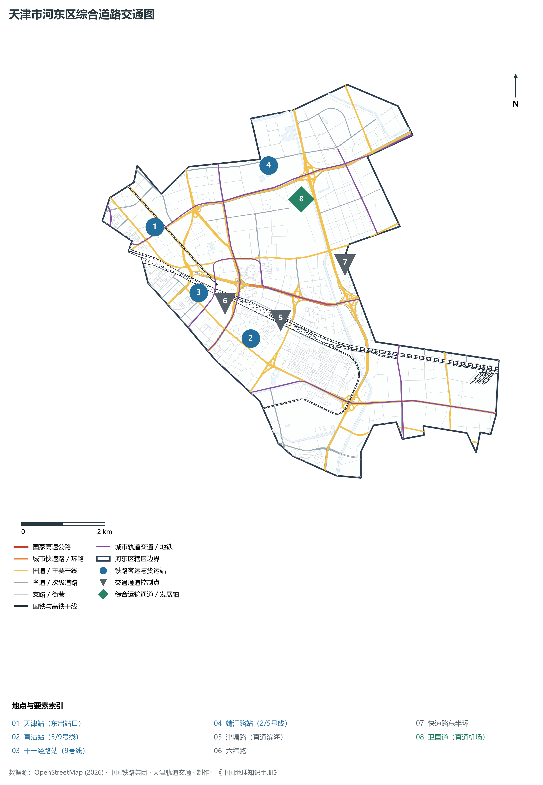

# 2.2 河东区

河东区位于天津市中心城区东部，海河干流东岸。西北隔海河与和平区、河西区相望，北接河北区，东、南分别与东丽区接壤。全区版图呈西北—东南向带状延伸，总面积 **41.70 km²**，常住人口 **83.2 万人**，是天津中心城区东部的产业转型高地、综合交通枢纽腹地与直沽文化发祥圣地。

在天津建城与文明发育史中，河东区享有“先有大直沽，后有天津卫”的崇高文史地位。元延祐三年（1316年）在此设大直沽漕运接运厅并建天妃宫，河东因漕运与海运接驳而率先开埠繁盛，成为北方妈祖文化与漕运码头文明的始祖之所。近代以降，河东区是天津作为北方老工业基地的重要承载地，棉纺、电力、轻工企业林立；当代河东区则深度融入“津城”现代活力核建设，依托海河东岸新商务区、天津站交通枢纽东广场所构筑的立体走廊，强力推进工业遗产更新与现代商贸金融集聚，绽放出“老工业摇篮”蝶变为“海河东岸品质新城”的勃勃生机。

---

## 一、区情速览

河东区是海河东岸集现代金融商务、科技创新服务与文旅商体融合于一体的综合活力区。

| 指标 | 数值与特征 | 全国/全市坐标 |
|:---|:---|:---|
| **行政面积** | 41.70 km² | 占中心城区土地面积约 23.1% |
| **常住人口** | 83.2 万人（2024 年末）；七普 85.88 万人 | 中心城区东部人口规模第一大区 |
| **常住人口城镇化率** | 100%（全域深度城市化） | 城镇化水平保持饱和 |
| **人口密度** | 19 952 人/km² | 全市前列，海河沿线及大直沽片区人口稠密 |
| **地区生产总值 (GDP)** | 428.5 亿元（2024 年，现价） | 服务业增加值占比突破 86%，发展韧性充沛 |
| **人均 GDP** | 约 5.15 万元人民币 | 随着现代商务楼宇与总部落地持续攀升 |
| **产业三次结构** | 0.0 : 13.8 : 86.2 | 工业老区成功腾笼换鸟，现代服务业主导 |
| **行政区划** | 13 个街道（大王庄、大直沽、中山门、向阳楼、二号桥等） | 区人民政府驻大王庄街道九纬路 106 号 |
| **战略核心定位** | 海河东岸新商务区核心承载地、直沽文脉传承创新示范区、数字创新与都市产业高地 | 奋力建设创新转型示范区与品质生活宜居区 |

**图 02-02-1 天津市河东区行政区划与区位图**：图上编号与地点、要素索引对应。

---

## 二、自然地理：海东阶地与平原水网

河东区地处海河下游冲积平原前缘，地势平展宽阔，自西北向东南微弱倾斜，地面标高起伏极小。

### 1. 地形地貌：海河冲积一二级漫滩阶地
全区地面绝对高程在 **2.4—5.6 m** 之间（大沽高程系）：

- **地貌相对高位**：分布于大王庄至大直沽一带的原海河天然堤残丘，标高 **4.8—5.6 m**，自古便是避风躲洪、漕船停靠与居民聚居的理想干燥高地；
- **低洼水网平原**：东南部二号桥、向阳楼及邻近东丽交界区域，海拔在 **2.4—3.2 m**，历史上多分布坑塘洼淀，经近数十年城市建设填垫已成为平整坚实的城市建设用地；
- **现代地表特征**：全域无天然山体丘陵，高楼建筑群与高架轻轨桥构成了独特的“人工岩石微地貌”。

### 2. 气候特征：温带季风与海河风廊效应
属于暖温带半湿润季风气候，兼具沿海大陆架微风调节：

- **气温水汽**：年均温约 **13.3 ℃**，海河宽阔水面在夏季形成明显的天然冷源与局地通风廊道，降低了沿岸街区的体感温度；
- **降水时空**：年平均降水量约 **570 mm**。夏季汛期受副高北抬降水影响，河东区依托月牙河与新开河排沥水系，构建了“蓄排结合、强排入河”的高效城市雨水调蓄防汛网络。

### 3. 河流水系：海河干流与排沥骨干

- **海河干流（河东段）**：全长达 10.5 km，为全区西南边界。水面宽 100—180 m，两岸建有高标准防洪生态亲水步道；
- **月牙河与新开河**：横贯北部与东部边界，是承担城市北部防洪排涝、分洪减灾与景观生态补水的综合骨干河道。

**图 02-02-2 天津市河东区地形地貌与水系图**：图上编号与地点、要素索引对应。

---

## 三、建置沿革与文化根脉

河东区是天津城市孕育的原生母体与近代工业文明的先驱者。

### 1. 地名考略与“先有大直沽”

- **大直沽历史源流**：早在金代，海河下游合流处即有“直沽寨”之设；元代设立“大直沽接运厅”，在此建有北方最早的天妃灵慈宫（元延祐三年，1316年）。民间广为流传“先有大直沽，后有天津卫”的谚语，印证了河东大直沽作为古代漕运物资集散枢纽与城市原生聚落的历史早熟性；
- **建置演变**：1952 年天津市设立第四区；1956 年以地处海河东岸正式定名为**河东区**，建制沿用至今。

### 2. 妈祖文脉与宗教民俗遗存

- **元代天妃宫遗址**：坐落于大直沽中路，是华北地区年代最早、规格极高的妈祖官庙遗址，出土了大量元代青花瓷、陶器及祭祀建筑构件，实证了南北漕运与海洋文化在海河东岸的深厚扎根；
- **荐福观音寺**：坐落于大直沽，是津门古刹名刹，梵呗悠扬，构筑了古老直沽的民俗与信仰文化地标。

### 3. 工业遗产蝶变与文创活力
河东区是天津作为北方老工业基地的重要缩影：

- **棉三创意街区**：前身为始建于 1921 年的裕丰纱厂、后为国营天津第三棉纺织厂。街区完整保留了锯齿形厂房、红砖外墙与近代纺织机械风貌，成功蝶变为融合数字科技、工业设计、戏剧展演与青年夜经济的国家级工业遗产文创示范园区；
- **天津第一热电厂（金茂汇）**：建于 1937 年的天津第一热电厂，曾是支撑城市半个世纪运转的能源巨擘。如今其巨大的红砖煤斗、发电机厂房与工业钢结构被完整保留活化，改造为全国领先的滨河工业遗产商业综合体。

**图 02-02-4 天津市河东区大直沽漕运发祥与海河东岸文创带分布图**：图上编号与地点、要素索引对应。

---

## 四、经济地理：海东商务崛起与工业遗产焕新

新时代的河东区，抢抓海河东岸经济带建设机遇，全面加快传统工业街区向现代智慧商务、数字经济和现代金融的跨越式跃升。

### 1. 产业腾笼换鸟与空间重构
从传统棉纺织、重型机械制造全面退出，构筑“1+2+3”现代产业体系：

- **现代都市服务业极核**：依托海河东路沿线，建设海河东岸新商务区，引育中建六局总部、中铁十八局总部、渤海银行等大型央企与金融机构；
- **科技创新与数字经济**：依托棉三数字创意园、二次方创新园，聚集软件研发、智能物联与文化创意企业近千家。

### 2. 经济总量跨越式跃升

- 2000 年河东区 GDP 仅为 **52.3 亿元**；
- 2010 年攀升至 **215.6 亿元**；
- 2024 年全区 GDP 稳步增长至 **428.5 亿元**，第三产业占比高达 86.2%，实现了由“老工矿重载区”向“高附加值现代服务区”的历史性蜕变。

### 3. 空间夜间灯光演化（1986—2013）

本节夜光图的观测年份为 1986—2013 年，指标为行政区汇总值（原表 sum）。

**图 02-02-5 天津市河东区空间经济活力演进：长时序夜光与 GDP 跨越式跃升**：各面板按标注的观测年份、指标和单位列示。

---

## 五、交通网络与现代枢纽

河东区地处中心城区通往滨海新区的咽喉走廊，享有得天独厚的“高铁门户、轻轨轴线、密集环网”立体交通体系。

**图 02-02-3 天津市河东区综合道路交通图**：图上编号与地点、要素索引对应。

### 1. 骨干干道与出城快速走廊

- **海河东路快速路**：全线紧邻海河，双向高效通达，串联海东新商务区各个商务组团；
- **通达滨海两大动脉**：
  - **津滨大道**：城市快速路，自东风立交桥直达东丽与滨海国际机场；
  - **津塘路**：百年历史干线，曾是连通天津市区与塘沽港口唯一的公路骨架；
- **跨河特大桥梁**：金茂桥、保定桥、大光明桥、刘庄桥、光华桥等密集分布，平均数百米便有一座桥梁紧密连通和平、河西两区。

### 2. 特等综合枢纽：天津站后广场

- **天津站后广场（河东集散中心）**：天津站作为全国特等大型国铁综合客运枢纽，其东站房与后广场坐落于河东区大王庄街道。集结京津城际铁路、京沪铁路、津秦客专，并实现与地铁 2、3、9 号线的地下无缝零换乘，是津城客流吞吐最大枢纽。

### 3. 轨道交通密网与轻轨干线

- **津滨轻轨 9 号线**：由天津站后广场始发，横贯河东全境（设十一经路站、直沽站、东兴路站、中山门站、一号桥站、二号桥站），是连接津城与滨城的“通勤生命线”；
- **地铁 2 号线**：直达滨海国际机场与天津西站，设远洋国际中心站、顺驰桥站、靖江路站；
- **地铁 4 号线与 5 号线**：纵贯南北，在成林道、直沽等多处形成网络化立体换乘。

---

## 六、河东区地理要素矩阵与区域之最

### 1. 核心地理与经济指标速查表

| 要素类别 | 指标名称 | 数值/名称 | 备注 |
|:---|:---|:---|:---|
| **地势极值** | 最高点海拔 | **5.6 m** | 大王庄海河天然阶地高位 |
| | 最低点海拔 | **2.4 m** | 二号桥向阳楼东侧平原洼地 |
| **水文要素** | 沿岸核心河流 | **海河干流** | 河东岸线长达 10.5 km |
| | 骨干排沥防洪水系 | **月牙河、新开河** | 汇入北运河与海河下游 |
| **经济效益** | 第三产业占比 | **86.2%** | 老工业基地成功转向现代服务业 |
| | 2024 年地区生产总值 | **428.5 亿元** | 现代楼宇与工业文创贡献突出 |
| **文旅遗存** | 古代文脉核心 | **大直沽元代天妃宫遗址** | 北方最早天后宫遗迹 |
| | 现代工业遗产标杆 | **棉三创意街区、金茂汇** | 全国工业遗产更新典型样板 |

### 2. 河东区之最（Superlatives）

- **城市文脉之最**：天津城市原生聚落与漕运文化的最早发祥地（“先有大直沽，后有天津卫”）；
- **妈祖信仰之最**：中国北方地区历史最悠久的官办妈祖神庙遗存（元代天妃宫）；
- **更新转型之最**：北方规模最大、最完整的棉纺老厂区活化典范（棉三创意街区）；
- **交通换乘之最**：拥有联通滨海新区日均客流量最大的轨道交通起始干线（津滨轻轨9号线河东段）。

---

## 参考与数据来源

1. 中华人民共和国自然资源部：《第三次全国国土调查主要数据公报（天津市河东区）》
2. 天津市统计局、河东区统计局：《2024年河东区国民经济和社会发展统计公报》
3. 天津市规划和自然资源局：《海河两岸综合开发与空间管制规划（2021—2035年）》
4. 阿里云 DataV.GeoAtlas 行政区划数据（审图号：GS(2021)6038号）
5. OpenStreetMap (OSM) 2026 年最新全要素道路与交通线网矢量
6. NOAA/VIIRS 1986—2013 年长时序夜间灯光遥感校验数据集
