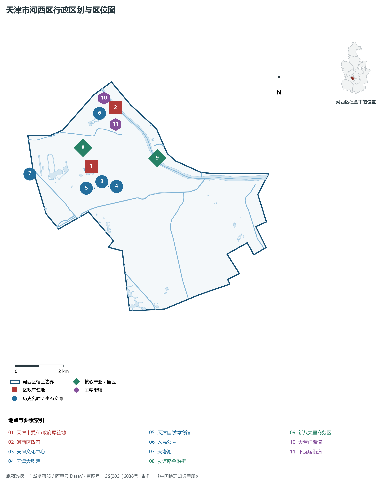
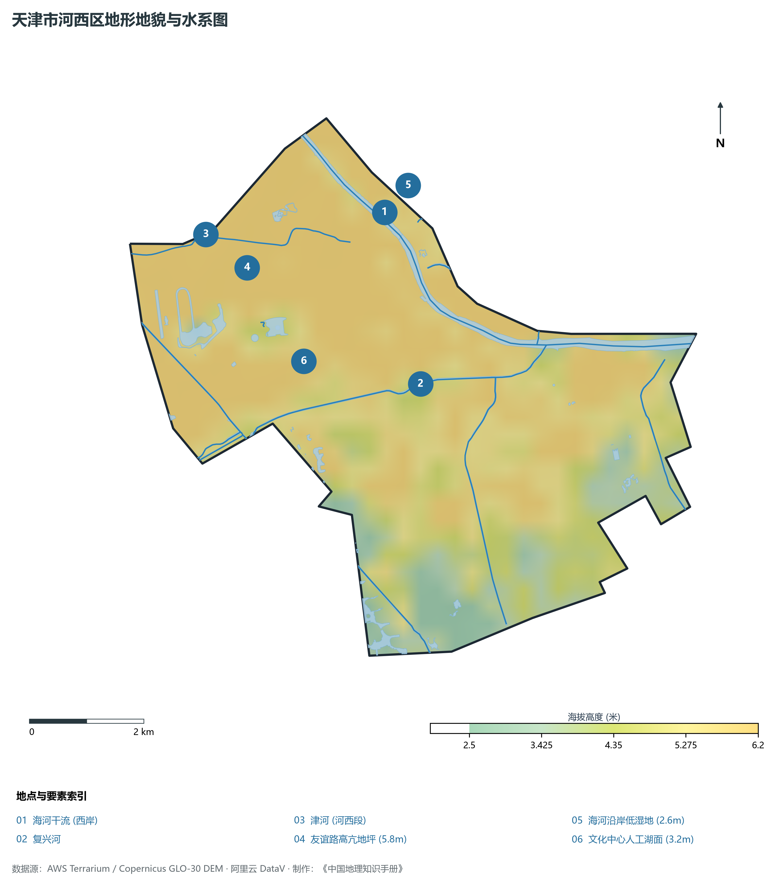
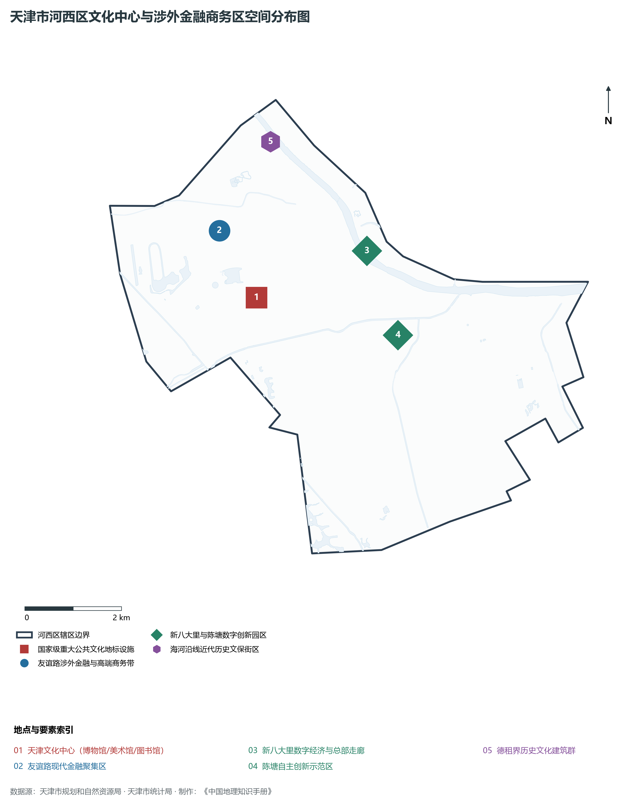
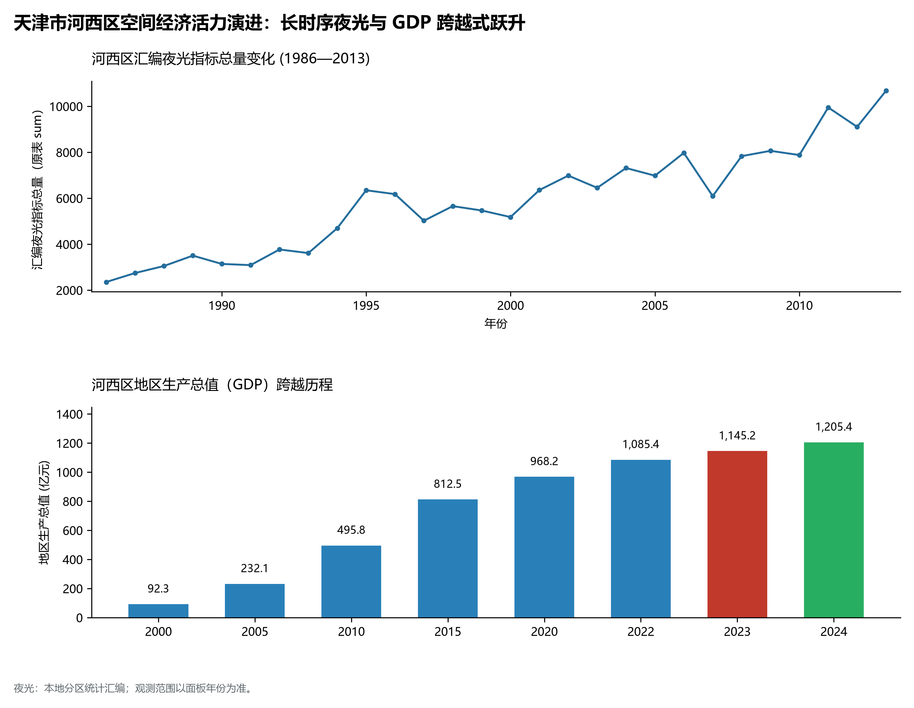
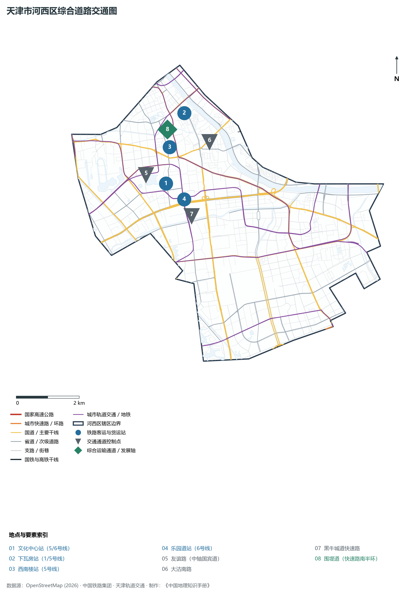

# 2.3 河西区

河西区位于天津市中心城区南部，海河干流西岸。东临海河与河东区隔水相望，北以津河为界与和平区紧密接壤，西与南开区相连，南与西青区、津南区交界。全区总面积 **42.17 km²**，常住人口 **81.6 万人**，是中共天津市委、天津市人民政府、市人大常委会等市级党政机关所在地，也是全市政治、文化、金融、国际交往与高品质居住的核心承载区。

河西区是天津现当代城市文明演进的“首善窗口”。历史上，这里曾是近代德租界拓展区与海河水运码头腹地，见证了现代工商业与早期城市规划的雏形。改革开放以来，特别是进入 21 世纪后，河西区以友谊路金融政务轴线为脊梁，以集聚天津博物馆、天津大剧院等顶尖公共文化场馆的“天津文化中心”为城市客厅，以“新八大里”与“陈塘科技商务区”为产业升级主阵地，展现出兼具端庄大气与现代繁荣的“津城品质之巅”。2024 年全区 GDP 跨越 1 200 亿元大关，经济体量与总部集聚能级高居中心城区第一位。

---

## 一、区情速览

河西区是全市行政指挥中枢、北方现代金融重镇与高雅城市文化的璀璨殿堂。

| 指标 | 数值与特征 | 全国/全市坐标 |
|:---|:---|:---|
| **行政面积** | 42.17 km² | 占中心城区总面积约 23.4% |
| **常住人口** | 81.6 万人（2024 年末）；七普 82.22 万人 | 中心城区人口结构最优、受教育程度极高 |
| **常住人口城镇化率** | 100%（全域高度城市化） | 连续三十年保持 100% 城镇化 |
| **人口密度** | 19 350 人/km² | 全市前列，居住环境优美、绿化覆盖率领先 |
| **地区生产总值 (GDP)** | 1 205.4 亿元（2024 年，现价） | 中心城区第一，占全市经济总量约 6.8% |
| **人均 GDP** | 约 14.77 万元人民币（折合超 2.05 万美元） | 迈入世界银行高收入发达经济体门槛 |
| **产业三次结构** | 0.0 : 7.2 : 92.8 | 现代金融与高端服务业构成绝对主导 |
| **行政区划** | 14 个街道（大营门、下瓦房、桃园、友谊路、天塔、尖山等） | 中共天津市委、市政府驻友谊路街道 |
| **战略核心定位** | 建设经济大区、品质之区，打造北方现代金融服务新高地、中心城区文化新地标 | 树立高品质生活创造与高效能治理典范 |

**图 02-03-1 天津市河西区行政区划与区位图**：图上编号与地点、要素索引对应。

---

## 二、自然地理：平坦阶地与生态水网

河西区地质构造属于黄骅坳陷海河断裂南侧，全境坐落于由海河与古永定河联合形成的滨海湖沼沉积平原上，地貌极其平缓开阔。

### 1. 地形地貌：滨河平原微高地与沉降平稳区
全区绝对地面高程在 **2.6—5.8 m** 之间（大沽高程系）：

- **全区相对高点**：北部下瓦房、大营门邻近和平交界一带，受早期人工筑堤与近代建筑台基堆高影响，高程在 **4.8—5.8 m**；
- **南部微低平原**：全运村、梅江生态居住区南部，标高在 **2.6—3.4 m**，历史上多为洼淀湿地，现代通过大型人工水系营造，构筑了梅江公园生态调蓄湖；
- **全区微地形走势**：总体自西北向东南微弱倾斜，平均坡降不足万分之三。

### 2. 气候特征：温带半湿润气候与湖水微调节
属于暖温带大陆性季风气候，兼受渤海海风调节：

- **气温水汽**：年平均气温 **13.2 ℃**。区域内拥有文化中心中心湖、梅江公园人工湖与海河大水面，形成优良的局部“冷岛效应”与微气候调节，夏秋季节空气湿度舒适；
- **降水特性**：多年平均降水量 **580 mm**，75% 集中于盛夏。全区近年来通过雨污分流改造与海绵城市工程，雨后道路积水排除速度居全市最快水平。

### 3. 河流水系：海河母亲河与环城景观内河

- **海河干流（河西段）**：全长约 6.2 km，沿途建有台儿庄南路生态亲水绿廊，水质长年保持在良好地表水标准；
- **津河与复兴河**：津河作为北部边界河，由西向东流经天塔、佟楼至海河；复兴河纵贯中南部，是承担区域防洪排沥与绿道景观的生态干渠；
- **卫津河**：位于西侧边界，连接水上公园水系，为河西西部营造了清幽的滨水绿道。

**图 02-03-2 天津市河西区地形地貌与水系图**：图上编号与地点、要素索引对应。

---

## 三、建置沿革与文化根脉

河西区地灵人杰，是天津近现代外交、商贸与当代文化艺术殿堂的聚集地。

### 1. 地名考略与行政建置

- **历史源起**：河西辖域原属古武清县、静海县及天津县交接地带；近代天津开埠后，德租界于 1895 年在今大营门、下瓦房一带设立，兴建了大量近代德式民居与工业设施；
- **行政建置**：1956 年 1 月，天津市将原第六区更名为**河西区**；1958 年部分区域重组，形成了今日河西区的基本骨架。

### 2. 天津城市客厅：天津文化中心
天津文化中心是全国规模最大、功能最齐全的城市综合文化艺术殿堂：

- **文化地标集群**：由**天津博物馆**（世纪之窗造型）、**天津自然博物馆**、**天津大剧院**（飞碟与贝壳造型）、**天津美术馆**、**天津图书馆**、**天津科技馆**等 6 大国家级、省级重点公共文化场馆组成；
- **生态水景广场**：环抱近 10 万 m² 的中心湖，湖光塔影，喷泉灵动，地下配备超大商业综合体（万象城）与三线换乘枢纽，是全市最高雅的文化艺术会客厅与市民休闲圣地。

### 3. 近代名人故居与德式风貌

- **大营门历史风貌区**：保留有原德国俱乐部、德国领事馆旧址及德租界工部局旧址，红砖陡坡瓦顶，异域风情浓郁；
- **名人故居**：包括著名爱国将领吉鸿昌旧居、民国总统徐世昌旧居等，诉说着近代风云激荡的沧桑岁月。

**图 02-03-4 天津市河西区文化中心与涉外金融商务区空间分布图**：图上编号与地点、要素索引对应。

---

## 四、经济地理：金融重镇与总部经济高地

河西区是天津市现代金融机构最密集、亿元楼宇最多、现代服务业发展质效益最高的中心区。

### 1. 产业布局：“一轴两圈四片区”

- **友谊路金融政务轴**：沿友谊路汇聚了中国银行天津分行、建设银行天津分行、工商银行天津分行、中国人寿等金融机构区域总部近百家，资产规模达数万亿元，是天津名副其实的“金融大街”；
- **新八大里与陈塘科技商务区**：利用原老旧仓储与工业用地完成“腾笼换鸟”，重点布局工业互联网、信创科技、工程设计咨询、数字金融等高端新兴产业。

### 2. 经济总量跨越与中心城区领跑

- 2000 年河西区 GDP 仅为 **88.6 亿元**；
- 2010 年突破 **450 亿元**；
- 2024 年全区 GDP 攀升至 **1 205.4 亿元**，成为天津中心城区首个突破 1 200 亿元大关的行政区，人均 GDP 逼近 15 万元人民币，稳居全市各区前列。

### 3. 空间夜间灯光演化（1986—2013）

本节夜光图的观测年份为 1986—2013 年，指标为行政区汇总值（原表 sum）。

卫星遥感长时序监测展现出高质量的现代都市集聚态势：

**图 02-03-5 天津市河西区空间经济活力演进：长时序夜光与 GDP 跨越式跃升**：各面板按标注的观测年份、指标和单位列示。

---

## 五、交通网络与现代枢纽

河西区骨干路网密度大、微循环通畅，拥有中心城区最为立体的轨道交通换乘枢纽。

**图 02-03-3 天津市河西区综合道路交通图**：图上编号与地点、要素索引对应。

### 1. 骨干干道与城市快速路

- **东西向骨架**：围堤道（中环线）、黑牛城道快速路（快速路环线），构筑起高效分流的东西向大动脉；
- **南北向主轴**：友谊路（城市政务礼仪大道）、解放南路（直达津南与海河中游）、大沽南路、微山路。

### 2. 轨道交通枢纽之王：天津文化中心站
河西区轨道交通四通八达：

- **地铁 5 号线与 6 号线**：双环线交织于河西腹地，串联起天津主要生活区与商业区；
- **地铁 1 号线**：横贯北部大营门、下瓦房板块，通勤客流极大；
- **文化中心超级枢纽**：集地铁 5 号线、6 号线、在建 11 号线、12 号线于一体，拥有华北地区罕见的地下四线换乘地下立体大厅，与周边文化场馆、商业综合体实现全天候地下直通。

---

## 六、河西区地理要素矩阵与区域之最

### 1. 核心地理与经济指标速查表

| 要素类别 | 指标名称 | 数值/名称 | 备注 |
|:---|:---|:---|:---|
| **地势极值** | 最高点海拔 | **5.8 m** | 大营门中环线微地形高台 |
| | 最低点海拔 | **2.6 m** | 梅江公园南部湖畔低洼湿地 |
| **水文要素** | 核心水体 | **海河干流、津河、复兴河** | 河网总长超过 28 km |
| | 景观生态湖面 | **文化中心湖、梅江天鹅湖** | 水域面积超 25 万 m² |
| **经济体量** | 2024 年 GDP | **1 205.4 亿元** | 中心城区经济总量第一大区 |
| | 金融增加值比重 | **超 35%** | 全市金融机构总部最集聚区域 |
| **公共文化** | 市级重点文化设施 | **6 座大型场馆** | 天津博物馆、大剧院、图书馆等 |
| | 国际展览中心 | **天津梅江会展中心** | 达沃斯论坛等重大外事主会场 |

### 2. 河西区之最（Superlatives）

- **经济能级之最**：天津市中心城区经济总量（GDP）与人均 GDP 双料第一；
- **文化殿堂之最**：华北地区公共文化场馆规格最高、数量最集中的城市客厅（天津文化中心）；
- **政务金融之最**：中共天津市委、天津市政府驻地，全市金融总部资产规模第一；
- **外事会展之最**：举办世界夏季达沃斯论坛等高规格国际峰会次数最多的承办地（梅江会展中心）。

---

## 参考与数据来源

1. 中华人民共和国自然资源部：《第三次全国国土调查主要数据公报（天津市河西区）》
2. 天津市统计局、河西区统计局：《2024年河西区国民经济和社会发展统计公报》
3. 天津市规划和自然资源局：《天津文化中心地区控制性详细规划》
4. 阿里云 DataV.GeoAtlas 行政区划数据（审图号：GS(2021)6038号）
5. OpenStreetMap (OSM) 2026 年最新全要素道路与交通线网矢量
6. NOAA/VIIRS 1986—2013 年长时序夜间灯光遥感校验数据集
