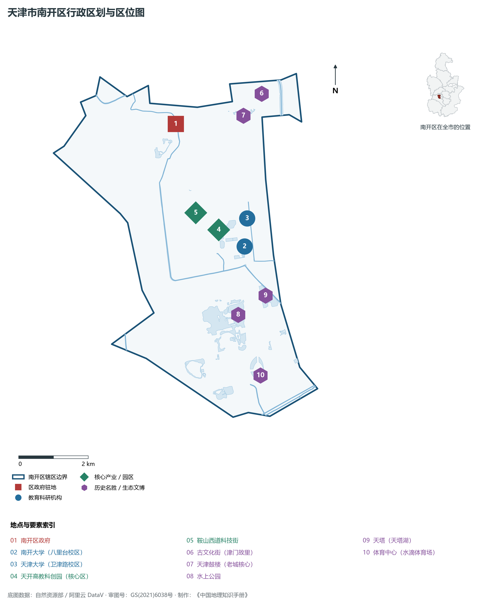
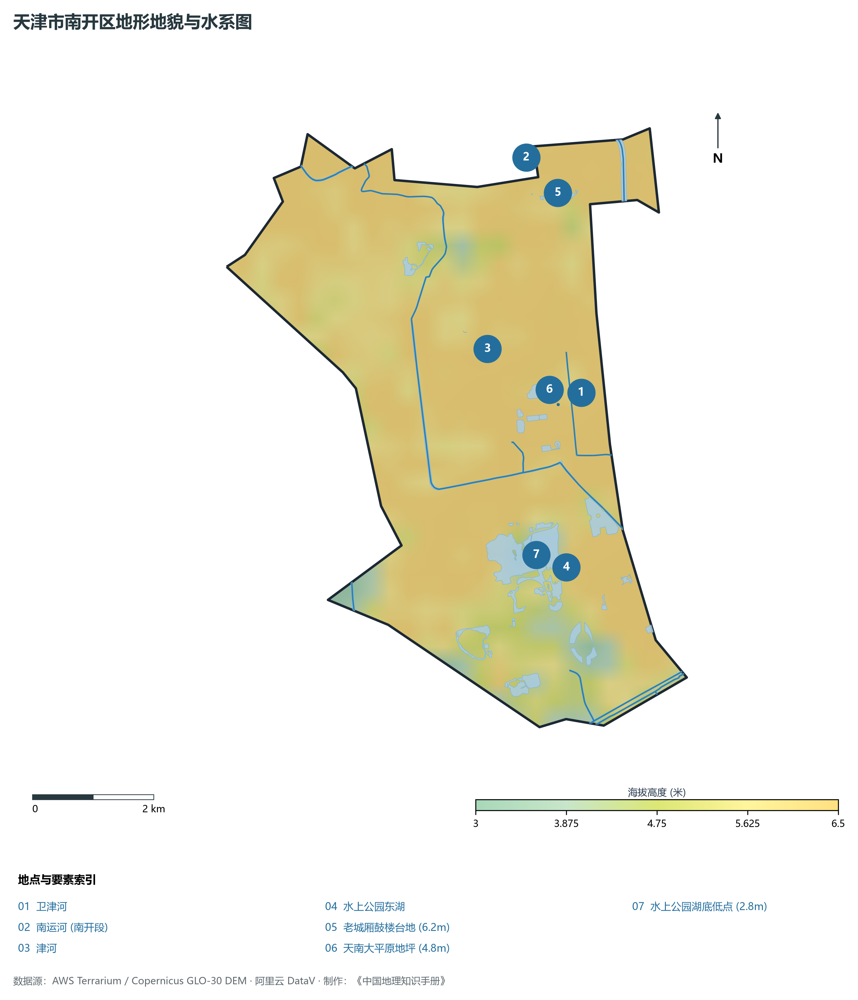
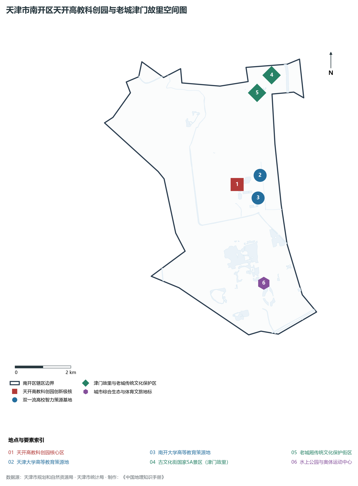
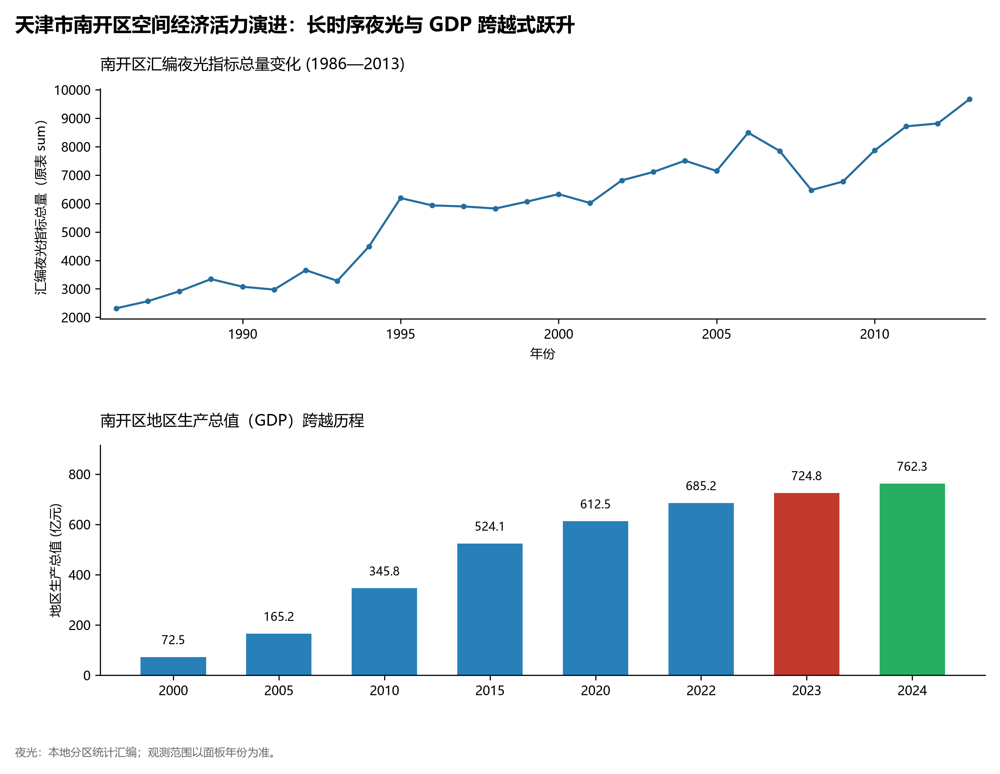
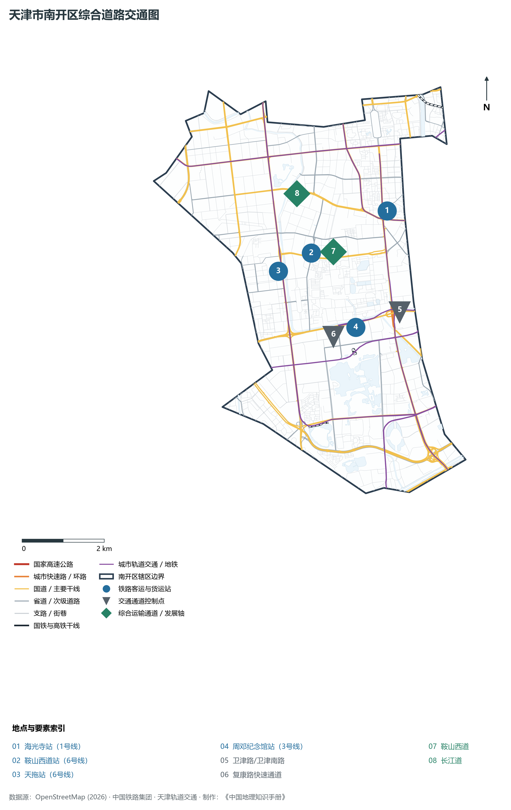

# 2.4 南开区

南开区位于天津市中心城区西南部。东临卫津河、海河与和平区、河西区隔河相望，南接西青区，西邻西青区，北以南运河与红桥区为界。全区总面积 **40.64 km²**，常住人口 **88.5 万人**，是天津市高校与国家级科研院所最集中的科教智谷、老城厢文脉渊薮以及天开高教科创园的核心承载区。

南开区因地处天津老城厢“南门之外的开阔地”而得名，是一座“老城根、新引擎”交相辉映的典范城区。这里拥有始建于明永乐二年的天津老城厢，鼓楼金钟与古文化街的妈祖神韵承载着六百年卫城文脉；近代更是严修、张伯苓创办南开系列学校，孕育周恩来总理等世纪伟人的爱国主义教育发祥地。当代南开区，南开大学、天津大学两所国家“双一流”顶尖名校在此隔墙相依，形成北方罕见的环大学知识创新带。在京津冀协同发展与创新驱动战略引领下，天开高教科创园核心区拔地而起，南开区正以磅礴的科教智慧动力，书写“科创中国”的津门新传奇。

---

## 一、区情速览

南开区是天津乃至中国北方最具活力的高等教育、科技创新与老城历史文脉承载地。

| 指标 | 数值与特征 | 全国/全市坐标 |
|:---|:---|:---|
| **行政面积** | 40.64 km² | 占中心城区总面积约 22.5% |
| **常住人口** | 88.5 万人（2024 年末）；七普 89.04 万人 | 中心城区常住人口第一大区 |
| **常住人口城镇化率** | 100%（全域深度城市化） | 高水平饱和城市化 |
| **人口密度** | 21 776 人/km² | 全市第三，高知人群与高校师生极度密集 |
| **地区生产总值 (GDP)** | 762.3 亿元（2024 年，现价） | 高技术服务业与数字经济贡献率持续提高 |
| **人均 GDP** | 约 8.61 万元人民币 | 随着天开园科创转化效能释放稳步跃升 |
| **产业三次结构** | 0.0 : 6.8 : 93.2 | 现代服务业与技术密集型产业占绝对优势 |
| **行政区划** | 12 个街道（鼓楼、兴南、广开、学府、万兴、水上公园等） | 区人民政府驻长虹街道黄河道 390 号 |
| **战略核心定位** | 天开高教科创园核心区、“创新南开”策源地、商旅文深度融合示范区 | 构建“创新高地、文化名区、宜居之城” |

**图 02-04-1 天津市南开区行政区划与区位图**：图上编号与地点、要素索引对应。

---

## 二、自然地理：平缓冲积扇与名胜水系

南开区坐落在海河水系与太行山前冲积扇交汇外缘，地形自西南向东北极其微缓倾斜，地势平坦低舒。

### 1. 地形地貌：古泻湖洼地与人工台坪
全区绝对地面高程在 **2.8—6.2 m** 之间（大沽高程系）：

- **全区相对高点**：北部鼓楼老城厢地坪与黄河道一带，海拔 **5.2—6.2 m**，鼓楼台基拔地而起，形成老城制高点；
- **全区地貌低点**：南部水上公园湖底与沉淀洼地，地面原生标高 **2.8—3.2 m**，历史上为典型的古海退积水淀泊，经新中国初期人工开凿改造为风景名胜水体；
- **地质土层**：上部为数米深黏土与粉砂层，下部为深厚海陆交互相沉积，地基稳定性良好。

### 2. 气候特征：温带半湿润季风与湖景微温差
属于暖温带大陆性半湿润季风气候：

- **水汽温和**：年平均气温 **13.3 ℃**。南部拥有水上公园、天塔湖等近百公顷宽阔水面，林木丰茂，为城市西南部构筑了显著的“城市绿肺”与小气候调节湿地；
- **降水集约**：年降水量约 **570 mm**。夏季短时强降雨常受老城排水系统容量考验，通过近年来海绵城市改造与张贵庄排沥渠连通，防汛排涝能力极大提升。

### 3. 河流水系：三河环绕与城中巨湖

- **卫津河**：南开区东部边界河流，北接津河，南通外环河，岸线绿柳成荫，是高校师生最亲近的滨河林荫绿道；
- **南运河**：全区北部边界河流，为京杭大运河重要段落，流经三岔河口汇流；
- **水上公园水系与天塔湖**：水上公园三湖九岛，水域面积达 89 公顷，与隔路相望的天塔湖相映成趣，构成天津市区最大的城市水景观带。

**图 02-04-2 天津市南开区地形地貌与水系图**：图上编号与地点、要素索引对应。

---

## 三、建置沿革与文化根脉

南开区兼具六百年古城沧桑底蕴与近代百年兴学救国的壮丽诗篇。

### 1. 地名考略与老城建制

- **天津老城厢**：明永乐二年（1404年）十一月二十一日，明成祖朱棣正式设“天津卫”，筑城设砖石四门，城池所在地即今南开区东北部老城厢。城内中心筑有鼓楼，按“左庙右学、文东武西”布局，奠定了六百年天津建城之祖制；
- **地名来源**：清末老城南门外原为开阔水洼野地，俗称“南开洼”；后爱国教育家严修、张伯苓在此创设南开中学、南开大学，遂以“南开”名扬四海；1956 年设**南开区**。

### 2. 津门文脉之祖：古文化街与文庙

- **古文化街（津门故里，国家 5A 级景区）**：全长 687 米，保留明清中式建筑风貌。街内建有中国北方最早、最大的**天后宫（娘娘宫）**，每年农历三月二十三“皇会”盛况空前；古文化街汇集泥人张、杨柳青年画、风筝魏等中华非遗老字号；
- **天津文庙博物馆**：始建于明正统元年（1436年），是全国唯一的“府学”与“县学”并列同处一体的古代官学古建群。

### 3. 世纪名校与爱国学风

- **南开大学**：创立于 1919 年，敬爱的周恩来总理的母校，秉承“允公允能，日新月异”校训，在数学、化学、经济学等领域享有崇高国际盛誉；
- **天津大学（北洋大学）**：创立于 1895 年，中国第一所现代大学，开创了中国近代高等教育之先河，工科实力雄厚，两校在卫津路与海河教育园区遥相呼应。

**图 02-04-4 天津市南开区天开高教科创园与老城津门故里空间图**：图上编号与地点、要素索引对应。

---

## 四、经济地理：科创智谷跃进与商贸文旅融合

南开区充分发挥科教资源高密度富集优势，加快由传统老城商业向“高智科创策源地”转型。

### 1. 天开高教科创园：科创核心引擎

- **天开园先导区**：以环南开大学、天津大学周边为核心，规划面积 7.14 km²。打造“高校研发—孵化转化—产业化加速”的全链条创新空间，引进新一代信息技术、合成生物、新能源新材料、智能制造等顶尖硬科技创新企业超千家，成为天津乃至北方高质量发展的新地标；
- **传统街区商贸升级**：大悦城商圈（老城厢商业巨擘）、鲁能城商圈、鞍山道数字街区等协同发展。

### 2. 经济总量跨越与结构升级

- 2000 年南开区 GDP 为 **112.5 亿元**；
- 2010 年增长至 **410.8 亿元**；
- 2024 年全区 GDP 达到 **762.3 亿元**，科技服务业增加值比重逐年跃升，全区有效发明专利拥有量高居全市首位。

### 3. 空间夜间灯光演化（1986—2013）

本节夜光图的观测年份为 1986—2013 年，指标为行政区汇总值（原表 sum）。

**图 02-04-5 天津市南开区空间经济活力演进：长时序夜光与 GDP 跨越式跃升**：各面板按标注的观测年份、指标和单位列示。

---

## 五、交通网络与现代枢纽

南开区处于中心城区向西辐射的枢纽位置，交通网络棋盘分明、立体多元。

**图 02-04-3 天津市南开区综合道路交通图**：图上编号与地点、要素索引对应。

### 1. 骨干干道网络

- **横向大道**：长江道、黄河道、南马路（老城厢南界）、鞍山西路（中国北方著名科技走廊）；
- **纵向轴线**：卫津路（连接高校与政务区的大动脉）、南门外大街、城厢东路、红旗路（西中环线）、密云路（西快速路）。

### 2. 立体轨道交通密网

- **地铁 1 号线**：设西南角站（与 2 号线换乘）、海光寺站、二纬路站；
- **地铁 2 号线**：横穿腹地，设长虹公园站、广开四马路站、西南角站、鼓楼站；
- **地铁 3 号线**：贯通西南部与海光寺，设红旗南路站、王顶堤站；
- **地铁 6 号线**：纵贯学府板块与水上公园，设鞍山西路站、水上公园东路站。

---

## 六、南开区地理要素矩阵与区域之最

### 1. 核心地理与经济指标速查表

| 要素类别 | 指标名称 | 数值/名称 | 备注 |
|:---|:---|:---|:---|
| **地势极值** | 最高点海拔 | **6.2 m** | 鼓楼老城厢古城台坪 |
| | 最低点海拔 | **2.8 m** | 水上公园湖底及南部低地 |
| **水文要素** | 城市景观巨湖 | **水上公园三湖、天塔湖** | 全市中心城区最大水景湿地 |
| | 环绕干渠 | **卫津河、南运河、津河** | 水岸线全长超 20 km |
| **科教智力** | 国家“双一流”高校 | **2 所**（南开大学、天津大学） | 拥有院士数十名、国家重点实验室密集 |
| | 核心科创载体 | **天开高教科创园核心区** | 北方创新创业重要策源地 |
| **文化旅游** | 国家 5A 级旅游景区 | **古文化街（津门故里）** | 全国著名历史文化商业街区 |
| | 城市地标高度 | **天津广播电视塔（天塔）** | 高度 **415.2 m**，世界著名高塔 |

### 2. 南开区之最（Superlatives）

- **城市始祖之最**：明永乐二年正式筑城设卫所在地，天津六百年老城建置原点（老城厢）；
- **科教智谷之最**：全市顶尖高校、国家重点实验室与两院院士最密集城区；
- **城市制高点之最**：全市中心城区最高的人工构筑物——天塔（415.2 m）；
- **民俗文旅之最**：全市最具老天津民俗风情与民间工艺魅力的国家级 5A 景区（古文化街）。

---

## 参考与数据来源

1. 中华人民共和国自然资源部：《第三次全国国土调查主要数据公报（天津市南开区）》
2. 天津市统计局、南开区统计局：《2024年南开区国民经济和社会发展统计公报》
3. 天津市科学技术局：《天开高教科创园建设规划方案（2023—2035年）》
4. 阿里云 DataV.GeoAtlas 行政区划数据（审图号：GS(2021)6038号）
5. OpenStreetMap (OSM) 2026 年最新全要素道路与交通线网矢量
6. NOAA/VIIRS 1986—2013 年长时序夜间灯光遥感校验数据集
