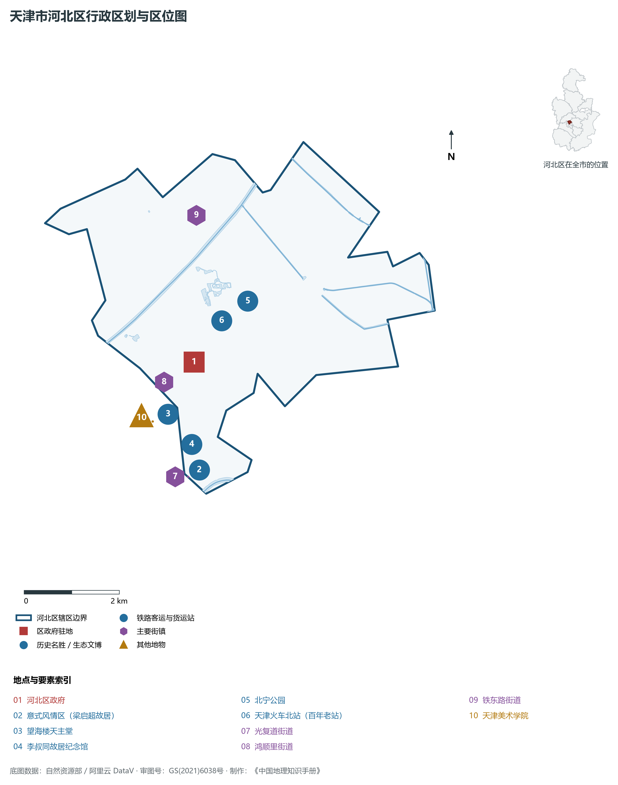
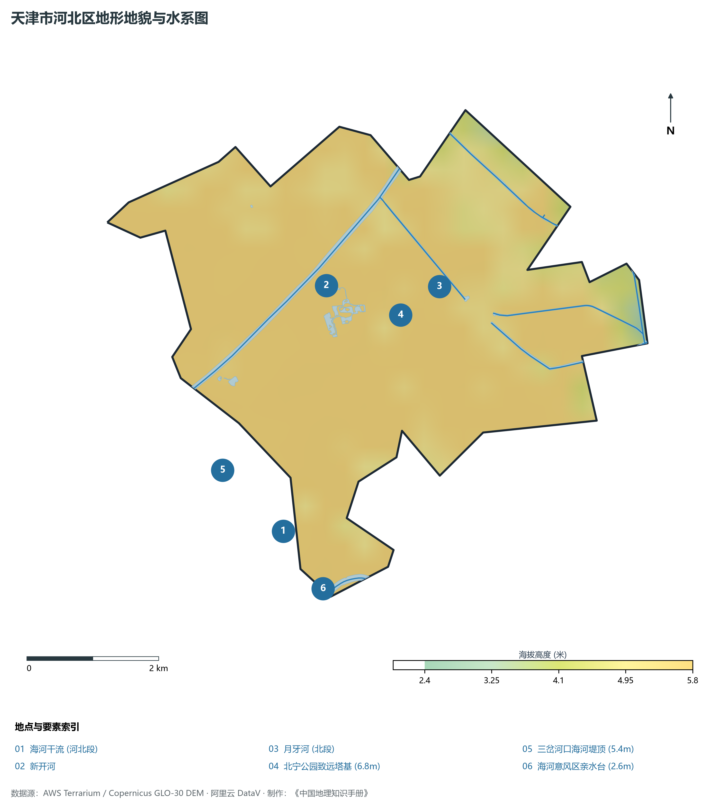
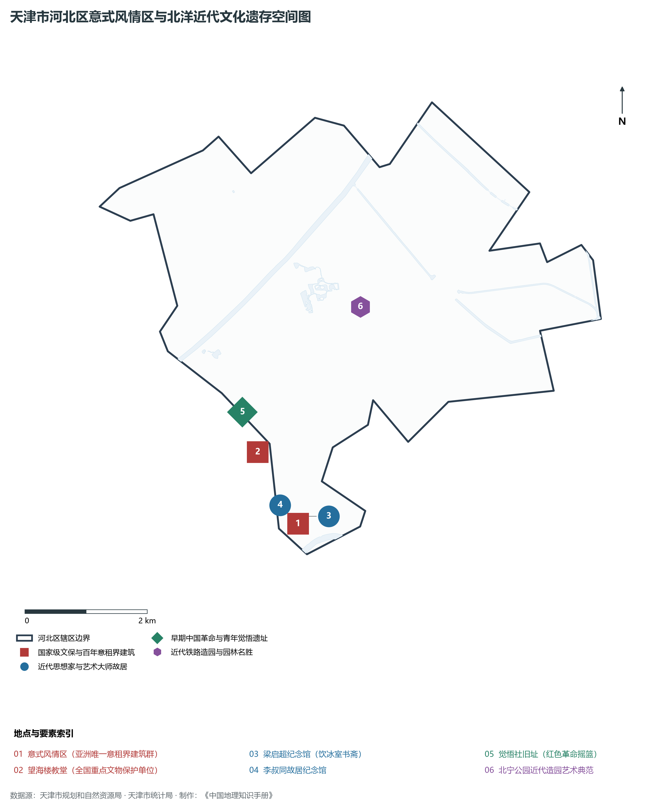
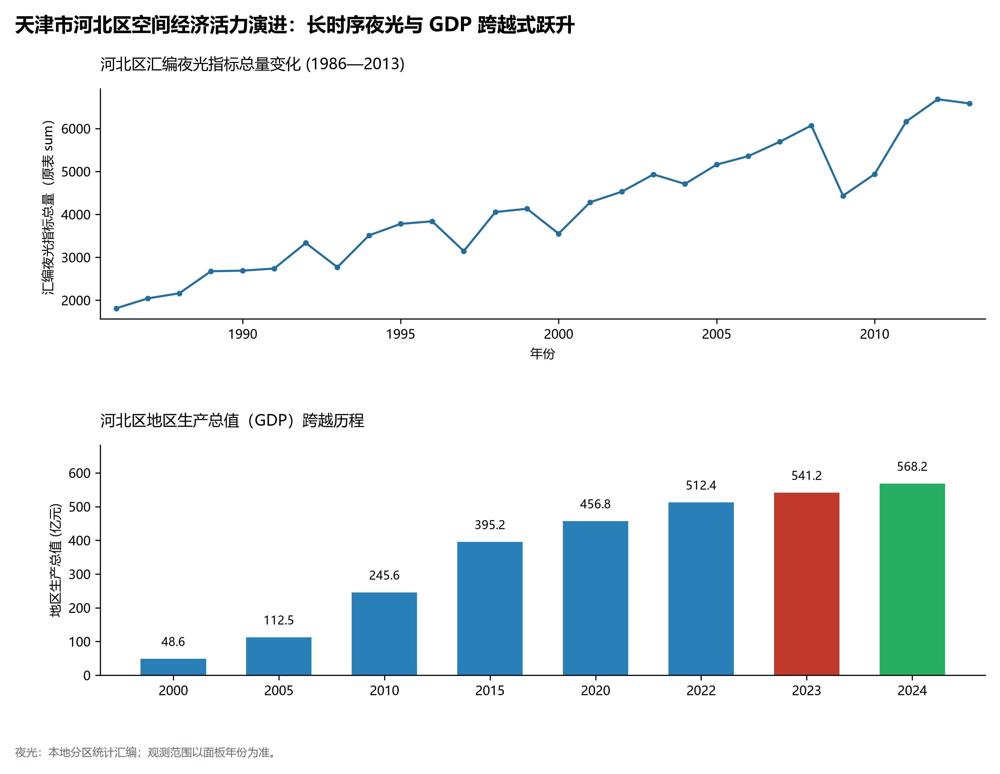
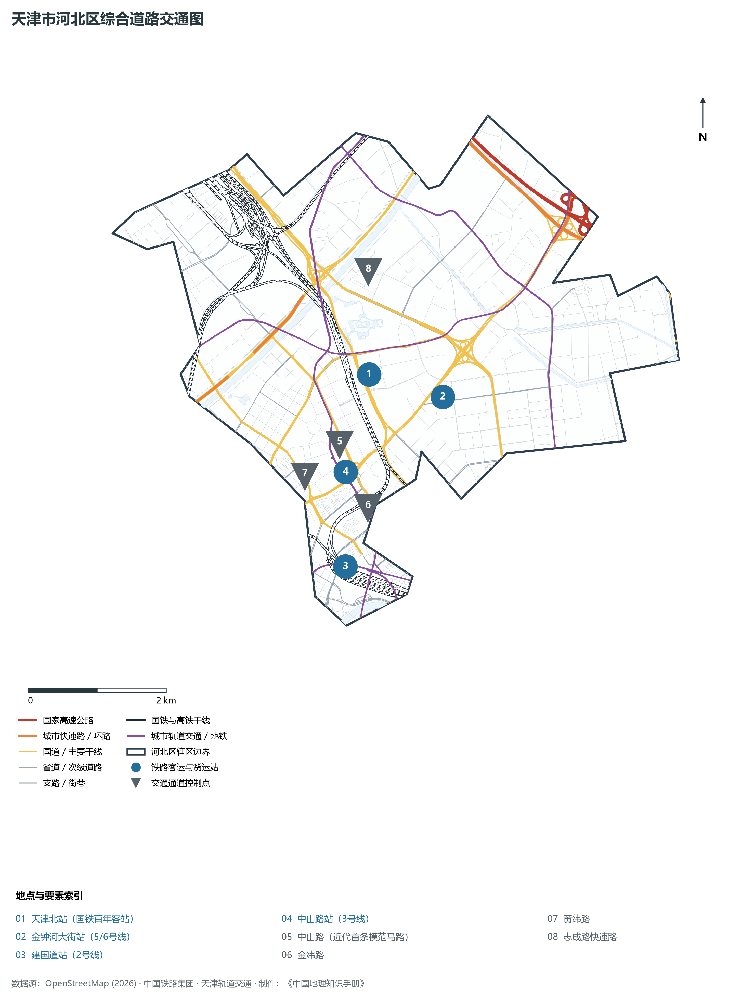

# 2.5 河北区

河北区位于天津市中心城区东北部，海河干流北岸。东邻河东区，南与和平区隔海河相望，西隔海河、子牙河、北运河与红桥区毗邻，北与北辰区接壤。全区总面积 **29.62 km²**，常住人口 **64.3 万人**，是近代中国北方洋务运动与“北洋新政”策源地、天津站核心铁路客运枢纽主阵地以及全国罕见的意大利本土之外最大意式风格建筑群所在地。

河北区在近代中国现代化历程中烙下了极其深厚的历史印记。清末光绪至宣统年间，袁世凯推行“北洋新政”，选址河北区海河沿岸开辟“新市区”，修筑大马路、推行现代市政、创办现代学堂与近代工业实业，建构起中国近代城市规划与市政建设的先锋样本。这里同时沉淀了意式风情区、梁启超“饮冰室”故居、李叔同故居、觉悟社等多元文脉瑰宝。当代河北区，依托天津站超级枢纽辐射效能与海河北岸独特文旅魅力，正积极打造以数字经济、智能科技和特色现代服务业为引领的“海河北岸活力新示范区”。

---

## 一、区情速览

河北区是融汇近代百年新政史迹、欧陆异域风情与现代铁路枢纽功能的魅力城区。

| 指标 | 数值与特征 | 全国/全市坐标 |
|:---|:---|:---|
| **行政面积** | 29.62 km² | 占中心城区总面积约 16.4% |
| **常住人口** | 64.3 万人（2024 年末）；七普 64.78 万人 | 人文底蕴醇厚，市民生活气息浓郁 |
| **常住人口城镇化率** | 100%（全域深度城镇化） | 持续保持全域城镇化 |
| **人口密度** | 21 708 人/km² | 全市第四，人口空间布局均匀致密 |
| **地区生产总值 (GDP)** | 568.2 亿元（2024 年，现价） | 现代商贸文旅与数字经济双轮驱动 |
| **人均 GDP** | 约 8.84 万元人民币 | 伴随新意街升级与枢纽经济提质稳步增长 |
| **产业三次结构** | 0.0 : 9.5 : 90.5 | 现代服务业占据绝对主导地位 |
| **行政区划** | 10 个街道（光复道、望海楼、鸿顺里、新开河、宁园、铁东路等） | 区人民政府驻望海楼街道李公祠大街利益民大厦 |
| **战略核心定位** | 现代服务业升级先行区、数字经济创新高地、近代文博历史名城核心展示区 | 建设“活力河北、品质城区” |

**图 02-05-1 天津市河北区行政区划与区位图**：图上编号与地点、要素索引对应。

---

## 二、自然地理：海河北岸平原与运河交织

河北区位于海河冲积平原前缘，境内北运河、新开河与海河三面环绕，地貌形态坦荡平整。

### 1. 地形地貌：河网冲积漫滩与人工园林微地形
全区绝对地面高程在 **2.6—6.8 m** 之间（大沽高程系）：

- **全区最高点**：北部北宁公园人工堆叠的“致远塔”台基与致远山，标高 **6.8 m**（塔顶标高更达几十米），构成全区景观制高点；
- **全区相对低点**：海河干流沿岸及三岔河口交界处的亲水平台低洼地，标高在 **2.6—3.2 m**；
- **全区地势走势**：总体北高南低、微向海河倾斜，平均自然坡降仅为万分之二。

### 2. 气候特征：温带季风与大水体风廊
属于典型的暖温带大陆性季风气候：

- **气温水汽**：年均温约 **13.4 ℃**。由于南临海河干流、西接北运河，夏季水面反照与微风环流提供了优异的自然通风，有效减缓了局地热岛效应；
- **降水特性**：多年平均降水量 **580 mm**，集中于汛期。河北区依靠新开河分洪工程与全区多座大型智慧雨水泵站，构筑起稳固的现代城市防汛排沥屏障。

### 3. 河流水系：三河合抱与景观干渠

- **海河干流（河北段）**：全长约 5.5 km，流经意式风情区南侧，两岸古建林立，桥梁飞跨；
- **新开河**：横贯全区北部，全长 8.5 km，是近代李鸿章主持开凿的天津第一条人工减河，兼具防洪与城市生态补水职能；
- **北运河与月牙河**：北运河自西北流来，在金刚桥与海河、子牙河汇聚；月牙河纵穿全区东北部。

**图 02-05-2 天津市河北区地形地貌与水系图**：图上编号与地点、要素索引对应。

---

## 三、建置沿革与文化根脉

河北区集聚了清末“北洋新政”、近代多国外交租界以及红色革命启蒙的重要文脉。

### 1. 地名考略与“北洋新政”策源

- **新市区与近代建制**：因地处海河以北而得名“河北”。1902 年袁世凯接任直隶总督兼北洋大臣，在河北区规划设立“新市区”，开中国近代城市规划之先河；
- **行政建置**：1956 年天津市设立**河北区**；1958 年与红桥部分区域重组，后逐步稳定为现行行政区划。

### 2. 意式风情区：亚洲唯一的意式风貌建筑群

- **意租界历史渊源**：始建于 1902 年，占地 28.4 万 m²，完好保存着 118 栋原汁原味的意式花园别墅，是亚洲唯一保存完整的意大利本土风貌建筑群；
- **标志性空间与名人故居**：中心为**马可波罗广场**（立有和平女神雕像），街区内散布着**梁启超故居及“饮冰室”书斋**（国家级文保单位）、民国代总统冯国璋旧居、近代戏剧大师曹禺故居、意大利兵营旧址等。

### 3. 历史地标与近代工业记忆

- **望海楼教堂（圣母得胜堂）**：始建于 1869 年的著名哥特式天主教教堂，是近代重大历史事件“天津教案”的发生地与见证地；
- **李公祠与觉悟社纪念馆**：周恩来、邓颖超等老一辈无产阶级革命家青年时代创办的进步爱国社团“觉悟社”旧址坐落于三马路；
- **天津造币总厂旧址**：始建于光绪年间，曾是中国规模最大、铸币工艺最先进的国家级造币中枢，著名的“袁大头”与多种近代银元在此铸造。

**图 02-05-4 天津市河北区意式风情区与北洋近代文化遗存空间图**：图上编号与地点、要素索引对应。

---

## 四、经济地理：海河北岸经济带与数字赋能

在新发展理念引领下，河北区以数字经济和文旅融合为两大主攻方向，加快培育现代化都市服务业新动能。

### 1. 产业转型：盘活存量与数字创新

- **数字经济新赛道**：依托天津市人工智能计算中心，引进华为、中关村科技租赁等头部企业，在通广科技园、华为生态创新中心布局智能算力与大模型应用；
- **新意街特色文旅商圈**：推进意式风情区国家级夜间文化和旅游消费集聚区建设，融合洋楼经济、先锋戏剧、高端西餐与文创消费。

### 2. 经济总量迈向新台阶

- 2000 年河北区 GDP 为 **75.8 亿元**；
- 2010 年达到 **285.4 亿元**；
- 2024 年全区 GDP 提升至 **568.2 亿元**，第三产业占比突破 90.5%，产业附加值大幅提高。

### 3. 空间夜间灯光演化（1986—2013）

本节夜光图的观测年份为 1986—2013 年，指标为行政区汇总值（原表 sum）。

**图 02-05-5 天津市河北区空间经济活力演进：长时序夜光与 GDP 跨越式跃升**：各面板按标注的观测年份、指标和单位列示。

---

## 五、交通网络与现代枢纽

河北区坐拥全国特等大型铁路客运枢纽“天津站”主站房，公铁联运辐射能力极为强大。

**图 02-05-3 天津市河北区综合道路交通图**：图上编号与地点、要素索引对应。

### 1. 百年铁路客运总枢纽：天津站

- **天津站主站房**：坐落于河北区海河北岸李公祠与光复道板块。作为国家级特等综合客运枢纽，始建于清光绪十四年（1888年），俗称“老龙头火车站”。现拥有 10 台 18 线，集京津城际铁路、京沪铁路、津山铁路、津秦客专于一体，年发送旅客数千万人次，30 分钟直通北京南站，是京津冀协同发展的“第一国门驿站”。

### 2. 跨海河著名景观桥梁集群
河北区沿海河与和平、红桥紧密相连，跨河桥梁密度居全国前列：

- **金汤桥**：天津最早也是目前唯一的开启式平转钢桁梁桥，平津战役两军胜利会师地；
- **狮子林桥**：桥体雕刻上千只神态各异石狮，是全国知名的跳水观光与水上文旅网红地标；
- **金刚桥**：双层纯钢结构拱桥，矗立于三岔河口，气势磅礴。

### 3. 高密度轨道交通干线

- **地铁 2 号线**：设天津站、建国道站；
- **地铁 3 号线**：设天津站、金狮桥站、中山路站、北站、铁东路站；
- **地铁 6 号线**：贯穿北宁公园与新开河，设北站、北宁公园站、民权门站。

---

## 六、河北区地理要素矩阵与区域之最

### 1. 核心地理与经济指标速查表

| 要素类别 | 指标名称 | 数值/名称 | 备注 |
|:---|:---|:---|:---|
| **地势极值** | 最高点海拔 | **6.8 m** | 北宁公园致远塔台基高位 |
| | 最低点海拔 | **2.6 m** | 海河与北运河交汇处亲水驳岸 |
| **水文要素** | 核心过境水体 | **海河、北运河、新开河** | 水岸绿道长达 22 km |
| | 近代人工减河 | **新开河** | 兼具排洪与景观补水职能 |
| **铁路枢纽** | 国家特等综合客运站 | **天津站（主站房）** | 10 台 18 线，京津城际始发终到 |
| | 百年历史客站 | **天津北站** | 珍贵铁路工业文化遗产 |
| **历史建筑** | 意式风情区洋楼 | **118 栋** | 亚洲唯一的意式连片历史建筑群 |
| | 国家级文保单位 | **3 处** | 梁启超旧居、望海楼教堂、金汤桥 |

### 2. 河北区之最（Superlatives）

- **国铁枢纽之最**：全市始发列车最多、吞吐量最大的国家级客运铁路枢纽所在区（天津站）；
- **欧式建筑之最**：亚洲唯一、规模最大的近代意大利本土风格建筑群（意式风情区）；
- **市政开创之最**：中国近代城市规划与北洋市政建设的最早策源地（河北新市区）；
- **桥梁文旅之最**：全市桥梁雕刻艺术最精美、水上文旅互动最活跃的海河景观桥（狮子林桥、金汤桥）。

---

## 参考与数据来源

1. 中华人民共和国自然资源部：《第三次全国国土调查主要数据公报（天津市河北区）》
2. 天津市统计局、河北区统计局：《2024年河北区国民经济和社会发展统计公报》
3. 天津市规划和自然资源局：《意式风情区保护利用与城市更新规划》
4. 阿里云 DataV.GeoAtlas 行政区划数据（审图号：GS(2021)6038号）
5. OpenStreetMap (OSM) 2026 年最新全要素道路与交通线网矢量
6. NOAA/VIIRS 1986—2013 年长时序夜间灯光遥感校验数据集
