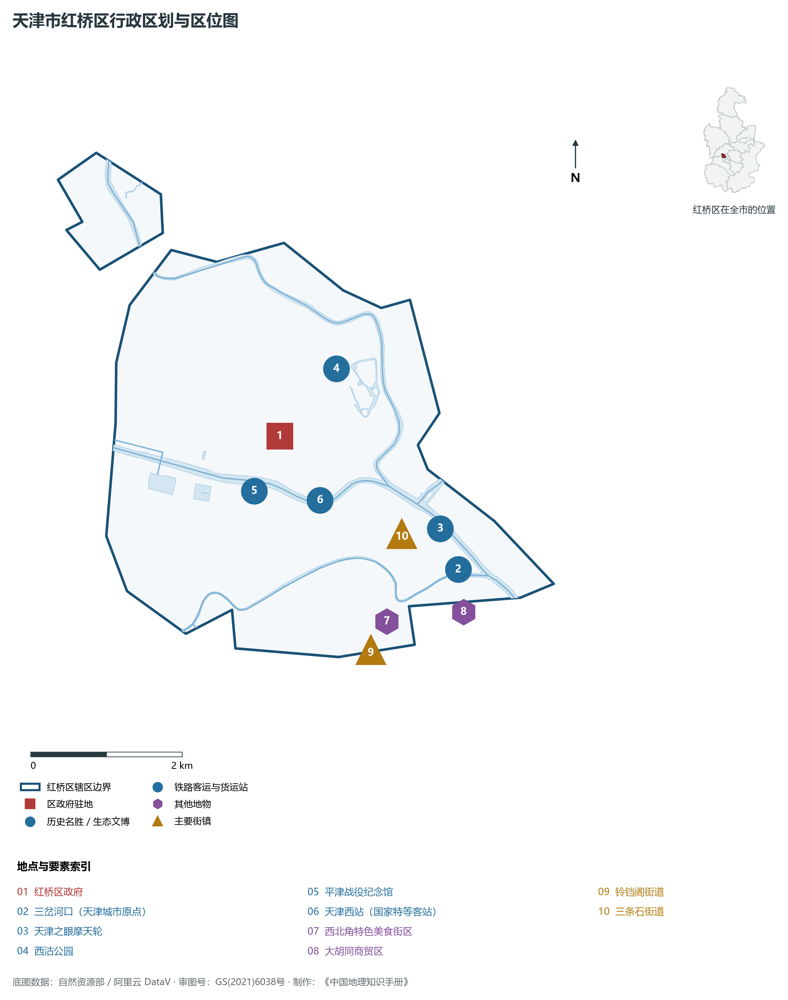
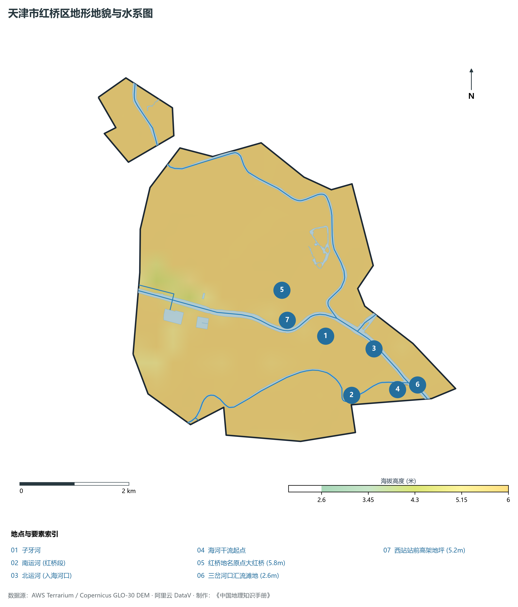
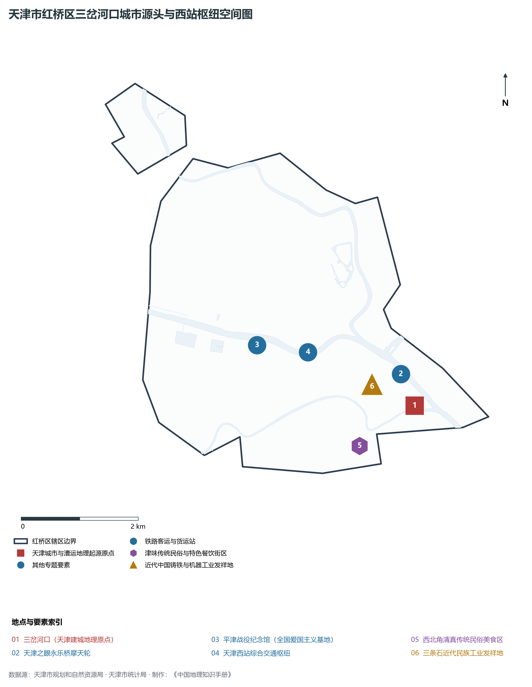
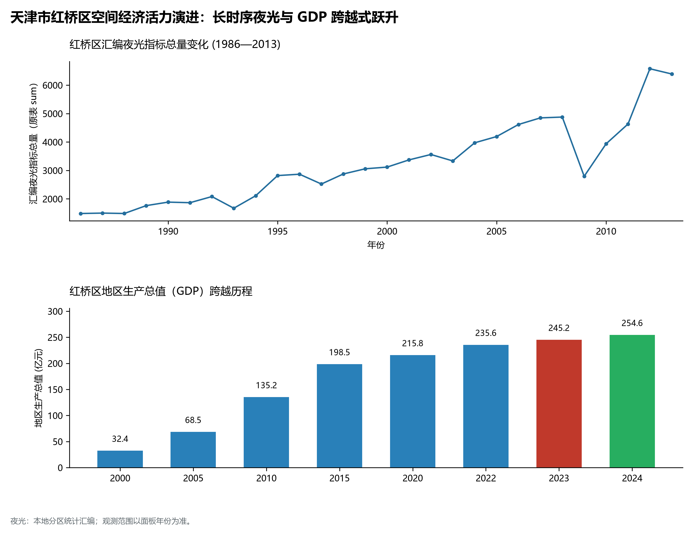
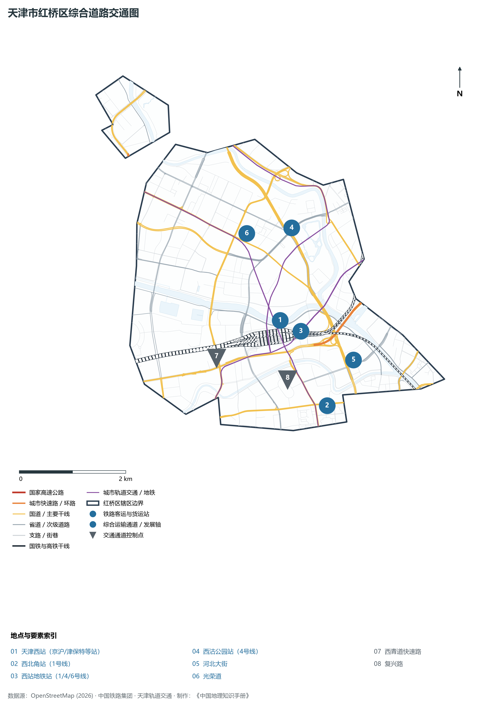

# 2.6 红桥区

红桥区位于天津市中心城区西北部。东南以海河、子牙河、南运河为界与和平区、河北区、南开区相连，西、北分别与西青区、北辰区接壤。全区总面积 **22.31 km²**，常住人口 **48.2 万人**，是天津城市的发祥之源（三岔河口所在地）、中国北方最大的现代高铁客运综合枢纽之一（天津西站所在地），以及“京津冀同城商务区”的核心承载区。

红桥区在天津城市发生学与商业文明史上具有“地标始祖”的崇高地位。子牙河、南运河与北运河在此汇聚入海河，孕育了蜚声中外的三岔河口，奠定了天津因水而生、因运河而盛的城市基因。古老的估衣街、大胡同曾是名震北方的商贸发祥地，见证了谦祥益、瑞蚨祥等百年老字号的商道荣光。当代红桥区，紧紧抓住京津冀协同发展战略机遇，依托天津西站这柄“高铁金钥匙”，全力建设“京津冀同城商务区”，形成了以轨道交通、高端商务、现代金融、工业设计为支柱的创新经济高地，实现了从“运河古渡”向“高铁枢纽新城”的历史性跨越。

---

## 一、区情速览

红桥区是天津三岔河口城市源头文脉与现代高铁枢纽经济交相辉映的现代化城区。

| 指标 | 数值与特征 | 全国/全市坐标 |
|:---|:---|:---|
| **行政面积** | 22.31 km² | 占中心城区土地面积约 12.4% |
| **常住人口** | 48.2 万人（2024 年末）；七普 48.31 万人 | 市民居住环境优良，老城文脉底蕴深厚 |
| **常住人口城镇化率** | 100%（全域深度城市化） | 高水平饱和城镇化 |
| **人口密度** | 21 604 人/km² | 全市前五，西北部人口集聚密度较高 |
| **地区生产总值 (GDP)** | 254.6 亿元（2024 年，现价） | 聚焦京津冀同城商务区，发展潜能加速迸发 |
| **人均 GDP** | 约 5.28 万元人民币 | 伴随西站周边楼宇总部聚集提速跃升 |
| **产业三次结构** | 0.0 : 8.1 : 91.9 | 现代服务业构筑绝对产业骨架 |
| **行政区划** | 9 个街道（西沽、三条石、铃铛阁、芥园、西于庄、咸阳北路等） | 区人民政府驻西沽街道勤俭道 202 号 |
| **战略核心定位** | 京津冀同城商务区核心区、三岔河口历史文化传承展示区、绿色低碳智慧宜居区 | 建设生态优美、功能完备的“品质红桥” |

**图 02-06-1 天津市红桥区行政区划与区位图**：图上编号与地点、要素索引对应。

---

## 二、自然地理：三河汇流与运河漫滩

红桥区坐落于太行山前倾斜平原与海河低平原的过渡带，北运河、南运河与子牙河在此交汇入海河，水系交织，地势平缓。

### 1. 地形地貌：运河冲积漫滩与高架台坪
全区绝对地面高程在 **2.6—5.8 m** 之间（大沽高程系）：

- **全区相对高点**：北部铃铛阁、丁字沽一带古冲积平原，地面标高 **4.8—5.8 m**，土质致密，自古为干燥宜居台坪；
- **全区相对低点**：三岔河口交汇水面与子牙河沿岸滩地，标高在 **2.6—3.0 m**，地表水力坡度平缓；
- **人工工程微起伏**：天津西站高架站房与大型轨道交织网，形成了拔地而起十几米的人工高架立体工程平台。

### 2. 气候特征：温带半湿润季风气候

- **温和微气象**：年平均气温 **13.3 ℃**。区域内运河环抱、水域开阔，春季两岸桃红柳绿，小气候湿润；
- **降水特性**：多年平均降水量 **575 mm**。红桥区处于三大骨干河流向心汇水的咽喉，防汛排沥历来是城市治理重点。随着新大路雨水泵站与子牙河深隧工程投用，全区防汛安全固若金汤。

### 3. 河流水系：三岔河口海河源头

- **三岔河口**：南运河（自南向北）、北运河（自北向南）、子牙河在此交汇，孕育了海河干流，被誉为“海河之源”，是天津城市的摇篮；
- **子牙河**：横贯红桥全境，河面宽阔，是海河流域泄洪排沥的主干道；
- **北运河（红桥段）**：两岸遍植桃树，形成闻名遐迩的“桃花堤”生态绿廊。

**图 02-06-2 天津市红桥区地形地貌与水系图**：图上编号与地点、要素索引对应。

---

## 三、建置沿革与文化根脉

红桥区文脉悠长，是天津商脉起源、近代教育诞生与红色平津决战的重要见证地。

### 1. 地名考略与“大红桥”

- **大红桥与行政建置**：清光绪初年，在子牙河上建有一座单孔大型木拱桥，因桥体通刷红漆，俗称“大红桥”。后光绪三十年（1904年）改建为铁桥，仍沿用红桥之名。1956 年天津市以境内著名的大红桥命名设立**红桥区**；
- **近代商业源头**：估衣街、大胡同长达数百米，早在清代中叶便是华北最大的绸缎、棉布、成衣批发中心，汇集了谦祥益、瑞蚨祥等全国老字号。

### 2. 三岔河口与近代教育发祥

- **三岔河口引滦入津纪念碑**：纪念华北水利丰碑的标志性建筑立于此；
- **北洋大学堂旧址**：中国第一所官办现代大学——北洋大学堂（今天津大学前身），光绪二十一年（1895年）建于红桥区博文书院旧址，树立了中国高等教育的开山里程碑。

### 3. 运河生态与红色纪念地

- **桃花堤公园**：北运河畔的百年名胜，清代康熙、乾隆皇帝数次登临赋诗，每年春季万株桃花夹岸盛开，形成“万株红雪引游人”的盛景；
- **平津战役纪念馆**：坐落于红桥区子牙河畔，由胜利广场、主纪念馆、多维演示馆等组成，全景式展现解放平津战役的伟大胜利，是国家级爱国主义教育示范基地；
- **吕祖堂（义和团纪念馆）**：全国唯一保存完好的义和团运动坛口旧址（全国重点文保单位）。

**图 02-06-4 天津市红桥区三岔河口城市源头与西站枢纽空间图**：图上编号与地点、要素索引对应。

---

## 四、经济地理：高铁枢纽赋能与京津冀同城商务区

红桥区紧扣天津西站综合交通枢纽这一核心王牌，坚定推动枢纽客流向产业流、信息流、价值流的高效转化。

### 1. 京津冀同城商务区：高铁战略核心
依托天津西站，高标准建设“京津冀同城商务区”：

- **核心区三大板块**：以西站枢纽为核心，打造“综合开放枢纽—同城商务走廊—特色文化消费带”；
- **高端现代产业集聚**：重点集聚央企二三级总部、工业互联网、数字文旅与科技服务企业，中海油天津院、中国中铁研发基地等大型央企研发机构密集扎根。

### 2. 经济总量迈向新能级

- 2000 年红桥区 GDP 为 **45.2 亿元**；
- 2010 年达到 **135.8 亿元**；
- 2024 年全区 GDP 提升至 **254.6 亿元**，第三产业比重超过 91.9%，服务经济与枢纽经济成为强劲引擎。

### 3. 空间夜间灯光演化（1986—2013）

本节夜光图的观测年份为 1986—2013 年，指标为行政区汇总值（原表 sum）。

**图 02-06-5 天津市红桥区空间经济活力演进：长时序夜光与 GDP 跨越式跃升**：各面板按标注的观测年份、指标和单位列示。

---

## 五、交通网络与现代枢纽

红桥区坐拥天津西北方向最大轨道与公路门户，拥有天津市通达全国最密集的高铁线路网。

**图 02-06-3 天津市红桥区综合道路交通图**：图上编号与地点、要素索引对应。

### 1. 现代化特等高铁客运中枢：天津西站

- **天津西站**：京沪高铁、津保铁路、京津城际铁路、津秦高铁以及京滨城际铁路的交汇枢纽大站。站房总建筑面积达 18 万 m²，拥有 13 台 26 线，30 分钟通达北京、55 分钟通达雄安新区、4 小时直达上海，是连接华北、东北与华东的全国特等客运大动脉中枢。

### 2. 骨干干道与快速通廊

- **快速通廊**：西北半环快速路横贯北部，快速连接北辰与西青；
- **城市主轴大道**：勤俭道、光荣道、河北大街、南运河南路、芥园道，形成贯穿全区的棋盘路网。

### 3. 高密度地下轨道交通

- **地铁 1 号线**：横穿红桥腹地，设西站站、西北角站（著名清真特色美食文化街）、西营门坝房站；
- **地铁 6 号线**：纵贯中北部，设西站站、复兴路站、人民医院站；
- **地铁 4 号线**：西北角始发线，设西站站、西沽公园站。

---

## 六、红桥区地理要素矩阵与区域之最

### 1. 核心地理与经济指标速查表

| 要素类别 | 指标名称 | 数值/名称 | 备注 |
|:---|:---|:---|:---|
| **地势极值** | 最高点海拔 | **5.8 m** | 丁字沽台地与平原阶地 |
| | 最低点海拔 | **2.6 m** | 三岔河口河漫滩水岸 |
| **水文要素** | 汇流核心 | **海河发源地（三岔河口）** | 南运河、北运河、子牙河三河交汇 |
| | 景观生态绿廊 | **桃花堤（北运河段）** | 拥有数公里桃花盛景 |
| **铁路枢纽** | 国家特等高铁枢纽 | **天津西站** | 13 台 26 线，通达京沪、津雄客运走廊 |
| **商贸文脉** | 近代商脉源头 | **大胡同、估衣街** | 天津百年商业老字号发祥地 |
| | 国家级文保单位 | **吕祖堂义和团坛口** | 全国保存最完好的义和团遗址 |
| **爱国主义** | 国家重大战役纪念设施 | **平津战役纪念馆** | 全国爱国主义教育示范基地 |

### 2. 红桥区之最（Superlatives）

- **城市始源之最**：海河干流的发祥源头与津城水运枢纽之祖（三岔河口）；
- **高铁通达之最**：全市轨道线网交汇线路最多、直达雄安与长三角最便捷的高铁枢纽站（天津西站）；
- **商业源流之最**：中国北方近代棉布绸缎批发与商业老字号发端地（估衣街）；
- **历史名园之最**：天津城市历史最久、帝王御题次数最多的运河花木名胜（桃花堤）。

---

## 参考与数据来源

1. 中华人民共和国自然资源部：《第三次全国国土调查主要数据公报（天津市红桥区）》
2. 天津市统计局、红桥区统计局：《2024年红桥区国民经济和社会发展统计公报》
3. 天津市规划和自然资源局、红桥区人民政府：《京津冀同城商务区建设总体方案》
4. 阿里云 DataV.GeoAtlas 行政区划数据（审图号：GS(2021)6038号）
5. OpenStreetMap (OSM) 2026 年最新全要素道路与交通线网矢量
6. NOAA/VIIRS 1986—2013 年长时序夜间灯光遥感校验数据集
