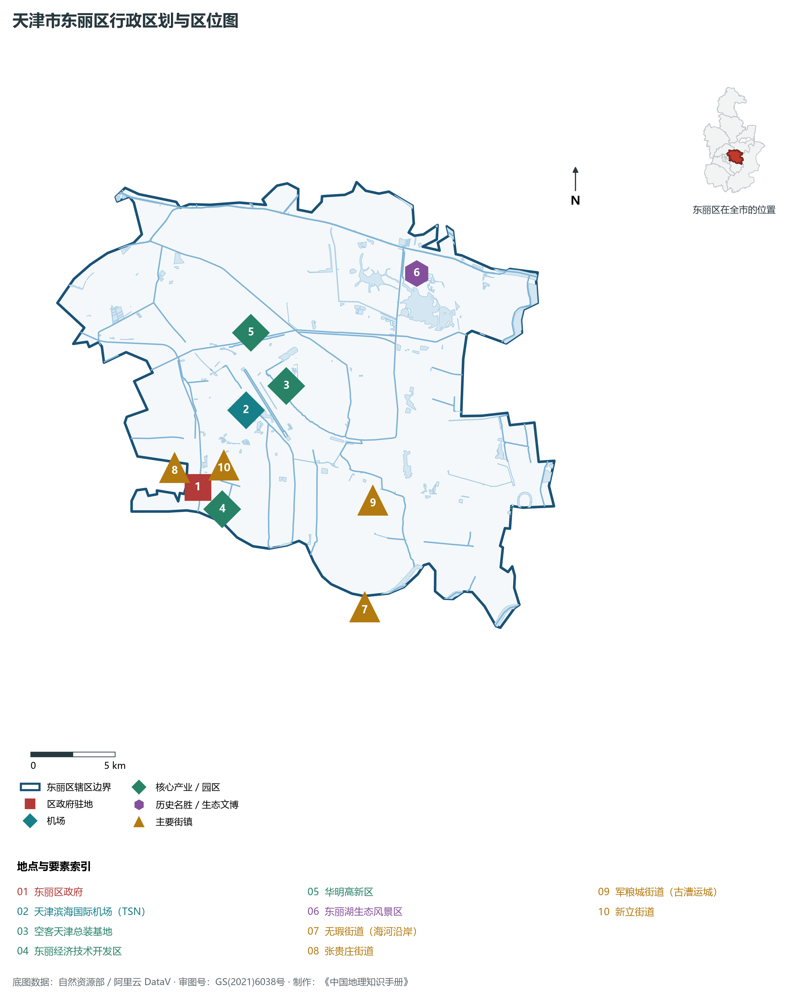
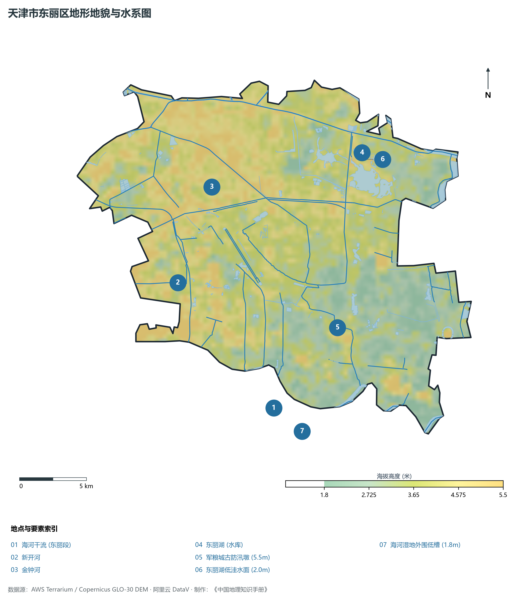
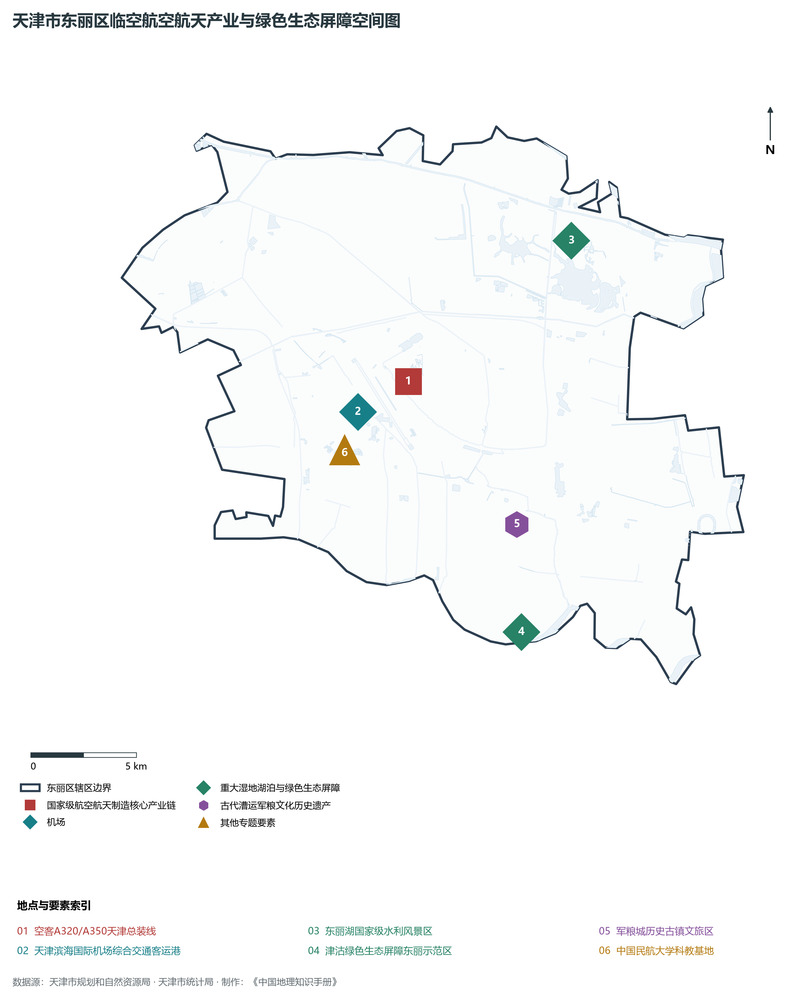
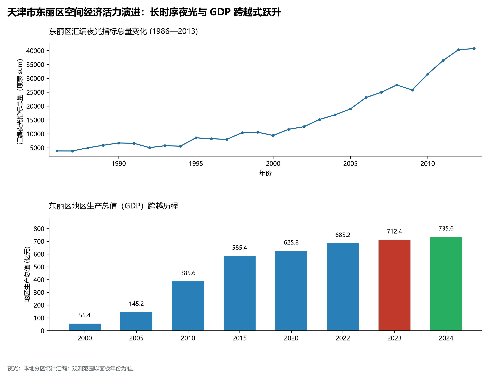
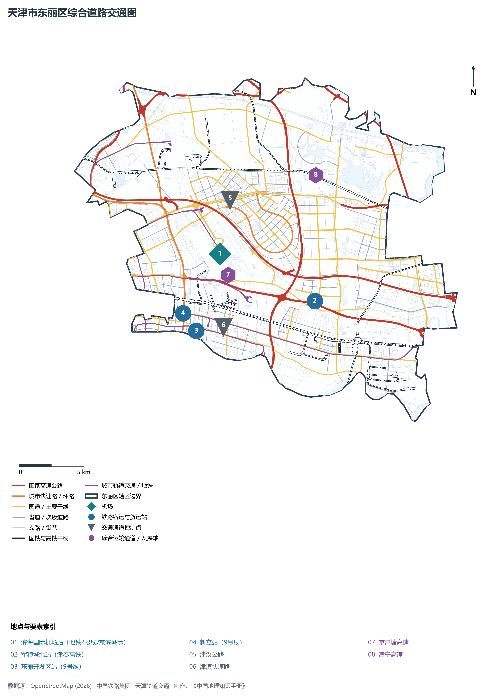

# 2.7 东丽区

东丽区位于天津市中心城区东北部至东部，地处津城与滨城相向发展的黄金走廊核心。西与河东区、河北区相连，南隔海河与津南区相望，东与滨海新区腹地紧密相依，北接北辰区与宁河区。全区总面积 **477.34 km²**，常住人口 **86.8 万人**，是天津滨海国际机场所在地、国家级航空物流与先进制造基地，以及拥有东丽湖国家级生态度假区的现代临空新城。

东丽区在天津城市发展史上兼具漕运兵饷要隘与近代工业拓展基地的双重角色。境内的军粮城自唐天宝年间即为北方抵御外侮与转运官粮的天下名驿，享有“先有军粮城，后有天津卫”的历史美誉。进入新世纪以来，东丽区抓住“双城”空间重塑与临空经济腾飞的历史机遇，高标准运营北方国际航空物流中心，加速布局航空航天、汽车零部件、新材料与生物医药产业；同时筑牢生态底色，全区逾 30% 土地纳入津沽绿色生态屏障，形成了“空铁水陆四通八达、蓝绿交织城景交融”的临空经济与生态品质之区。

---

## 一、区情速览

东丽区是天津“双城”协同发展的战略支点、北方国际航空货运枢纽与临空现代产业高地。

| 指标 | 数值与特征 | 全国/全市坐标 |
|:---|:---|:---|
| **行政面积** | 477.34 km² | 占全市总面积约 4.0%，地处津滨走廊枢纽 |
| **常住人口** | 86.8 万人（2024 年末）；七普 85.70 万人 | 环城四区产业人口与临空人才集聚地 |
| **常住人口城镇化率** | 89.2% | 城市化水平与城乡融合走在全省前列 |
| **人口密度** | 1 818 人/km² | 沿津滨走廊与机场周边人口高密度集聚 |
| **地区生产总值 (GDP)** | 735.6 亿元（2024 年，现价） | 先进制造业与临空物流服务业贡献显著 |
| **人均 GDP** | 约 8.47 万元人民币 | 临空经济与高新技术产业赋能持续拉动 |
| **产业三次结构** | 0.8 : 46.5 : 52.7 | 先进制造业基础坚实，临空服务业蓬勃跃迁 |
| **行政区划** | 11 个街道（张贵庄、丰年村、万新、华明、军粮城、新立等） | 区人民政府驻张贵庄街道跃进路 38 号 |
| **战略核心定位** | 北方国际航空物流中心核心区、高端先进制造集聚区、绿港智慧生态品质之城 | 打造津滨走廊绿色发展示范区与科创新城 |

**图 02-07-1 天津市东丽区行政区划与区位图**：图上编号与地点、要素索引对应。

---

## 二、自然地理：滨海倾斜平原与湿地洼淀

东丽区地质构造属于黄骅坳陷西部斜坡，全境位于海河与蓟运河下游冲积海积平原，地貌起伏微小，由西北向东南平缓过渡。

### 1. 地形地貌：海积平原与天然贝壳沙堤残迹
全区绝对地面高程在 **1.8—4.5 m** 之间（大沽高程系）：

- **全区相对高点**：北部邻近北辰、金钟河一带古天然堤高岗，地面标高 **3.8—4.5 m**；
- **全区相对低点**：南部邻近海河低洼洼淀及东部荒水洼湿地，标高在 **1.8—2.4 m**，地下潜水位浅，部分区域原为滨海轻度盐渍化土壤；
- **机场净空平原**：滨海国际机场坐落于全区中心腹地，万亩净空保护区内平坦如砥，是建设大型国际航空枢纽的绝佳地理基底。

### 2. 气候特征：暖温带滨海大陆性气候

- **气温水汽**：年平均气温 **13.1 ℃**。临近渤海湾受海陆风环流影响，春季回暖快、空气对流强；夏季降水充沛，受东丽湖万亩大水面蒸腾调节，局部湿度适宜；
- **降水时空**：多年平均降水量 **575 mm**，降水集中于 7、8 月。区域内建有金钟河、新开河、海河东丽段防汛调蓄干渠，防洪排沥网络健全。

### 3. 河流水系：三水横贯与万亩湖泊

- **海河干流（东丽段）**：全区南部边界河流，长达 20 余公里，水阔流缓，两岸构筑了大规模海河生态绿道与绿化屏障；
- **金钟河与新开河**：横贯北部，承担蓟运河与北运河水系的排洪减灾任务；
- **东丽湖（丽湖湿地）**：全区最大的人工水库与生态湖泊，水面面积达 8 km²，蓄水量逾 2 200 万 m³，常年栖息红嘴鸥、白鹭等珍稀水鸟数十种，被誉为“北方湿地明珠”。

**图 02-07-2 天津市东丽区地形地貌与水系图**：图上编号与地点、要素索引对应。

---

## 三、建置沿革与文化根脉

东丽区拥有上千年的军饷漕运与北方海防文化积累，是中国近代工业拓展与民航事业的摇篮。

### 1. 地名考略与“先有军粮城”

- **军粮城历史源远**：唐天宝八载（749年），幽州节度使在今东丽区境内设“军粮城”，作为北方屯兵积粮与海运漕饷转运的总中枢，其建制比明代天津卫早近七百年，故在津沽大地享有“先有军粮城，后有天津卫”的著名历史断语；
- **行政建制演进**：1953 年建东郊区；1992 年撤销东郊区，取“日出东方、丽日繁华”之意正式设立**东丽区**。

### 2. 军粮城古驿与海防漕运文化

- **军粮城遗址与文脉**：古军粮城是海上丝绸之路与北方大运河漕运交接的重要历史见证，出土了大量唐宋时期的粮仓地基砖瓦、古航道木桩与陶瓷器具，实证了唐宋帝国对北方边疆经略的后勤生命线；
- **大韩庄东丽烈士陵园**：缅怀解放天津战役中强渡海河英勇牺牲革命先烈的爱国主义纪念圣地。

### 3. 中国民航高等学府与航空航天文化

- **中国民航大学**：坐落于东丽区张贵庄，是经中国民用航空局直属的全国唯一民航全学科特色高等学府，建校 70 余年来为中国民航工业培养了过半的高级飞行、机务与空管专门人才；
- **空客 A320 航空配套区**：毗邻机场布局空客亚洲总装线配套产业园，成为中国与欧洲高科技工业合作的璀璨国家名片。

**图 02-07-4 天津市东丽区临空航空航天产业与绿色生态屏障空间图**：图上编号与地点、要素索引对应。

---

## 四、经济地理：航空城腾飞与先进制造业集聚

东丽区围绕“一基地三区”建设要求，坚持工业立区、科技强区，构建以航空航天、高端装备、新能源新材料和临空服务为主导的高能级产业集群。

### 1. 产业布局：空港领航与园区支撑

- **空港经济区与航空航天城**：以空客 A320/A350 系列飞机总装线为链主，集聚庞巴迪、古德里奇、中航直升机等航空制造与维修企业 200 余家，形成全球第三条单通道客机总装链条；
- **东丽经济技术开发区与华明高新区**：重点发展新能源汽车核心零部件、高端医疗器械与新一代信息技术，集聚平高智能电气、爱思达航天等专精特新“小巨人”企业。

### 2. 经济总量跨越与产业高质化

- 2000 年东丽区 GDP 为 **58.5 亿元**；
- 2010 年增长至 **320.2 亿元**；
- 2024 年全区 GDP 跃升至 **735.6 亿元**，规模以上工业总产值突破千亿元大关，成为天津实体经济与先进制造研发的重要承载极。

### 3. 空间夜间灯光演化（1986—2013）

本节夜光图的观测年份为 1986—2013 年，指标为行政区汇总值（原表 sum）。

**图 02-07-5 天津市东丽区空间经济活力演进：长时序夜光与 GDP 跨越式跃升**：各面板按标注的观测年份、指标和单位列示。

---

## 五、交通网络与现代枢纽

东丽区坐拥天津唯一的国际干线机场，享有“一港双铁多高快速”的立体化综合交通体系。

**图 02-07-3 天津市东丽区综合道路交通图**：图上编号与地点、要素索引对应。

### 1. 国际大型航空客货超级枢纽：滨海国际机场

- **天津滨海国际机场**：拥有两条 3 600 米高等级跑道（4E/4F 级），T1 国际航站楼、T2 国内航站楼总面积逾 36 万 m²。2024 年年旅客吞吐量突破 2 500 万人次，货邮吞吐量稳居北方前列，是中国重要的航空货运中心与国际定期客运大口岸。

### 2. 高铁客运站与骨干公路网

- **军粮城北站**：津滨城际铁路重要经停站，15 分钟通达天津站、10 分钟直达滨海新区于家堡金融区；
- **高快速公路大动脉**：京津塘高速（中国第一条跨省市高等级高速公路）、津宁高速、津滨高速、外环东路，构成全方位通达京津冀的公路网。

### 3. 空铁联运地下轨道交通

- **地铁 2 号线**：直达滨海国际机场地下交通中心（交通换乘枢纽），实现航站楼、地铁与公交零距离换乘；
- **地铁 10 号线与 11 号线**：穿越东丽西部智慧新城板块，直连河东、河西与中心城区。

---

## 六、东丽区地理要素矩阵与区域之最

### 1. 核心地理与经济指标速查表

| 要素类别 | 指标名称 | 数值/名称 | 备注 |
|:---|:---|:---|:---|
| **地势极值** | 最高点海拔 | **4.5 m** | 金钟河沿岸古冲积台地 |
| | 最低点海拔 | **1.8 m** | 南部海河漫滩与荒水洼低洼地 |
| **水文要素** | 区域最大水库湿地 | **东丽湖** | 水面 8 km²，蓄水量超 2 200 万 m³ |
| | 边界大江 | **海河干流（东丽段）** | 岸线长达 20 km |
| **空港枢纽** | 国家级航空枢纽 | **天津滨海国际机场** | 双 3600 米跑道，4E/4F 级大型口岸 |
| | 基地高校 | **中国民航大学** | 中国民航专业人才最高学府 |
| **生态指标** | 绿色生态屏障占比 | **超 30%** | 全区近三分之一土地纳入一级二级生态管控 |
| **经济效益** | 2024 年地区生产总值 | **735.6 亿元** | 先进制造业与临空物流产出雄厚 |

### 2. 东丽区之最（Superlatives）

- **民航门户之最**：全市唯一国际大型干线机场与中国北方最繁忙的国际航空货运中枢（滨海国际机场）；
- **历史建制之最**：津沽平原最早有确切文献记载的唐代屯兵军运城堡名城（军粮城）；
- **生态水域之最**：全市中心城区外围离市区最近的国家级万亩温泉湿地度假湖泊（东丽湖）；
- **外资制造之最**：空客公司在欧洲本土之外建立的第一个民用飞机总装线所在地（空客A320天津总装线）。

---

## 参考与数据来源

1. 中华人民共和国自然资源部：《第三次全国国土调查主要数据公报（天津市东丽区）》
2. 天津市统计局、东丽区统计局：《2024年东丽区国民经济和社会发展统计公报》
3. 中国民用航空华北地区管理局：《天津滨海国际机场总体规划（2020年版）》
4. 阿里云 DataV.GeoAtlas 行政区划数据（审图号：GS(2021)6038号）
5. OpenStreetMap (OSM) 2026 年最新全要素道路与交通线网矢量
6. NOAA/VIIRS 1986—2013 年长时序夜间灯光遥感校验数据集
