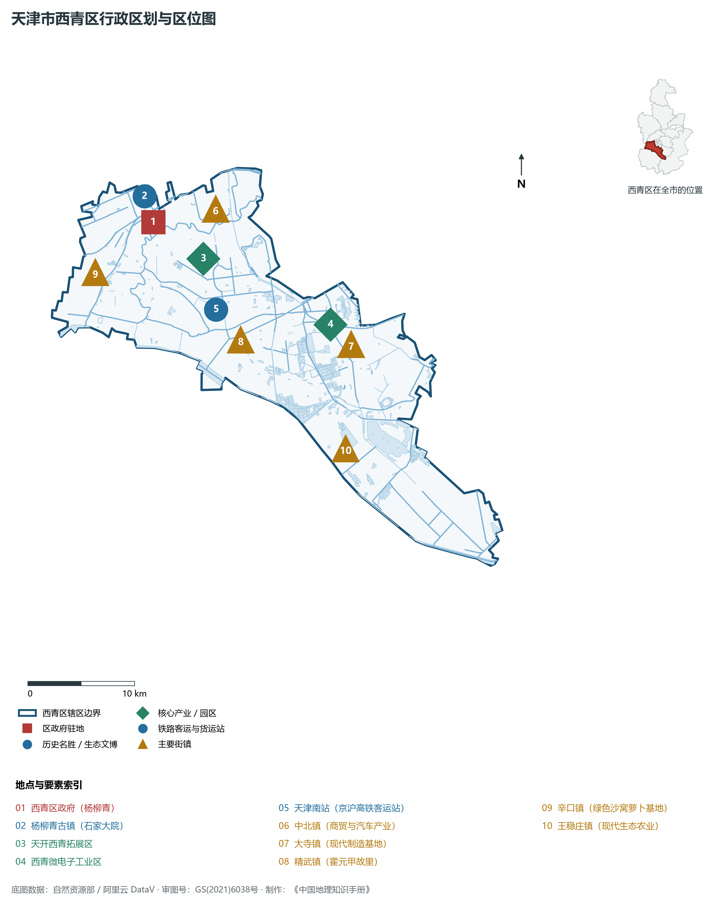
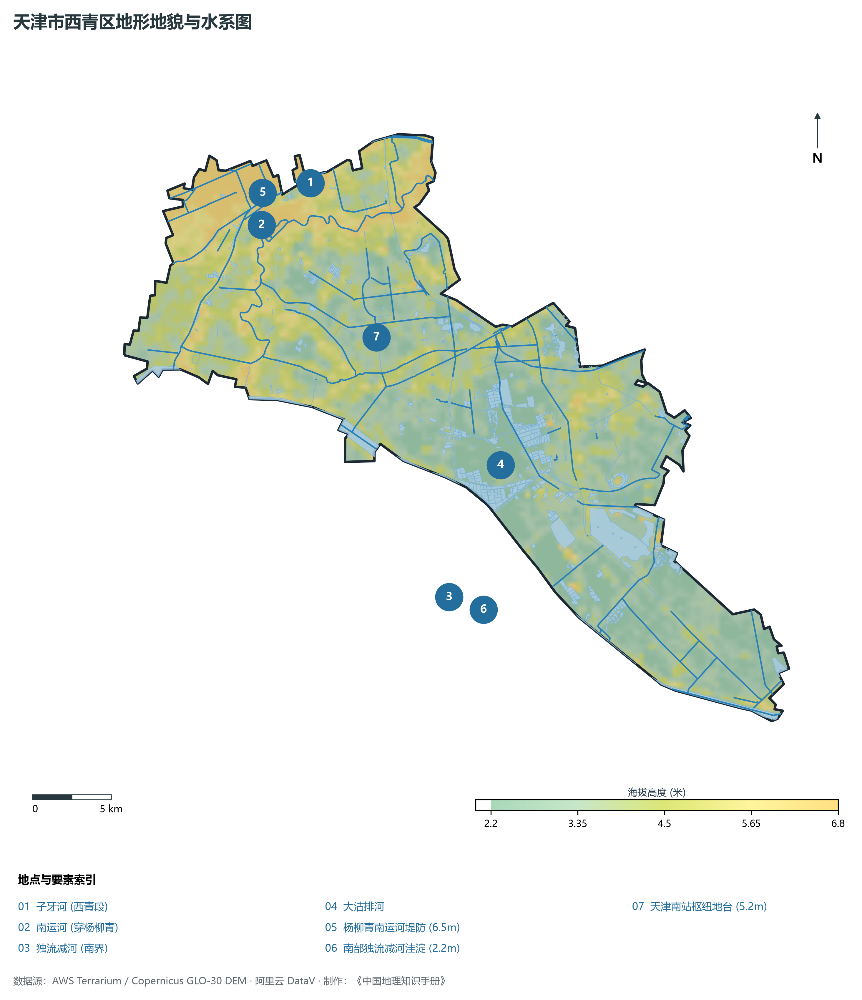
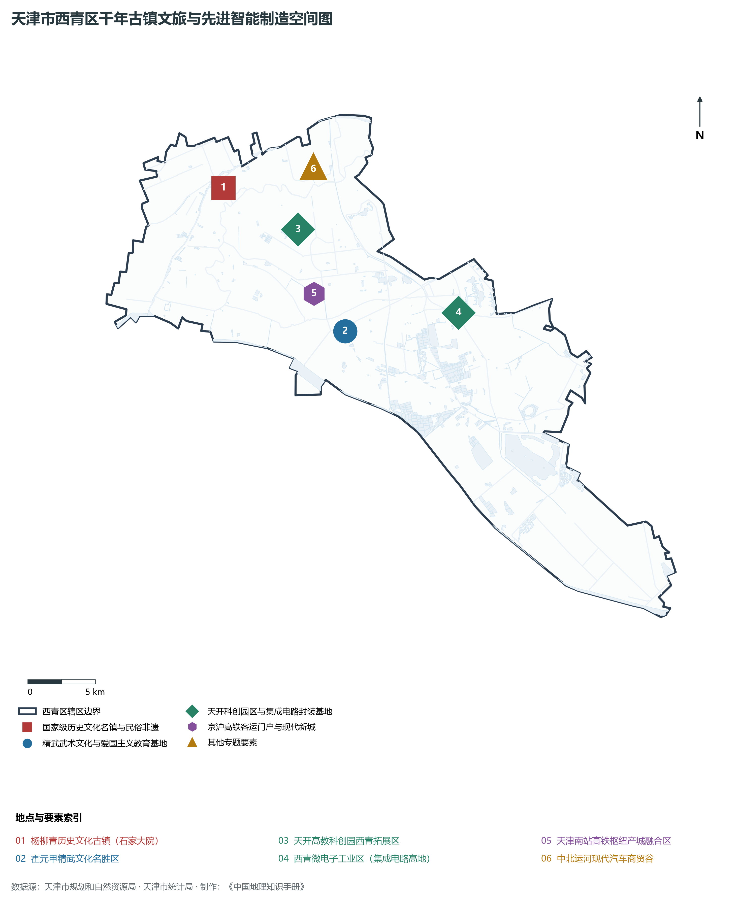
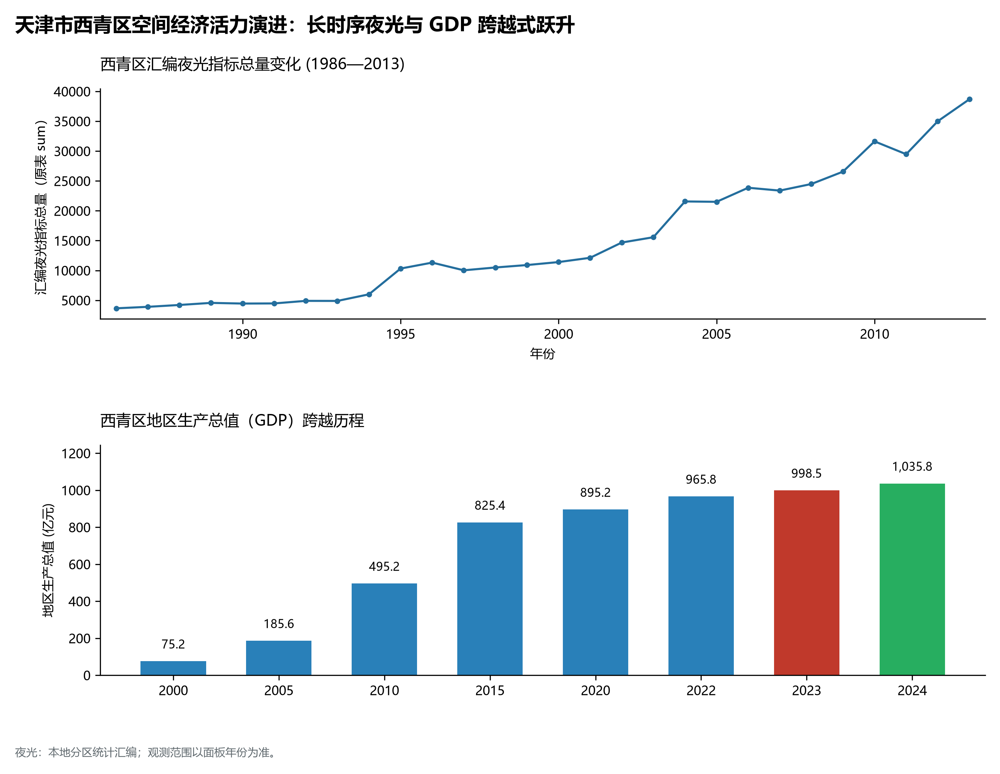
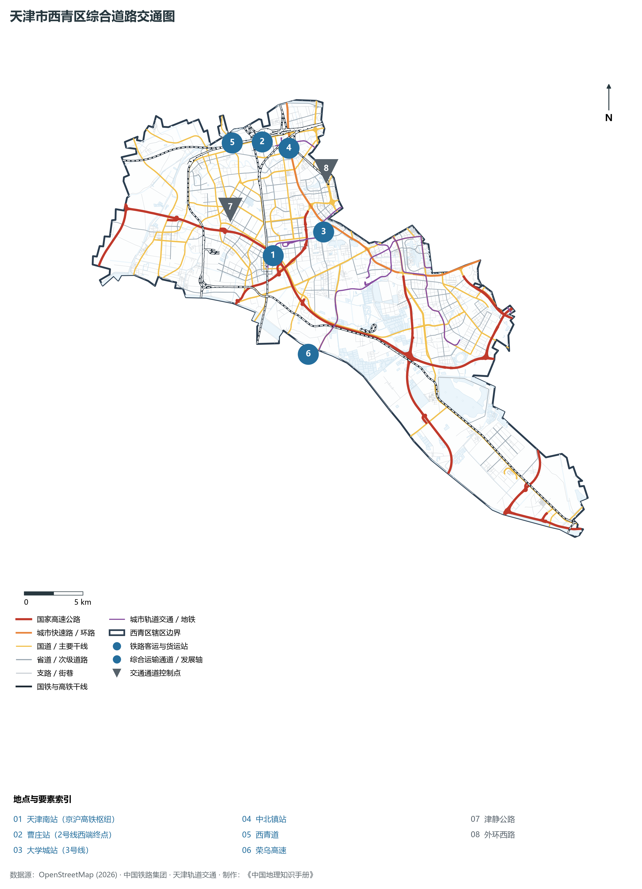

# 2.8 西青区

西青区位于天津市中心城区西南部，北依子牙河与北辰区、红桥区相依，东临南开区与河西区，东南与津南区为邻，南与静海区接壤，西与河北省霸州市、文安县毗邻。全区总面积 **562.91 km²**，常住人口 **119.5 万人**，是天津环城四区中常住人口最多、经济总量率先跨越千亿元门槛的产业经济第一强区。

西青区是运河古镇文化与近代中华武术精神的发祥圣地。千年京杭大运河穿境而过，孕育了中国四大木版年画之首的杨柳青年画，以及保存完好的北方第一晚清民间巨宅——石家大院；精武镇走出了一代爱国武术宗师霍元甲，“爱国、修身、正义、助人”的精武精神享誉海内外。进入现代，西青区作为连接雄安新区与天津主城区的关键西部门户，坐拥京沪高铁“天津南站”客运枢纽，深度融入天开高教科创园西翼拓展区，以集成电路微电子、高端汽车零部件、生物医药与新能源为代表的先进制造研发实力傲视华北，生动展现了“千年运河秀、活力新西青”的锦绣画卷。

---

## 一、区情速览

西青区是天津市先进制造业研发核心区、运河非遗文化聚集区与高铁枢纽门户区。

| 指标 | 数值与特征 | 全国/全市坐标 |
|:---|:---|:---|
| **行政面积** | 562.91 km² | 占全市总面积约 4.7%，环城西翼纵深广阔 |
| **常住人口** | 119.5 万人（2024 年末）；七普 119.51 万人 | 环城四区常住人口第一大区，年净流入居前 |
| **常住人口城镇化率** | 92.5% | 高水平城镇化，城乡统筹示范区 |
| **人口密度** | 2 123 人/km² | 中北镇、大寺镇及西青开发区人口稠密 |
| **地区生产总值 (GDP)** | 1 068.2 亿元（2024 年，现价） | 环城四区唯一突破千亿元大关的经济领头羊 |
| **人均 GDP** | 约 8.94 万元人民币 | 制造业与高新技术产业强劲支撑 |
| **产业三次结构** | 0.9 : 45.8 : 53.3 | 工业增加值雄厚，先进制造与现代服务业齐飞 |
| **行政区划** | 2 个街道、7 个镇（西营门、李七庄；杨柳青、中北、精武、大寺等） | 区人民政府驻杨柳青镇府前街 2 号 |
| **战略核心定位** | 建设千亿级制造业强区、打造京津冀同城商务新走廊、运河文化传承创新高地 | 奋力争当全市高质量发展与产城融合排头兵 |

**图 02-08-1 天津市西青区行政区划与区位图**：图上编号与地点、要素索引对应。

---

## 二、自然地理：海河中下游平原与大运河穿流

西青区地处太行山东麓冲积平原向海积平原过渡地带，全境地势坦荡，自西微向东倾斜，地貌平缓开阔。

### 1. 地形地貌：平原微起伏与古运河高亢台坪
全区绝对地面高程介于 **2.2—5.8 m** 之间（大沽高程系）：

- **全区相对高点**：西北部杨柳青镇老城区与子牙河沿岸高亢地带，地面标高 **4.8—5.8 m**，古代在此筑堤建镇，土层高爽不易积水；
- **全区相对低点**：西南部王稳庄镇与独流减河沿岸洼淀，地面原生标高仅 **2.2—2.8 m**，历史上为低洼易涝沼泽，现代经水利治理建成了万亩高标准农田与鱼塘；
- **地层土质**：广泛分布第四系深厚冲积沉积物，土层肥沃湿润，极利于耕作与城市大型工业园区基础建设。

### 2. 气候特征：暖温带季风气候与平原微气象
属于典型大陆性季风气候：

- **气温光照**：年平均气温 **13.2 ℃**，全年日照时数逾 2 600 小时，光照充沛、热量丰富；
- **降水特性**：年降水量约 **570 mm**。夏季短时强暴雨主要通过独流减河、大沽排河外排入海，构筑起稳固的水利防汛安全屏障。

### 3. 河流水系：四水并流与大运河生态绿带

- **南运河（京杭大运河西青段）**：全长约 24.5 km，由静海入境，穿过杨柳青镇流入红桥三岔河口，两岸林草丰茂，是世界文化遗产大运河的重要流经段；
- **子牙河与大清河**：自西向东横穿北部，是海河流域分洪减灾的天然干道；
- **独流减河**：横贯南部，宽阔宏伟，是天津市南部最重要的流域性防洪排涝大型人工减河。

**图 02-08-2 天津市西青区地形地貌与水系图**：图上编号与地点、要素索引对应。

---

## 三、建置沿革与文化根脉

西青区是运河古镇文化、非遗民间美术与近代中华武术文化的辉煌交汇地。

### 1. 地名考略与行政演进

- **杨柳青古镇渊源**：杨柳青自宋代见于文献，金元时期即为运河重要码头。相传宋代名将杨延昭在此屯兵植柳，春来“杨柳青青”，遂得名杨柳青；
- **行政建制**：1953 年建西郊区；1992 年更名为**西青区**，寓意“西陲热土、郁郁青青”。

### 2. 中国木版年画之乡与晚清第一宅

- **杨柳青年画（国家级首批非遗）**：中国四大木版年画之首，始于明代崇祯年间，融汇了版画刻印与工笔重彩人工手绘，形成“半印半画”的独特艺术风格，代表作《莲年有余》娃娃抱鲤鱼红遍大江南北；
- **石家大院（尊美堂，全国重点文保单位）**：始建于清光绪元年（1875年），占地 7 200 m²，拥有北方最大的民间戏楼、典型晚清三进四合套院与雕花精美砖木石雕，被专家誉为“华北第一民间宅院”。

### 3. 精武之魂：霍元甲故里与精武门

- **霍元甲故居与纪念馆**：一代爱国武术宗师霍元甲诞生于小南河村（今精武镇）。他创办“精武体育会”，以尚武精神洗雪“东亚病夫”国耻；
- **精武门·中华武林园**：融武术文化交流、实景演艺、体育赛事于一体的国家 4A 级景区，是全世界精武后人寻根谒祖的中华武林圣地。

**图 02-08-4 天津市西青区千年古镇文旅与先进智能制造空间图**：图上编号与地点、要素索引对应。

---

## 四、经济地理：千亿制造强区与现代智造高地

西青区坚定把发展经济的着力点放在实体经济上，是天津市工业体系最健全、高新技术企业最聚集的经济领跑者。

### 1. 产业布局：微电子硅谷与汽车智造基地

- **西青经济技术开发区（国家级开发区）**：全国重要的微电子集成电路产业基地，集聚恩智浦、罗姆半导体、中芯国际芯片配套等行业巨头；高端汽车产业聚集一汽丰田配套、电装等世界500强企业百余家；
- **天开西青拓展区**：依托大学城与高铁南站，重点承接新能源、新材料、智能硬件等成果转化与产业化项目。

### 2. 经济总量破千亿领跑环城

- 2000 年西青区 GDP 为 **72.1 亿元**；
- 2010 年增长至 **410.5 亿元**；
- 2024 年全区 GDP 历史性达到 **1 068.2 亿元**，稳居全市各区前列，成为环城四区中唯一的千亿级经济大区。

### 3. 空间夜间灯光演化（1986—2013）

本节夜光图的观测年份为 1986—2013 年，指标为行政区汇总值（原表 sum）。

**图 02-08-5 天津市西青区空间经济活力演进：长时序夜光与 GDP 跨越式跃升**：各面板按标注的观测年份、指标和单位列示。

---

## 五、交通网络与现代枢纽

西青区坐拥京沪高铁客运大枢纽天津南站，是天津中心城区连通北京、雄安与华东沿海的西部门户。

**图 02-08-3 天津市西青区综合道路交通图**：图上编号与地点、要素索引对应。

### 1. 国家高铁骨干枢纽：天津南站

- **天津南站**：京沪高铁高架客运大站，拥有 2 台 6 线。是天津连接雄安新区津雄城际铁路的重要汇聚点，30 分钟直达北京南站，4 小时直通上海虹桥，年吞吐旅客近千万人次，周边正加快崛起“天津南站科技商务区”。

### 2. 纵横交错骨干公路网

- **高速公路网**：津沧高速、荣乌高速（津晋段）、津雄高速、京台高速横贯全区，构建了密集的对外高速交通走廊；
- **城市主干道**：外环西路、中北大道、辛老路、津静公路，畅达各街镇与中心城区。

### 3. 轨道交通纵横密织

- **地铁 3 号线**：西端终点站设在天津南站，实现了高铁与市内地铁的无缝直达零换乘；
- **地铁 5 号线与 6 号线**：南端深入西青大寺、李七庄与梅江板块，极大拉近了西青与市区时空距离。

---

## 六、西青区地理要素矩阵与区域之最

### 1. 核心地理与经济指标速查表

| 要素类别 | 指标名称 | 数值/名称 | 备注 |
|:---|:---|:---|:---|
| **地势极值** | 最高点海拔 | **5.8 m** | 杨柳青镇运河堤顶台地 |
| | 最低点海拔 | **2.2 m** | 王稳庄镇南部洼淀平原 |
| **水文要素** | 运河文化遗产 | **大运河（南运河西青段）** | 世界文化遗产保护段，全长 24.5 km |
| | 防洪骨干人工减河 | **独流减河** | 宽数百米，直接入海排洪 |
| **铁路枢纽** | 国家级高铁骨干站 | **天津南站** | 京沪高铁重要经停枢纽 |
| **经济指标** | 2024 年地区生产总值 | **1 068.2 亿元** | 环城四区唯一破千亿经济大区 |
| | 常住人口总数 | **119.5 万人** | 环城四区常住人口第一大区 |
| **国家级非遗** | 中国民间美术瑰宝 | **杨柳青木版年画** | 中国四大木版年画之首 |
| | 重点文保建筑 | **石家大院（尊美堂）** | 华北第一民间大宅院 |

### 2. 西青区之最（Superlatives）

- **经济规模之最**：全市环城四区中地区生产总值（GDP）最高且唯一破千亿元的经济领头羊；
- **常住人口之最**：全市环城各区常住人口总量第一大区（119.5 万人）；
- **民间年画之最**：中国民间木版年画艺术历史最久、名声最盛的传承高地（杨柳青年画）；
- **武术精神之最**：享誉世界的爱国武术大师霍元甲故里与精武精神发源地（精武门）。

---

## 参考与数据来源

1. 中华人民共和国自然资源部：《第三次全国国土调查主要数据公报（天津市西青区）》
2. 天津市统计局、西青区统计局：《2024年西青区国民经济和社会发展统计公报》
3. 国家发改委、天津市规划和自然资源局：《大运河文化保护传承利用实施规划》
4. 阿里云 DataV.GeoAtlas 行政区划数据（审图号：GS(2021)6038号）
5. OpenStreetMap (OSM) 2026 年最新全要素道路与交通线网矢量
6. NOAA/VIIRS 1986—2013 年长时序夜间灯光遥感校验数据集
