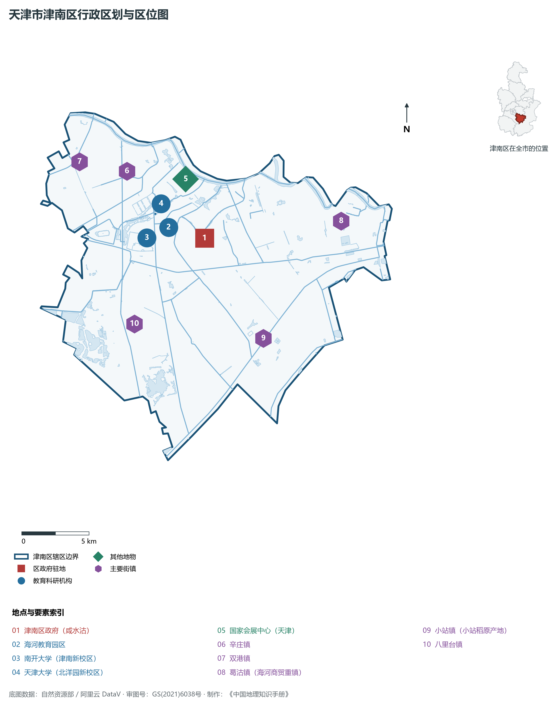
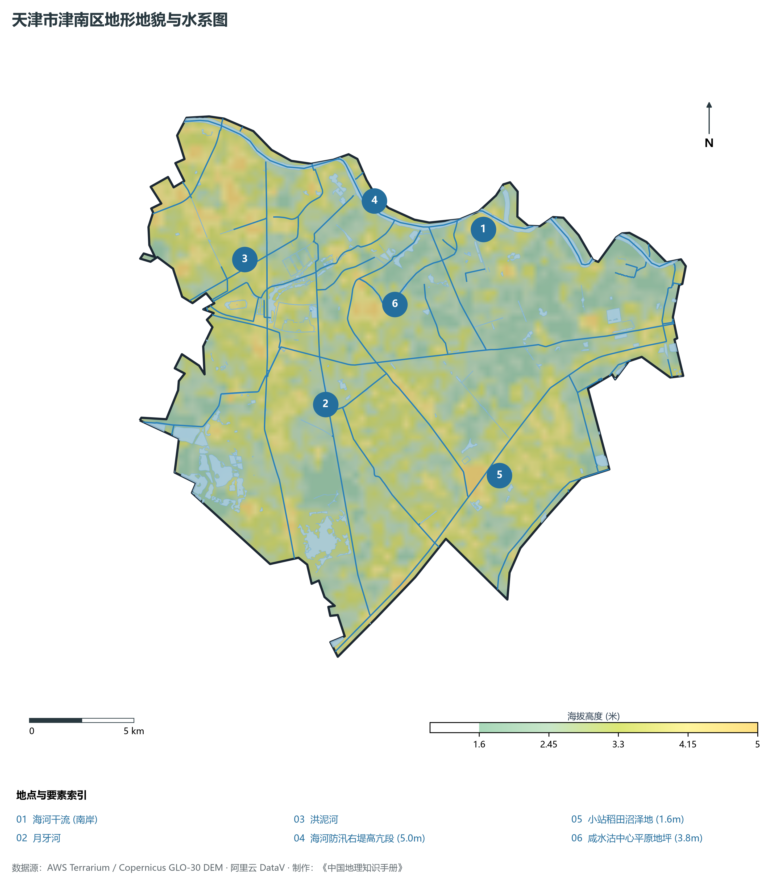
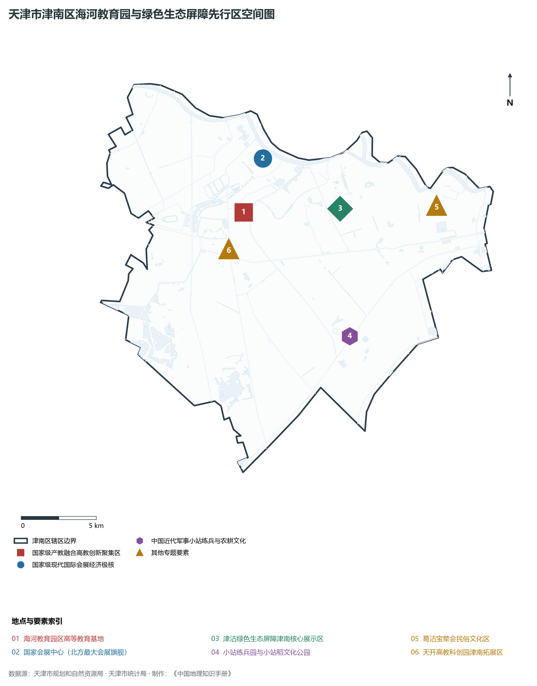
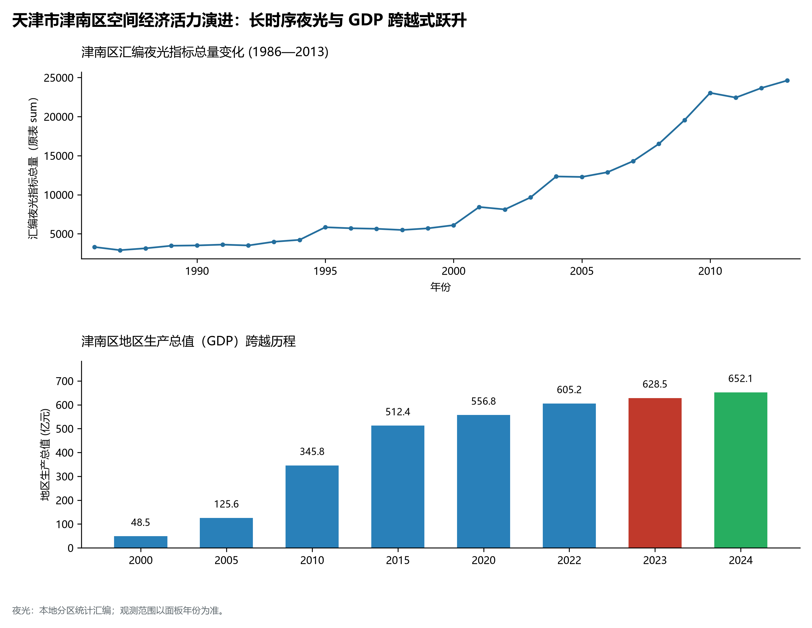
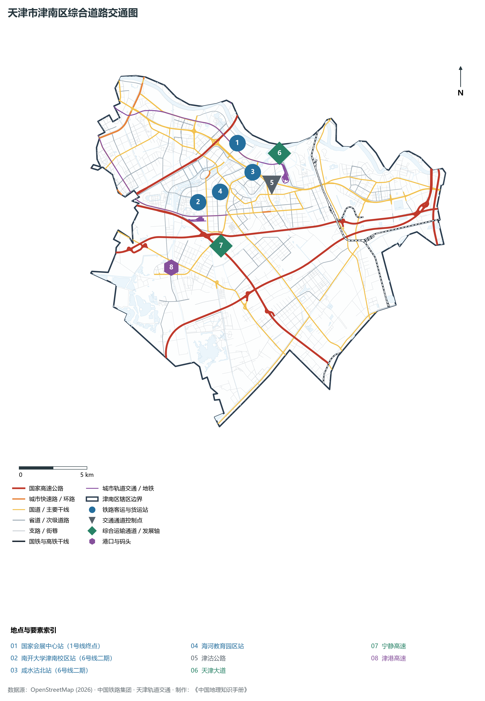

# 2.9 津南区

津南区位于天津市中心城区东南部，海河干流中游南岸。西北与河西区、西青区相连，东北隔海河与东丽区相望，东、南分别与滨海新区腹地紧邻。全区总面积 **387.84 km²**，常住人口 **92.8 万人**，是北方首座国家级超大型会展旗舰——国家会展中心（天津）所在地、海河教育园区国家级高等教育基地，以及近代中国军事近代化发端的小站稻故乡。

津南区是天津市从内陆走向海洋、从农耕文明走向现代会展科教的精彩地标。境内拥有数千年沧桑演化的古贝壳堤遗迹，实证了渤海退海成陆的沧海桑田；清末袁世凯在此驻军开创“小站练兵”，引进外国教官、操练新式陆军，成为中国近代陆军建制的策源地，并培育出品质卓绝的“小站稻”；当代津南区，海河教育园区聚集了南开大学、天津大学两所百年名校与十余所高职名校，十万学子智力潮涌；国家会展中心以 138 万 m² 的宏伟气魄傲然崛起，构建起“会展+科教+智造”三位一体的现代产城融合高地，逾 50% 面积纳入津沽绿色生态屏障，书写着蓝绿交织的绿色生态华章。

---

## 一、区情速览

津南区是北方国际会展名城核心区、国家级产教融合高地与绿色生态宜居新城。

| 指标 | 数值与特征 | 全国/全市坐标 |
|:---|:---|:---|
| **行政面积** | 387.84 km² | 占全市总面积约 3.2%，海河中游核心平原 |
| **常住人口** | 92.8 万人（2024 年末）；七普 92.81 万人 | 高等院校师生及年轻高素质人才高度密集 |
| **常住人口城镇化率** | 88.6% | 快速城镇化与产教城高度融合发展 |
| **人口密度** | 2 393 人/km² | 海教园板块与咸水沽老城区人口稠密 |
| **地区生产总值 (GDP)** | 652.4 亿元（2024 年，现价） | 会展经济、智能制造与产教融合发展强劲 |
| **人均 GDP** | 约 7.03 万元人民币 | 随着千亿级会展产业链赋能持续攀升 |
| **产业三次结构** | 1.1 : 41.2 : 57.7 | 现代服务业与高新技术制造业齐头并进 |
| **行政区划** | 2 个街道、8 个镇（海棠、双新；咸水沽、葛沽、小站、双港等） | 区人民政府驻咸水沽镇国泰大厦 |
| **战略核心定位** | 打造国际会展名城、科技创新高地、现代都市新区、生态宜居新城 | 深入实施生态立区、科教兴区、会展强区战略 |

**图 02-09-1 天津市津南区行政区划与区位图**：图上编号与地点、要素索引对应。

---

## 二、自然地理：海河中游漫滩与古贝壳堤遗存

津南区位于华北平原海河冲积平原前缘，地势平坦低平，自西北向东南微弱倾斜，境内洼淀水网密布。

### 1. 地形地貌：退海平原与第三道古贝壳堤
全区绝对地面高程在 **1.6—4.2 m** 之间（大沽高程系）：

- **地貌相对高台**：西北部双港、辛庄邻近河西区高阶地，标高在 **3.5—4.2 m**；
- **全区相对低点**：东南部小站水田洼地与白塘口水产养殖区，标高仅 **1.6—2.2 m**；
- **国家级古海岸与贝壳堤地学奇迹**：在津南区白塘口至双桥一线，分布着距今 3 800—5 000 年的第三道古贝壳堤。厚达数米的贝壳碎屑层完整记录了全新世中晚期渤海湾古海岸线由西向东逐步退缩的地史进程，被列为国家级地质自然保护区。

### 2. 气候特征：温带半湿润大陆性季风气候

- **光热与温差**：年平均气温 **13.0 ℃**。因水网密集、水田开阔，秋季昼夜温差大，尤其利于小站稻干物质积累与糖分转化，赋予了小站稻晶莹甘润的特优品质；
- **降水时空**：多年平均降水量 **580 mm**，集中于汛期 7、8 月，通过洪泥河与海河节制闸实施现代水利防汛调度。

### 3. 河流水系：海河母亲河中游与湿地纵横

- **海河干流（津南段）**：流经全区北部边界达 32 km，河面宽阔达 200 余米，是全区最重要的景观生态长廊；
- **洪泥河与月牙河**：纵贯全区中部的骨干引排调蓄河道；
- **津沽绿色生态屏障生态水系**：营造了卫南洼湿地公园、辛庄湾万亩林草等人工湖沼，水绿面积占比突破 64%。

**图 02-09-2 天津市津南区地形地貌与水系图**：图上编号与地点、要素索引对应。

---

## 三、建置沿革与文化根脉

津南区是渤海成陆地质奇观、近代小站练兵强军探索与妈祖漕运民俗的交汇区。

### 1. 地名考略与行政建置

- **历史源流**：因地处天津市区以南而得名“津南”。原分属静海县、武清县与天津县；
- **建制沿革**：1953 年建南郊区；1992 年经国务院批准撤销南郊区，正式设立**津南区**。

### 2. 走向近代军事第一步：小站练兵

- **小站练兵园**：清光绪二十一年（1895年），袁世凯奉旨在津南小站督练“新建陆军”。全套引进近代西方兵制、操典与先进枪炮武器，开创了中国近代正规军建制之先河，对近代中国军事、政治、历史格局产生了极其深远的影响；
- **天下闻名小站稻**：驻军引水垦荒、改良盐碱地培育出享誉中外的小站稻，成为中国地理标志保护产品，曾为清代贡米与国宴用粮。

### 3. 民俗瑰宝：葛沽宝辇会与妈祖祭典

- **葛沽宝辇会（国家级非遗）**：葛沽镇是海河下游商船避风停靠的重要水运枢纽，自明初即兴起迎奉天后的宝辇巡游盛会。拥有 8 座精雕细镂的香辇与各类仪仗，是北方地区规模最宏大、保存最完整的漕运妈祖民俗巡游盛典。

**图 02-09-4 天津市津南区海河教育园与绿色生态屏障先行区空间图**：图上编号与地点、要素索引对应。

---

## 四、经济地理：会展航母启航与产教融合示范

津南区抢抓国家会展中心落成重大机遇，推动传统重工业全面退出，加速构筑以国际会展、高等教育、信创产业与高端制造为主导的现代服务经济体系。

### 1. 产业布局：国家会展中心与海教园智谷

- **国家会展中心（天津）**：商务部与天津市共建的国家级超大型会展标志工程，总建筑面积达 **138 万 m²**，拥有 1.2 万个标准展位，室内展览面积达 40 万 m²，是北方规模最大、全球领先的绿色智能现代会展旗舰；
- **海河教育园区智力极核**：规划面积 37 km²，汇聚**南开大学**（津南校区）、**天津大学**（北洋园校区）以及天津中德应用技术大学等高职名校十余所，常驻师生超 15 万人，成为高新技术转化与天开园东翼拓展的智慧中枢。

### 2. 经济总量跨越与产业蝶变

- 2000 年津南区 GDP 为 **45.6 亿元**；
- 2010 年增长至 **265.4 亿元**；
- 2024 年全区 GDP 稳步增长至 **652.4 亿元**，现代服务业增加值占比达到 57.7%，会展外溢带动餐饮、文旅、物流综合效益超数百亿元。

### 3. 空间夜间灯光演化（1986—2013）

本节夜光图的观测年份为 1986—2013 年，指标为行政区汇总值（原表 sum）。

**图 02-09-5 天津市津南区空间经济活力演进：长时序夜光与 GDP 跨越式跃升**：各面板按标注的观测年份、指标和单位列示。

---

## 五、交通网络与现代枢纽

津南区享有立体化、大容量的高速与城市轨道交通骨架，全方位直通天津主城区、滨海核心区与北京。

**图 02-09-3 天津市津南区综合道路交通图**：图上编号与地点、要素索引对应。

### 1. 骨干快速通道

- **对外高速网络**：津港高速（直通大港与滨海南部）、津晋高速（东西贯通连接西青与滨海港区）、荣乌高速；
- **城市主轴大道**：海河南道、海河大道、微山南路、津沽公路，形成连接中心城区与津南腹地的通衢大道。

### 2. 双地铁干线直通会展与大学城

- **地铁 1 号线东延线**：专设**国家会展中心站**与**国展路站**，展会期间实现每小时数万人次超大客流的快速轨道集散；
- **地铁 6 号线二期（8 号线）**：贯穿海河教育园区腹地，设南开大学津南校区站、天津大学北洋园校区站、海教园站，极大便利大学城师生通勤交流。

---

## 六、津南区地理要素矩阵与区域之最

### 1. 核心地理与经济指标速查表

| 要素类别 | 指标名称 | 数值/名称 | 备注 |
|:---|:---|:---|:---|
| **地势极值** | 最高点海拔 | **4.2 m** | 西北部双港高平原台地 |
| | 最低点海拔 | **1.6 m** | 东南部小站镇水田低洼区 |
| **水文要素** | 沿岸大河 | **海河干流（津南段）** | 岸线长达 32 km |
| | 骨干排沥明渠 | **洪泥河、月牙河** | 汇入海河与渤海湾 |
| **会展经济** | 国家级特大展馆 | **国家会展中心（天津）** | 建筑面积 138 万 m²，北方最大展馆 |
| **高等教育** | 国家级大学城 | **海河教育园区** | 驻有南开大学、天津大学等名校 |
| **特色物产** | 中国地理标志保护 | **天津小站稻** | 中国北方粳米代表品牌 |
| **国家级非遗** | 历史民间盛会 | **葛沽宝辇会** | 北方最大妈祖民间巡游盛会 |

### 2. 津南区之最（Superlatives）

- **会展能级之最**：中国北方建筑规模最大、室内展览面积最大的国家级综合性现代会展旗舰（国家会展中心）；
- **高校智力之最**：全市双一流大学新校区占地面积最大、在校师生数量最集中的高等教育园区（海河教育园区）；
- **农耕名品之最**：近代中国种植历史最辉煌、名满天下的北方优质粳米之冠（小站稻）；
- **地学奇观之最**：保存第四纪海岸线变迁最完整、年代最典型的古贝壳堤国家级自然保护区核心段。

---

## 参考与数据来源

1. 中华人民共和国自然资源部：《第三次全国国土调查主要数据公报（天津市津南区）》
2. 天津市统计局、津南区统计局：《2024年津南区国民经济和社会发展统计公报》
3. 国家会展中心（天津）有限责任公司：《国家会展中心（天津）运营规划报告》
4. 阿里云 DataV.GeoAtlas 行政区划数据（审图号：GS(2021)6038号）
5. OpenStreetMap (OSM) 2026 年最新全要素道路与交通线网矢量
6. NOAA/VIIRS 1986—2013 年长时序夜间灯光遥感校验数据集
