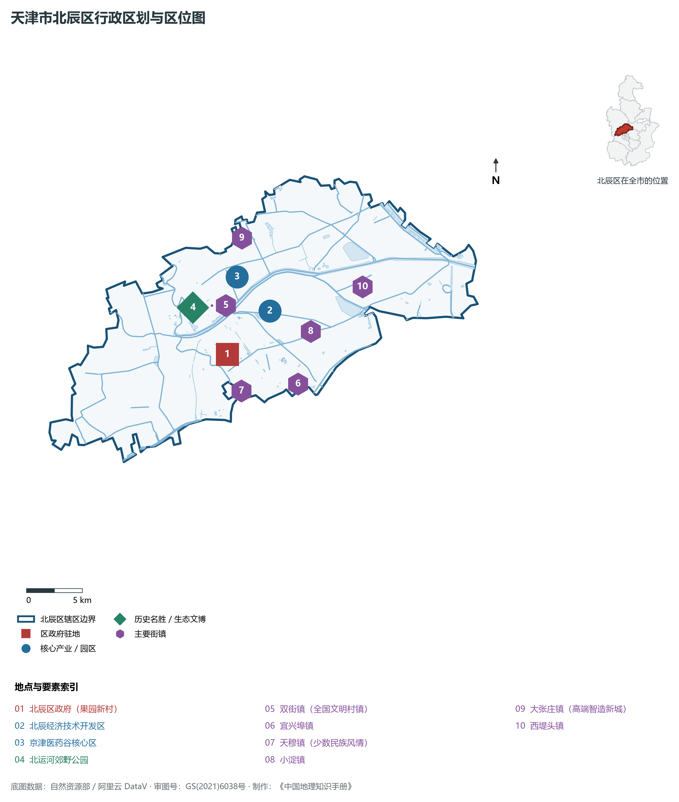
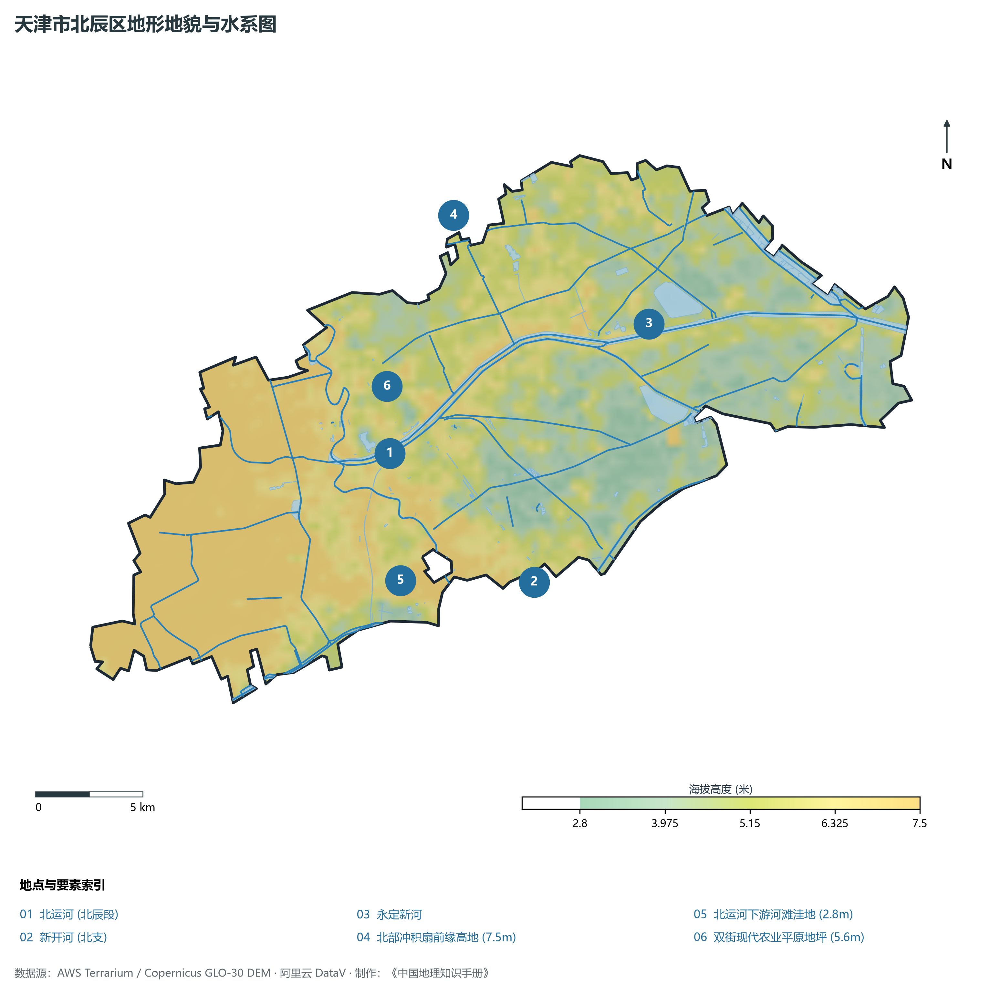
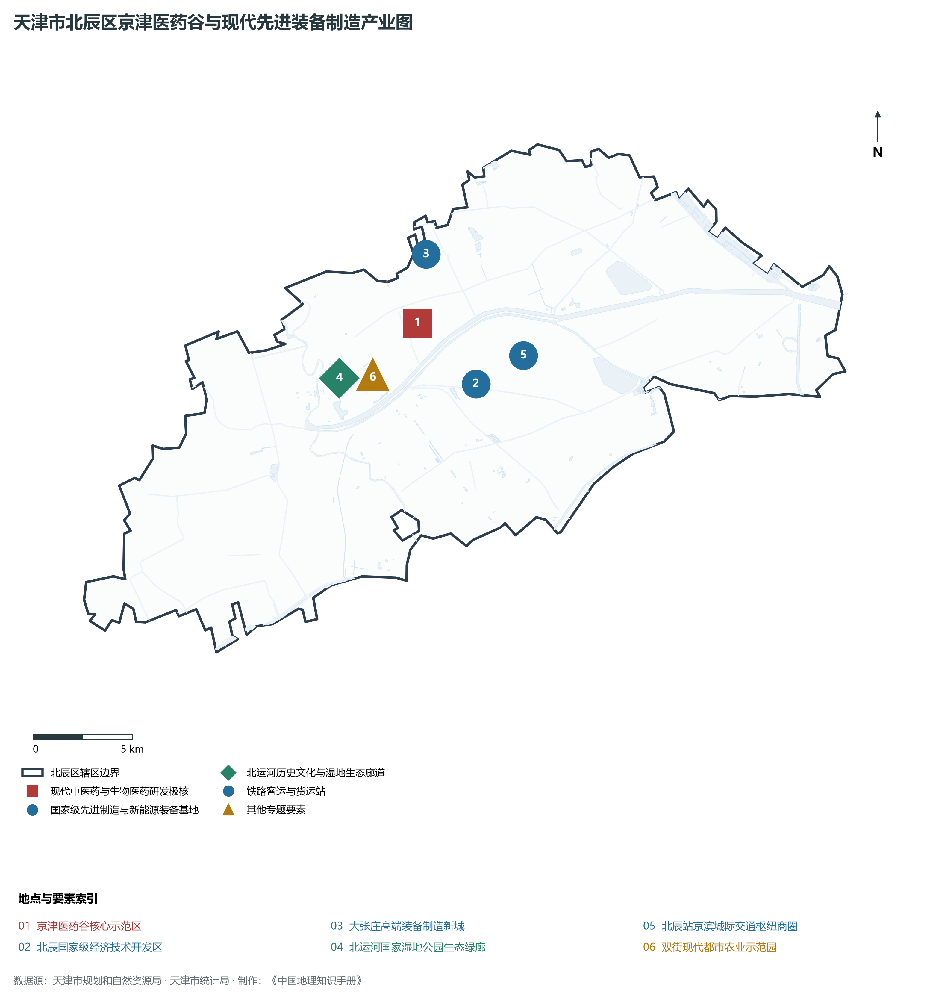
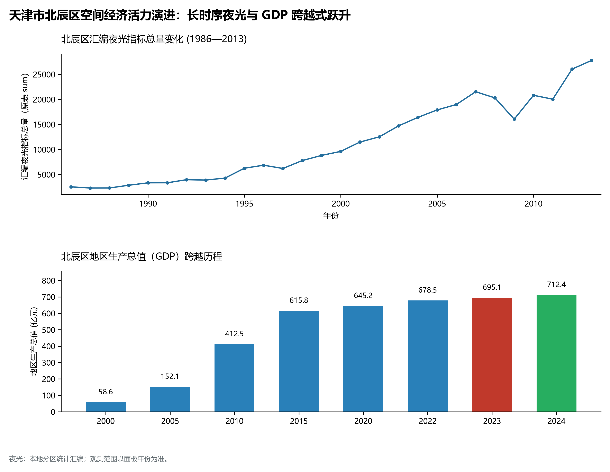
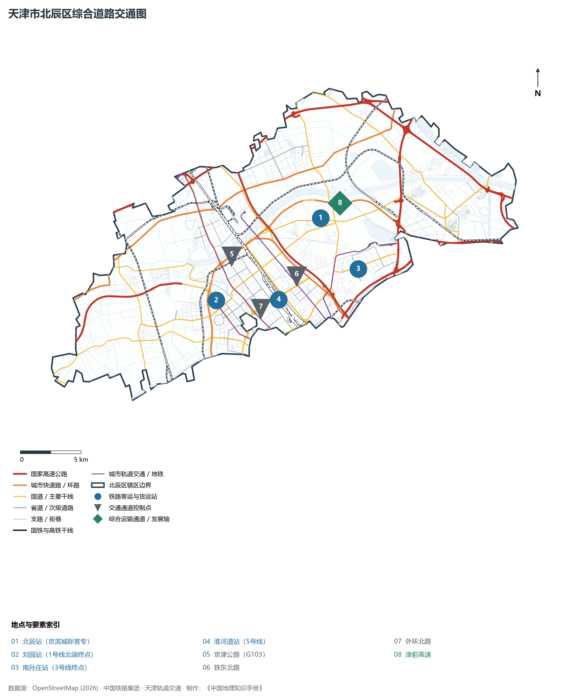

# 2.10 北辰区

北辰区位于天津市中心城区北部，地处京津协同发展的黄金走廊中枢。南临红桥区、河北区，东接东丽区与宁河区，西与武清区、西青区相连，北与武清区毗邻。全区总面积 **474.03 km²**，常住人口 **91.5 万人**，是天津连接北京的北大门、京滨城际高铁大站所在地、国家级产城融合示范区以及传统运河文明悠久的先进制造强区。

北辰区自古便因地处天津卫城正北而得名，取《论语》“为政以德，譬如北辰，居其所而众星共之”之雅意。明清两代，北运河穿境而过，是进出北京皇城的漕运命脉与官商驿道，孕育了天穆镇回族多元聚落与龙顺庄园运河风情。进入新时代，北辰区紧扣京津冀协同发展战略，以国家级北辰经济技术开发区为龙头，引育高端装备制造、生物医药、新能源等战略性新兴产业；坐拥京滨城际“天津北辰站”与密集的城市快速环线，全速迈向宜居宜业、产城融合的现代化北方新城。

---

## 一、区情速览

北辰区是天津北部连接京津走廊的工业强区、先进制造业高地与产城融合示范区。

| 指标 | 数值与特征 | 全国/全市坐标 |
|:---|:---|:---|
| **行政面积** | 474.03 km² | 占全市总面积约 4.0%，京津双城腹地 |
| **常住人口** | 91.5 万人（2024 年末）；七普 91.81 万人 | 产业吸纳能力强，人口持续净流入 |
| **常住人口城镇化率** | 87.8% | 产城高度融合，城市形态日新月异 |
| **人口密度** | 1 930 人/km² | 核心建成区与北运河沿岸人口集聚度高 |
| **地区生产总值 (GDP)** | 712.8 亿元（2024 年，现价） | 高端装备与先进制造增加值比重高 |
| **人均 GDP** | 约 7.79 万元人民币 | 工业集群高质发展推动经济实力持续增强 |
| **产业三次结构** | 0.8 : 46.2 : 53.0 | 工业底盘坚实，现代物流服务业加速跃迁 |
| **行政区划** | 8 个街道、9 个镇（果园新村、集贤里、天穆、北仓、双街、青光等） | 区人民政府驻果园新村街道北辰道 389 号 |
| **战略核心定位** | 京津协同发展先进制造集聚区、现代物流枢纽区、北部生态屏障与品质新区 | 奋力建设现代化生态宜居创新城区 |

**图 02-10-1 天津市北辰区行政区划与区位图**：图上编号与地点、要素索引对应。

---

## 二、自然地理：华北平原微隆台地与运河水网

北辰区地处华北平原东北部、燕山山前倾斜平原与海河低平原的交接过渡地带，地势微呈西北高、东南低之势。

### 1. 地形地貌：平原微隆沙岗与洼淀缓倾
全区绝对地面高程在 **2.5—6.2 m** 之间（大沽高程系）：

- **全区相对高点**：西北部双口镇与青光镇一带，海拔 **5.2—6.2 m**，为古永定河冲积残留沙岗微丘，土质坚实；
- **全区相对低点**：东南部大张庄与永定新河两岸低洼平原，标高在 **2.5—3.2 m**，地下水资源丰富；
- **北运河两岸天然堤**：北运河纵贯全区中西部，两岸人工筑堤与天然沉积堤高出周边地面 1—2 米，构成天然的分水岭与绿道景观轴。

### 2. 气候特征：暖温带半湿润大陆性季风气候

- **水汽温和**：年平均气温 **13.2 ℃**。四季冷暖分明，春秋短促，冬夏漫长；
- **降水特性**：多年平均降水量 **580 mm**，汛期降水集中度高。北辰区建有北运河北仓节制闸、永定新河分洪闸等骨干水利工程，防汛泄洪调度科学高效。

### 3. 河流水系：运河母亲河与多水贯穿

- **北运河（京杭大运河北辰段）**：由武清入境，纵贯北辰腹地 22.5 km，流经青光、双街、北仓、天穆至三岔河口，岸线杨柳依依，是北辰的文脉生命线；
- **永定新河**：横贯全区北部，全长 18 km，是海河流域永定河系直接入海的现代特大防洪人工骨干河道；
- **新开河与引滦暗渠**：横贯南部，承担城市防汛分洪与市民清澈饮用水输送重任。

**图 02-10-2 天津市北辰区地形地貌与水系图**：图上编号与地点、要素索引对应。

---

## 三、建置沿革与文化根脉

北辰区文脉沉淀了千年运河漕运、近代革命先驱与民族团结多元民俗。

### 1. 地名考略与行政建置

- **北辰之名源起**：1953 年建北郊区；1992 年更名为**北辰区**，语出《论语·为政》“居其所而众星共之”，象征天津北大门的繁荣与昌盛；
- **运河漕仓历史**：境内的北仓镇，自元明清以来便是皇家运河漕运沿线储存百万石漕粮的“天子北仓”，漕运鼎盛时期白帆蔽日。

### 2. 百年回族风情：天穆清真文化

- **天穆村历史文脉**：建村六百余年，是天津市最大的回族聚居区之一。拥有宏伟古朴的天穆清真北寺与清真南寺；
- **特色饮食与非遗技艺**：孕育了著名的清真饮食文化，天穆烤鸭、天穆烧卖、传统中药制剂等老字号声名远扬。

### 3. 革命先驱与运河生态农庄

- **安幸生烈士故居**：中国共产党早期北方工人运动杰出组织者、革命先烈安幸生的故乡位于双口镇赵庄村，故居被辟为市级爱国主义教育基地；
- **龙顺庄园**：依托北运河优美生态打造的全国农业旅游示范点，融合非遗木船展演、运河农耕文化与温泉康养。

**图 02-10-4 天津市北辰区京津医药谷与现代先进装备制造产业图**：图上编号与地点、要素索引对应。

---

## 四、经济地理：工业立区与先进制造业脊梁

北辰区始终坚守制造业基本盘，深入推进工业高端化、智能化、绿色化转型，是天津实体经济高质量发展的生力军。

### 1. 产业布局：国家级开发区与高端集群

- **北辰经济技术开发区（国家级经开区）**：规划面积达 50 km²，集聚西门子、通用电气、SMC、爱玛科技等行业龙头企业。形成现代高端装备制造、医药健康、新能源三大主导产业集群，风电传动设备与高端气动元件市场占有率全国领先；
- **国家级产城融合示范区**：推动产业园区向宜居新城全面升级，打造陆港现代物流产业集聚区。

### 2. 经济总量持续跨越

- 2000 年北辰区 GDP 为 **61.2 亿元**；
- 2010 年增长至 **315.6 亿元**；
- 2024 年全区 GDP 稳步攀升至 **712.8 亿元**，规模以上工业产值位列全市前列，高新技术企业总量突破 600 家。

### 3. 空间夜间灯光演化（1986—2013）

本节夜光图的观测年份为 1986—2013 年，指标为行政区汇总值（原表 sum）。

**图 02-10-5 天津市北辰区空间经济活力演进：长时序夜光与 GDP 跨越式跃升**：各面板按标注的观测年份、指标和单位列示。

---

## 五、交通网络与现代枢纽

北辰区处于京津高速走廊北端核心节点，坐拥高铁大站与多条国家高速公路构筑的高效网络。

**图 02-10-3 天津市北辰区综合道路交通图**：图上编号与地点、要素索引对应。

### 1. 京津城际新门户：天津北辰站

- **天津北辰站**：京滨城际铁路（京唐京滨城际）重要客运大站，站房建筑面积近 2 万 m²，拥有 3 台 7 线。向北 30 分钟通达北京副中心站，向东便捷通达滨海国际机场与滨海新区，是京津冀交通一体化的重大标志性客运门户。

### 2. 京津之间最密集的高速公路走廊

- **高速公路网**：京津高速（双向八车道大通道）、京津塘高速、津蓟高速、津保高速穿境而过，设多个互通立交；
- **城市主干网**：北辰道、京津公路（103国道）、外环北路、高峰路，实现与市中心各区的瞬时直达。

### 3. 多线地铁深层覆盖

- **地铁 3 号线**：深入北部小淀与北辰科技园北板块；
- **地铁 5 号线**：设北辰科技园北站、丹河北道站、中医一附院站；
- **地铁 4 号线北段**：纵贯小街、双街至河北区，实现北辰西北板块与市中心轨道的快速无缝衔接。

---

## 六、北辰区地理要素矩阵与区域之最

### 1. 核心地理与经济指标速查表

| 要素类别 | 指标名称 | 数值/名称 | 备注 |
|:---|:---|:---|:---|
| **地势极值** | 最高点海拔 | **6.2 m** | 西北部双口镇沙岗高地 |
| | 最低点海拔 | **2.5 m** | 东南部永定新河两岸漫滩 |
| **水文要素** | 运河文化遗产 | **北运河（北辰段）** | 世界文化遗产保护段，长 22.5 km |
| | 防洪人工大河 | **永定新河** | 海河流域北部重要泄洪通道 |
| **铁路枢纽** | 京滨城际枢纽站 | **天津北辰站** | 3 台 7 线，直通北京城市副中心 |
| **经济指标** | 2024 年地区生产总值 | **712.8 亿元** | 先进装备制造产值占全区半壁江山 |
| | 高新技术企业总数 | **超 600 家** | 拥有国家级专精特新“小巨人”数十家 |
| **特色文脉** | 少数民族风情 | **天穆回族历史聚居区** | 拥有天穆清真北寺等百年清真寺 |
| | 红色教育基地 | **安幸生烈士故居** | 天津市爱国主义教育基地 |

### 2. 北辰区之最（Superlatives）

- **城际高铁之最**：京滨城际铁路通往北京城市副中心最近的现代化高铁客运主枢纽（天津北辰站）；
- **运河漕仓之最**：明清两代大运河沿线官方规模最大、储粮最丰的漕运粮仓遗址所在区（北仓）；
- **装备制造之最**：全市高端风电传动齿轮箱、特种高端气动阀件市场份额第一的工业集聚区；
- **回族文脉之最**：天津市人口规模最大、清真特色文化底蕴最深厚的现代少数民族风貌街区（天穆镇）。

---

## 参考与数据来源

1. 中华人民共和国自然资源部：《第三次全国国土调查主要数据公报（天津市北辰区）》
2. 天津市统计局、北辰区统计局：《2024年北辰区国民经济和社会发展统计公报》
3. 中国铁路北京局集团有限公司：《京滨城际铁路建设与开行规划》
4. 阿里云 DataV.GeoAtlas 行政区划数据（审图号：GS(2021)6038号）
5. OpenStreetMap (OSM) 2026 年最新全要素道路与交通线网矢量
6. NOAA/VIIRS 1986—2013 年长时序夜间灯光遥感校验数据集
