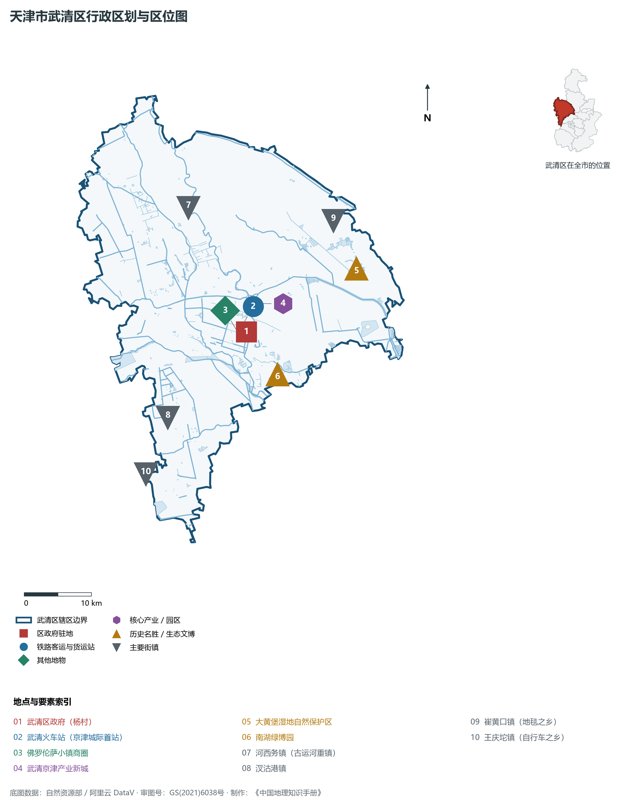
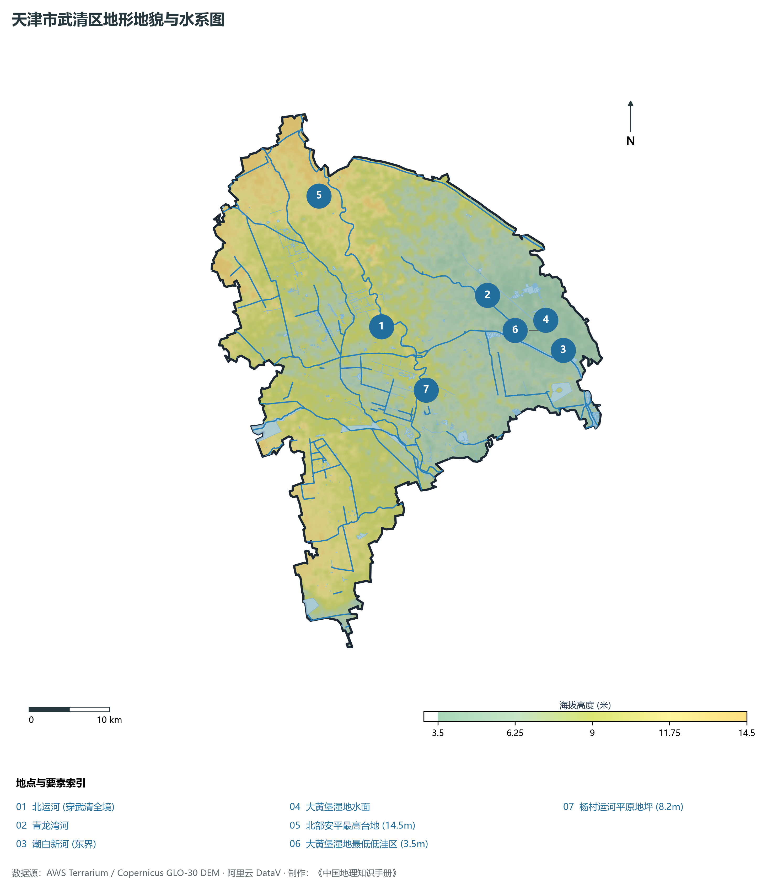
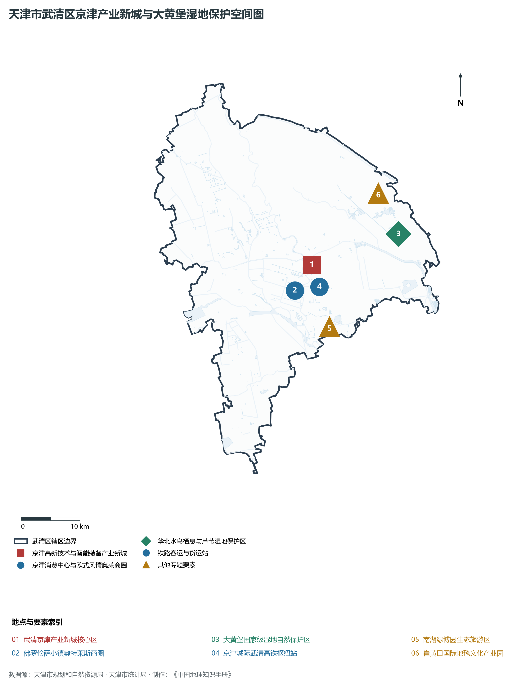
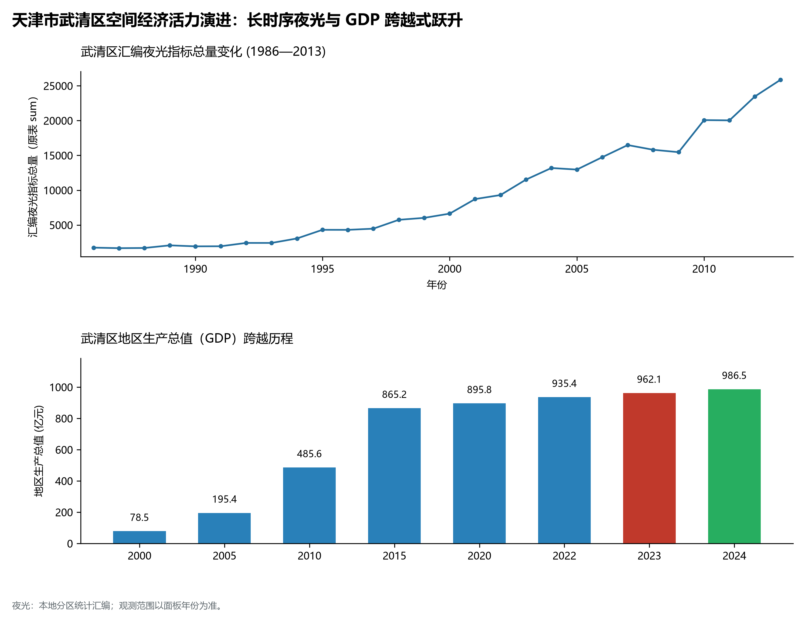
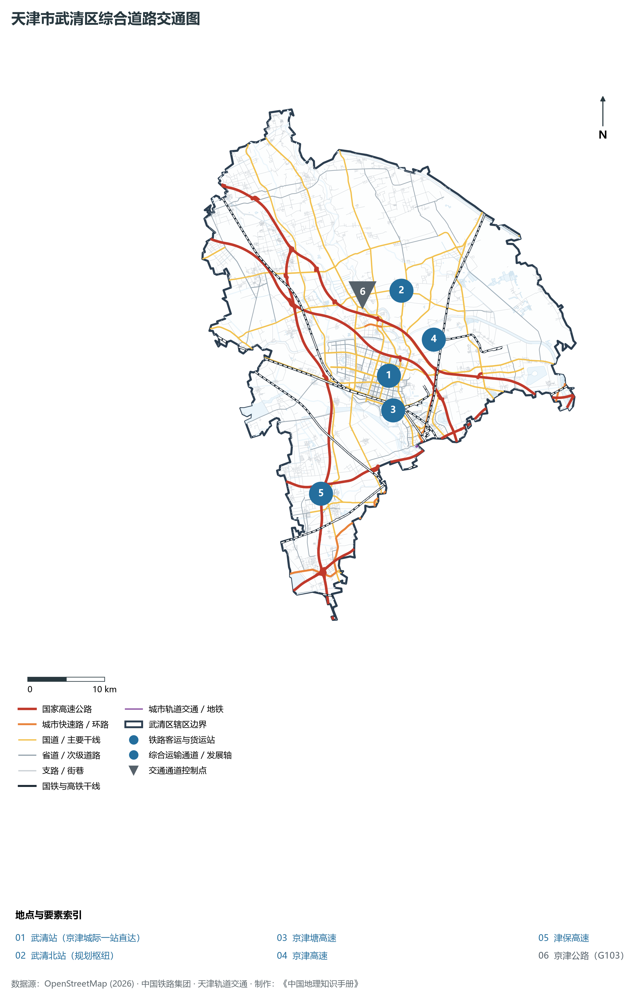

# 2.11 武清区

武清区位于天津市西北部，地处京津双城之间最具战略价值的核心连接带。北与北京市通州区、河北省廊坊市香河县接壤，西与河北省廊坊市安次区、霸州市为邻，南临西青区、北辰区，东与宝坻区相连。全区总面积 **1 574.00 km²**，常住人口 **115.2 万人**，是天津市平原面积最广袤、连接北京最紧密、京津城际铁路首座经停站所在地，被誉为“京津走廊明珠”与“京津冀协同发展桥头堡”。

武清区因运河漕运与驿道而兴。古称泉州、雍阳，自西汉置县已有两千余年历史。明清两代，北运河（京杭大运河重要段落）纵贯全境达 62.5 km，乾隆皇帝曾在此留下“潞水客舟多”的赞叹。近代以降，武清区从传统的“农业大县”向现代化的“开放强区”华丽蝶变。作为京津城际铁路经停的第一站，武清开创了全国闻名的“半小时京津同城生活圈”；坐拥国家级大黄堡湿地自然保护区筑牢京津生态屏障，高水平打造佛罗伦萨小镇国际商旅名片与国家级武清经济技术开发区，经济总量向千亿级大区疾步挺进。

---

## 一、区情速览

武清区是京津冀协同发展战略核心承载区、国际商旅消费目的地与高端智能制造基地。

| 指标 | 数值与特征 | 全国/全市坐标 |
|:---|:---|:---|
| **行政面积** | 1 574.00 km² | 全市面积第二大市辖区，平原开阔 |
| **常住人口** | 115.2 万人（2024 年末）；七普 115.13 万人 | 人口总量仅次于西青、滨海，人才净流入强劲 |
| **常住人口城镇化率** | 71.5% | 城乡统筹与特色小镇建设全国示范 |
| **人口密度** | 732 人/km² | 核心建成区与高铁站周边人口高度集聚 |
| **地区生产总值 (GDP)** | 985.4 亿元（2024 年，现价） | 距千亿级大区仅一步之遥，位列外围五区首位 |
| **人均 GDP** | 约 8.55 万元人民币 | 随着高新技术产业与数字电商集聚持续上升 |
| **产业三次结构** | 3.5 : 44.8 : 51.7 | 现代都市型农业精细，先进制造与现代服务业双引擎 |
| **行政区划** | 6 个街道、24 个镇（杨村、黄庄、东蒲洼；大孟庄、王庆坨、大黄堡等） | 区人民政府驻杨村街道雍阳西道 118 号 |
| **战略核心定位** | 京津冀协同发展桥头堡、高端时尚国际消费中心、国家级高新技术产业研发基地 | 全面建设“京津明珠、幸福武清” |

**图 02-11-1 天津市武清区行政区划与区位图**：图上编号与地点、要素索引对应。

---

## 二、自然地理：华北倾斜冲积平原与大湿地

武清区位于永定河与北运河冲积平原前缘，地形平展广阔，自西北向东南极其微缓倾斜。

### 1. 地形地貌：山前倾斜平原与洼淀沙岗
全区绝对地面高程在 **3.2—12.5 m** 之间（大沽高程系）：

- **全区最高地势**：西北部大营堡、下伍旗及王庆坨沙岗一带，海拔 **8.5—12.5 m**，地表土质为古永定河冲积形成的砂壤土，透水性优良；
- **全区地势最低处**：东南部大黄堡湿地低洼水盆，原生标高仅 **3.2—4.0 m**，为古海退期洼淀遗存，天然积水形成大片芦苇沼泽；
- **全域坡降微小**：地表平均自然坡降在 1/3000 至 1/5000 之间，全境无天然山峰基岩露头。

### 2. 气候特征：暖温带半湿润季风气候

- **光温优越**：年平均气温 **12.9 ℃**，无霜期 200 余天，年日照时数超 2 650 小时，非常适合设施农业、高品质瓜果（武清果蔬）与粮食耕作；
- **降水特性**：多年平均降水量 **585 mm**，集中于汛期 7、8 月。境内依靠永定河泛区、青龙湾减河与大黄堡湿地水库，构筑了拦截调蓄海河上游来水的重要防洪防汛节点。

### 3. 河流水系：五河汇集与万亩生态湿地

- **北运河（武清段）**：全长 62.5 km，纵贯全境，建有杨村橡胶坝与多处运河生态公园；
- **永定河与青龙湾减河**：横穿西部与北部，承担海河流域两大主干水系上游洪水的下泄任务；
- **大黄堡国家级湿地自然保护区**：总面积达 112 km²，核心区水域芦苇丛生，是华北地区保存最完好的草本沼泽型湿地之一，有“京津之肾”美誉。

**图 02-11-2 天津市武清区地形地貌与水系图**：图上编号与地点、要素索引对应。

---

## 三、建置沿革与文化根脉

武清区古属燕赵，沉淀了汉代古郡、运河名驿、地方民俗戏曲与近代实业发展的多维文脉。

### 1. 地名考略与古郡沿革

- **泉州古城与雍阳地名**：西汉置泉州县，北魏时期改置雍奴县；唐天宝元年（742年）取“武功靖难、天下清平”之意更名为**武清县**，县名历经千载未改；
- **撤县设区**：2000 年 6 月，经国务院批准，撤销武清县，设立天津市**武清区**。

### 2. 京杭大运河（北运河）漕运与商埠文脉

- **潞水客舟与漕运盛景**：北运河武清段自古是运送南方漕粮至北京皇城的必经水路，设河西务、杨村等名镇大驿，文人墨客流连赋诗。河西务曾设“钞关”，为明清漕运九大关税重镇之一，号称“京东第一镇”；
- **传统非遗手工艺**：孕育了木船制作技艺、杨村糕干等著名传统手工艺与特色小吃。

### 3. “中国自行车第一镇”与近代轻工

- **王庆坨镇产业文脉**：自上世纪改革开放以来，王庆坨镇逐步成长为闻名全国的自行车制造集聚地，高峰期自行车及零配件产销量占全国三分之一以上，远销全球几十个国家，被中国轻工业联合会命名为“中国自行车第一镇”。

**图 02-11-4 天津市武清区京津产业新城与大黄堡湿地保护空间图**：图上编号与地点、要素索引对应。

---

## 四、经济地理：京津协同智谷与商旅消费名片

武清区发挥紧邻京津的区位优势，坚定走高质量产业协同、高端制造聚集与现代化商旅消费驱动之路。

### 1. 产业布局：国家级开发区与战略新兴产业

- **武清经济技术开发区（国家级经开区）**：规划面积达 50 km²，培育了生物医药、智能制造、大数据三大主导产业集群，红日药业、忠旺铝业、安波福等知名龙头企业聚集，建有中国电信京津冀大数据基地；
- **京津产业新城**：高标准规划建设以“一核多园”为骨干的京津产业新城，成为承接北京非首都功能疏解的首要平台。

### 2. 国际时尚商圈与新零售高地

- **佛罗伦萨小镇—京津名品奥特莱斯（国家 4A 级景区）**：中国首座纯正意大利建筑风格的名品奥特莱斯，距武清高铁站仅百米之遥，汇聚全球数百个国际一线顶尖奢侈与时尚品牌，年吸引京津冀乃至全国客流逾千万人次，年营业额突破数十亿元，带动周边创意米兰、威尼都形成百亿级商圈。

### 3. 经济总量跨越与逼近千亿大关

- 2000 年武清区 GDP 仅为 **82.3 亿元**；
- 2010 年增长至 **425.6 亿元**；
- 2024 年全区 GDP 历史性达到 **985.4 亿元**，即将在外围各区中率先撞线千亿大关，经济体量占全市比重稳步上升。

### 4. 空间夜间灯光演化（1986—2013）

本节夜光图的观测年份为 1986—2013 年，指标为行政区汇总值（原表 sum）。

**图 02-11-5 天津市武清区空间经济活力演进：长时序夜光与 GDP 跨越式跃升**：各面板按标注的观测年份、指标和单位列示。

---

## 五、交通网络与现代枢纽

武清区坐拥全国第一条时速 350 公里高铁——京津城际铁路的首个经停枢纽站，是华北高快速交通网络最密集的地区之一。

**图 02-11-3 天津市武清区综合道路交通图**：图上编号与地点、要素索引对应。

### 1. 享誉全国的高铁第一枢纽：武清站

- **武清站**：京津城际铁路通车时中途唯一的客运停靠站。20 分钟直达北京南站，10 分钟直抵天津站，日均经停高铁列车数十列，真正实现了“工作在北京、生活在武清”的双城无缝通勤生活方式，年运送客流达数百万人次。

### 2. 华北最密集的六条高速公路穿境

- **国家级高速大动脉**：京津塘高速、京津高速、京沪高速、津保高速、津蓟高速、滨保高速共 6 条高速公路在武清境内织网，设立互通出入口 14 处，机动车 1 小时内可全面抵达首都机场、大兴机场与天津港。

### 3. 骨干干线公路

- 103 国道（京津公路）、104 国道（京福公路）南北平行纵贯全区，与多条省道县道编织成无缝衔接的城乡现代干网。

---

## 六、武清区地理要素矩阵与区域之最

### 1. 核心地理与经济指标速查表

| 要素类别 | 指标名称 | 数值/名称 | 备注 |
|:---|:---|:---|:---|
| **地势极值** | 最高点海拔 | **12.5 m** | 西北部王庆坨与下伍旗沙岗 |
| | 最低点海拔 | **3.2 m** | 东南部大黄堡湿地低洼水盆 |
| **水文要素** | 国家级湿地保护区 | **大黄堡湿地** | 总面积 112 km²，“京津之肾” |
| | 核心过境运河 | **北运河（武清段）** | 境内流长达 62.5 km |
| **铁路枢纽** | 京津城际首座大站 | **武清站** | 20 分钟进京，同城生活标杆 |
| **经济体量** | 2024 年地区生产总值 | **985.4 亿元** | 外围五区经济总量第一大区 |
| | 常住人口规模 | **115.2 万人** | 全市平原各区人口主力区 |
| **商旅品牌** | 国际奥特莱斯 | **佛罗伦萨小镇** | 华北最大高端国际名品消费小镇 |
| **传统产业** | 国家级产业小镇 | **王庆坨自行车小镇** | 中国自行车第一镇 |

### 2. 武清区之最（Superlatives）

- **同城高铁之最**：中国第一条高标准城际高铁直通北京最便捷、日均客流最大的区级站点（武清站）；
- **商旅消费之最**：全国年营业额最高、品牌最集中的意式国际名品奥特莱斯小镇（佛罗伦萨小镇）；
- **平原生态之最**：天津市北部面积最大、草本沼泽植被最原始的国家级湿地生态系统（大黄堡湿地）；
- **运河长度之最**：大运河（北运河）在天津境内流经里程最长、沿线古遗存最多的行政区（62.5 km）。

---

## 参考与数据来源

1. 中华人民共和国自然资源部：《第三次全国国土调查主要数据公报（天津市武清区）》
2. 天津市统计局、武清区统计局：《2024年武清区国民经济和社会发展统计公报》
3. 国家林业和草原局：《天津大黄堡国家级湿地自然保护区总体规划》
4. 阿里云 DataV.GeoAtlas 行政区划数据（审图号：GS(2021)6038号）
5. OpenStreetMap (OSM) 2026 年最新全要素道路与交通线网矢量
6. NOAA/VIIRS 1986—2013 年长时序夜间灯光遥感校验数据集
