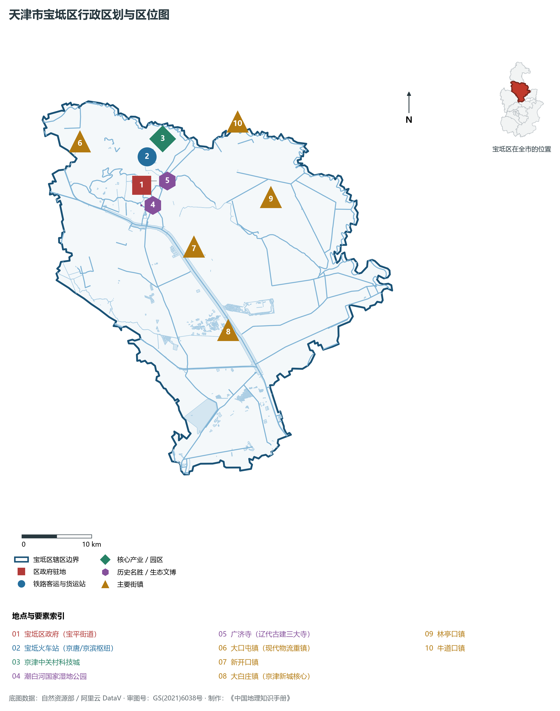
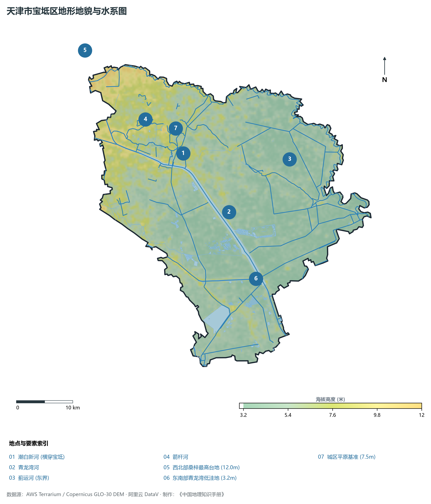
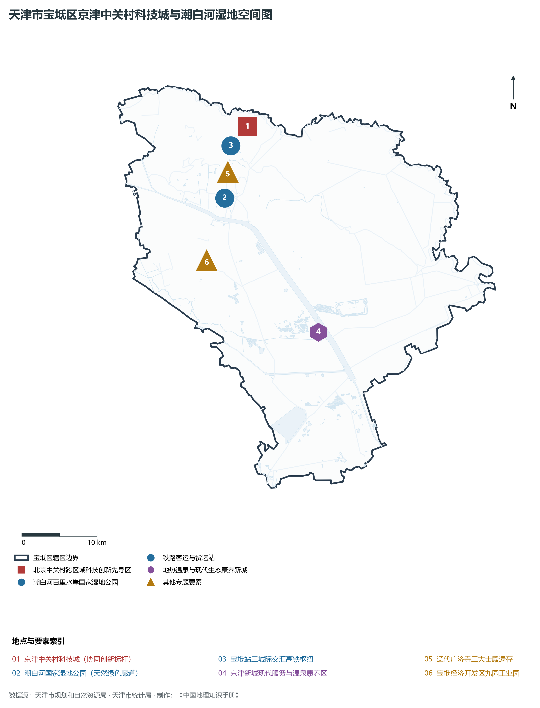
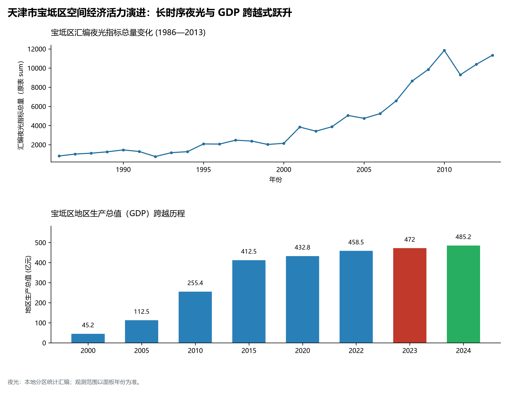
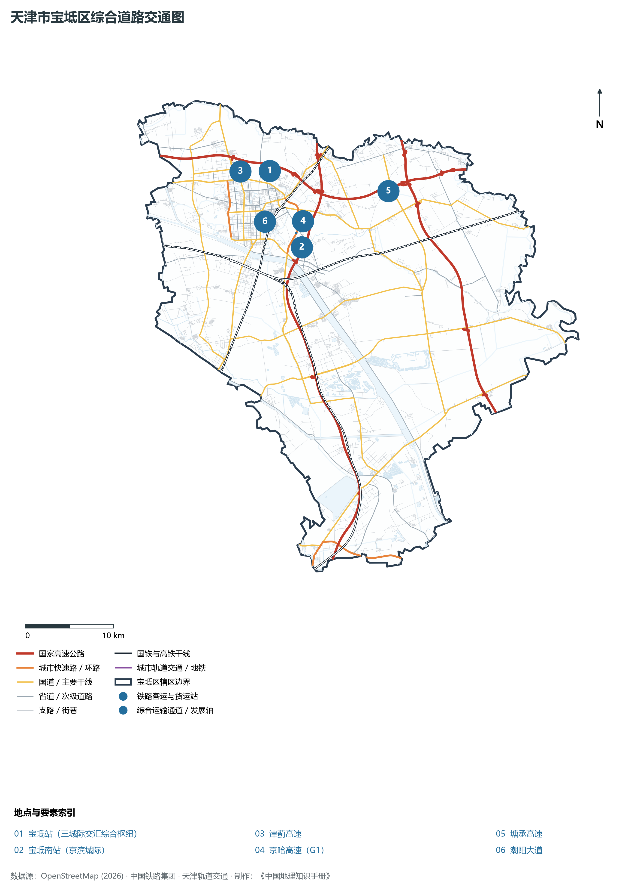

# 2.12 宝坻区

宝坻区位于天津市北部偏东，地处燕山南麓山前平原向渤海海积平原过渡的腹心地带。东接河北省唐山市玉田县，东南邻宁河区，南临武清区与北辰区，西与河北省廊坊市香河县、三河市接壤，北连蓟州区。全区总面积 **1 509.00 km²**，常住人口 **72.5 万人**，是京津唐三角几何地理中心、京唐京滨城际铁路交汇大站所在地、国家生态文明建设示范区，素有“京东大邑、文宝坻水”的美誉。

宝坻历史悠久，文脉昌炽。金大定十二年（1172年）因境内商贾云集、关税丰阜，金世宗取《周礼》“如保赤子，如坻如京”之意，敕建“宝坻县”。明万历年间，一代心学宗师袁黄（袁了凡）任宝坻知县，在此体察民情、推行减赋兴水、撰写传世善书《了凡四训》，留下深厚的人文道德丰碑；境内的辽代广济寺三大士殿被梁思成先生誉为“海内木构孤品”。当代宝坻区，牢牢把握京津冀协同发展主战略，以“宝坻站”为支点全面融入“轨道上的京津冀”，打造京津中关村科技城，依托潮白河国家湿地公园构建蓝绿交织的生态样板，实现从传统农业大区向现代化生态科技新城的历史性跨越。

---

## 一、区情速览

宝坻区是京津唐几何中心的创新智造高地、生态康养宜居福地与现代化枢纽新城。

| 指标 | 数值与特征 | 全国/全市坐标 |
|:---|:---|:---|
| **行政面积** | 1 509.00 km² | 占全市总面积约 12.6%，土地资源平整充沛 |
| **常住人口** | 72.5 万人（2024 年末）；七普 72.24 万人 | 人口增长平稳，承接京津人才导入提速 |
| **常住人口城镇化率** | 63.8% | 城镇化空间潜力巨大，城乡融合协调 |
| **人口密度** | 480 人/km² | 平原水乡特色显著，生态空间开阔 |
| **地区生产总值 (GDP)** | 486.2 亿元（2024 年，现价） | 实体智造与生态科技产业拉动显著 |
| **人均 GDP** | 约 6.71 万元人民币 | 随着中关村科技城入驻产能释放稳步提升 |
| **产业三次结构** | 5.2 : 43.5 : 51.3 | 现代都市型农业与高新技术工业齐头并进 |
| **行政区划** | 6 个街道、18 个镇（宝平、海滨、钰华；大口屯、黄庄、大钟庄等） | 区人民政府驻宝平街道建设路 18 号 |
| **战略核心定位** | 京津中关村科技城创新主阵地、生态宜居协同发展示范区、京东现代综合交通枢纽 | 全面建设“枢纽之区、科创之区、美丽宝坻” |

**图 02-12-1 天津市宝坻区行政区划与区位图**：图上编号与地点、要素索引对应。

---

## 二、自然地理：潮白水系平原与华北湿地水乡

宝坻区坐落于燕山山前冲积扇下部扇缘平原，地表平坦如砥，总体由西北向东南极其平缓倾斜。

### 1. 地形地貌：冲积洪积平原与洼淀微地形
全区绝对地面高程在 **2.8—9.8 m** 之间（大沽高程系）：

- **全区相对高位**：西北部新开口镇、郝各庄镇一带，海拔 **7.5—9.8 m**，土质多为沙壤土，透气性好；
- **全区相对低位**：东南部黄庄洼、大钟庄低洼沼泽平原，标高仅 **2.8—3.5 m**，历史上多受潮白新河与蓟运河汛期溢流漫灌，现代建成万亩生态水稻丰产区；
- **微地貌特征**：全域无天然山体，但潮白新河两岸建有高耸的人工防洪长堤，形成平原纵深中的制高景观走廊。

### 2. 气候特征：温带大陆性半湿润季风气候

- **水汽光热**：年平均气温 **12.6 ℃**。水网密布、气候湿润，秋季日照充足，温差适宜，造就了黄庄水稻的特级品质；
- **降水特性**：多年平均降水量 **600 mm**，是天津平原区降水量较丰沛的区域之一。全区防汛体系以潮白新河为泄洪大动脉，沿途设多道大型橡胶坝与退水闸。

### 3. 河流水系：多河汇流与潮白生态走廊

- **潮白新河**：横贯全境达 45 km，河道宽阔水清岸绿，是全区最重要的防洪骨干通道与生态动脉；
- **蓟运河与青龙湾河**：流经东北边界与南部边界，纵横交织；
- **潮白河国家湿地公园**：全长数十公里，规划总面积达 5 580 公顷，水域芦苇与湿地林木交相辉映，是华北平原难得的超大型带状湿地生态屏障。

**图 02-12-2 天津市宝坻区地形地貌与水系图**：图上编号与地点、要素索引对应。

---

## 三、建置沿革与文化根脉

宝坻区文化底蕴深厚，辽代古建筑、明代心学德政与民间戏曲艺术交融生辉。

### 1. 地名考略与行政建置

- **金代建县之始**：金大定十二年（1172年），因地处运河要津、盐铁商税充盈，金世宗分香河县东南部置**宝坻县**，寓意“宝阜之地、坻京沃土”；
- **撤县设区**：2001 年 3 月，经国务院批准，撤销宝坻县，正式设立天津市**宝坻区**。

### 2. 辽代木构古建绝品：广济寺三大士殿

- **广济寺三大士殿（全国重点文保单位）**：始建于辽开泰十四年（1025年），现殿体原为金代重建，为单檐桥台式辽金木结构建筑孤品。梁思成、林徽因先生曾于 1932 年专程来此进行细致测绘与考察，惊叹其“斗栱雄大、梁架简朴，为我国辽金木构之极品”。

### 3. 袁了凡德政与评剧发祥之源

- **袁黄（袁了凡）治宝遗风**：明万历十六年袁了凡任宝坻知县，力推平水利、均徭役、劝农桑、兴善政，其所著家训《了凡四训》融通儒释道三家哲学，成为天下修身治家的不朽宝典；
- **全国评剧与京东大鼓之乡**：宝坻是评剧早期发端与发展的重要沃土，走出了一代宗师新凤霞等杰出艺术家；同时也是国家级非遗“京东大鼓”盛行的曲艺之乡。

**图 02-12-4 天津市宝坻区京津中关村科技城与潮白河湿地空间图**：图上编号与地点、要素索引对应。

---

## 四、经济地理：中关村协同引领与生态智造腾飞

宝坻区立足自身区位与生态优势，全面承接北京非首都功能疏解，加快构建以新能源新材料、高端装备制造与现代医药为核心的先进制造业体系。

### 1. 产业引擎：京津中关村科技城

- **京津中关村科技城**：由北京市中关村管委会、天津市宝坻区政府协同共建，规划面积 14.5 km²。打破行政藩篱，全面复制北京中关村先行先试政策，重点引进新一代信息技术、智能网联汽车、新能源新材料和生物医药与医疗器械“3+1”高端产业，引育高端企业超 1 200 家，成为跨省市协同创新的标杆旗舰；
- **经济技术开发区升级**：九园工业园、塑料包装制品与现代食品产业园区多点开花。

### 2. 经济总量跨越与提质

- 2000 年宝坻区 GDP 为 **51.2 亿元**；
- 2010 年突破 **200 亿元**；
- 2024 年全区 GDP 稳步增长至 **486.2 亿元**，工业增加值占 GDP 逾四成，高新技术产业产值比重跨越式提升。

### 3. 空间夜间灯光演化（1986—2013）

本节夜光图的观测年份为 1986—2013 年，指标为行政区汇总值（原表 sum）。

**图 02-12-5 天津市宝坻区空间经济活力演进：长时序夜光与 GDP 跨越式跃升**：各面板按标注的观测年份、指标和单位列示。

---

## 五、交通网络与现代枢纽

随着京唐城际、京滨城际铁路的通车，宝坻区一跃成为京津冀城市群北部最重要的高铁枢纽门户。

**图 02-12-3 天津市宝坻区综合道路交通图**：图上编号与地点、要素索引对应。

### 1. 轨道上的京津冀新极核：宝坻站

- **宝坻站（高铁特等枢纽）**：京唐城际铁路、京滨城际铁路交汇大站，规划津承城际铁路接轨于此。站房建筑面积近 1.6 万 m²，拥有 4 台 10 线。20 分钟直达北京副中心站，15 分钟抵达天津滨海国际机场，40 分钟直抵唐山，使宝坻一跃成为连接京、津、冀、辽的北方高铁大通衢。

### 2. 高速公路网与骨干公路

- **高速公路纵横**：京哈高速（原京沈高速，北京通往东北第一动脉）、津蓟高速、塘承高速在宝坻境内呈“井”字形交织，设有 11 个高速出入口；
- **国省干道**：潮阳大道、通唐公路、津围公路穿行全域，无缝连接周边各县市。

---

## 六、宝坻区地理要素矩阵与区域之最

### 1. 核心地理与经济指标速查表

| 要素类别 | 指标名称 | 数值/名称 | 备注 |
|:---|:---|:---|:---|
| **地势极值** | 最高点海拔 | **9.8 m** | 西北部新开口镇冲积阶地 |
| | 最低点海拔 | **2.8 m** | 东南部黄庄洼低洼水稻田 |
| **水文要素** | 区域母亲河 | **潮白新河（宝坻段）** | 境内全长达 45 km |
| | 国家级湿地公园 | **潮白河国家湿地公园** | 规划面积达 5 580 公顷 |
| **铁路枢纽** | 双高铁交汇枢纽 | **宝坻站** | 京唐、京滨两条高铁直达经停 |
| **产业协同** | 京津跨省科技园区 | **京津中关村科技城** | 规划面积 14.5 km²，中关村模式 |
| **古代建筑** | 辽金木构古建 | **广济寺三大士殿** | 全国重点文物保护单位 |
| **非遗曲艺** | 国家级非遗名片 | **评剧、京东大鼓** | 宝坻为评剧重要发祥与发展地 |

### 2. 宝坻区之最（Superlatives）

- **高铁交汇之最**：全市外围区中同时接入京唐、京滨、津承三条骨干城际高铁的特等客运站（宝坻站）；
- **跨省园区之最**：北京中关村在京外首个全方位直管与机制共建的综合科技产业新城（京津中关村科技城）；
- **古代木构之最**：天津市保存年代最古老、体量最宏伟的辽金单檐木结构殿宇珍品（广济寺三大士殿）；
- **湿地带长之最**：华北地区沿单条平原河流两岸延伸最长的带状国家湿地公园（潮白河国家湿地公园）。

---

## 参考与数据来源

1. 中华人民共和国自然资源部：《第三次全国国土调查主要数据公报（天津市宝坻区）》
2. 天津市统计局、宝坻区统计局：《2024年宝坻区国民经济和社会发展统计公报》
3. 北京中关村管委会、宝坻区人民政府：《京津中关村科技城总体规划（2018—2035年）》
4. 阿里云 DataV.GeoAtlas 行政区划数据（审图号：GS(2021)6038号）
5. OpenStreetMap (OSM) 2026 年最新全要素道路与交通线网矢量
6. NOAA/VIIRS 1986—2013 年长时序夜间灯光遥感校验数据集
