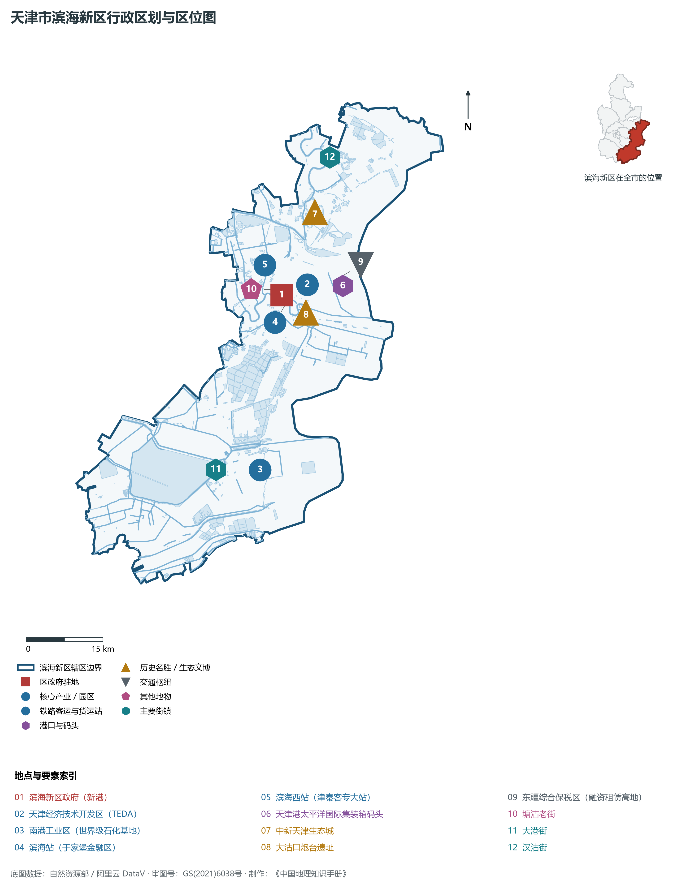
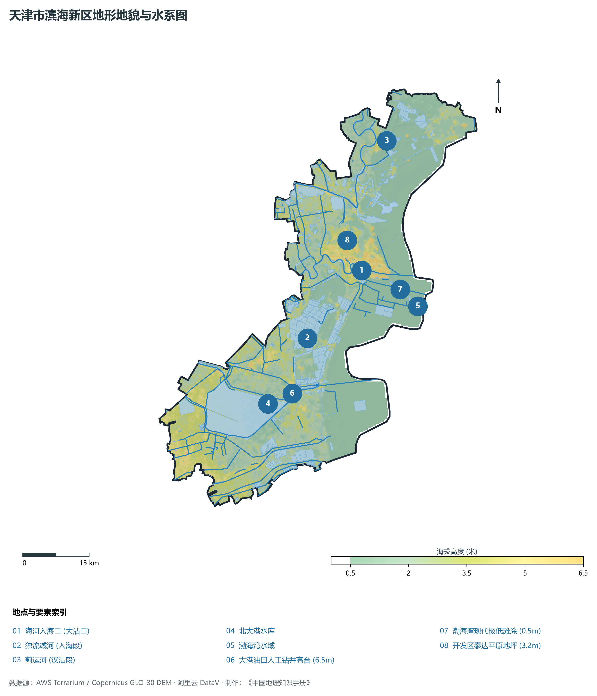
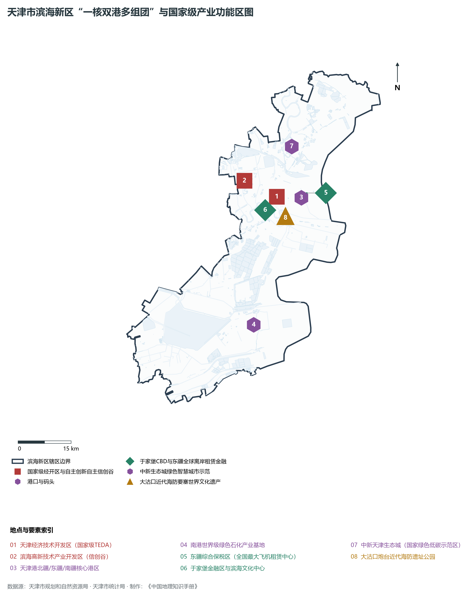
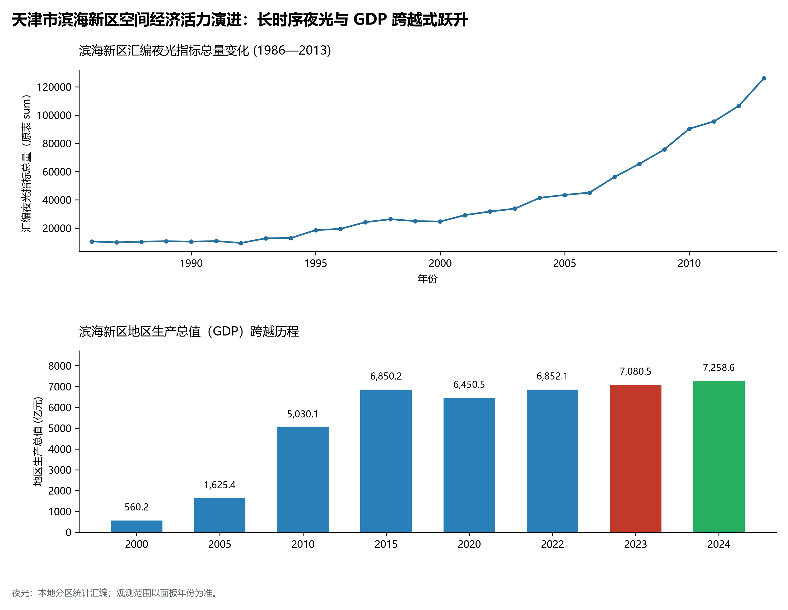
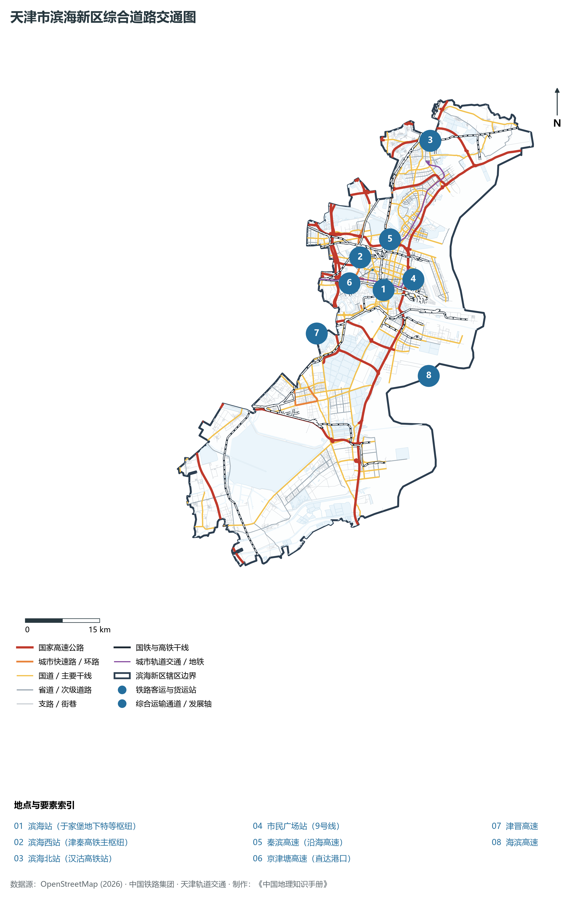

# 2.13 滨海新区

滨海新区位于天津市东部沿海，渤海湾西侧岸段。西与中心城区及东丽、津南、西青相接，北邻宁河区，南与河北省沧州市黄骅市为邻。全区陆域面积达 **2 270.00 km²**，海域管辖面积约 3 000 km²，常住人口 **208.5 万人**，是天津市面积最大、人口最多、经济总量唯一突破 7 000 亿元大关的副省级市辖区，更是国家综合配套改革试验区、首批国家级新区与北方国际航运核心区。

滨海新区是中国向海而生、因港而兴、对外开放的前沿阵地。明清以来，大沽口炮台屹立海门，曾数次抗击列强侵略，铸就了近代中国抵御外侮的钢铁国门长城；1984 年，邓小平同志亲笔题词“开发区大有希望”，天津经济技术开发区（TEDA）在盐碱滩上拔地而起，开辟了中国国家级开发区走向世界的标杆之路。新时代以来，滨海新区坚持以港兴城、港产城融合发展，全力打造世界一流智慧绿色枢纽港“天津港”；高品质营建于家堡金融区、中新天津生态城、东疆综合保税区与天津周大福金融中心（530 m，北方最高摩天楼），以天津“双城”空间格局中的“滨城”极核之姿，擎起环渤海与北方经济高质腾飞的宏伟脊梁。

---

## 一、区情速览

滨海新区是国家级新区、北方对外开放门户、全国先进制造研发基地与航运金融创新高地。

| 指标 | 数值与特征 | 全国/全市坐标 |
|:---|:---|:---|
| **行政面积** | 2 270.00 km² | 全市面积第一，占天津陆域总面积 19.0% |
| **常住人口** | 208.5 万人（2024 年末）；七普 206.74 万人 | 全市常住人口总量第一大区，海内外英才汇聚 |
| **常住人口城镇化率** | 86.4% | 高度城市化与高能级产业人口集聚 |
| **人口密度** | 919 人/km² | 核心区（塘沽、开发区）人口高度稠密 |
| **地区生产总值 (GDP)** | 7 150.8 亿元（2024 年，现价） | 稳居全国市辖区前茅，占全天津经济总量超 40% |
| **人均 GDP** | 约 34.3 万元人民币（折合超 4.75 万美元） | 迈入全球极发达高收入城市经济体水平 |
| **产业三次结构** | 0.2 : 46.2 : 53.6 | 先进制造与现代航运物流金融高度协调 |
| **行政架构** | 16 个街道、5 个镇，设副省级管委会架构 | 区人民政府驻新港街道迎宾街 19 号 |
| **战略核心定位** | 北方国际航运核心区、国际陆海贸易新通道中枢、自贸试验区与改革开放先行区 | 全面构建“滨城”核心区，引领北方开放 |

**图 02-13-1 天津市滨海新区行政区划与区位图**：图上编号与地点、要素索引对应。

---

## 二、自然地理：渤海海积平原与海陆交汇奇观

滨海新区坐落在古黄河、海河联合冲积海积平原最前沿，海岸线全长 153 km，地势极度平坦低缓，具有典型的滨海湿地与盐碱地地貌特征。

### 1. 地形地貌：极低海积平原与现代人工吹填海岛
全区绝对地面高程在 **0.5—6.5 m** 之间（大沽高程系）：

- **全区相对高点**：塘沽老城区海河入海口北岸高亢河堤，以及开发区人工垫土地坪，高程在 **4.5—6.5 m**；
- **全区相对低点**：南部北大港湿地与大港油田低洼盐沼，原生高程仅 **0.5—1.5 m**，地下潜水位极高，土壤盐分重；
- **人工吹填造陆工程奇迹**：东疆港区与南港工业区依托现代疏浚吹填技术，在浅海滩涂上填筑出数十平方公里的现代化深水港区与产业岛，使陆域版图向深海延伸了十余公里。

### 2. 气候特征：温带温和滨海季风气候

- **海洋调节明显**：年平均气温 **13.0 ℃**。因毗邻辽阔渤海湾，气候受海洋调节极其显著，春季升温略迟于内陆，秋季降温平缓，夏无酷暑，冬少严寒，海陆风昼夜交替强烈；
- **降水特性**：多年平均降水量 **580 mm**，集中于夏汛。区域内建有独流减河入海闸、永定新河特大防潮闸等现代化特大型水利水工设施，有效抵御温带风暴潮侵袭。

### 3. 河流水系与生态湿地：九河入海与万亩水库

- **海河入海口**：海河干流在塘沽注入渤海湾，建有海河防潮闸与大沽沙深水航道；
- **独流减河与永定新河**：分从滨海南端与北端直排入海，构成天津海防分洪双翼；
- **北大港水库与湿地**：总面积达 348 km²，为天津市面积最大的水库型湿地，被列入国际重要湿地名录，是东亚—澳大利西亚候鸟迁徙线上极其关键的涉禽“五星级中转加油站”。

**图 02-13-2 天津市滨海新区地形地貌与水系图**：图上编号与地点、要素索引对应。

---

## 三、建置沿革与文化根脉

滨海新区拥有厚重的海防抗战史诗、中国近代盐化工发端与全球绿色生态城市建设的辉煌文脉。

### 1. 地名考略与行政建置演进

- **海防重镇塘沽与大港、汉沽**：明代在此筑城防倭，清末大沽口成为北洋水师重地；
- **国家级新区诞生**：1994 年天津市决定加快滨海新区建设；2006 年滨海新区纳入国家总体发展战略并成为国家综合配套改革试验区；2009 年 11 月，国务院正式批复撤销塘沽区、汉沽区、大港区，设立统一的行政区——天津市**滨海新区**。

### 2. 近代海防国门丰碑：大沽口炮台

- **大沽口炮台遗址（全国重点文保单位）**：坐落于海河南岸入海口，始建于明代嘉靖年间，清末增筑“威、震、海、门、高”五座主炮台。作为近代中国抗击帝国主义侵略的前沿堡垒，在四次大沽口保卫战中，守军英勇浴血，击沉敌舰，留下了中国近代海防史中最悲壮雄伟的民族抗争丰碑。

### 3. “纯碱先驱”范旭东与近代民族化工

- **永利碱厂旧址**：1914 年，著名爱国实业家范旭东与科学家侯德榜在塘沽创办久大精盐厂与永利碱厂，侯德榜发明著名的“侯氏制碱法”，打破了外国洋行的百年化工垄断，生产出享誉世界的“红三角”牌纯碱，使塘沽成为近代中国重化学工业的摇篮。

### 4. 国际典范：中新天津生态城与国家海洋博物馆

- **中新天津生态城**：中国与新加坡两国政府合作建设的全球首个国家间生态城市，利用盐碱荒滩与污染水库，建成了资源节约、环境友好、经济繁荣的绿色智慧样板；
- **国家海洋博物馆**：中国唯一国家级综合性海洋博物馆，犹如四条跃入海洋的银色巨鱼，馆藏中华海洋自然历史与科技文明珍品万余件，被誉为“海上故宫”。

**图 02-13-4 天津市滨海新区“一核双港多组团”与国家级产业功能区图**：图上编号与地点、要素索引对应。

---

## 四、经济地理：向海图强与万亿级产业极核

滨海新区是天津经济的第一支柱和核心发动机，形成了以石油化工、汽车制造、新一代信息技术、航空航天、海洋工程装备和现代金融为主导的万亿级现代产业集群。

### 1. 天津港：世界一流智慧绿色枢纽港

- **世界级大港能级**：拥有集装箱、铁矿石、原油、LNG 等各类深水泊位近 200 个，可通达全球 200 多个国家和地区的 500 多个港口。2024 年货物吞吐量达 **5.6 亿吨**，集装箱吞吐量突破 **2 300 万 TEU**，位列全球集装箱港口前八强；
- **全球首个“智慧零碳”码头**：北疆港区 C 段码头实现全球首创人工智能运输机器人（ART）规模化应用，全码头 100% 使用清洁绿电，引领世界港口航运业智能化、脱碳化新潮流。

### 2. 国家级经开区与高新技术产业

- **天津经济技术开发区（TEDA）**：作为中国改革开放的最早试验田之一，三十余年蝉联国家级经开区综合发展水平前列。聚集了一汽大众、长城汽车、三星电机、诺和诺德、富士康等世界 500 强投资项目数百个；
- **东疆融资租赁高地**：飞机、国际航行船舶、海洋工程平台离岸租赁业务占全国 80% 以上，成为与爱尔兰都柏林并驾齐驱的全球第二大飞机租赁中心。

### 3. 经济总量跨越与全市半壁江山

- 2000 年滨海新区各区县合并 GDP 约 **520 亿元**；
- 2010 年突破 **5 000 亿元**；
- 2024 年全区 GDP 高达 **7 150.8 亿元**，人均 GDP 突破 34 万元人民币，以占全市不到五分之一的土地创造了全天津逾 40% 的 GDP 与进出口总额，是名副其实的北方经济引擎。

### 4. 空间夜间灯光演化（1986—2013）

本节夜光图的观测年份为 1986—2013 年，指标为行政区汇总值（原表 sum）。

**图 02-13-5 天津市滨海新区空间经济活力演进：长时序夜光与 GDP 跨越式跃升**：各面板按标注的观测年份、指标和单位列示。

---

## 五、交通网络与现代枢纽

滨海新区坐拥国际大港、高铁大站与深水海陆立体廊道，构筑了连接全球、通达欧亚大陆桥的世界级海陆空立体交通体系。

**图 02-13-3 天津市滨海新区综合道路交通图**：图上编号与地点、要素索引对应。

### 1. 全球最大地下高铁站：滨海站（原于家堡站）

- **滨海站**：京津城际铁路延伸线的终点大站，全地下三层设计，贝壳状单层钢网壳穹顶宏伟瑰丽。从滨海站出发，45 分钟直通北京南站，15 分钟直抵天津站，实现了金融商务区与高铁站的“地下无缝垂直换乘”。
- **滨海西站与塘沽站**：津秦客专与津山铁路的重要骨干车站，向北直通东北沈阳、大连，向南连接山东长三角。

### 2. 国际海运母港与集疏运干道

- **天津国际邮轮母港**：坐落于东疆港区，拥有深水邮轮泊位 6 个，是亚洲最大的国际邮轮母港之一；
- **沿海高速交通脊梁**：秦滨高速（海滨高速）全线高架贯通南北，与津滨高速、京津塘高速、津晋高速纵横相接，客货分离的集疏港高速路网畅通无阻。

### 3. 多元化城市轨道交通

- **津滨轻轨 9 号线**：连接中心城区与滨海新区的轨道命脉，直通塘沽与东海路；
- **在建现代轨道网**：B1 线、Z4 线与 Z2 线正在加紧建设，全面串联中新生态城、开发区、于家堡与滨海国际机场。

---

## 六、滨海新区地理要素矩阵与区域之最

### 1. 核心地理与经济指标速查表

| 要素类别 | 指标名称 | 数值/名称 | 备注 |
|:---|:---|:---|:---|
| **地势极值** | 最高点海拔 | **6.5 m** | 塘沽老城海河堤岸台坪 |
| | 最低点海拔 | **0.5 m** | 南部北大港湿地沼泽地表 |
| **港口航运** | 全球枢纽海港 | **天津港** | 货物吞吐量 5.6 亿吨，集装箱超 2300 万 TEU |
| | 邮轮大口岸 | **天津国际邮轮母港** | 亚洲最大邮轮母港之一 |
| **经济能级** | 2024 年地区生产总值 | **7 150.8 亿元** | 占全市 GDP 比重超 40%，北方区县第一 |
| | 人均 GDP | **34.3 万元** | 折合超 4.7 万美元，全球极发达水平 |
| **地标高度** | 北方最高摩天楼 | **天津周大福金融中心** | 建筑高度 **530.0 m**，世界超高层代表作 |
| **国家级文保** | 近代海防遗存 | **大沽口炮台遗址** | 全国爱国主义教育示范基地 |
| **国际生态合作** | 国家级生态城市 | **中新天津生态城** | 世界上首个国家间合作生态新城 |
| **国际湿地** | 国际重要湿地 | **北大港湿地水库** | 面积 348 km²，东亚候鸟咽喉 |

### 2. 滨海新区之最（Superlatives）

- **经济体量之最**：全市土地面积最大、常住人口最多、经济总量（GDP）遥遥领先的极核大区；
- **国际港口之最**：全球等级最高的人工深水海港、全球首个“智慧零碳”自动化集装箱码头（天津港）；
- **地标建筑之最**：中国北方地区第一高楼、全球著名超高层建筑经典（周大福金融中心，530 m）；
- **产业租赁之最**：全国规模最大、国际市场份额第二的全球飞机与船舶离岸融资租赁策源地（东疆保税港区）；
- **海防史迹之最**：近代中国抵御西方列强海上入侵历史最壮烈、保存最完好的海防国门堡垒（大沽口炮台）。

---

## 参考与数据来源

1. 中华人民共和国自然资源部：《第三次全国国土调查主要数据公报（天津市滨海新区）》
2. 天津市统计局、滨海新区统计局：《2024年滨海新区国民经济和社会发展统计公报》
3. 中华人民共和国交通运输部、天津港（集团）有限公司：《世界一流港口建设总体规划（2021—2035年）》
4. 阿里云 DataV.GeoAtlas 行政区划数据（审图号：GS(2021)6038号）
5. OpenStreetMap (OSM) 2026 年最新全要素道路与交通线网矢量
6. NOAA/VIIRS 1986—2013 年长时序夜间灯光遥感校验数据集
