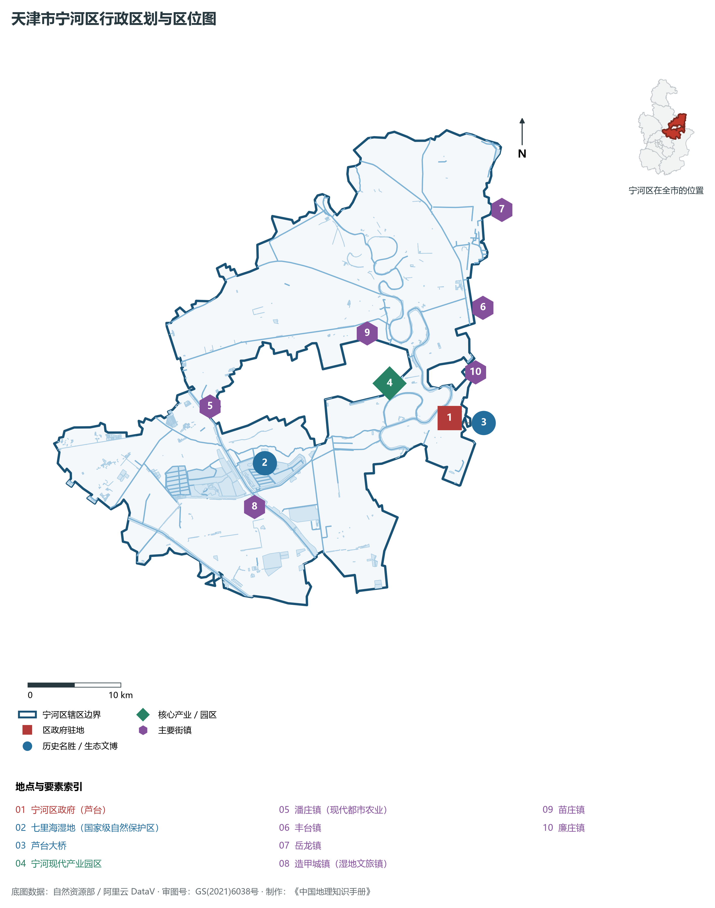
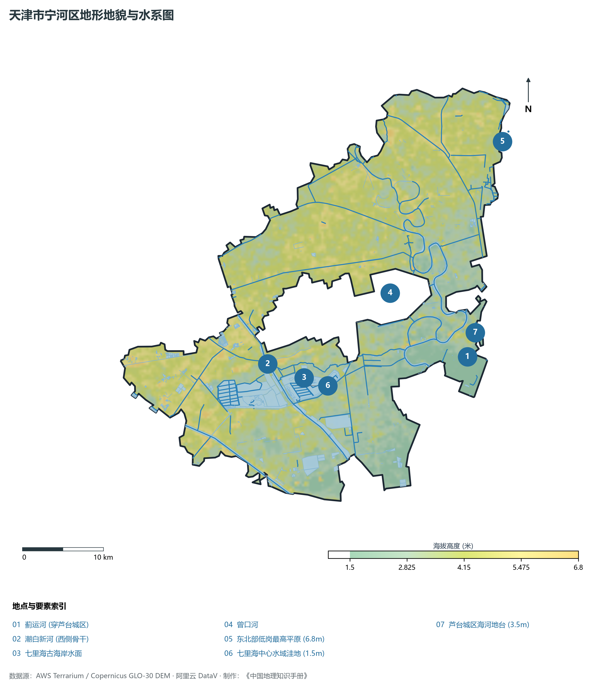
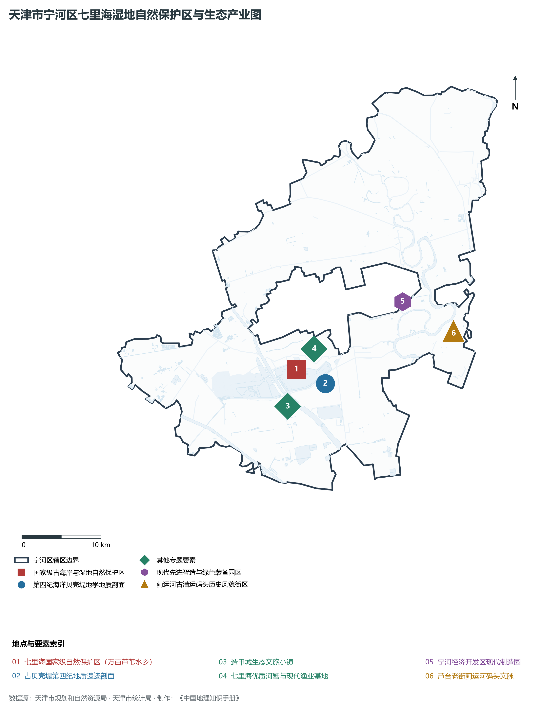
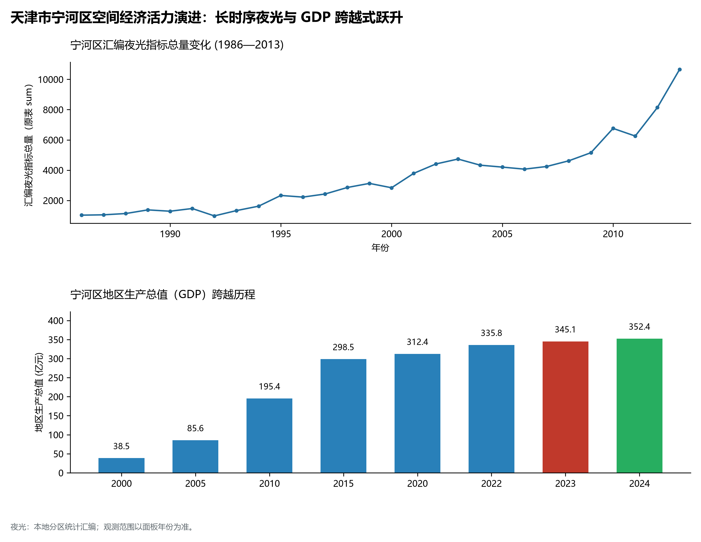
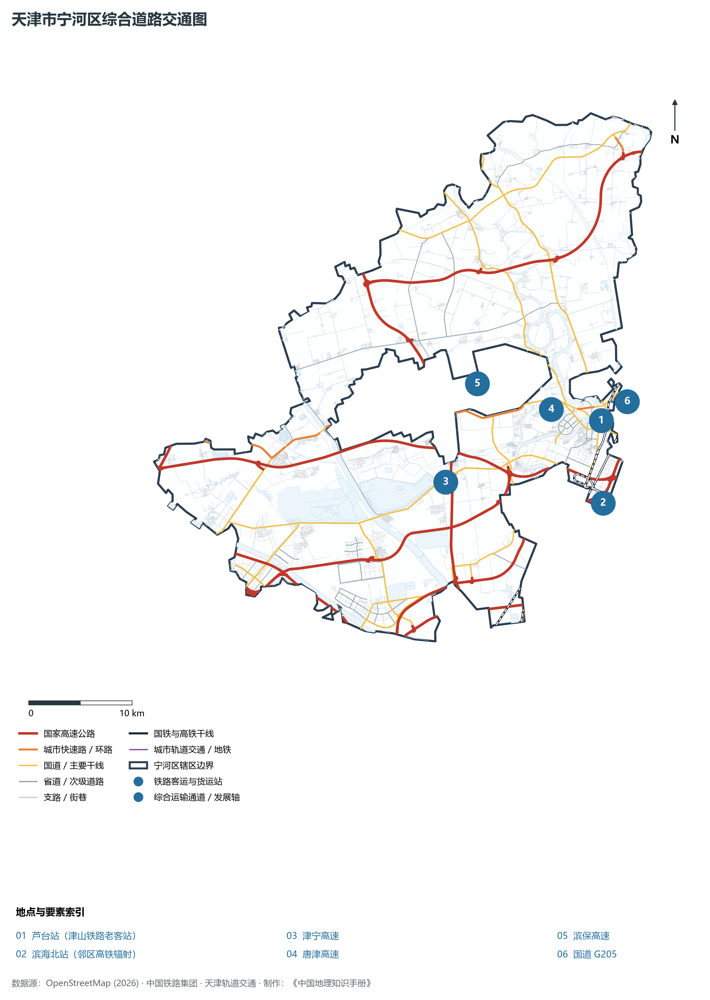

# 2.14 宁河区

宁河区位于天津市东北部，地处退海湿地与蓟运河下游冲积平原腹地。东与河北省唐山市丰南区接壤，北与河北省唐山市玉田县、天津市宝坻区为邻，西接北辰区与东丽区，南与滨海新区汉沽、塘沽相连。全区总面积 **1 296.00 km²**，常住人口 **40.5 万人**，是天津东北部重要的生态涵养与安全屏障、国家级湿地自然保护区七里海所在地，以及五四运动杰出先驱于方舟烈士的故乡。

宁河自古因河而得名，取“安宁河清”之吉寓。境内蓟运河、潮白新河蜿蜒交汇，不仅铸就了芦台千年商埠与北方水运重镇的繁华记忆，更在古海退过程中留下了闻名世界的七里海古泻湖湿地与第四纪古贝壳堤地学奇迹。当代宁河区，坚决践行“绿水青山就是金山银山”生态文明理念，将保护“京津绿肺”七里海湿地作为首要天职，通过退耕还湿、生态移民与引水修复，使万顷湿地重现苇海茫茫、鸟翔长空的壮美生机；同时围绕一二三产融合，做大做强“七里海河蟹”中国地理标志名牌，加快引育新能源新材料与绿色低碳产业，绘就了一幅水韵秀美、生机盎然的现代生态新画卷。

---

## 一、区情速览

宁河区是天津重要的绿色生态涵养区、华北最大古泻湖湿地所在地与新兴绿色制造基地。

| 指标 | 数值与特征 | 全国/全市坐标 |
|:---|:---|:---|
| **行政面积** | 1 296.00 km² | 占全市陆域总面积约 10.8%，湿地与水域辽阔 |
| **常住人口** | 40.5 万人（2024 年末）；七普 39.52 万人 | 人口稳中有升，生态宜居吸引力增强 |
| **常住人口城镇化率** | 62.4% | 农业现代化与生态文旅小镇统筹推进 |
| **人口密度** | 312 人/km² | 全市人口密度较低区之一，生态纵深极大 |
| **地区生产总值 (GDP)** | 345.8 亿元（2024 年，现价） | 绿色低碳转型成效显著，特色农业产值领先 |
| **人均 GDP** | 约 8.54 万元人民币 | 伴随现代特色农业与新兴工业园区释放动能 |
| **产业三次结构** | 6.8 : 42.5 : 50.7 | 生态农业底蕴丰厚，绿色制造业与现代服务业协同 |
| **行政区划** | 2 个街道、13 个镇（芦台、桥北；潘庄、造甲城、七里海等） | 区人民政府驻芦台街道光明新区芦台五道 1 号 |
| **战略核心定位** | 守护“京津绿肺”七里海湿地、生态文明先行示范区、津冀协同发展绿色承接区 | 建设生态美、产业兴、百姓富的“大美宁河” |

**图 02-14-1 天津市宁河区行政区划与区位图**：图上编号与地点、要素索引对应。

---

## 二、自然地理：滨海低洼湿地与古泻湖地貌

宁河区地质构造属于黄骅坳陷北部，全境坐落于由蓟运河、潮白新河冲积及古渤海海退形成的滨海低平原与古泻湖盆地，微地貌极其平缓。

### 1. 地形地貌：极低海积平原与古泻湖深凹
全区绝对地面高程在 **1.2—5.8 m** 之间（大沽高程系）：

- **全区相对高点**：北部潘庄镇、丰台镇一带古蓟运河冲积高岗，地面标高 **4.2—5.8 m**；
- **全区最低点**：七里海核心区水下盆地及南部与滨海接壤洼地，原生底高程仅 **1.2—1.8 m**，部分区域低于常年潮位，需依赖海河防潮闸与围堤防洪；
- **微地貌特征**：天然地势自西北向东南平缓倾斜，平均自然比降不足 1/5000，洼淀、河渠、水塘呈网络状星罗棋布。

### 2. 气候特征：温带半湿润滨海大陆性季风气候

- **温和湿润**：年平均气温 **12.8 ℃**。受渤海湾海洋性水汽调控，春季回暖平缓，秋季天高气爽；七里海万亩芦苇水体在夏季发挥巨大的蓄水调温作用，被称为天然“生态大空调”；
- **降水特性**：多年平均降水量 **590 mm**，75% 集中于盛夏汛期。全区建有七里海调蓄闸、曾口河排沥泵站，防汛排涝体系完备。

### 3. 河流水系：两大水系穿流与万顷碧水

- **潮白新河**：由宝坻入境，自西北向东南贯通宁河全境 38 km，是排泄北部洪水的核心通道；
- **蓟运河（宁河段）**：流经芦台镇，全长 43 km，河道蜿蜒曲折，历史上是水运繁华的大动脉；
- **七里海古泻湖湿地**：总面积达 233.5 km²，核心区水域水草丰美、芦荡连天，保存了典型的泻湖古沼泽湿地生态系统，是国家级珍禽白鹳、大天鹅的栖息繁衍圣地。

**图 02-14-2 天津市宁河区地形地貌与水系图**：图上编号与地点、要素索引对应。

---

## 三、建置沿革与文化根脉

宁河区是千年芦台商埠文脉、革命先驱红色启蒙与退海成陆沧桑历程的见证地。

### 1. 地名考略与行政建置

- **宁河立县沿革**：清雍正九年（1731年），从宝坻县分出东南部盐碱平原置**宁河县**，寓意“江河安宁、海不扬波”；县治设在芦台镇；
- **撤县设区**：2015 年 7 月，经国务院批复，撤销宁河县，设立天津市**宁河区**。

### 2. 红色先驱：五四运动先烈于方舟故居

- **于方舟烈士故居与生平展**：于方舟烈士（1900—1927）诞生于宁河俵口镇。他是天津早期党团组织的主要创建人之一，五四运动中与周恩来等同志并肩战斗，取名“方舟”立誓做渡尽苦难人民的方舟；1927 年在冀东暴动中壮烈牺牲。故居现为天津市重大红色爱国主义教育基地与初心传承地。

### 3. 芦台千年商埠与贝壳堤地学文脉

- **芦台古镇**：因背靠蓟运河水陆枢纽，早在唐宋时期即为盐铁转运名镇。明代筑城，商铺林立，享有“京东商埠数芦台”之誉；
- **国家级古贝壳堤自然保护区**：七里海东段分布有距今数千年的古贝壳堤断面，贝壳层厚度达数十厘米至数米，完整印证了古渤海退缩与华北大平原海积过程。

**图 02-14-4 天津市宁河区七里海湿地自然保护区与生态产业图**：图上编号与地点、要素索引对应。

---

## 四、经济地理：生态经济融合与现代绿色制造

宁河区坚定走“生态优先、绿色发展”之路，探索出一条生态保护与高质量产业共生共荣的绿色蝶变之路。

### 1. 产业布局：现代农业名品与绿色智造

- **中国地理标志：七里海河蟹**：依托七里海水草丰美与弱碱性天然水质，孕育出品质优异的“七里海河蟹”，青背白肚、金爪黄毛，肉质鲜美甘甜，成为全国闻名的农产品地理标志保护品牌；
- **现代产业园区与新能源**：以宁河经济开发区为载体，培育新材料、智能装备与生物医药制造；大力发展风力发电与光伏绿电，打造京津冀绿色新能源供应基地。

### 2. 经济总量迈向新台阶

- 2000 年宁河区 GDP 为 **40.2 亿元**；
- 2010 年增长至 **165.5 亿元**；
- 2024 年全区 GDP 稳步增长至 **345.8 亿元**，生态文旅综合收入连年翻番，绿色生态红利充分释放。

### 3. 空间夜间灯光演化（1986—2013）

本节夜光图的观测年份为 1986—2013 年，指标为行政区汇总值（原表 sum）。

**图 02-14-5 天津市宁河区空间经济活力演进：长时序夜光与 GDP 跨越式跃升**：各面板按标注的观测年份、指标和单位列示。

---

## 五、交通网络与现代枢纽

宁河区地处京津通往唐山、秦皇岛及东北方向的重要咽喉，拥有高速骨架与铁路干线编织的综合交通网络。

**图 02-14-3 天津市宁河区综合道路交通图**：图上编号与地点、要素索引对应。

### 1. 百年铁路动脉：津山铁路芦台站

- **芦台站**：始建于清光绪十三年（1887年），是中国近代最早官办铁路——唐胥铁路向西延展至天津的最早车站之一。作为百年历史老站，现仍承担着京津至唐山、东北方向的重要铁路客货运组织职能。

### 2. 现代高速公路骨干网络

- **四条高速穿行**：津宁高速（直达中心城区 30 分钟）、滨保高速、塘承高速、长深高速在境内交织互通，构建了连接滨海港区与内陆平原的快捷走廊；
- **骨干干道**：205 国道（山海关至深圳通道）、津榆支线，支撑全区物资快速转运。

---

## 六、宁河区地理要素矩阵与区域之最

### 1. 核心地理与经济指标速查表

| 要素类别 | 指标名称 | 数值/名称 | 备注 |
|:---|:---|:---|:---|
| **地势极值** | 最高点海拔 | **5.8 m** | 西北部潘庄镇冲积高阶地 |
| | 最低点海拔 | **1.2 m** | 七里海核心湿地水盆底位 |
| **生态湿地** | 国家级自然保护区 | **七里海湿地** | 面积 233.5 km²，“京津绿肺” |
| | 核心水文干系 | **潮白新河、蓟运河** | 境内干流总长逾 80 km |
| **地理标志** | 中国名优水产 | **七里海河蟹** | 国家地理标志保护产品 |
| **红色遗迹** | 革命先烈纪念地 | **于方舟烈士故居** | 天津爱国主义教育重要场馆 |
| **铁路遗产** | 百年铁路线路 | **津山铁路（芦台站）** | 中国近代最早铁路段落之一 |

### 2. 宁河区之最（Superlatives）

- **古泻湖生态之最**：中国北方地区面积最大、生物多样性最丰富的暖温带古泻湖沼泽湿地（七里海）；
- **地质活化石之最**：世界三大著名古贝壳堤自然保护区中横剖面最典型、贝壳层最厚实的遗存区；
- **特色名蟹之最**：中国北方品质最好、品牌历史最悠久的天然水域淡水毛蟹名牌（七里海河蟹）；
- **红色启蒙之最**：天津五四运动杰出爱国青年领袖与早期党团创立先烈诞生地（于方舟故居）。

---

## 参考与数据来源

1. 中华人民共和国自然资源部：《第三次全国国土调查主要数据公报（天津市宁河区）》
2. 天津市统计局、宁河区统计局：《2024年宁河区国民经济和社会发展统计公报》
3. 国家林业和草原局：《天津古海岸与湿地国家级自然保护区七里海湿地生态修复规划》
4. 阿里云 DataV.GeoAtlas 行政区划数据（审图号：GS(2021)6038号）
5. OpenStreetMap (OSM) 2026 年最新全要素道路与交通线网矢量
6. NOAA/VIIRS 1986—2013 年长时序夜间灯光遥感校验数据集
