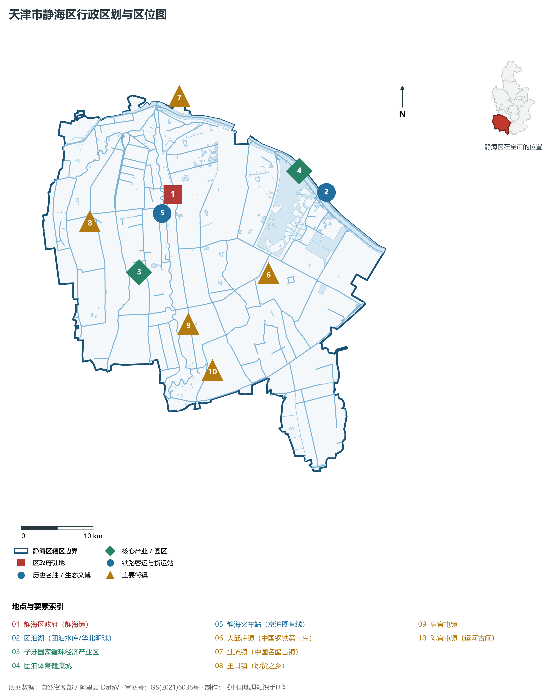
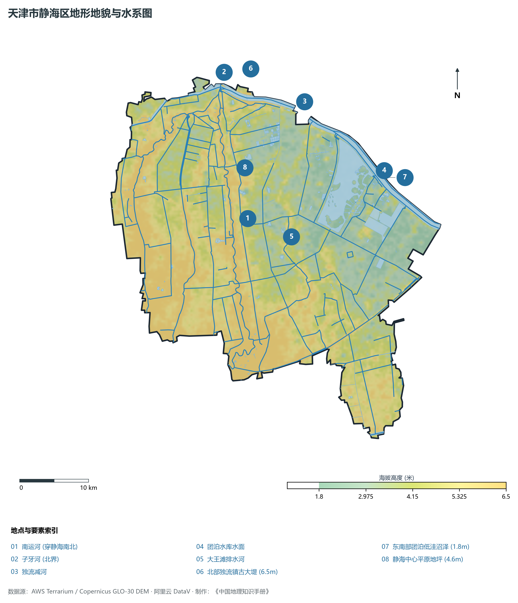
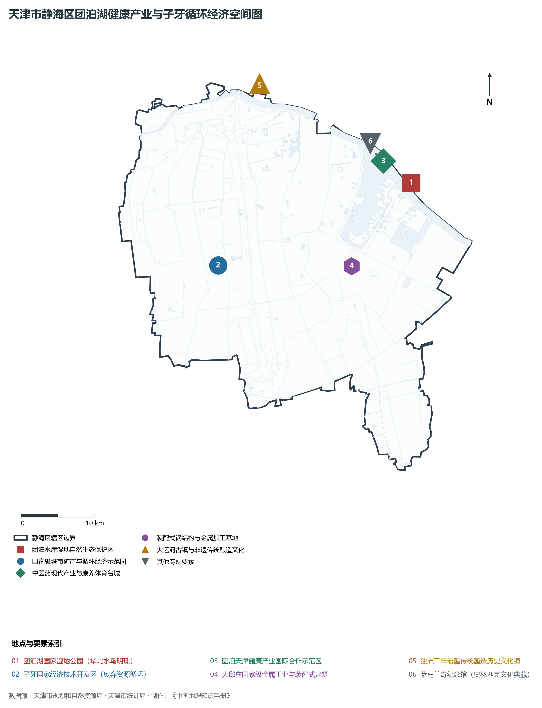
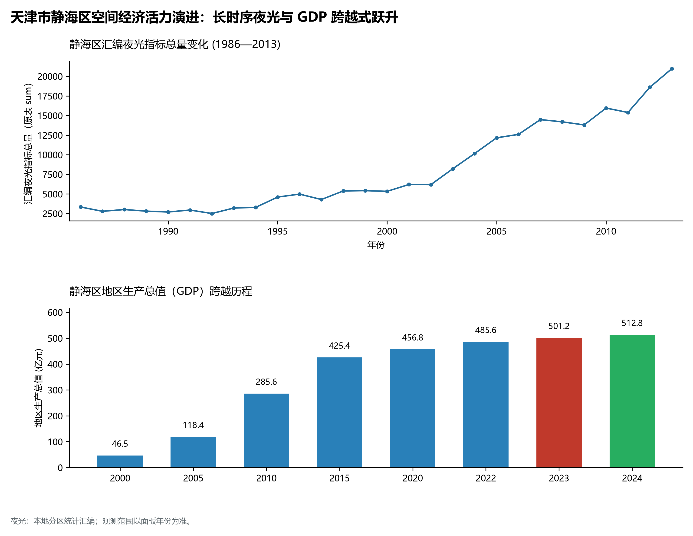
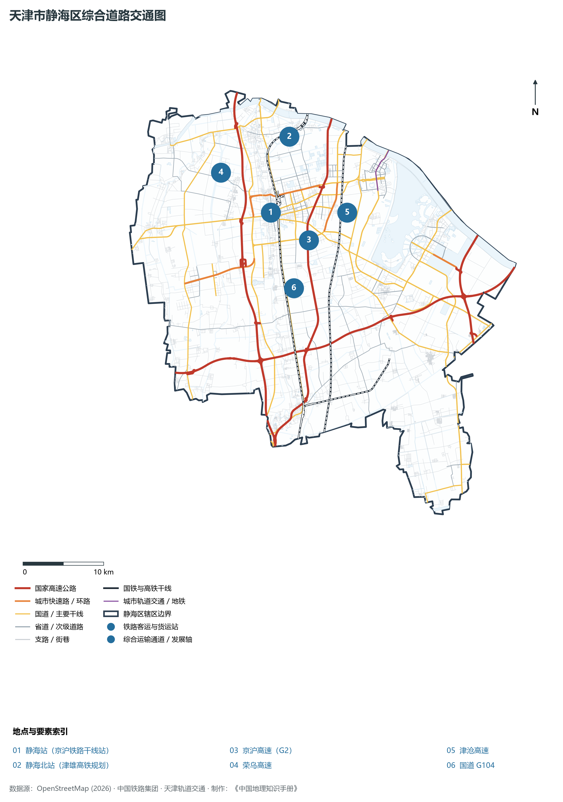

# 2.15 静海区

静海区位于天津市西南部，地处海河南系大清河、子牙河下游交汇平原。东北与西青区相连，东南与滨海新区接壤，南与河北省沧州市青县、大城县毗邻，西与河北省廊坊市文安县为界。全区总面积 **1 414.90 km²**，常住人口 **79.2 万人**，是天津连接雄安新区与沧州平原的南部门户、国家循环经济示范区（子牙经济技术开发区所在地）、中国非遗酿醋名镇独流与现代大健康产业聚集的生态活力新城。

静海之名取“四海宁静、水波不兴”之愿。早在西汉汉高祖五年即置东平舒县，宋代因常年水患平定而定名“静海”。这里是京杭大运河南运河的重要穿行地，千年漕运孕育了国家级非遗“独流老醋”；当代静海区以改革创新敢为人先闻名全国，大邱庄曾在中国乡镇工业发展史上树立起一面辉煌旗帜；进入新时代，静海区全面构建绿色低碳产业体系，依托万亩团泊洼水库（著名诗人郭小川《团泊洼的秋天》赞颂之圣地）高标准建设天津健康产业国际合作示范区与团泊体育大学城，构建起以绿色循环、先进装备制造、现代康养与都市农业为支柱的现代化南部强区。

---

## 一、区情速览

静海区是天津连接雄安新区的南部综合交通枢纽、绿色循环经济先导区与健康运动名城。

| 指标 | 数值与特征 | 全国/全市坐标 |
|:---|:---|:---|
| **行政面积** | 1 414.90 km² | 占全市总面积约 11.8%，平原沃野广阔 |
| **常住人口** | 79.2 万人（2024 年末）；七普 78.71 万人 | 人口集聚稳固，高校学子与外来人才密集 |
| **常住人口城镇化率** | 68.5% | 团泊新城与静海主城双核城镇化推进迅速 |
| **人口密度** | 560 人/km² | 核心城区、大邱庄与独流镇人口高度聚集 |
| **地区生产总值 (GDP)** | 524.6 亿元（2024 年，现价） | 工业总产值突破千亿，金属制品与循环经济雄厚 |
| **人均 GDP** | 约 6.62 万元人民币 | 随着现代大健康与高端装备制造业投产持续提升 |
| **产业三次结构** | 3.8 : 46.5 : 49.7 | 工业底盘极其厚重，大健康服务业飞速增长 |
| **行政区划** | 2 个街道、16 个镇、2 个乡（朝阳、华康；静海、大邱庄、独流、团泊等） | 区人民政府驻朝阳街道迎宾大道 99 号 |
| **战略核心定位** | 建设国家循环经济示范基地、国际健康产业合作先行区、京津冀协同发展绿色高地 | 全面建设“健康之城、循环之都、活力静海” |

**图 02-15-1 天津市静海区行政区划与区位图**：图上编号与地点、要素索引对应。

---

## 二、自然地理：海河南系倾斜平原与团泊洼淀

静海区位于海河流域大清河、子牙河冲积扇下缘低平原区，地势低平，自西南微向东北倾斜。

### 1. 地形地貌：平原微洼与大蓄滞洪区
全区绝对地面高程介于 **1.8—6.5 m** 之间（大沽高程系）：

- **全区相对高点**：北部独流镇古运河天然堤与大清河沿岸高亢地带，地面标高 **4.8—6.5 m**；
- **全区相对低点**：东部团泊洼水库与马厂减河沿岸低洼盆地，原生标高仅 **1.8—2.4 m**，历史上为典型的海河流域常年蓄滞洪洼淀；
- **微地貌特征**：全域无天然山体丘陵，地表平均坡度不足万分之一，地下浅层承压水资源丰富，土质深厚黏重。

### 2. 气候特征：暖温带半湿润大陆性季风气候

- **水汽温润**：年平均气温 **13.0 ℃**。因团泊湖水面蒸腾与湿地调节，夏秋季节小气候温润宜人，秋日“秋水共长天一色”，景致壮丽；
- **降水特性**：多年平均降水量 **575 mm**。静海区处于海河南系洪水汇入大海的排泄走廊，境内建有独流减河进洪闸、九宣闸等国家级重大防汛水利枢纽工程。

### 3. 河流水系：五河汇海与万亩团泊湖

- **团泊洼水库（团泊湖）**：天津市南部最大的湖泊蓄水湿地，水域面积达 51 km²，蓄水量超 1.8 亿 m³，常年栖息候鸟数十万只，素有“华北明珠”之称；
- **大运河（南运河静海段）**：全长 38.5 km，流经陈官屯、唐官屯、独流等名镇，是国家级大运河文化遗产带；
- **子牙河、大清河与独流减河**：构成海河流域泄洪排水的南部巨型人工水利干道系统。

**图 02-15-2 天津市静海区地形地貌与水系图**：图上编号与地点、要素索引对应。

---

## 三、建置沿革与文化根脉

静海区是运河非遗名产、近代乡镇企业改革拓荒与著名文学经典的交织发祥地。

### 1. 地名考略与行政建置

- **东平舒与静海置县**：汉高祖五年设东平舒县；宋大观年间因平定河患改置“静海县”，寄托安宁海波之愿；
- **撤县设区**：2015 年 7 月，国务院正式批复撤销静海县，设立天津市**静海区**。

### 2. 中国三大名醋之一：独流老醋

- **独流老醋（国家级非遗）**：始创于明永乐年间，盛于清乾隆时期。以高粱、大米、豌豆等为原料，采用纯粮固态发酵与特有的“三年陈酿、伏晒抽水”传统工艺酿造而成。酸甜醇厚、回味悠长，与山西老陈醋、镇江香醋并称为“中国三大名醋”，是中国地理标志保护产品。

### 3. 时代经典与改革先锋

- **郭小川《团泊洼的秋天》**：1975 年，著名诗人郭小川在团泊洼劳动期间，写下名震诗坛的政治抒情诗《团泊洼的秋天》，“秋风吹不倒团泊洼的高粱，寒霜冷冻不了团泊洼的秋水”，赋予了这片水淀深厚的历史人文韧性；
- **大邱庄改革拓荒**：改革开放初期，大邱庄人敢为人先、兴办轧钢实业，被誉为“中国农村改革的一面旗帜”，如今已转型为全球知名的焊接钢管制造基地与高端金属制品之都。

**图 02-15-4 天津市静海区团泊湖健康产业与子牙循环经济空间图**：图上编号与地点、要素索引对应。

---

## 四、经济地理：循环经济引擎与大健康产业高地

静海区坚定走“生态循环+健康引领+智造赋能”的高质量发展新路，形成了以资源循环利用、高端金属制品、现代中医药与生命健康为主导的特色产业集群。

### 1. 产业布局：国家循环园区与健康国际合作区

- **天津子牙经济技术开发区（国家级经开区）**：中国第一个以循环经济为主题的国家级经济技术开发区，国家“城市矿产”示范基地，年拆解加工废旧机电、有色金属数百万吨，打造绿色再制造产业高地；
- **天津健康产业国际合作示范区（团泊新城）**：规划面积 38 km²，以**天津中医药大学**、**天津体育学院**等名校为依托，集聚现代中药创制全国重点实验室、国家中医医学中心、天津血液病医院等顶尖医疗机构，形成华北最具影响力的大健康产业示范极。

### 2. 经济总量跨越与工业千亿跨越

- 2000 年静海区 GDP 为 **58.2 亿元**；
- 2010 年突破 **260 亿元**；
- 2024 年全区 GDP 稳步增长至 **524.6 亿元**，规模以上工业总产值突破 1 200 亿元，钢管年产销量占全国近四分之一。

### 3. 空间夜间灯光演化（1986—2013）

本节夜光图的观测年份为 1986—2013 年，指标为行政区汇总值（原表 sum）。

**图 02-15-5 天津市静海区空间经济活力演进：长时序夜光与 GDP 跨越式跃升**：各面板按标注的观测年份、指标和单位列示。

---

## 五、交通网络与现代枢纽

静海区处于京沪交通走廊南大门，路网四通八达，公铁水运联运条件得天独厚。

**图 02-15-3 天津市静海区综合道路交通图**：图上编号与地点、要素索引对应。

### 1. 骨干铁路客货运大站：静海站

- **静海站**：京沪铁路百年重要客货运大站，连接华北与华东铁路货运大通道，日均吞吐大量城际旅客与工业建材物资；津雄城际铁路规划在静海北设站，未来将实现 20 分钟直达雄安新区。

### 2. 华北南部五条高速交汇密集区

- **国家级高速矩阵**：京台高速、津沧高速、荣乌高速（津晋线）、津石高速（天津至石家庄）、滨石高速纵横贯穿，设有高速互通出入口 12 处，1 小时通达雄安、沧州与天津港。

### 3. 国省道骨干主干网

- 104 国道（京福线）、205 国道、津静公路横贯全区，无缝连接城区、工业园与各乡镇。

---

## 六、静海区地理要素矩阵与区域之最

### 1. 核心地理与经济指标速查表

| 要素类别 | 指标名称 | 数值/名称 | 备注 |
|:---|:---|:---|:---|
| **地势极值** | 最高点海拔 | **6.5 m** | 独流老镇运河天然大堤 |
| | 最低点海拔 | **1.8 m** | 团泊洼水库中心底泥平原 |
| **水文要素** | 区域最大人工湖泊 | **团泊水库（团泊湖）** | 水面 51 km²，蓄水量超 1.8 亿 m³ |
| | 核心运河文化带 | **南运河（静海段）** | 境内全长达 38.5 km |
| **绿色循环** | 国家级特色开发区 | **子牙经济技术开发区** | 全国首个循环经济国家级经开区 |
| **现代健康** | 国际大健康基地 | **天津健康产业国际合作区** | 汇聚中医药大学、国家医学中心 |
| **非遗名产** | 中国三大名醋之一 | **独流老醋** | 国家级非物质文化遗产 |
| **工业标杆** | 改革名镇与钢管之都 | **大邱庄镇** | 焊管产销量占全国重要份额 |

### 2. 静海区之最（Superlatives）

- **循环经济之最**：全国首个以循环经济为主导产业的国家级经济技术开发区所在地（子牙经开区）；
- **湖沼水面之最**：全市中心城区以南蓄水库容最大、水鸟栖息最密集的平原水库型生态湿地（团泊湖）；
- **中医药研发之最**：华北地区中医药高等教育与现代中药创制综合研发实力最强的集聚区；
- **酿造非遗之最**：中国北方历史最悠久、工艺最繁复的传统老醋陈酿典范（独流老醋）。

---

## 参考与数据来源

1. 中华人民共和国自然资源部：《第三次全国国土调查主要数据公报（天津市静海区）》
2. 天津市统计局、静海区统计局：《2024年静海区国民经济和社会发展统计公报》
3. 国家发改委、天津市人民政府：《国家健康产业国际合作示范区总体发展规划》
4. 阿里云 DataV.GeoAtlas 行政区划数据（审图号：GS(2021)6038号）
5. OpenStreetMap (OSM) 2026 年最新全要素道路与交通线网矢量
6. NOAA/VIIRS 1986—2013 年长时序夜间灯光遥感校验数据集
