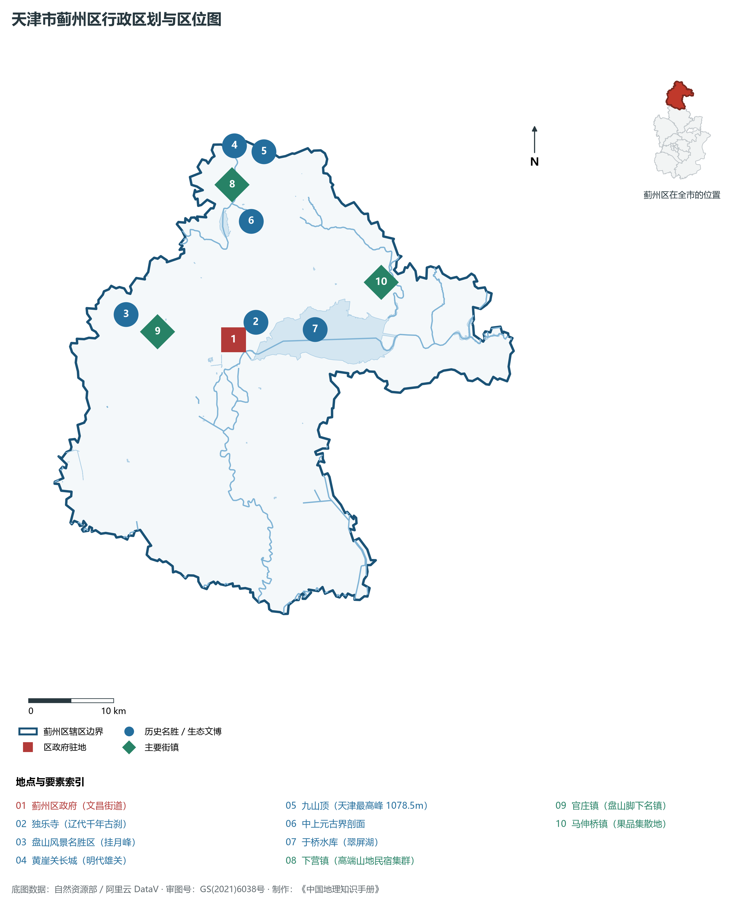
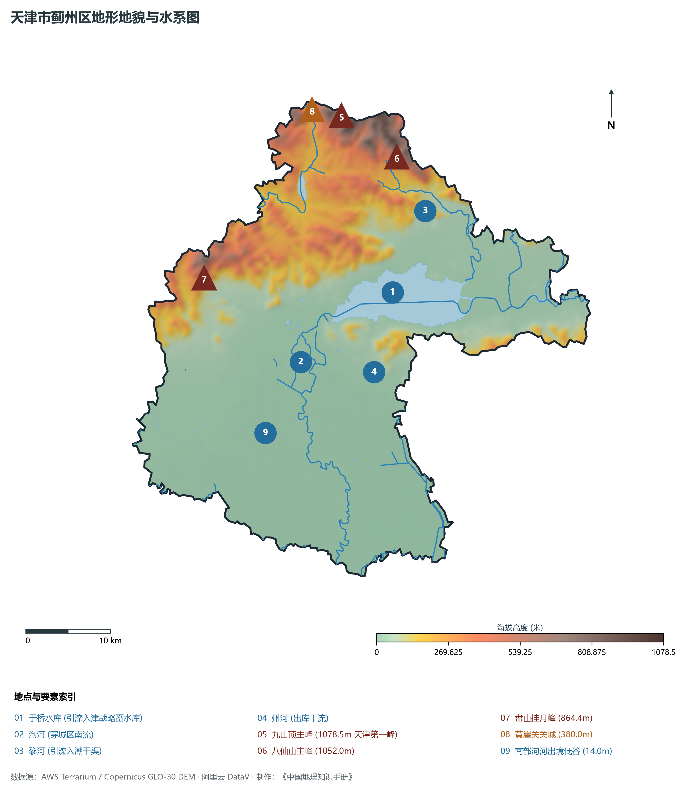
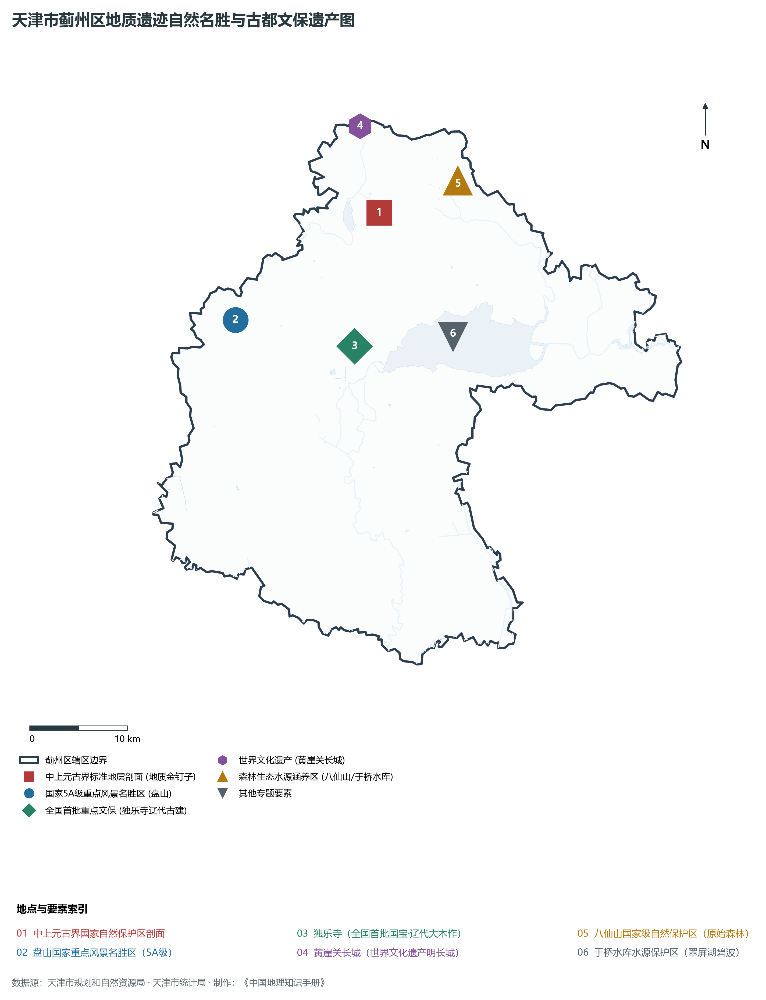
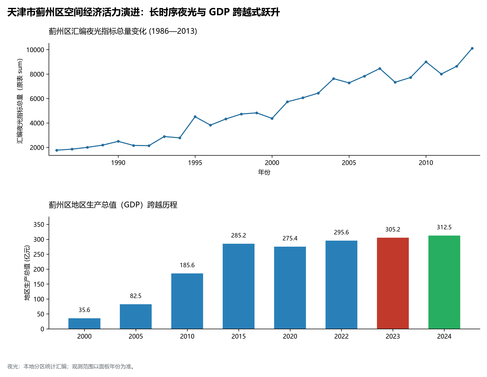
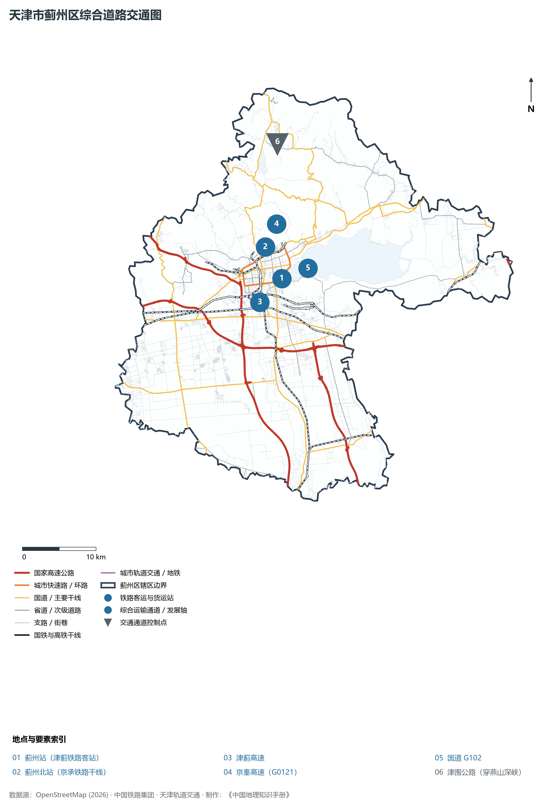

# 2.16 蓟州区

蓟州区位于天津市最北部，地处燕山山脉南麓余脉向华北平原过渡的地貌梯级枢纽。东邻河北省唐山市遵化市、迁西县，西接北京市平谷区、密云区，南临宝坻区，东南接河北省玉田县，北依燕山主脊与河北省承德市兴隆县接壤。全区总面积 **1 590.00 km²**，常住人口 **79.8 万人**，是天津市唯一的半山半丘陵区与纯深山区、国家级重点生态功能区、国家全域旅游示范区，拥有天津市陆域最高峰九山顶（1 078.5 m），素有“京津后花园”之美誉。

蓟州文史地学双峰并峙，是大自然与华夏文明在此凝铸的崇高杰作。地质学界誉其为“大地史书”，境内完整出露厚达数千米、距今 18 亿至 8 亿年的“中上元古界国家自然保护区”，是全球中上元古界地层的标准剖面与地学圣殿。在文化年轮中，蓟州古称渔阳，隋唐置蓟州，历为北方军事重镇与长城要隘；独乐寺观音阁建于辽统和二年（984年），以国内现存最古老的木结构高阁与十一面观音巨像令梁思成、林徽因先生折服倾倒；盘山胜景更得乾隆皇帝“早知有盘山，何必下江南”的至高赞誉。当代蓟州区，坚定不移守护“绿水青山”，以于桥水库生态安全为天职，全力打造国家级全域生态文旅胜地与绿色都市康养名城，构筑起拱卫京津的巍峨生态屏障。

---

## 一、区情速览

蓟州区是天津唯一的燕山深山森林生态涵养区、国家全域旅游示范区与世界地学名山胜地。

| 指标 | 数值与特征 | 全国/全市坐标 |
|:---|:---|:---|
| **行政面积** | 1 590.00 km² | 占全市总面积约 13.3%，山地丘陵占全区半壁 |
| **常住人口** | 79.8 万人（2024 年末）；七普 79.55 万人 | 山区人口布局错落，文旅康养从业人口集聚 |
| **常住人口城镇化率** | 58.2% | 生态乡村与精品文旅小镇独具魅力 |
| **人口密度** | 502 人/km² | 南部平原较密集，北部深山区人口稀疏 |
| **地区生产总值 (GDP)** | 312.5 亿元（2024 年，现价） | 生态文旅产业附加值极高，绿色发展成色足 |
| **人均 GDP** | 约 3.92 万元人民币 | 依托全域旅游、特色果品与绿色康养持续提升 |
| **产业三次结构** | 8.5 : 32.2 : 59.3 | 生态农业品质卓越，现代文旅服务业为主引擎 |
| **行政区划** | 1 个街道、25 个镇、1 个民族乡（文昌；渔阳、洇溜、官庄、下营等） | 区人民政府驻文昌街道府前街 2 号 |
| **战略核心定位** | 京津生态涵养核心区、绿色低碳创新样板区、国家全域旅游示范区、健康宜居福地 | 全面建设“生态优先绿色发展典范城市” |

**图 02-16-1 天津市蓟州区行政区划与区位图**：图上编号与地点、要素索引对应。

---

## 二、自然地理：燕山崇山峻岭与高山峡谷地貌

蓟州区地貌在天津乃至华北平原独树一帜，由北向南呈现出“深山—浅丘—山前洪积平原—水库湖盆”的剧烈梯级高差过渡。

### 1. 地形地貌：天津地势之巅与中上元古界奇观
全区绝对地面高程在 **5.5—1 078.5 m** 之间（大沽高程系），垂直落差超千米：

- **全市最高峰：九山顶**：位于下营镇常州村东北界，海拔 **1 078.5 m**，是天津市陆地绝对地理制高点。山势雄奇险峻，登顶可“一脚踏三省”（京、津、冀）；
- **第二第三高峰**：八仙山主峰海拔 **1 052.0 m**，森林覆盖率达 95% 以上，是华北罕见的原始次生林森林公园；盘山挂月峰海拔 **864.4 m**，怪石嶙峋，名泉竞涌；
- **全球地质圣殿：中上元古界剖面**：厚达 9 197 米的沉积变质岩石地层，形成于距今 18.5 亿至 8 亿年前，完好封存着古单细胞真核生物、叠层石化石，被国际地科联确立为全球地质年代划分的标准剖面；
- **全区最低点**：东南部于桥水库库尾及与宝坻接壤的低平原湿地，海拔仅 **5.5—7.5 m**。

### 2. 气候特征：温带半湿润山地季风气候

- **立体山地小气候**：年平均气温 **11.5 ℃**（九山顶等高山地区年均温仅 7—8 ℃），盛夏平均气温比天津市区低 4—6 ℃，是华北著名的避暑清凉胜地；
- **全市降水中心**：多年平均降水量达 **720—780 mm**，高山迎风坡最高年份可达 1 000 mm 以上，充沛的山地降水孕育了蓟北森林甘泉与丰富的地下矿泉水资源。

### 3. 河流水系：引滦入津巨库与山溪纵横

- **于桥水库（翠屏湖）**：天津市最重要的水源调蓄水库，总库容达 15.6 亿 m³，引滦入津工程的调蓄枢纽大水库。水面碧波万顷，四周青山环绕，如同一面巨大的翡翠明镜镶嵌在蓟州平原上；
- **泃河与州河**：发源于北部深山峡谷，汇入于桥水库后南下海河水系；
- **黎河与淋河**：穿行崇山峻岭，常年清流潺潺，为两岸山谷带来灵动的飞瀑与深潭。

**图 02-16-2 天津市蓟州区地形地貌与水系图**：图上编号与地点、要素索引对应。

---

## 三、建置沿革与文化根脉

蓟州区是华夏文明的古老原点之一，集长城军事古堡、辽代木构奇迹与帝王文人名山于一身。

### 1. 地名考略与行政沿革

- **渔阳古郡与蓟州得名**：春秋战国属燕国；秦设无终县；隋大业三年改置渔阳郡；唐开元十八年（730年）以境内蓟门山（盘山旧称）而始称**蓟州**；
- **撤县设区**：1913 年改称蓟县；2016 年 7 月，国务院正式批复撤销蓟县，设立天津市**蓟州区**。

### 2. 中国木构建筑极品：独乐寺观音阁

- **独乐寺（全国首批重点文保单位）**：始建于唐贞观十年，辽统和二年（984年）重建。主阁**观音阁**高达 23 米，是我国现存最古老的木结构楼阁式建筑；阁内矗立着高达 16 米的**十一面观音立像**，为我国现存最大的辽代泥塑立像；
- **建筑大师梁思成考察**：1932 年梁思成先生首次对独乐寺进行深入科学测绘，并在《独乐寺观音阁山门考》中惊叹其“上承唐代遗风，下启宋式营造，其结构至巧，为海内孤品”。

### 3. 盘山国家 5A 级景区与黄崖关明长城

- **盘山风景名胜区（国家 5A 级景区）**：自古以“三盘胜境”（上盘松胜、中盘石胜、下盘水胜）名扬天下。清代康熙、乾隆皇帝曾数十次巡幸盘山，乾隆帝留下脍炙人口的御题长叹：“早知有盘山，何必下江南”；
- **黄崖关长城（全国重点文保单位）**：明代蓟镇长城重要关隘，抗倭名将戚继光曾在此担纲总兵巡阅戍守。建有全国首座长城博物馆、八卦迷宫关城与悬空长城，气势磅礴。

**图 02-16-4 天津市蓟州区地质遗迹自然名胜与古都文保遗产图**：图上编号与地点、要素索引对应。

---

## 四、经济地理：生态产业化与全域旅游典范

蓟州区摒弃传统重工污染模式，深耕“绿水青山”资源禀赋，成为华北地区生态产品价值实现机制（VEP）的先行示范者。

### 1. 产业布局：全域生态旅游与特色康养

- **国家全域旅游示范区**：全区拥有国家 5A 级景区 1 处（盘山）、4A 级景区 5 处（黄崖关长城、独乐寺、梨木台、九山顶、车神架），精品民宿与乡村旅游重点村数百个，郭家沟、常州村等荣获全国乡村旅游重点村镇称号；
- **绿色地理标志名果**：依托富硒山地土壤与纯净泉水，培育了“蓟州板栗”、“盘山柿子”、“桑梓西瓜”、“黄花山核桃”等十余个中国地理标志保护产品，林果总产值数亿元。

### 2. 经济总量与生态价值提升

- 2000 年蓟州区（蓟县）GDP 为 **48.6 亿元**；
- 2010 年增长至 **165.2 亿元**；
- 2024 年全区 GDP 稳步增长至 **312.5 亿元**，第三产业增加值占 GDP 达 59.3%，生态富民与绿色 GDP 质量稳居全市各区前列。

### 3. 空间夜间灯光演化（1986—2013）

本节夜光图的观测年份为 1986—2013 年，指标为行政区汇总值（原表 sum）。

**图 02-16-5 天津市蓟州区空间经济活力演进：长时序夜光与 GDP 跨越式跃升**：各面板按标注的观测年份、指标和单位列示。

---

## 五、交通网络与现代枢纽

蓟州区处于京津唐承四市交汇中心，铁路干线与山地高速环线构筑了通达便捷的现代旅游交通体系。

**图 02-16-3 天津市蓟州区综合道路交通图**：图上编号与地点、要素索引对应。

### 1. 景区直通铁路与客运老站

- **津蓟铁路客运专线（蓟州北站）**：自天津站直达蓟州北站，常年开行大容量市郊旅游列车与“大美蓟州”主题文旅列车，是市民奔赴蓟北避暑度假的“绿色快巴”；
- **大秦重载铁路（蓟州站）**：国家特大运煤能源干线横穿全区南部，担负着国家能源战略保供任务。

### 2. 高速公路网络

- **津蓟高速公路**：天津中心城区直通盘山与蓟州主城的交通脊梁，全程仅需 1 小时；
- **京秦高速公路与塘承高速**：横贯东西、纵连南北，使蓟州半小时通达北京副中心、1 小时通达承德与唐山。

### 3. 全市最美山地公路：津围北二线

- 全长约 31 km，全线桥隧相连、盘山越岭，沿线设多处高山观景台与停车驿站，是华北最负盛名的自驾游“最美天路”。

---

## 六、蓟州区地理要素矩阵与区域之最

### 1. 核心地理与经济指标速查表

| 要素类别 | 指标名称 | 数值/名称 | 备注 |
|:---|:---|:---|:---|
| **地势极值** | 最高点海拔（全市第一峰） | **1 078.5 m** | 九山顶（下营镇常州村） |
| | 最低点海拔 | **5.5 m** | 于桥水库库尾低平原地坪 |
| **全市地势落差** | 最大相对高差 | **1 073.0 m** | 全市高差最大市辖区 |
| **水文要素** | 城市战略生命线水库 | **于桥水库（翠屏湖）** | 总库容 15.6 亿 m³，引滦调蓄 |
| **地质奇观** | 全球标准地层剖面 | **中上元古界剖面** | 距今 18.5 亿至 8 亿年历史 |
| **古代建筑** | 辽代第一木构 | **独乐寺观音阁** | 全国首批重点文保单位（984 年） |
| **名胜景区** | 国家 5A 级景区 | **盘山风景名胜区** | 乾隆帝赞“何必下江南” |
| **长城古迹** | 戚继光戍守要隘 | **黄崖关长城** | 拥有全国首座长城博物馆 |

### 2. 蓟州区之最（Superlatives）

- **地理地势之最**：全市唯一纯山地行政区，拥有全天津最高地理极点——九山顶（1 078.5 m）；
- **地学剖面之最**：世界上出露最完整、序列最连续的中上元古界地质标准剖面（蓟县剖面）；
- **古代木构之最**：中国现存年代最久远的木结构多层楼阁式建筑殿堂（独乐寺观音阁，建于 984 年）；
- **水源工程之最**：保障天津城市生产生活数十年清泉供给的引滦入津调蓄水库（于桥水库）；
- **自然森林之最**：华北地区石质山地温带原始次生林保存最完好的天然植物基因库（八仙山）。

---

## 参考与数据来源

1. 中华人民共和国自然资源部：《第三次全国国土调查主要数据公报（天津市蓟州区）》
2. 天津市统计局、蓟州区统计局：《2024年蓟州区国民经济和社会发展统计公报》
3. 国家地质矿产部、国际地层委员会：《天津蓟县中上元古界国家自然保护区地质科学报告》
4. 梁思成：《独乐寺观音阁山门考》（《中国营造学社汇刊》第三卷第二期）
5. 阿里云 DataV.GeoAtlas 行政区划数据（审图号：GS(2021)6038号）
6. OpenStreetMap (OSM) 2026 年最新全要素道路与交通线网矢量
7. AWS Terrain Tiles / Copernicus GLO-30 数字高程模型（DEM）
