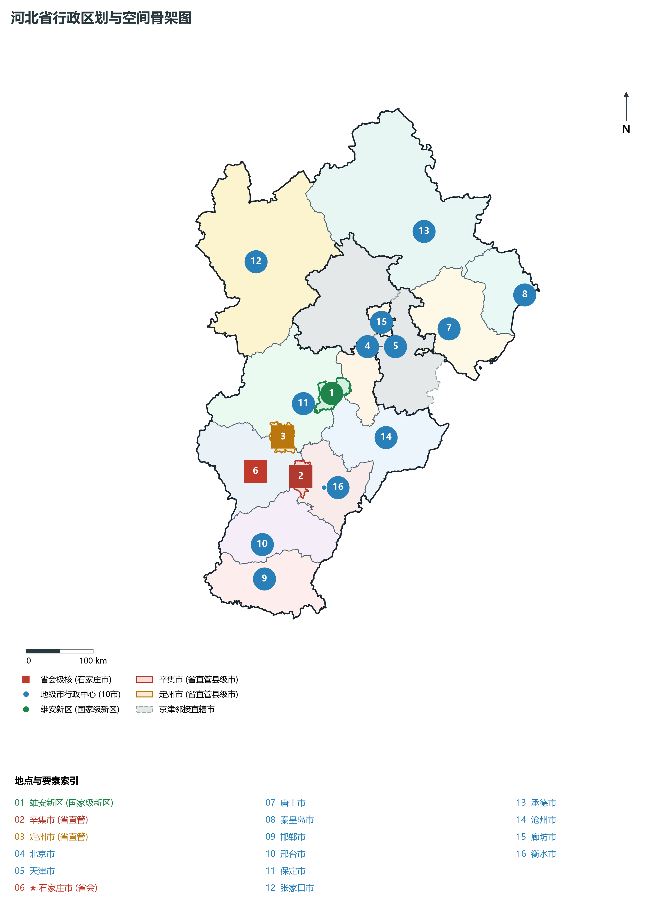
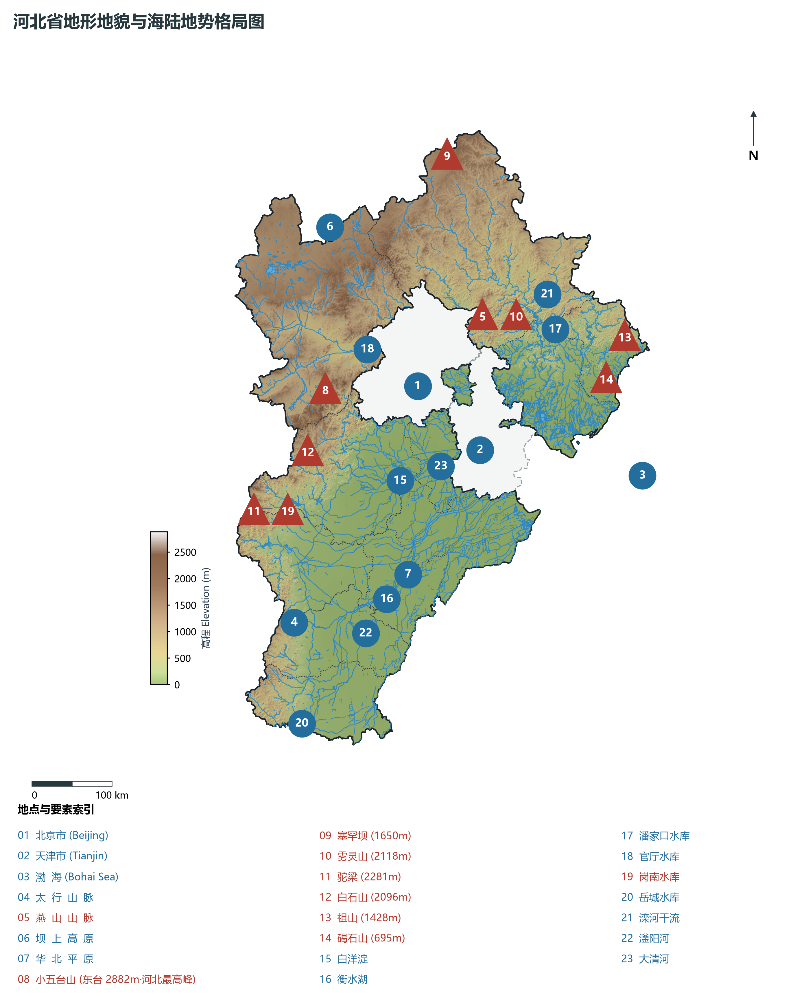
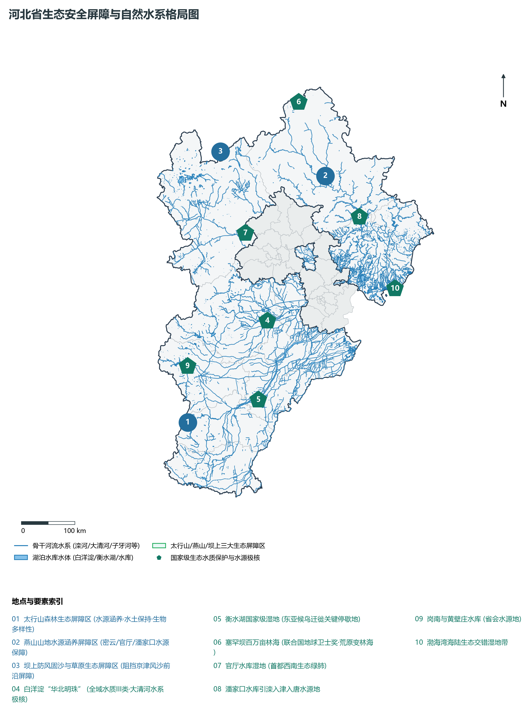
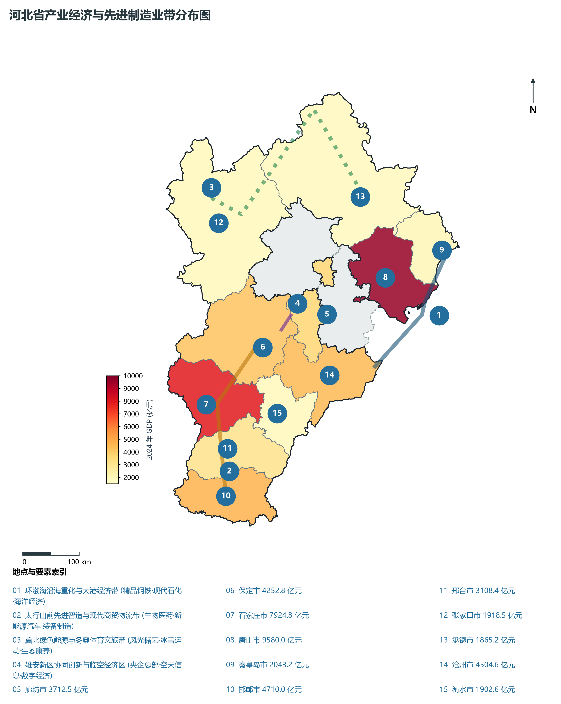
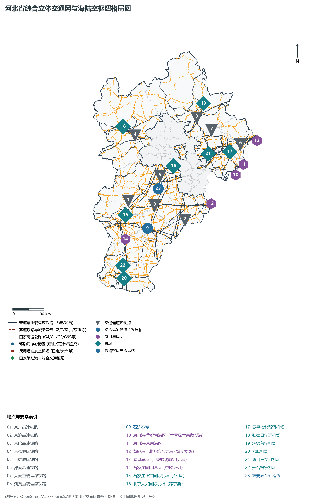

# 第三章 河北省地理统揽与“三区一基地”空间格局

河北，简称“冀”，中华人民共和国省级行政区，省会石家庄市。地处华北大平原北部，环抱首都北京与直辖市天津，东临渤海，西倚巍巍太行，北跨燕山与内蒙古高原南缘相连，南接中原鲁豫大地。全省地理坐标介于东经 113°27′—119°50′、北纬 36°05′—42°40′ 之间，全域土地面积 **18.88 万平方公里**，是全国唯一兼具高原、山地、丘陵、盆地、平原、洼淀和滨海海陆全地貌要素的“微缩中国”式省份。

“燕赵多慷慨悲歌之士”，自古为农耕文明与游牧文明交融撞击的地理前沿，控扼北方游牧南下之咽喉，拱卫中原京畿之安全。近代以来，唐胥铁路点燃中国铁路史第一簇火花，开滦煤矿、启新洋灰奠定中国近代重化工业基石；新中国成立前夕，党中央在平山县西柏坡运筹帷幄、决胜三大战役，开启“进京赶考”的伟大征程。当代河北，全省下辖 11 个地级市、雄安新区以及定州、辛集两个省直管县级市，常住人口超 **7 420 万人**，地区生产总值（GDP）跨越 **4.4 万亿元** 台阶。

在京津冀协同发展国家重大战略指引下，河北紧扣党中央赋予的“全国现代商贸物流重要基地、产业转型升级试验区、新型城镇化与城乡统筹示范区、京津冀生态环境支撑区”（“三区一基地”）战略定位，以高标准高质量建设雄安新区为关键牵引，协同北京携手举办 2022 年冬奥会，筑牢张承塞罕坝与太行燕山水源涵养生态安全屏障，加速构建环渤海世界级港口群与太行山前先进智造创新带，展现出燕赵大地在新时代波澜壮阔的地理空间重塑与高质量发展新格局。

---

## 一、省情速览与全省基础指标

河北省版图如同一柄护卫京畿的拱形巨盾，地势自西北向东南呈三级阶梯状剧烈倾降，北起塞外坝上，南抵漳水卫河，西出太行八陉，东拥渤海湾岸。

| 核心指标 | 全省数值与空间分布 | 全国/战略定位 |
|:---|:---|:---|
| **行政区划面积** | 188 800 km² | 平原占 43.7%，低山丘陵山地占 48.1%，高原占 8.2%，全要素地貌省份 |
| **常住人口** | 7 420 万人 (2024 年末)；七普 7 461.02 万人 | 全国第 6 人口大省；保定、石家庄、邯郸常住人口均超 900 万人 |
| **常住人口城镇化率** | 62.8% (2024 年) | 廊坊 (66.8%)、唐山 (65.8%) 领先，全省新型城镇化提速推进 |
| **人口密度** | 393 人/km² | 冀中南平原超 600—750 人/km²，张家口、承德等冀北山区约 85—110 人/km² |
| **地区生产总值 (GDP)** | 44 440.0 亿元 (2024 年，现价) | 稳居全国十强行列；唐山市突破 9 500 亿元，石家庄突破 7 900 亿元双核引领 |
| **人均 GDP** | 约 5.99 万元人民币 | 沿海唐山突破 11.8 万元，廊坊近 6.8 万元，全省产业结构加速向中高端跃升 |
| **产业三次结构** | 9.8 : 39.4 : 50.8 | 工业底蕴雄厚，先进装备、生物医药、新材料及现代物流服务业加速集群化 |
| **行政架构** | 11 个地级市，1 个国家级新区 (雄安)，2 个省直管县级市 (定州、辛集) | 共 167 个县级行政区 (49 区、21 县级市、91 县、6 自治县)；省会石家庄 |
| **战略发展总定位** | “三区一基地”与千年大计雄安新区 | 全国现代商贸物流重要基地、产业转型升级试验区、新型城镇化示范区、生态支撑区 |

**图 03-00-2 河北省行政区划与空间骨架图**：图上编号与地点、要素索引对应。

---

## 二、自然地理基底：三大阶梯、九河下梢与环渤海湾

河北省的自然地貌格局是晚新生代以来构造运动与沉积作用雕琢的典型样本，地形起伏剧烈，地势总格局为**西北高、东南低**，从内蒙古高原南缘向华北平原与渤海湾呈阶梯式大幅跌落。

### 1. 三大地貌阶梯与地势纵贯
全省自然地理自西北向东南由三大巨型单元依次展开：

1. **坝上高原区（内蒙古高原南缘）**：
   - 分布于张家口北部（张北、康保、尚义、沽源）与承德围场北部，平均海拔 **1 300—1 600 m**，地表为波状起伏的浅丘台地与干燥草原，边缘为断裂抬升的陡坎峭壁。气候干寒，大风呼啸，是内蒙古高原向华北平原过渡的天然前哨，也是京津地区重要的防风固沙屏障；
2. **燕山—太行山山地丘陵区（冀北与冀西山地）**：
   - **太行山脉**：自北向南纵贯河北西部，全长逾 400 km，山体险峻，断崖林立，海拔多在 1 000—2 000 m。其东坡受华北断裂控制形成剧烈的山前大断裂带，河流切割出著名的“太行八陉”（军都陉、蒲阴陉、飞狐陉、井陉等），历来为穿越太行、连通晋冀的咽喉孔道；
   - **燕山山脉**：横亘于河北北部，呈东西走向，山势浑厚磅礴，由花岗岩、变质岩及厚层石灰岩构成，主脊海拔 1 500—2 200 m。长城沿山脊险要处蜿蜒修筑，构成了历史上中原农耕帝国抵御游牧骑兵的铁壁铜墙；
3. **河北冲积平原与滨海海积平原区（华北大平原主体）**：
   - 面积达 8.15 万 km²，占全省总面积逾 43%。按成因分为：
     - **山前冲洪积倾斜平原**：分布于太行山与燕山山前山麓带（石家庄、保定、邢台、邯郸市区所在），海拔 30—100 m，由众多河流冲积扇叠置形成，地势微倾，排水良好，土层深厚，地下水富集，是华北最早开发的沃野粮仓与城市带；
     - **中部低平原与洼淀区**：海拔 10—30 m，包括黑龙港流域、大清河下游淀洼，排水不畅，历史上易涝易碱，白洋淀、衡水湖、大陆泽（古洼）错落其间；
     - **滨海海积平原**：东临渤海，岸线长约 487 km，海拔在 2—5 m 以下，发育有宽阔的泥质潮滩、沿海盐田与沙丘泻湖，曹妃甸深水突堤与黄骅港构成了深水出海通道。

**图 03-00-1 河北省地形地貌与海陆地势格局图**：图上编号与地点、要素索引对应。

### 2. “河北屋脊”小五台山与全省极值落差
全省最高峰为位于张家口市蔚县境内的小五台山主峰**东台**，海拔达到 **2 882.0 m**，被称为“河北屋脊”与“太行之巅”。小五台山由太古界结晶基底与元古界碳酸盐岩构成，垂直带谱极其完整，山顶残存晚更新世冰川侵蚀遗迹。全省最低点位于渤海沿岸大清河、子牙新河入海口及沿海滩涂，海拔仅为 **0.2—0.5 m**，全省南北与东西地貌最大垂直高差近 **2 880 m**，造就了华北地区最为丰富多样的生物气候垂直分带与景观异质性。

### 3. 气候特征：温带半湿润半干旱大陆性季风气候
河北省地处欧亚大陆东岸中纬度地带，季风气候特征鲜明，水热梯度剧烈：

- **年均气温**：全省年平均气温在 **1.0—14.0 ℃** 之间，由西北向东南递增。坝上高原冬季漫长严寒，年均温仅 1—3 ℃，极端最低温可跌破 -40 ℃；中南部平原年均温达 12—14 ℃，无霜期达 180—210 天；
- **降水时空高度不均**：全省年降水量大致在 **350—750 mm** 之间：
  - **空间分布**：呈自东南向西北递减的总趋势，但在太行山、燕山迎风坡因地形剧烈抬升，极易形成暴雨中心（如邢台内丘樟么、保定阜平、唐山迁西），年降水量可超 800 mm；背风侧的张家口盆地与坝上高原降水锐减至 350—400 mm；
  - **时间分配**：具有“冬干夏雨、春秋干旱、暴雨集中”的极端季风特征，6—8 月降水占全年总量的 **70%—80%**，常以历时短、强度大的特大暴雨形式倾泻，极易在山前平原引发山洪与严重洪涝灾害。

---

## 三、水文水系与“海河百川归渤海”

海河流域是中国七大江河水系中开发历史最悠久、水资源开发利用率最高、人水矛盾最尖锐的水系。河北省大部分地域属于海河流域，东北部则属于滦河水系，河流呈“扇形汇流、分散排海”的复杂水网体系。

### 1. 骨干水系脉络与河流走势
全省主要水系自北向南分为五大干系：

1. **滦河水系**：发源于张家口沽源闪电河，经内蒙古多伦回折流入承德，横贯燕山峡谷，在迁西大黑汀出山进入唐山平原，于乐亭注入渤海。全长 888 km，水量充沛，是引滦入津、引滦入唐工程的生命源泉；
2. **北三河水系（潮白河、北运河、蓟运河）**：源于冀北燕山山地，穿经北京、廊坊及天津北部入海，是京冀协同生态补水与大运河文化带的关键水轴；
3. **大清河水系**：由北拒马河、南拒马河、漕河、唐河等太行诸水汇流而成，向东倾入**白洋淀**，再经赵王新河排入天津独流减河与海河干流，是直接关乎雄安新区防洪安澜的骨干水系；
4. **子牙河水系**：由太行山南段的**滹沱河**与**滏阳河**在沧州献县枢纽汇合而成，向东北流经沧州注入海河及子牙新河排海，是石家庄、邢台、邯郸与沧州的主要地表水廊道；
5. **南运河与漳卫河水系**：发源于山西太行山南麓，经邯郸、邢台东部平原，在馆陶汇合为卫运河，经临清入南运河北上沧州，是京杭大运河在河北的主航道遗存。

**图 03-00-5 河北省生态安全屏障与自然水系格局图**：图上编号与地点、要素索引对应。

### 2. 华北两大天然湖泊：白洋淀与衡水湖

- **白洋淀（华北明珠）**：位于保定与沧州交界的安新、雄县、容城境内，现为雄安新区的生态核心。由 143 个大小淀泊、3 700 多条沟壕组成，总面积达 **360 km²**，是华北平原最大的淡水湖泊湿地，承担着调节区域微气候、涵养地下水源、庇护水生生物与东亚迁徙候鸟的关键功能。新时代实施全流域生态清淤与“补水、治污、防洪”综合治理后，白洋淀水质稳定达到 **III类** 标准，野生鸟类增加至 279 种；
- **衡水湖（东亚蓝宝石）**：位于衡水市桃城区与冀州区交界，水面及湿地总面积达 **75 km²**，蓄水容积 1.2 亿 m³，是华北平原唯一保留完整内陆淡水湿地生态系统的国家级自然保护区，被国际湿地界誉为“东亚候鸟迁徙线上不可替代的补给驿站”，青头潜鸭等极危物种常年在此筑巢繁殖。

### 3. 骨干水利与南水北调中线干渠
为化解太行山前山洪频发与平原水资源匮乏的尖锐矛盾，新中国成立以来在太行山、燕山各河出山口修建了**岗南水库、黄壁庄水库、西大洋水库、王快水库、岳城水库、潘家口水库**等大型控制性水利枢纽。
更为关键的是，**南水北调中线工程**自淅川丹江口引水，在邯郸入境，沿太行山东麓倾斜平原自南向北贯穿邯郸、邢台、石家庄、保定全境，全长逾 460 km，年均向河北平原输送优质汉江水超 30 亿 m³，彻底扭转了华北地下水超采引发的“世界最大地下水漏斗区”被动局面，推动滹沱河、滏阳河、瀑河等干涸河道实现全线清水复流。

---

## 四、历史文脉与燕赵大地空间演进

河北是中华文明演进的核心舞台之一。东方人类在泥河湾点燃旧石器时代第一抹智慧之光，炎黄蚩尤在涿鹿展开华夏民族奠基之战，战国七雄之燕、赵在此并立竞逐。

### 1. 燕赵文化与长城要塞防御

- **燕南赵北与慷慨悲歌**：西周初年封召公于燕（古蓟城为中心），战国时期赵国迁都邯郸（3 000 年未改其名），燕赵两国在北疆与东胡、匈奴连年交锋，孕育出深沉刚烈、重义轻利、救急扶危的燕赵精神品格；
- **万里长城之集大成者**：河北境内现存战国、秦、汉、北魏、北齐、金、明等各时期长城遗址达 **2 498.5 km**，长度居全国省区市首位。其中明长城构筑尤为坚固雄奇：
  - **山海关**（秦皇岛）：“天下第一关”，连通关内外辽西走廊之咽喉；
  - **金山岭长城**（承德滦平）：视野开阔、敌楼密集、文字砖林立，被誉为“明长城之精华”；
  - **大境门**（张家口）：“万里长城第一门”，自古为塞外张库大道与蒙俄跨国贸易的通商大门。

### 2. 直隶畿辅治理与清代避暑山庄

- **清代直隶总督署（保定）**：雍正八年（1730年）直隶总督署正式移驻保定，统辖顺天、保定、正定、大名等府，成为清代“居诸督抚之首”的权力中枢，李卫、方观承、曾国藩、李鸿章、袁世凯等重臣先后在此坐镇，见证了晚清洋务运动、新军编练与近代化转型；
- **承德避暑山庄及周围寺庙**：康熙四十二年（1703年）始建，历经康、雍、乾三朝 89 年营建，占地 5.64 km²，为中国现存最大的古典皇家园林。山庄外围环列汉藏等多元建筑交融的“外八庙”，体现了“一座条约不如一座山庄、修庙即安辑天下”的高超边疆治理智慧，1994 年被联合国教科文组织列入《世界文化遗产名录》。

### 3. 中国近代工业摇篮与红色西柏坡

- **近代工业先声**：1878 年李鸿章创办直隶开平矿务局（唐山开滦），1881 年建成中国第一条自建标准轨距铁路——唐胥铁路，制造出中国第一台蒸汽机车“龙号机车”，并催生了中国第一桶机制水泥（启新洋灰）与第一件卫生瓷，唐山因此被尊为“中国近代工业的摇篮”；
- **红色革命灯塔**：抗日战争时期，八路军在涉县建立一二九师司令部，在易县狼牙山谱写英雄壮歌；解放战争决胜阶段，毛泽东率中共中央进驻平山县**西柏坡**，在这里指挥了辽沈、淮海、平津三大战役，召开了著名的七届二中全会，确立了“两个务必”的清醒警示，铸就了党史丰碑。

---

## 五、经济地理：沿海重化、太行智造走廊与临空创新

当代河北经济已经彻底告别高污染、高消耗的粗放阶段，正在向高端化、智能化、绿色化深刻蜕变。全省形成了“沿海突破、沿线壮大、山区保育、雄安领航”的现代化产业空间新格局。

### 1. 四大战略性产业空间走廊
依据资源禀赋与生态约束，全省产业经济呈现明显的带状分异：

1. **环渤海沿海重化与大港经济带（唐山—沧州—秦皇岛）**：
   - 以唐山曹妃甸、沧州渤海新区、秦皇岛港为核心支撑，集中布局世界级绿色精品钢铁（首钢京唐、河钢乐亭）、大型临港绿色石化（中捷、黄骅现代烯烃芳烃基地）、海洋生物医药与大宗散货跨境贸易，是拉动全省 GDP 与工业增加值的“定海神针”；
2. **太行山前先进智造与现代商贸物流走廊（石家庄—保定—邢台—邯郸）**：
   - 沿京广铁路与京港澳高速通道，串联冀中南四大核心城市。聚焦生物医药（石家庄五大药企）、新能源汽车与智能网联汽车（保定长城汽车全球总部）、先进装备制造与电力电气设备（保定中国电谷）、新型储能与特种金属材料（邯郸武安、邢台信都），打造辐射华北与中原的先进制造业重镇；
3. **冀北绿色生态与清洁能源/冬奥文旅带（张家口—承德）**：
   - 彻底转变传统矿产依赖，依托优质风能、太阳能资源，建设国家级**张北可再生能源示范区**，百万千瓦级“绿电入京”工程每年为北京输送清洁绿电超 140 亿 kWh；借助冬奥会举办契机，崇礼冰雪运动、承德避暑康养、塞罕坝生态文旅形成跨越发展；
4. **雄安新区与廊坊临空协同创新区（雄安—廊坊）**：
   - 雄安新区启动区全力集聚央企二三级总部、前沿科创中心与空天信息产业链；廊坊依托北京大兴国际机场综合保税区与临空经济区，发展航空科技、生命健康、跨境电商与高端供应链总部。

**图 03-00-4 河北省产业经济与先进制造业带分布图**：图上编号与地点、要素索引对应。

### 2. 特色县域经济与单项冠军集群
河北省县域经济具有极强的专业化分工特色，数十个县级特色产业集群产销量领跑全国甚至全球：

- **中国羊绒之都（清河）**：羊绒加工能力占全国的 60%，原绒交易量占全球的 40% 以上；
- **中国丝网之都（安平）**：拥有 400 余年织网历史，丝网产销量占全国的 80% 以上，出口全球 190 多个国家；
- **中国皮都（辛集）**：国家级生态皮革产业基地的先锋，年产皮衣、裘皮数千万件；
- **中国箱包之都（高沟/白沟）**：年产箱包数亿只，与国际电商深度对接；
- **中国童车之都（平乡/广宗）**：自行车童车产销量占全国半壁江山；
- **中国玻璃名城（沙河）**：特种安全玻璃与建筑玻璃规模居全国第一。

---

## 六、综合立体交通网络与海陆空枢纽

河北地处京津冀交通枢纽的承载核心，四通八达的骨干路网将京津与东北、西北、华东、中原紧密焊接在一起，构建起高密度的海陆空现代综合交通大动脉。

### 1. 环渤海三大枢纽大港与亿吨级大宗集散
河北大陆海岸线长 487 km，拥有三大大型综合海港，2024 年全省港口货物吞吐量突破 **13.5 亿吨**，稳居全国沿海省份前列：

1. **唐山港（曹妃甸港区 + 京唐港区）**：
   - 2024 年货物吞吐量超 **8.4 亿吨**，位列世界沿海港口第二位。曹妃甸港区拥有水深 25—36 m 的深水岸线，可直靠 40 万吨级巨型散货轮与大型 LNG 船舶，是首钢京唐原料保障与国家战略原油储备的前沿口岸；
2. **黄骅港（沧州）**：
   - 国家能源投资集团煤炭出海港与北方综合大港，年吞吐量逾 **3.3 亿吨**，是朔黄铁路重载煤运通道的终点出海口，保障东南沿海能源电力生命线的核心节点；
3. **秦皇岛港**：
   - 全球最大干散货煤炭输出码头之一，大秦铁路终端港，享有“中国经济晴雨表”之美称，正加快向集装箱、绿色航运及滨海游轮旅游母港转型。

**图 03-00-3 河北省综合立体交通网与海陆空枢纽格局图**：图上编号与地点、要素索引对应。

### 2. 纵横全国的轨道交通网络

- **高铁网络高密度互通**：京广高铁贯穿保定、石家庄、邢台、邯郸；京沪高铁纵贯沧州；京哈高铁贯通承德与唐山、秦皇岛；京张高铁与崇礼铁路连通张家口冬奥赛区；京雄城际铁路将北京西站、大兴机场与雄安新区直连，实现雄安至北京 50 分钟高铁通达；
- **重载货运世界领先**：**大秦铁路**（大同—秦皇岛）是中国第一条双线电气化重载货运专线，年运量突破 4.5 亿吨；**朔黄铁路**（神池—黄骅港）为第二条西煤东运重载铁路，双机牵引万吨重载列车昼夜不息。

### 3. 多层级机场体系与陆港枢纽
全省建成运营石家庄正定国际机场、唐山三女河机场、秦皇岛北戴河机场、张家口宁远机场、承德普宁机场、邯郸机场、邢台褡裢机场等干支结合机场网络。其中：

- **北京大兴国际机场**跨越北京大兴区与廊坊市广阳区，河北片区占机场总体用地逾 60%，共享全球最大单体单面客运航站楼红利；
- **石家庄正定国际机场**被民航局定位于“北京首都机场与大兴机场的低成本航空枢纽与北方主要航空快件货运集散地”；
- **石家庄国际陆港（高邑）**：常态化开行中欧班列，直达莫斯科、汉堡、塔什干，2024 年开行量突破 600 列，成为京津冀内陆面向共建“一带一路”国家的重要开放陆港门户。

---

## 七、新时代重大战略：京津冀协同、雄安新区与绿色生态屏障

跨入新时代，党中央作出的京津冀协同发展战略、设立河北雄安新区决策、筹办北京冬奥会盛事，深刻改变了河北在全国区域发展版图中的位势与命运。

### 1. 雄安新区：千年大计、未来之城
2017 年 4 月 1 日，中共中央、国务院决定设立河北雄安新区。这是继深圳经济特区和上海浦东新区之后又一具有全国意义的新区：

- **定位**：北京非首都功能疏解集中承载地、高水平社会主义现代化城市、推动高质量发展的全国样板；
- **建设进展**：从“一块白纸”到“拔地而起”，累计完成基础设施与产业投资超 7 000 亿元。**容东、容西、雄东** 片区数万户回迁居民喜迁新居；**启动区** 央企总部区成形成势，中国中化大厦、中国华能总部、中国星网总部、中国矿产资源总部等标志性大厦全面拔地封顶；北京交通大学、北京科技大学、中国地质大学（北京）、北京林业大学首批四所高校雄安校区开工建设，宣武医院雄安院区全面投用；
- **全域地下管廊与数字孪生**：雄安新区率先全域推行“先地下后地上”，累计建成地下综合管廊数百公里；每修一座实体桥梁、一栋实体建筑，在数字空间均同步生成一个同构的**数字孪生模型**，成为名副其实的智慧城市典范。

### 2. 塞罕坝精神与生态支撑区战略
塞罕坝位于承德市围场满族蒙古族自治县北部，曾是“黄沙遮天日，飞鸟无栖树”的茫茫荒原。自 1962 年建立机械林场以来，三代林场人历经半个多世纪艰苦卓绝的奋斗，在海拔 1 000—1 900 m 的高寒沙地创造了 **115 万亩人工林海** 的人间奇迹，森林覆盖率达 82%，每年为京津涵养水源 2.84 亿 m³、释放氧气 59.8 万吨，荣膺联合国“地球卫士奖”。
在塞罕坝精神指引下，全省严守太行山、燕山、塞罕坝与坝上草原生态红线，实施“退耕还林、封山育林、矿山修复”全域生态工程，彻底消除京津北部风沙源头，坚决筑牢护卫京畿的绿色生态屏障。

### 3. 2022 年北京冬奥遗产与区域协同繁荣
张家口崇礼赛区作为北京 2022 年冬奥会和冬残奥会雪上项目主承办地，圆满举办跳台滑雪、单板滑雪、越野滑雪等赛事。“雪如意”（国家跳台滑雪中心）、“冰玉环”（高架漫步廊道）惊艳世界。
冬奥后，京张体育文化旅游带全面铺开，京张城际与崇礼支线实现 1 小时滑雪交通圈，崇礼各大滑雪场年接待冰雪游客突破 400 万人次，带动张承地区由传统闭塞山地跃升为全国知名、国际一流的冰雪旅游度假胜地。

---

## 八、全书编排与分市导读

第三章《河北省》正文遵循海淀基准，设立 16 个系统性章节：

- **03-00 河北省地理统揽与“三区一基地”空间格局**（本章）
- **03-01 石家庄市**：省会极核·太行东麓商贸枢纽与生物医药之都
- **03-02 唐山市**：沿海极核·近代工业摇篮与万亿经济重镇
- **03-03 秦皇岛市**：海滨明珠·天下第一关与世界级能源输出大港
- **03-04 邯郸市**：冀南门户·三千年未改名古都与晋冀鲁豫枢纽
- **03-05 邢台市**：太行前缘·五邑古都十朝雄郡与百泉复涌名城
- **03-06 保定市**：京畿重地·直隶总督文脉与先进智造高地
- **03-07 张家口市**：冬奥名城·坝上高原风光储氢基地与首都水源生态屏障
- **03-08 承德市**：避暑胜地·皇家园林名城与京津北方生态水源涵养区
- **03-09 沧州市**：运河古都·千亿黄骅大港与沿海现代石化基地
- **03-10 廊坊市**：京津走廊·大兴机场临空经济与北三县协同高地
- **03-11 衡水市**：湖城水韵·衡水湖东亚蓝宝石与特色轻工名市
- **03-12 雄安新区**：国家大事·千年大计数字孪生典范与白洋淀生态极核
- **03-13 辛集市**：省直管市·中国皮都与冀中南生态皮革先进制造名城
- **03-14 定州市**：省直管市·中山古都中华第一塔与先进制造节点
- **03-15 河北省地理要素矩阵与省内之最**：全省各市指标比照矩阵与地理/经济极值大全

全章统揽 75 幅出版级矢量地图与 10 余万字权威学术论述，全面、立体、多维揭示燕赵大地跨越千年的自然地理基底与波澜壮阔的现代空间变迁。
