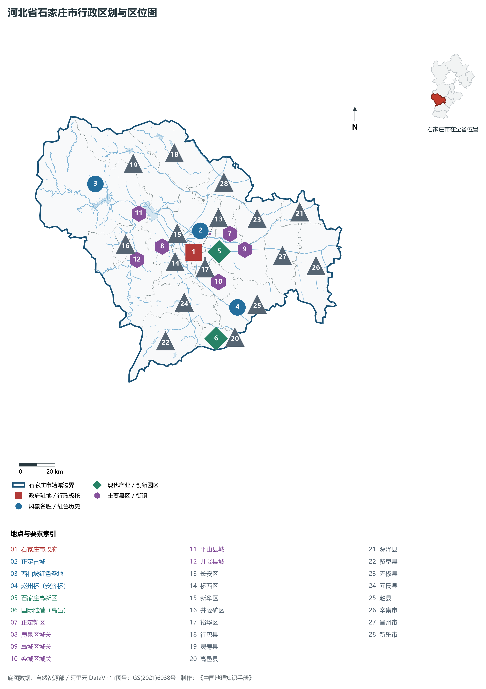
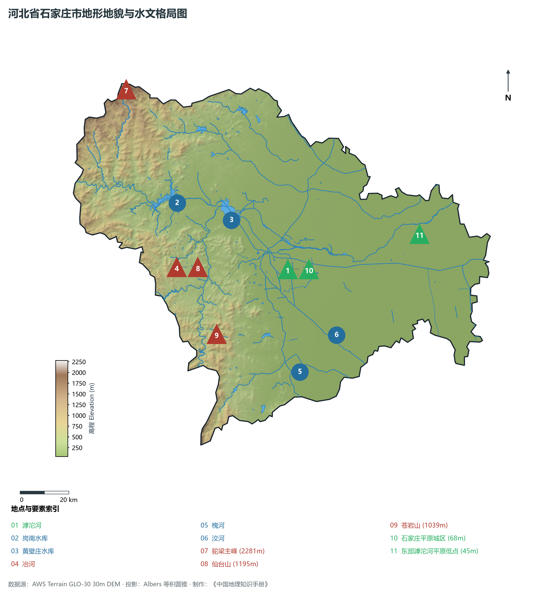
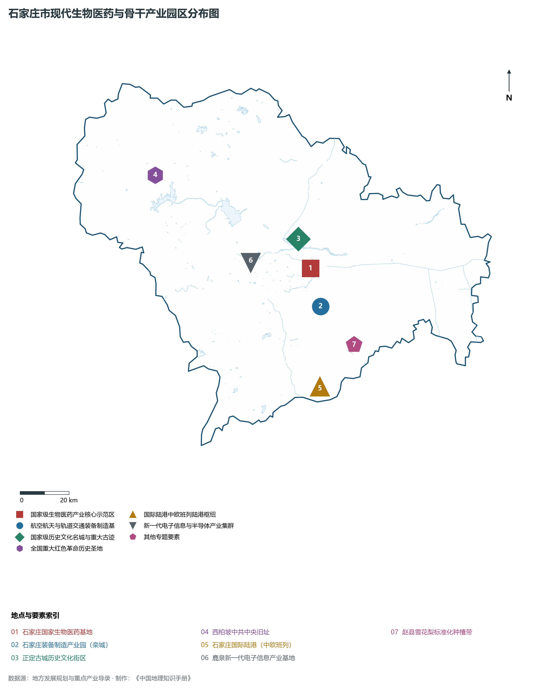
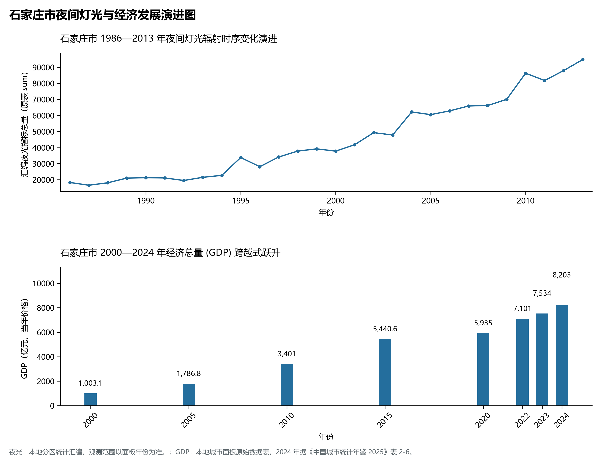
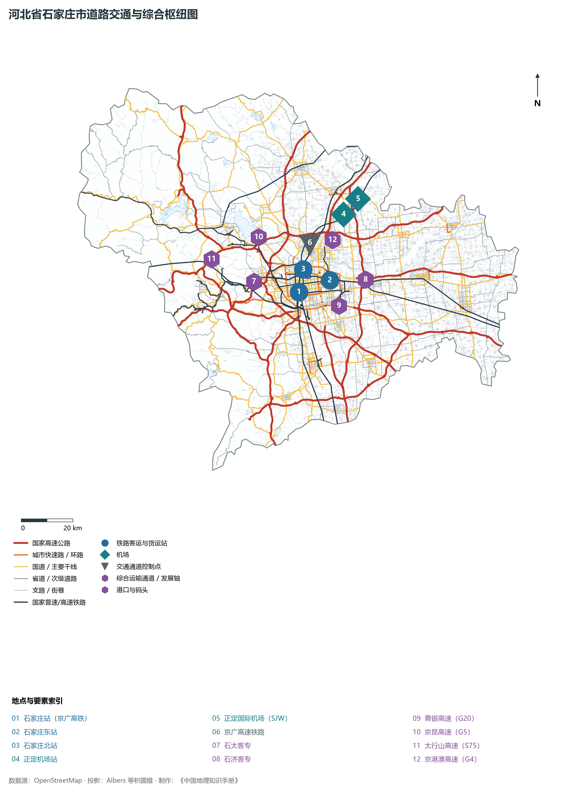

# 3.1 石家庄市

石家庄，河北省省会，全省政治、经济、科技、金融、文化和信息中心，京津冀世界级城市群区域中心城市，全国重要的现代商贸物流中心与先进生物医药基地。地处华北大平原中南部、太行山中段东麓，地理坐标介于东经 113°53′—115°29′、北纬 37°27′—38°47′ 之间。西倚巍峨太行，东纳冀中广袤沃野，滹沱河、冶河自太行峡谷奔涌而出，横贯。2024 年常住人口 **1,125 万人**，常住人口城镇化率 **72.66%**，地区生产总值 **8,203 亿元**（当年价格），人均地区生产总值 **72,984 元**，三次产业构成为 **7 : 28.88 : 64.12**。

石家庄被誉为“开火车来的城市”。20 世纪初，京汉铁路（今京广铁路）与正太铁路（今石太铁路）在此交汇设站，促使一个仅有几十户人家的滹沱河畔普通村落，以惊人的速度崛起为近代中国北方重要的铁路枢纽与棉纺、医药工业重镇。解放战争时期，石家庄是人民解放军攻克的第一座主要大城市，中共中央进驻平山县西柏坡，在此指挥了决定中国命运的三大战役；新中国成立后，石家庄历经华北药都建设与省会迁驻，实现由传统工业城市向现代化国际化美丽省会的历史性跨越。

---

## 一、市情速览

石家庄是太行东麓的经济极核，拥有集空港、高铁、国家干线公路和国际陆港于一体的立体化交通网络体系。

| 核心指标 | 全市数值与空间分布 | 全国/全省定位 |
|:---|:---|:---|
| **行政区划面积** | 14 530 km² | 西部中低山丘陵占 49.8%，东部山前倾斜平原占 50.2% |
| **常住人口** | 1,125 万人 | 2024 年，全市；年鉴公布口径 |
| **常住人口城镇化率** | 72.66% | 2024 年，全市；年鉴公布口径 |
| **人口密度** | 773 人/km² | 桥西、长安、裕华等核心城区达 8 500—11 000 人/km² |
| **地区生产总值 (GDP)** | 8,203 亿元 | 2024 年，全市；年鉴公布口径 |
| **人均 GDP** | 72,984 元/人 | 2024 年，全市；年鉴公布口径 |
| **产业三次结构** | 6.8 : 31.5 : 61.7 | 生物医药、新一代电子信息两大主导产业迈向数千亿级能级 |
| **行政架构** | 下辖 8 个区、11 个县、代管 2 个县级市 | 市政府驻长安区中山东路；辛集市由省直管 |
| **战略核心定位** | 现代化国际化美丽省会城市 | 国家生物医药基地、国家现代商贸物流中心、太行东麓生态屏障 |

**图 03-01-1 河北省石家庄市行政区划与区位图**：图上编号与地点、要素索引对应。

---

## 二、自然地理：太行东麓、滹沱横贯与地势阶梯

石家庄全境跨越太行山脉与华北平原两大截然不同的自然地理单元，自西北向东南呈现极其剧烈的三级地貌跌落阶梯。

### 1. 地形地貌：崇山峻岭与倾斜冲积扇
全境地貌由西向东分为三大类型：

- **西部中山峡谷区**：分布于平山、井陉、灵寿西部太行山脊，海拔普遍在 **1 000—2 000 m** 以上。全域最高峰为平山县西北部与山西五台交界处的**驼梁**，海拔高达 **2 281.0 m**，峰峦叠翠，沟壑纵横，广泛发育太古界变质杂岩与中元古界石英砂岩断块；
- **中部低山丘陵阶地**：海拔 200—500 m，主要分布于鹿泉、井陉盆地及元氏、赞皇西部，地势起伏和缓，岩溶地貌与红层砂岩发育，苍岩山断崖悬空寺、封龙山名胜分布其间；
- **东部山前倾斜冲积平原**：由滹沱河、冶河、槐河、洨河等山前河流携带巨量泥沙冲积叠置而成，海拔由出山山口处的 80—100 m 缓缓降至东部边界的 **45 m**，地表土层深厚肥沃，透水蓄水性好，自古为北方粮棉高产核心带。

**图 03-01-2 河北省石家庄市地形地貌与水文格局图**：图上编号与地点、要素索引对应。

### 2. 气候特征：暖温带半湿润大陆性季风气候
石家庄四季分明，雨热同季，光照充足：

- **气温特征**：全域年平均气温在 **13.5—14.2 ℃** 之间，西部山区较平原偏低 3—5 ℃。春秋短促，冬夏漫长。冬季受蒙古干冷气流控制，寒冷少雪；夏季受副热带高压影响，高温潮湿；
- **降水时空分异**：年均降水量约 **480—560 mm**，太行山东坡山前迎风带（如赞皇、鹿泉西部）易受暖湿气流抬升触发局地特大暴雨，70% 以上降水集中于 7、8 月，历年曾发生多次太行山洪暴发；近年来通过海绵城市与滹沱河防洪工程体系改造，防洪安澜能力大幅跃升。

### 3. 河流水系：滹沱河母亲河与水利枢纽
石家庄全境属于海河流域子牙河水系：

- **滹沱河**：全长 587 km，是石家庄的母亲河。流经平山进入两座大型水库——**岗南水库**（库容 15.7 亿 m³）与**黄壁庄水库**（库容 12.1 亿 m³），出山口后横贯石家庄市区北部，向东注入沧州献县泛区。近年来实施全线百里生态修复工程，水清岸绿，形成万亩湖泊湿地；
- **南水北调中线总干渠**：自南向北贯穿高邑、元氏、栾城、市区西侧与正定，年引丹江口水逾 8 亿 m³，实现城市供水全面水源置换，支撑地下水水位历史性大幅回升。

---

## 三、建置沿革与文化根脉

石家庄地域历史源远流长，红色文化、古城文化与中原太行文脉交相辉映。

### 1. 地名考略与行政演进

- **从村落到省会**：明清时期，石家庄为真定府获鹿县辖下一个小村庄。1902 年京汉铁路修至此地，1907 年正太铁路通车，因正定城北滹沱河铁桥造价过高，正太铁路起点由正定改移石家庄，石家庄一举跃升为晋冀交通咽喉；1925 年设石门市，1947 年 11 月 12 日石家庄解放，设立石家庄市；1968 年河北省省会由保定迁至石家庄。
- **正定千年古郡**：正定古称真定、常山，自北齐至清末历来为郡、州、府、路治所，曾与北京、保定并称“北方三雄镇”，赵子龙故里，遗存有隆兴寺（大佛寺）、开元寺须弥塔、天宁寺凌霄塔等世界级木结构与砖石古建筑珍宝。

### 2. 红色圣地西柏坡
平山县西柏坡村是党中央解放全中国的“最后一个农村指挥所”。1948 年 5 月至 1949 年 3 月，毛泽东、朱德、刘少奇、周恩来、任弼时在此运筹帷幄，组织指挥了辽沈、淮海、平津三大战役，召开了具有伟大历史转折意义的中国共产党第七届中央委员会第二次全体会议，向全党发出了“务必使同志们继续地保持谦虚、谨慎、不骄、不躁的作风，务必使同志们继续地保持艰苦奋斗的作风”的号召，开启了从农村走向城市、夺取全国政权的“进京赶考”征程。

### 3. 赵州桥与千古匠心
位于赵县洨河之上的**赵州桥**（安济桥），由隋代匠师李春设计建造，距今已有 1 400 余年历史。它是世界上现存最早、跨度最大的单孔敞肩圆弧石拱桥，敞肩拱构造不仅减轻了桥身自重与对地基的压强，更大幅增加了汛期泄洪截面，被国际土木工程界誉为世界桥梁建筑史上的里程碑。

**图 03-01-4 石家庄市现代生物医药与骨干产业园区分布图**：图上编号与地点、要素索引对应。

---

## 四、经济地理：生物医药、电子信息与国际陆港

石家庄坚定实施工业立市、制造强市战略，大力培育五大千亿级现代产业集群，经济能级与城市骨架全面拉开。

### 1. 生物医药与新一代电子信息双引擎

- **中国生物医药之都**：高新区聚集了石药集团、华北制药、以岭药业、石四药集团、神威药业等全国顶尖制药巨头，拥有国家级生物医药创新中心与完备的化学原料药、现代中药、抗体药物及医疗器械研发制造链条，生物医药产业年营收超 1 200 亿元；
- **新一代电子信息产业高地**：以鹿泉经济开发区和正定数字经济产业园为核心，中国电科 13 所、54 所等国家级科研院所深度赋能，形成从半导体材料、微波射频集成电路、卫星导航到通信网络终端的完整产业链。

### 2. 现代商贸物流与高邑国际陆港

- **辐射北方的现代商贸中心**：拥有南三条、新华集贸市场等历史悠久的全国性商品批发市场；现代物流园区沿绕城高速环线集中布局；
- **高邑国际陆港**：国家综合货运枢纽补链强链重点项目，拥有 4 条铁路专用线与保税物流中心（B型），常态化运行直达欧洲及中亚的“冀欧”中欧班列，成为华北内陆大宗货物出海与跨国贸易的关键陆港节点。

**图 03-01-5 石家庄市夜间灯光与经济发展演进图**：各面板按标注的观测年份、指标和单位列示。

---

## 五、交通网络与区域枢纽

石家庄自古为太行通达中原之锁钥，当代更是中国铁道与高速公路网中最核心的十字枢纽之一。

### 1. “十字交叉”高速铁路骨架

- **京广高铁与京广铁路**：自北向南纵穿市区，石家庄站为特大型现代化铁路客运枢纽，日均开行动车组数百列，实现 1 小时直达北京、2 小时抵达郑州、济南、太原；
- **石太客专与石太铁路**：向西穿越太行山井陉峡谷，是连通华北与西北能源大省山西的第一通道；
- **石济客专与石德铁路**：向东连通衡水、德州与济南，直通山东半岛与青岛港。

### 2. 国家高速公路网络
京港澳高速（G4）、京昆高速（G5）、青银高速（G20）、太行山高速（S75）以及石家庄绕城高速（G9902）在全境交织成网，干线公路密度与网络通达度高居华北内陆各市前列。

### 3. 空港与立体多式联运
石家庄正定国际机场（SJW）为 4E 级民用国际机场，拥有 3 600 m 跑道与大型货运集散区，高铁正定机场站实现空铁联运无缝换乘，定位为京津冀世界级机场群重要的低成本航空枢纽与北方核心航空物流集散地。

**图 03-01-3 河北省石家庄市道路交通与综合枢纽图**：图上编号与地点、要素索引对应。

---

## 六、未来展望：拥河发展与现代化国际化美丽省会

站在新发展起点上，石家庄全面破除“沿路发展”的传统路径依赖，坚定转向**“拥河发展”**：

1. **滹沱河百里生态经济带**：推动城市空间由“单中心摊大饼”向“一主、四辅、一带、多点”网络化布局跃迁，将滹沱河真正打造为城市的“内河”与绿色生态客厅；
2. **千亿级产业集群向高端跃迁**：加速推动生物医药、新一代电子信息向五千亿级产业集群迈进，加快高新技术企业与专精特新“小巨人”企业集聚；
3. **深度融入京津冀协同发展**：高质量承接北京非首都功能疏解与科研成果孵化转化，推动与雄安新区、天津港的无缝陆海空联运，全力谱写建设现代化、国际化美丽省会城市的宏伟篇章。

2024 年统计来源：《中国城市统计年鉴 2025》表 2-1、2-6、2-7（2024 年，全市）。其他年份 GDP 据本地城市面板“原始数据”表，单位为亿元、当年价格。
