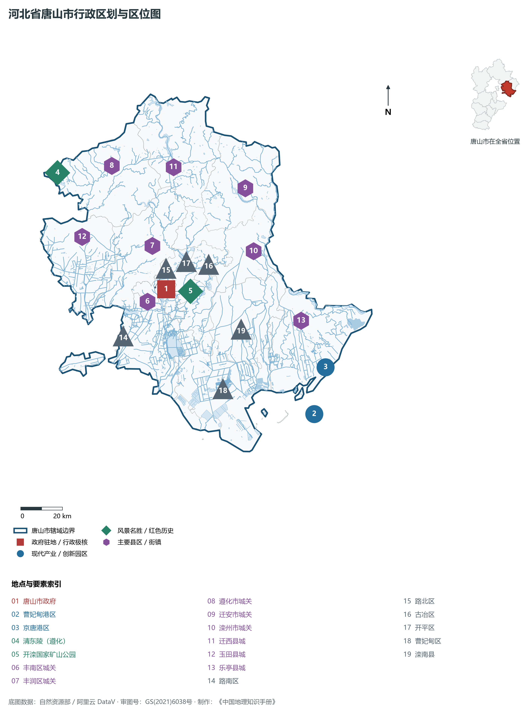
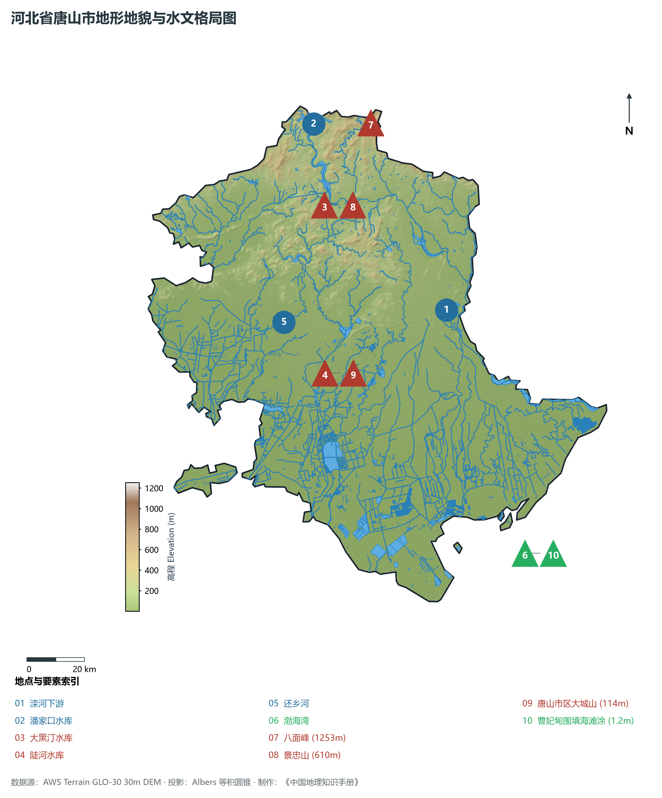
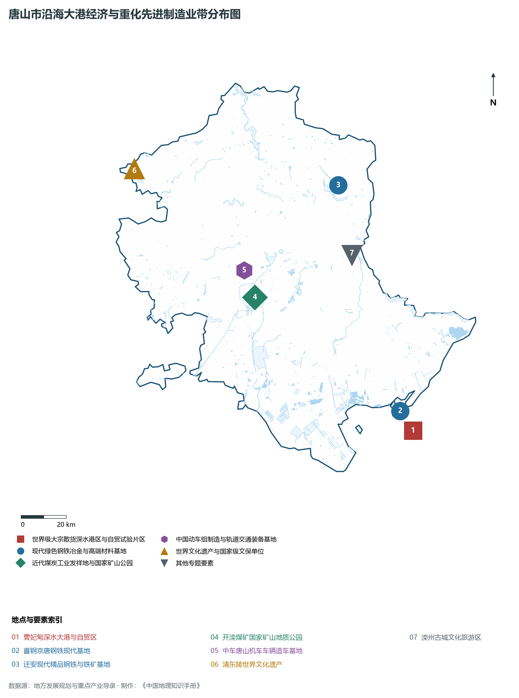
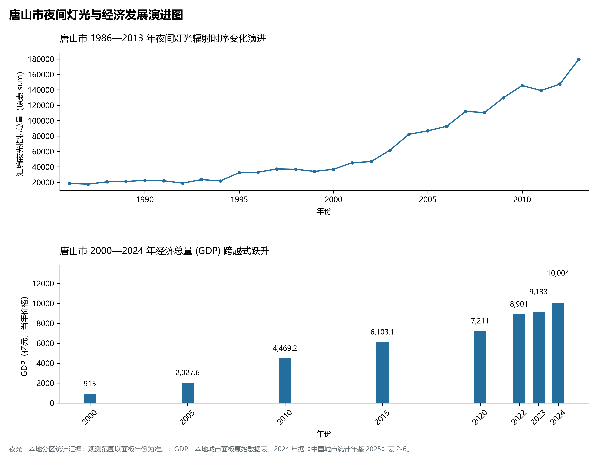
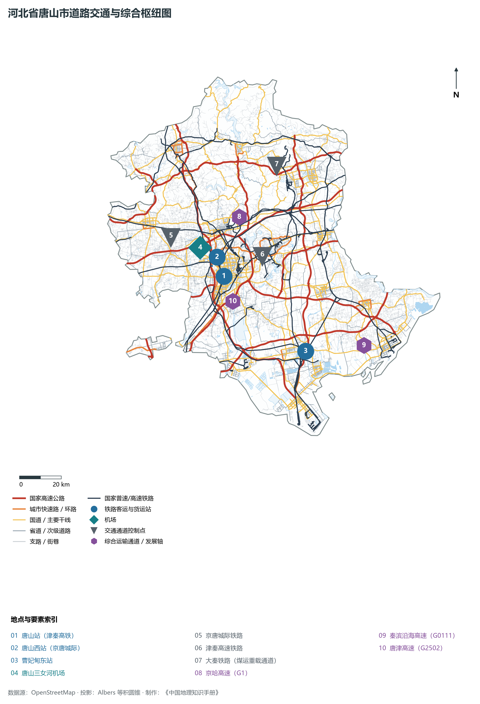

# 3.2 唐山市

唐山，河北省经济中心、沿海特大城市、首批国家产业转型升级示范区，素有“中国近代工业摇篮”与“北方瓷都”之美誉。地处渤海湾北部海岸、燕山山脉南麓，西距北京约 150 km，西南距天津约 100 km，地理坐标介于东经 117°31′—119°19′、北纬 38°55′—40°28′ 之间。南临浩瀚渤海，海岸线长达 **229.7 km**；北倚连绵燕山，滦河水系横贯其间。2024 年常住人口 **772 万人**，常住人口城镇化率 **67.1%**，地区生产总值 **10,004 亿元**（当年价格），人均地区生产总值 **129,565 元**，三次产业构成为 **6.61 : 50.41 : 42.98**。

唐山是近代中国工业文明最璀璨的发祥地之一。1878 年开滦煤矿创建，1881 年中国第一条自建铁路（唐胥铁路）、第一台蒸汽机车（龙号机车）在此诞生，催生了中国第一桶机制水泥与第一件卫生陶瓷。1976 年 7 月 28 日发生里氏 7.8 级大地震，整座城市瞬间夷为平地；在党中央关怀与全国军民倾力支援下，英雄的唐山人民以“公而忘私、患难与共、百折不挠、勇往直前”的抗震精神，十年崛起一座崭新现代化工业城。进入新时代，唐山坚定实施“向海发展”战略，首钢京唐跨海搬迁曹妃甸，建设世界级大宗散货深水港，实现了由传统资源型内陆重工业向沿海现代绿色先进制造业的惊世蝶变。

---

## 一、市情速览

唐山市是河北省第一大工业强市与沿海经济核心增长极，形成了以曹妃甸港区为龙头的现代化港产城体系。

| 核心指标 | 全市数值与空间分布 | 全国/全省定位 |
|:---|:---|:---|
| **行政区划面积** | 13 472 km² | 平原占 73.2%，北部低山丘陵占 22.4%，沿海滩涂占 4.4% |
| **常住人口** | 772 万人 | 2024 年，全市；年鉴公布口径 |
| **常住人口城镇化率** | 67.1% | 2024 年，全市；年鉴公布口径 |
| **人口密度** | 573 人/km² | 路南、路北中心城区超 5 000 人/km²，沿海低密发展空间广阔 |
| **地区生产总值 (GDP)** | 10,004 亿元 | 2024 年，全市；年鉴公布口径 |
| **人均 GDP** | 129,565 元/人 | 2024 年，全市；年鉴公布口径 |
| **产业三次结构** | 7.2 : 53.4 : 39.4 | 典型的重化先进工业支撑格局，二产增加值超 5 000 亿元 |
| **行政架构** | 7 个市辖区、4 个县、代管 3 个县级市 | 市政府驻路北区西山道；曹妃甸区享副厅级经开区权限 |
| **战略核心定位** | 东北亚地区经济合作窗口城市 | 环渤海地区新型工业化基地、首都经济圈重要支点、世界级港口群 |

**图 03-02-1 河北省唐山市行政区划与区位图**：图上编号与地点、要素索引对应。

---

## 二、自然地理：燕山叠嶂、滦河润泽与曹妃甸深水湾

唐山市地形北高南低，由北部的燕山余脉向南倾降为广袤的平原，并在最南端展开漫长而深邃的渤海湾海岸线。

### 1. 地貌分区与高程阶梯
全境地貌自北向南分为三大鲜明单元：

1. **北部低山丘陵区（燕山南翼）**：分布于迁西、遵化、迁安北部，海拔在 200—1 000 m 之间。山势峻拔险要，最高峰为迁西县西北与承德兴隆交界处的**八面峰**，海拔 **1 253.0 m**；该区石英砂岩与铁矿变质杂岩极其丰富，是著名的中国三大铁矿基地之一（迁安、迁西铁矿）；
2. **中部山前倾斜冲积与平原过渡区**：海拔 10—50 m，由滦河、还乡河、陡河等自山前冲积成宽展平原，土质肥沃，光热水资源匹配优异，为高产粮油果蔬之乡；
3. **南部滨海海积平原与天然深水深槽**：海拔普遍在 **0.5—5.0 m** 之间。南部沿海发育有著名的**曹妃甸天然深槽**：其前缘距离陆地仅数公里即达 -25 m 至 -36 m 水深，且不淤不冻，是渤海湾乃至我国北方极其罕有的可直泊 40 万吨级巨轮的天然深水良港选址。

**图 03-02-2 河北省唐山市地形地貌与水文格局图**：图上编号与地点、要素索引对应。

### 2. 气候特征：暖温带半湿润滨海季风气候
唐山地处大陆与海洋交界地带，四季分明，季风显著：

- **气温**：年平均气温约为 **11.5—12.5 ℃**。南部沿海因受渤海海水巨大热容缓冲调节，冬无严寒、夏无酷暑，海陆风昼夜交替；北部山区冬季气温较低，常伴有燕山冷锋南下；
- **降水**：年降水量约为 **550—680 mm**，属于华北平原迎风多雨区之一。降水主要集中在 7、8 月，迁西、遵化山前迎风坡受燕山抬升常形成局地强降水中心，为潘家口、大黑汀水库提供充沛水资源补给。

### 3. 水系脉络：滦河干流与引滦入津入唐工程

- **滦河干流**：由承德峡谷切入唐山迁西，蜿蜒流经迁安、滦州，在乐亭注入渤海，是唐山最重要的地表水源大动脉；
- **引滦水利枢纽工程**：在迁西境内的**潘家口水库**（总库容 29.3 亿 m³）与**大黑汀水库**（总库容 3.37 亿 m³）构成了国家级大型跨流域水利枢纽，不仅常年向唐山市工业与城市生活稳定供水，更是保障直辖市天津生命用水的关键生态命脉。

---

## 三、建置沿革与文化根脉

唐山地名源于唐太宗李世民东征高句丽时驻跸大城山，赐山名为“唐山”。唐山文脉兼具深邃的历史遗产与震撼世界的近代工业精神。

### 1. 建置沿革脉络
商代属孤竹国（伯夷、叔齐采薇让国典故发祥地）；汉置右北平郡与辽西郡；明清时期属顺天府与永平府；清光绪四年（1878年）开平矿务局设立，唐山集镇迅速繁荣，清末设唐山镇；1938 年正式设立唐山市；1978 年升格为河北省省辖市。

### 2. 世界文化遗产清东陵
位于遵化市境内的**清东陵**，是中国现存规模最宏大、体系最完整、布局最得体的清代皇家陵寝建筑群。陵区占地 80 km²，安葬着顺治（孝陵）、康熙（景陵）、乾隆（裕陵）、咸丰（定陵）、同治（惠陵）五位皇帝以及慈禧太后（菩陀峪定东陵）等 161 位皇室成员，2000 年被联合国教科文组织列入《世界文化遗产名录》。

### 3. 开滦煤矿与中国近代工业摇篮

- **开滦国家矿山公园**：由李鸿章委任唐廷枢于 1878 年创办，是中国最早采用西方先进机械化采煤的现代矿山，被誉为“中国第一佳矿”。遗存有中国第一条标准轨距铁路（唐胥铁路起点）、开滦总医院近代建筑群以及长达千米的井下探秘大巷，见证了中国产业工人阶级的诞生与中国重工业现代化的漫长足迹；
- **抗震精神与新唐山丰碑**：唐山抗震纪念馆与抗震纪念碑耸立于市区核心，巍然铭刻着全城大地震中向死而生、凤凰涅槃的崇高城市品格。

**图 03-02-4 唐山市沿海大港经济与重化先进制造业带分布图**：图上编号与地点、要素索引对应。

---

## 二、经济地理：向海发展、绿色精品钢铁与曹妃甸极核

唐山拥有全国最具竞争力的现代重工业基础体系，并加速由“一钢独大”向高端装备、现代物流、绿色化工、海洋经济多元驱动转型。

### 1. 世界级精品钢铁与高端装备集群

- **全球最大绿色钢铁制造基地**：唐山钢铁产能占全国近十分之一，历经大规模“退城搬迁”与超低排放技术改造，形成了以首钢京唐、河钢唐钢等为代表的世界最顶尖绿色精品钢铁航母，在汽车板、家电板、超高强度耐蚀管线钢等领域打破多项国际垄断；
- **中国动车组摇篮（中车唐山机车）**：中国第一列时速 350 km CRH3 高速动车组在此下线，当代已形成轨道交通整车研发制造、检修运维的全产业链，产品远销欧洲、北美、东南亚。

### 2. 曹妃甸：面向东北亚开放的前沿门户
曹妃甸曾是一座荒凉的带状沙岛，新时代已填海成陆数百平方公里，构建起集深水大港、现代临港产业与生态新城于一体的滨海增长极：

- **唐山港曹妃甸港区**：建有全球最大矿石码头、40 万吨级专业化散货泊位与千万吨级大型 LNG 接收站，2024 年唐山港全港货物吞吐量超 **8.4 亿吨**，位列全球沿海港口第二位；
- **首钢京唐钢铁基地**：彻底告别北京石景山老厂，在曹妃甸沿海建成了年产 1 400 万吨钢的海上绿色钢铁梦想工厂，海水淡化与全封闭皮带管廊实现资源内循环。

**图 03-02-5 唐山市夜间灯光与经济发展演进图**：各面板按标注的观测年份、指标和单位列示。

---

## 五、交通网络与临港枢纽

唐山是连接东北与华北的陆路咽喉走廊，海铁联运网络极度发达。

### 1. 轨道与重载铁路走廊

- **高铁通道**：津秦高铁横贯南部平原，京唐城际铁路直通北京通州城市副中心（唐山西站至副中心仅需 39 分钟），京哈铁路与大秦铁路重载煤运专线横贯东西；
- **海铁联运专用线**：大秦铁路、唐呼铁路、蒙冀铁路三大重载铁路干线直插曹妃甸港与京唐港，实现“晋陕蒙煤炭由铁入港、远洋铁矿石由海入内陆”的零换乘闭环。

### 2. 高速路网与海港空运

- **高速公路纵横**：京哈高速（G1）、长深高速（G25）、秦滨沿海高速（G0111）、唐津高速交织成密集网络；
- **三女河机场**：4C 级军民合用民用机场，开通直达上海、广州、成都等多条国内干线航线。

**图 03-02-3 河北省唐山市道路交通与综合枢纽图**：图上编号与地点、要素索引对应。

---

## 六、未来展望：新时代“三个努力建成”

唐山正沿着习近平总书记指引的“努力建成东北亚地区经济合作窗口城市、环渤海地区新型工业化基地、首都经济圈重要支点”方向勇毅前行：

1. **加快万亿级经济体量跨越**：大力发展高端装备、海洋经济、新能源及绿色氢能产业，打造世界一流精品钢铁与新材料之都；
2. **深化深水港口产城融合**：提升唐山港全球航运资源配置能力，推进曹妃甸综合保税区与自贸试验区制度型开放创新；
3. **京津冀东部生态与现代产业协同节点**：构筑燕山水源生态屏障，携手京津打造世界级先进制造业基地与环渤海高水平开放高地。

2024 年统计来源：《中国城市统计年鉴 2025》表 2-1、2-6、2-7（2024 年，全市）。其他年份 GDP 据本地城市面板“原始数据”表，单位为亿元、当年价格。
