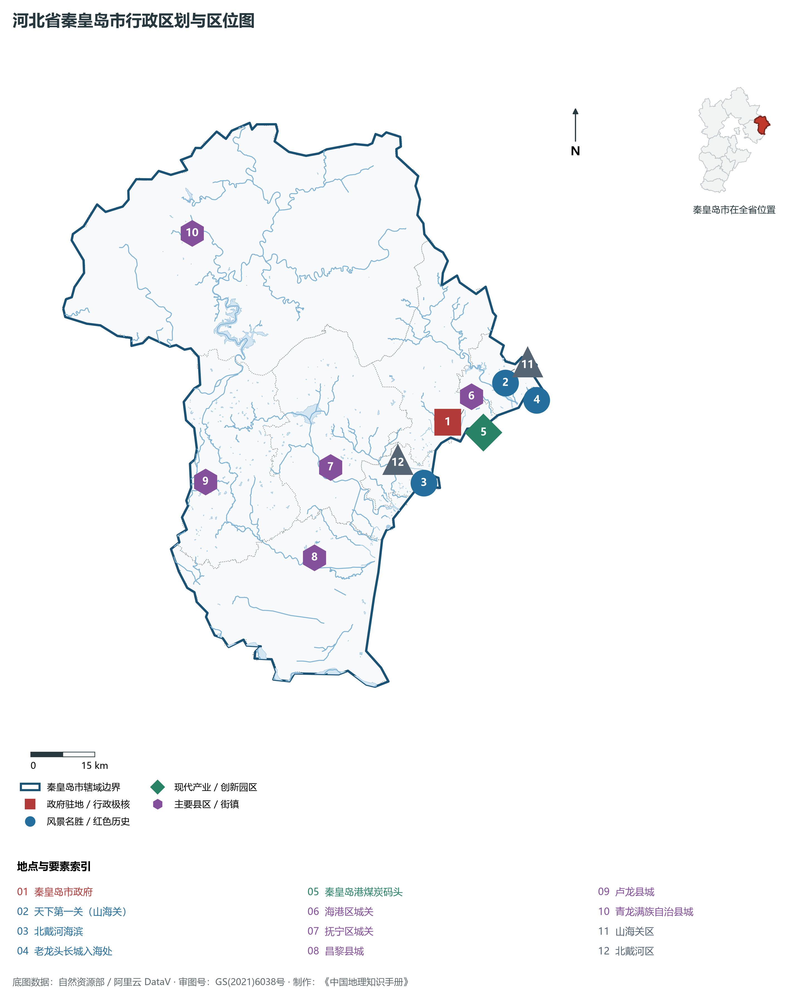
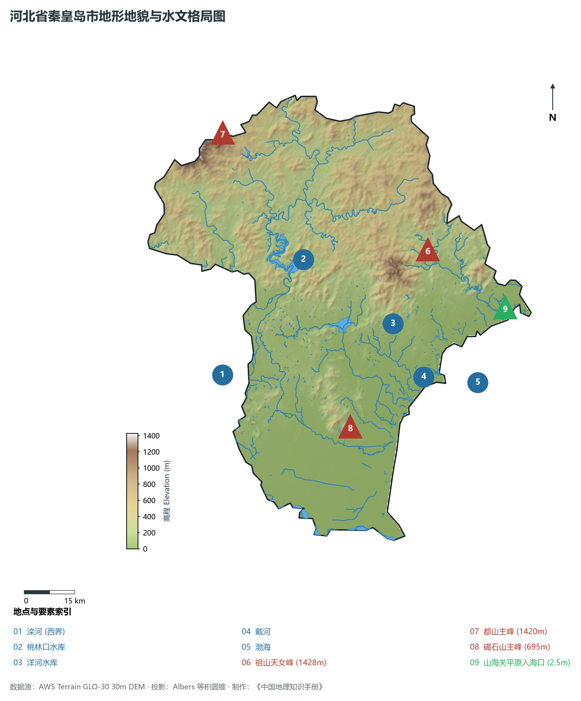
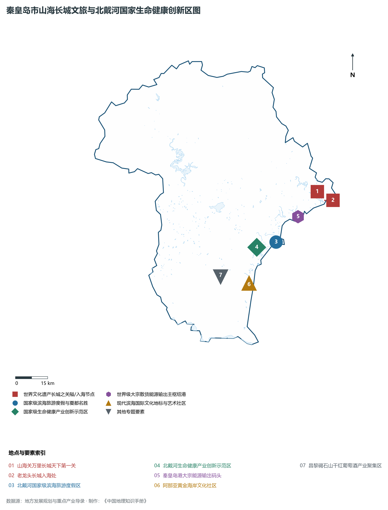
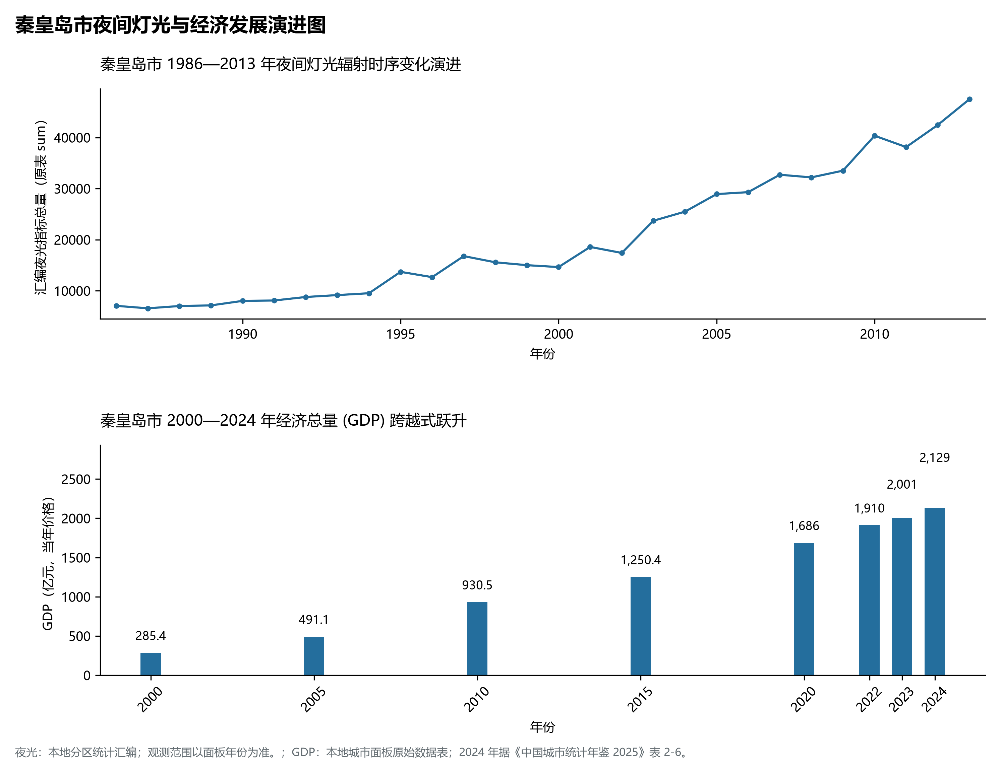
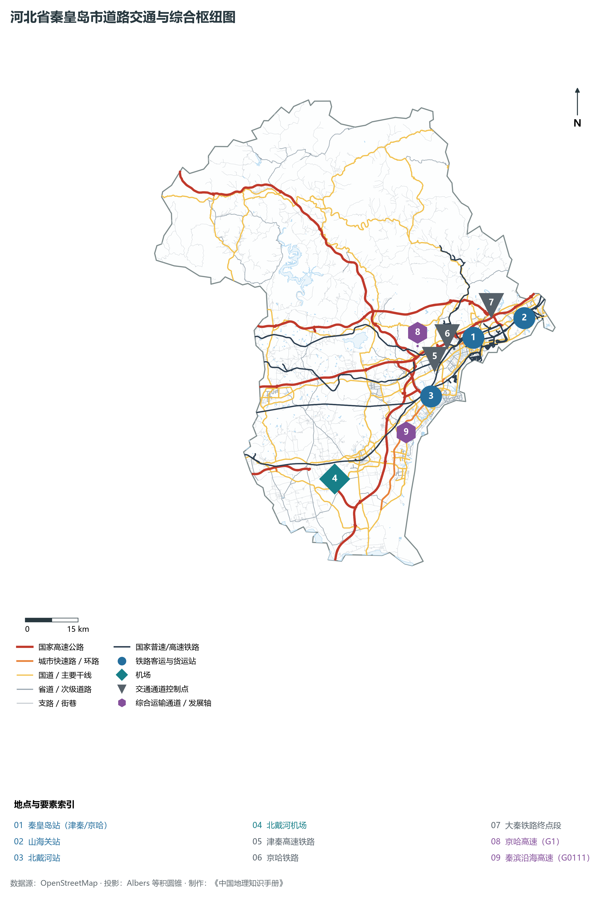

# 3.3 秦皇岛市

秦皇岛，中国唯一以帝王名号得名的海滨名城、中国首批 14 个沿海开放城市之一、享誉中外的“夏都”与滨海旅游度假胜地、世界级大宗散货能源输出大港。地处河北省东北部、南临渤海、北依燕山，西南与唐山毗连，东北与辽宁省葫芦岛市隔界相望，控扼连接华北与东北的咽喉纽带——“辽西走廊”。地理坐标介于东经 118°51′—119°51′、北纬 39°24′—40°37′ 之间。大陆海岸线长 **178.4 km**。2024 年常住人口 **311 万人**，常住人口城镇化率 **66.79%**，地区生产总值 **2,129 亿元**（当年价格），人均地区生产总值 **68,456 元**，三次产业构成为 **12.44 : 31.29 : 56.27**。

秦皇岛兼具壮丽的海陆地貌与深厚的山海文脉。公元前 215 年，秦始皇东巡入海求仙驻跸于此，留下了《史记》确切记载的求仙入海处遗址与城市得名之缘；明洪武年间，大将徐达在此修筑天下第一关——山海关，万里长城由此破海而出，巍然锁钥辽西走廊；1898 年，清光绪皇帝御批秦皇岛自辟为通商口岸，北戴河正式被辟为中外避暑度假区，开启近代中国现代旅游与国际滨海休养之先声。新中国成立以来，大秦铁路终端煤港在此建成，秦皇岛一跃成为支撑“北煤南运”国家能源安全的战略咽喉。新时代，秦皇岛全力推进国家级生命健康产业创新示范区建设，展现出山海关隘文脉、世界能源枢纽与国际康养度假名城融汇绽放的全新活力。

---

## 一、市情速览

秦皇岛拥有优异的海岸线、世界级的避暑微气候与以大秦铁路为后盾的现代化深水港区。

| 核心指标 | 全市数值与空间分布 | 全国/全省定位 |
|:---|:---|:---|
| **行政区划面积** | 7 813 km² | 低山丘陵占 61.4%，平原占 32.6%，滨海沙丘与潮滩占 6.0% |
| **常住人口** | 311 万人 | 2024 年，全市；年鉴公布口径 |
| **常住人口城镇化率** | 66.79% | 2024 年，全市；年鉴公布口径 |
| **人口密度** | 401 人/km² | 海港区超 3 200 人/km²，青龙满族自治县约 150 人/km² |
| **地区生产总值 (GDP)** | 2,129 亿元 | 2024 年，全市；年鉴公布口径 |
| **人均 GDP** | 68,456 元/人 | 2024 年，全市；年鉴公布口径 |
| **产业三次结构** | 13.5 : 34.2 : 52.3 | 第三产业占绝对优势，滨海康养、高端文商旅加速集聚 |
| **行政架构** | 4 个市辖区、2 个县、1 个自治县 | 市政府驻海港区友谊路；青龙为满族自治县 |
| **战略核心定位** | 国际一流旅游城市与现代能源大港 | 国家生命健康产业创新示范区、沿海开放前沿、绿色能源集散地 |

**图 03-03-1 河北省秦皇岛市行政区划与区位图**：图上编号与地点、要素索引对应。

---

## 二、自然地理：山海相连、碣石耸立与避暑黄金岸线

秦皇岛是华北平原向东北辽西走廊收窄过渡的典型陆海交汇带，燕山余脉自西北直逼海滨，形成“山海紧逼、平原狭长”的独特地形景观。

### 1. 地貌阶梯与极值高差
全域地貌由西北向东南倾降，呈阶梯式过渡：

- **冀东北中山丘陵区**：分布于青龙满族自治县及海港区北部，山峦重叠，海拔在 500—1 400 m 之间。最高峰为青龙境内的**都山**，海拔达 **1 420.7 m**；祖山主峰天女峰（1 428 m）花岗岩奇峰如笋，云雾缭绕；
- **山海关与海滨狭长冲积平原**：自燕山山脚至渤海之间，宽度仅 5—20 km，由戴河、洋河、汤河冲积而成，地势平缓，是古代华北出关通往东北平原的唯一天然咽喉陆路通道；
- **滨海黄金沙滩与泻湖沙丘地貌**：海岸线由花岗岩蚀余基岩岬角与开阔优质沙质海滩交替构成。北戴河、昌黎黄金海岸发育有高逾数十米的沿海风成沙丘地貌群，沙软潮平，水质清澈，是世界顶级的天然海滨浴场；昌黎七里海为华北著名的古潟湖湿地。

**图 03-03-2 河北省秦皇岛市地形地貌与水文格局图**：图上编号与地点、要素索引对应。

### 2. 气候特征：暖温带半湿润大陆性季风气候与“夏都”微气候
秦皇岛具有华北平原极其罕见的“海洋性调节”避暑微气候：

- **夏无酷暑**：最热月（7—8 月）平均气温仅 **24.5—25.0 ℃**，极端最高气温极少突破 35 ℃，夏季相对湿度适中，海陆风交替带来清凉海风，自晚清以来便被公认为中国北方最著名的“夏都”；
- **降水充沛**：受燕山迎风抬升与渤海暖湿气团共同作用，年平均降水量达 **620—720 mm**，是河北省降水最为丰沛的区域之一。

### 3. 水系分布：滦河、戴河与桃林口水库

- **滦河下游**：自迁安流出，成为秦皇岛与唐山的西部天然界河；
- **桃林口水库**：位于青龙县大石岭乡青龙河上，总库容 **8.59 亿 m³**，控制流域面积 5 060 km²，是保障秦皇岛城市供水、农业灌溉与生态防洪的“大水缸”；
- **入海河流群**：戴河、洋河、汤河自北向南独流入海，形成了水质优良的近岸河口湿地生态廊道。

---

## 三、建置沿革与文化根脉

秦皇岛是长城文化、海洋文化与近现代避暑外交文化的集大成者。

### 1. 建置沿革
商周属孤竹国；秦汉属辽西郡、右北平郡；明洪武十四年（1381年）大将徐达修筑山海关，设立山海卫；清置临榆县（今山海关）、抚宁县；1948 年设立秦榆市，1949 年定名为秦皇岛市，1984 年被国务院列为全国首批沿海开放城市。

### 2. 万里长城天下第一关与老龙头

- **山海关（天下第一关）**：万里长城东部起点的第一重镇，城堞森严，东门城楼挂有明代名臣萧显手书“天下第一关”巨匾，气势磅礴；
- **老龙头入海石城**：明万里长城唯一入海的一段，长城宛如巨龙自燕山俯冲而下，龙首探入汹涌渤海浪涛之中，构成了长城建筑史上“水陆双锁”的千古奇观。

### 3. 避暑夏都与阿那亚现代海岸文化

- **北戴河近代建筑群**：1898 年辟为避暑区后，英、法、美、德、俄等国人士以及中国近代显要在联峰山及海滨兴建了风格各异的花园别墅 700 多栋，是与江西庐山、河南鸡公山、浙江莫干山并列的“中国四大近代避暑胜地”；
- **阿那亚黄金海岸文化社区**：近年来在昌黎海滨崛起的现代化先锋艺术文化地标，孤独图书馆、海边礼堂等现代极简主义建筑与沙滩海洋深度融合，成为享誉国际的青年文化与滨海度假范本。

**图 03-03-4 秦皇岛市山海长城文旅与北戴河国家生命健康创新区图**：图上编号与地点、要素索引对应。

---

## 四、经济地理：现代大港、生命健康与临港制造

秦皇岛坚持把生态立市与产业强市有机结合，构建起现代港航物流、国际康养文旅、先进制造三大主导产业集群。

### 1. 秦皇岛港：北煤南运战略枢纽
秦皇岛港是中国近代最早的自辟口岸之一，也是世界级大宗散货干散煤集散地：

- **大秦铁路终点站港口**：拥有数十个现代化大型专业化煤炭泊位，最大可靠泊 15 万吨级散货船，年吞吐煤炭逾 1.5 亿吨，源源不断输往华东、华南沿海各大发电厂，是维护国家能源安全与宏观经济平稳运行的战略基石；
- **转型发展**：港区正加快绿色低碳转型，扩大集装箱与杂货班轮业务，规划建设高品质邮轮母港与滨海国际游艇俱乐部。

### 2. 北戴河生命健康产业创新示范区
2016 年经国务院同意设立的**北戴河生命健康产业创新示范区**，是我国北方唯一的国家级生命健康产业平台：

- **政策先行先试**：享有进口急需医疗器械、前沿生物医药研发特批、国际先进医疗技术临床转化等一系列国家级优惠政策；
- **产业集聚**：重点发展精准医疗、生物制药、高端康复养老、健康旅游与生物医疗大数据，打造国际一流的“健康中国”先行示范样板。

### 3. 沿海先进制造业高地
经济技术开发区集聚了中信戴卡（全球最大铝车轮制造企业，全球市场占有率连续十余年稳居第一）、康泰医学、哈电重装（核电大型装备制造）等行业领军龙头，高端先进装备制造能级持续跃升。

**图 03-03-5 秦皇岛市夜间灯光与经济发展演进图**：各面板按标注的观测年份、指标和单位列示。

---

## 五、交通网络与走廊枢纽

秦皇岛是扼守“关内关外”的交通咽喉，综合立体交通骨干网络联通四方。

### 1. 铁路大动脉

- **客运客专**：津秦高铁横贯海滨平原，秦皇岛站、北戴河站、山海关站客流密集，实现 1.5 小时抵津、2 小时进京、2 小时抵沈阳；
- **货运重载通道**：大秦铁路从山西大同穿越太行、燕山，直达秦皇岛港柳村南站与各专业煤码头；京哈铁路承担着繁重的客货混跑干线职能。

### 2. 高速公路网络
京哈高速（G1）纵贯全境进入辽宁，秦滨沿海高速（G0111）沿海展开直通天津滨海新区与山东半岛，承秦高速（G95支线）将燕山腹地承德与沿海深水港快捷相连。

### 3. 航空与海空港口
秦皇岛北戴河机场（BPE）为 4D 级民用机场，可满足波音 737、空客 A320 等中型客机起降，开辟多条直达全国主要枢纽城市的航线，实现空铁海三维无缝换乘。

**图 03-03-3 河北省秦皇岛市道路交通与综合枢纽图**：图上编号与地点、要素索引对应。

---

## 六、未来展望：国际一流旅游城市与沿海开放新极核

面对高质量发展新机遇，秦皇岛坚定走生态优先、绿色发展之路：

1. **建设国际一流旅游城市**：深耕山海长城世界文化遗产、北戴河夏都与滨海沙滩核心优势，推动全季、全域文旅产品转型升级；
2. **打造国家生命健康创新高地**：以北戴河示范区为核心，加速高端医疗、生物前沿医药与康养装备企业导入；
3. **推动大港向绿色智慧综合贸易港跨越**：提升深水泊位利用效率，服务保障国家能源通道安全，携手京津打造环渤海高品质宜居宜游宜业现代海滨都市。

2024 年统计来源：《中国城市统计年鉴 2025》表 2-1、2-6、2-7（2024 年，全市）。其他年份 GDP 据本地城市面板“原始数据”表，单位为亿元、当年价格。
