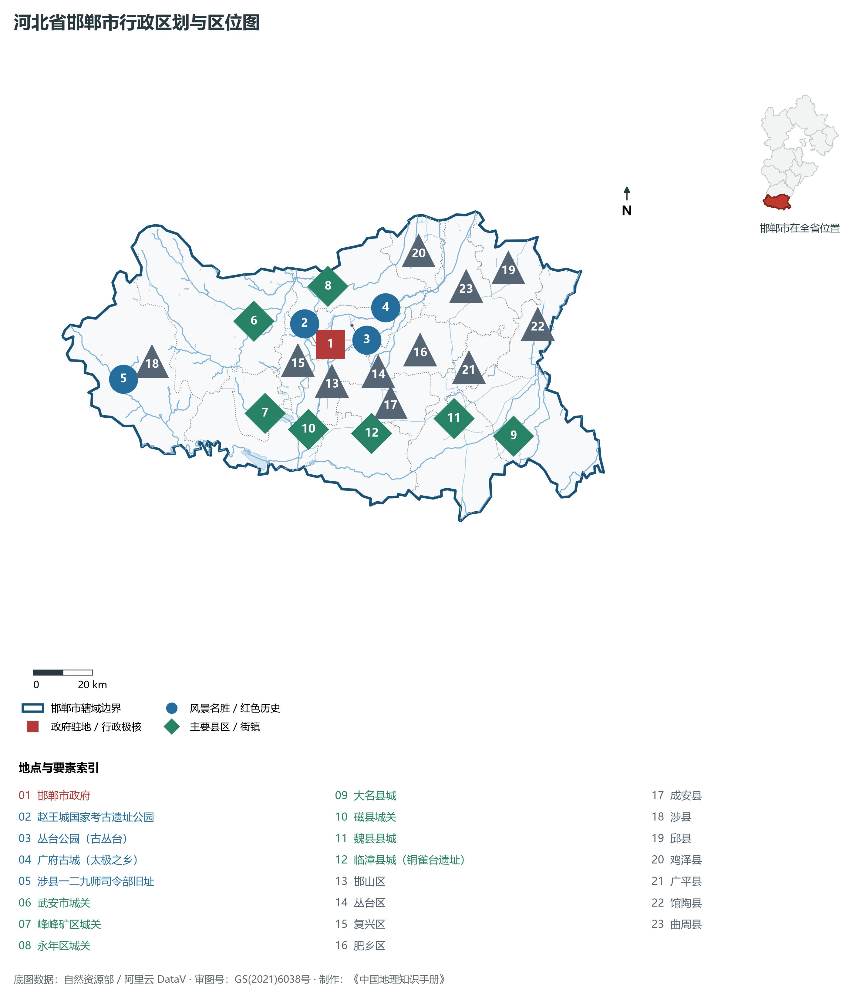
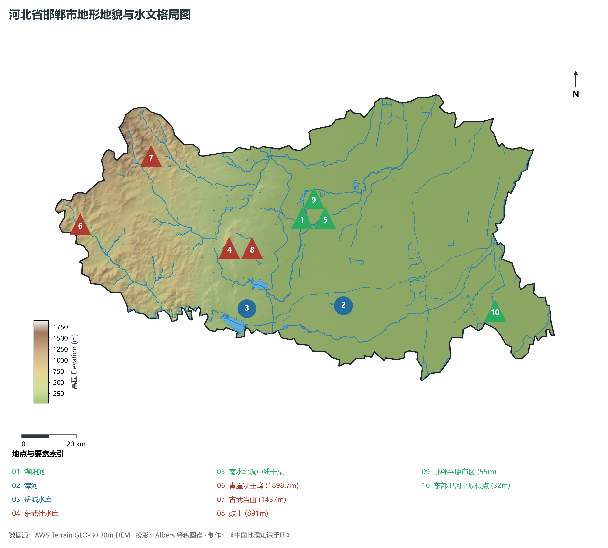
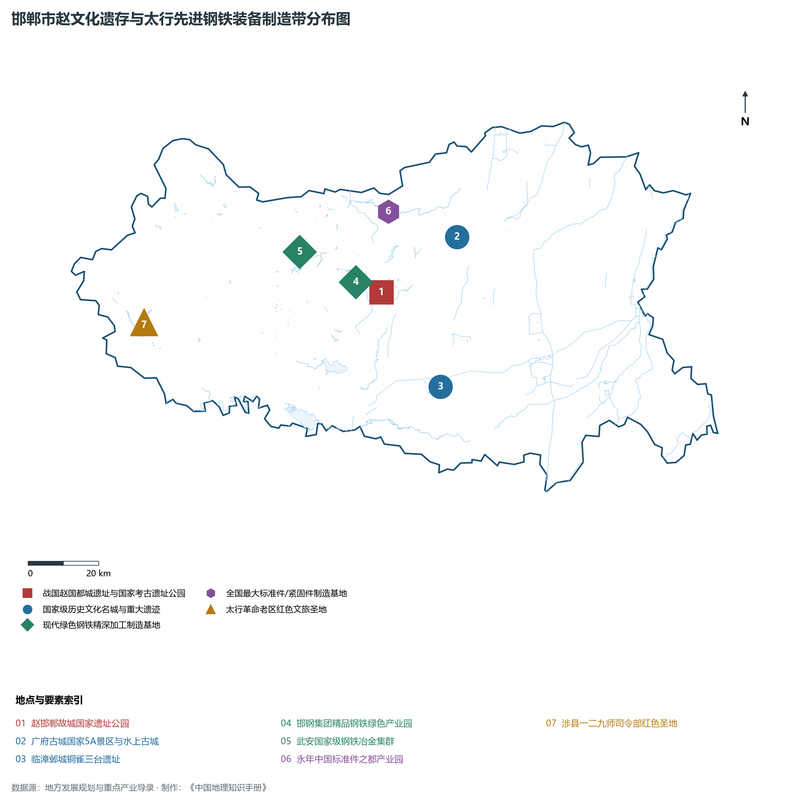
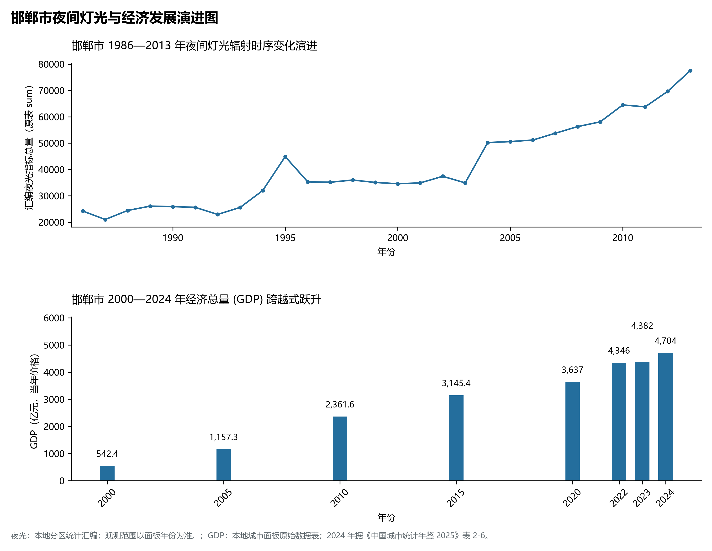
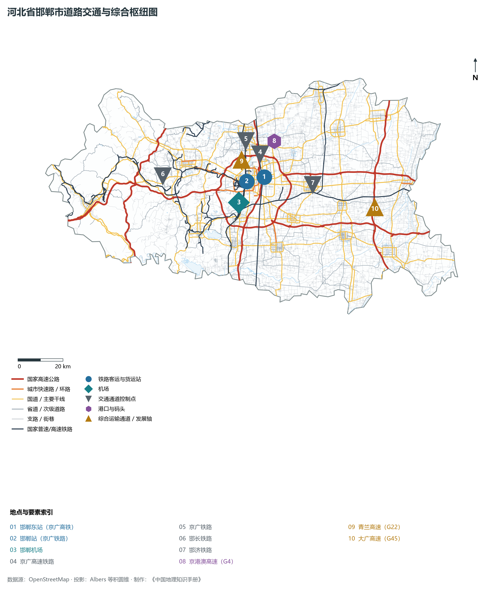

# 3.4 邯郸市

邯郸，国家历史文化名城、华北地区重要工业基地与晋冀鲁豫四省交会区域中心城市，中国唯一一座三千年来未曾改名的古都。地处河北省最南端、太行山脉南段东麓与华北大平原交界地带，南隔漳河与河南省安阳市相连，东与山东省聊城市接壤，西越太行与山西省长治市毗邻，地理坐标介于东经 114°03′—115°28′、北纬 36°04′—37°01′ 之间。2024 年常住人口 **918 万人**，常住人口城镇化率 **62.1%**，地区生产总值 **4,704 亿元**（当年价格），人均地区生产总值 **51,258 元**，三次产业构成为 **9.58 : 39.57 : 50.85**。

邯郸文脉极盛，成语典故之都。早在 8 000 年前的磁山文化时期，先民便在此刀耕火种，创制了世界最早的家鸡驯养与黍类种植记录；战国时期，赵敬侯自中牟迁都邯郸，赵武灵王在此厉行“胡服骑射”，开创了古代军事与民族交融之先河，“完璧归赵”、“负荆请罪”、“邯郸学步”等 1 500 余条成语在此沉淀发酵；三国曹魏时期，邺城（临漳）筑铜雀台，开创中国古代城市规整对称“轴线中枢”规划之典范。现代邯郸是晋冀鲁豫最大的钢铁、煤炭、电力重化工业基地之一与太行山老区红色堡垒，当代正加速迈向太行山麓绿色精品钢材基地与新材料先进智造名城。

---

## 一、市情速览

邯郸是冀南的综合交通枢纽与工农业并重的特大城市。

| 核心指标 | 全市数值与空间分布 | 全国/全省定位 |
|:---|:---|:---|
| **行政区划面积** | 12 066 km² | 西部太行低中山丘陵占 40.5%，东部华北平原占 59.5% |
| **常住人口** | 918 万人 | 2024 年，全市；年鉴公布口径 |
| **常住人口城镇化率** | 62.1% | 2024 年，全市；年鉴公布口径 |
| **人口密度** | 780 人/km² | 核心六区超 4 500 人/km²，平原各县在 600—850 人/km² |
| **地区生产总值 (GDP)** | 4,704 亿元 | 2024 年，全市；年鉴公布口径 |
| **人均 GDP** | 51,258 元/人 | 2024 年，全市；年鉴公布口径 |
| **产业三次结构** | 9.4 : 44.8 : 45.8 | 重工底蕴雄厚，现代钢铁、装备制造与食品医药并重 |
| **行政架构** | 6 个区、11 个县、代管 1 个县级市 (武安) | 市政府驻丛台区联纺东路；武安市为千亿级经济强县 |
| **战略核心定位** | 晋冀鲁豫四省交会区域中心城市 | 全国重要的先进制造业基地、国家历史文化名城、太行门户 |

**图 03-04-1 河北省邯郸市行政区划与区位图**：图上编号与地点、要素索引对应。

---

## 二、自然地理：太行东麓断崖、三级地貌与滏阳河发祥地

邯郸西高东低，太行山自西向东在此发生强烈的构造断裂，形成了山地、丘陵与冲积平原错落的立体地貌空间。

### 1. 地貌分区与高程落差
全域地貌划分为三大类型：

- **西部太行中山峡谷区**：分布于涉县、武安西部，海拔在 **800—1 800 m** 之间。全域最高峰为涉县西北与山西黎城交界处的**青崖寨**，海拔达 **1 898.7 m**。地层以寒武系、奥陶系巨厚灰岩及太古宙片麻岩为主，嶂石岩地貌断崖林立，太行峡谷幽深；
- **中部丘陵阶地与盆地**：海拔 150—500 m，主要分布于峰峰矿区、武安盆地及磁县西部，煤炭与铁矿资源富集；
- **东部山前倾斜平原与冲积平原**：海拔 30—80 m，地面平坦开阔，由滏阳河、漳河冲积形成，土壤肥沃，全境最低点位于东部大名县卫河出境滩地，海拔仅 **32.0 m**。

**图 03-04-2 河北省邯郸市地形地貌与水文格局图**：图上编号与地点、要素索引对应。

### 2. 气候特征：暖温带半湿润大陆性季风气候

- **气温**：年平均气温 **13.5—14.2 ℃**。四季分明，夏季炎热多雨，冬季干燥寒冷，无霜期约 200 天；
- **降水**：年降水量约为 **520—580 mm**，太行迎风坡山麓带易受夏季季风抬升形成强对流暴雨，暴雨径流汇入岳城水库与东武仕水库。

### 3. 水系脉络：海河流域滏阳河与漳卫河

- **滏阳河**：海河流域子牙河水系南源，发源于峰峰矿区滏山南麓黑龙洞泉群，自西南向东北流贯邯郸市区，流长 400 余 km，是沿岸农业与城市生活的核心水源；
- **漳河**：分清漳河与浊漳河，在涉县合流后汇入**岳城水库**（总库容 13.0 亿 m³），是豫冀两省界河与控制性防洪水利枢纽；
- **东武仕水库**：位于磁县滏阳河干流出山口，总库容 1.8 亿 m³，为邯郸市区供水与工业用水生命工程；
- **南水北调中线总干渠**：自磁县入境，经邯郸市区西侧向北穿流，年分水超 4 亿 m³，极大支撑了全域地下水压采与生态复苏。

---

## 三、建置沿革与文化根脉

邯郸不仅是中国地名历史上的罕见“活化石”，更是战国文化、曹魏文化与太极拳文化的集大成者。

### 1. 战国赵都与“中国成语典故之都”

- **赵邯郸故城（国家考古遗址公园）**：战国赵国都城，由赵王城与大北城两部分组成，占地逾 20 km²。赵王城三座城邑鼎立，地面夯土台基巍峨保存，是中国现存保存最完整、规模最大的战国都城遗址之一；
- **古丛台与七贤祠**：武灵丛台始建于战国赵武灵王时期，台高 26 m，为赵王检阅军队与观赏歌舞之地，“胡服骑射”在此推行；
- **成语典故渊薮**：邯郸发生或衍生出“毛遂自荐”、“价值连城”、“完璧归赵”、“负荆请罪”、“纸上谈兵”等 1 500 多条成语，被中国文联命名为“中国成语典故之都”。

### 2. 水上古城广府与太极拳发祥地
永年区东南的**广府古城**（国家 5A 级景区），坐落于华北第四大洼淀永年洼的千亩芦苇湿地环抱之中，城墙规整高耸，四周护城河宽逾百米，水清岸绿，素有“水上太极城”美誉。这里是杨式太极拳创始人杨露禅与武式太极拳创始人武禹畴的故里，太极拳由此名扬海内外。

### 3. 涉县一二九师司令部与太行革命丰碑
抗日战争全面爆发后，刘伯承、邓小平率领八路军一二九师挺进涉县赤岸村，在此运筹帷幄建立太行抗日根据地，指挥了响堂铺、神头岭、百团大战等著名战役，创建了晋冀鲁豫边区首府，孕育了伟大的“太行精神”。

**图 03-04-4 邯郸市赵文化遗存与太行先进钢铁装备制造带分布图**：图上编号与地点、要素索引对应。

---

## 四、经济地理：钢铁冶金转型、标准件制造与现代文旅

邯郸加速由传统粗放型资源大市向绿色低碳高质效工业强市跨越，形成现代精品钢材、先进装备制造、高端新材料等骨干集群。

### 1. 精品钢铁冶金与高端材料

- **邯钢与武安钢铁基地**：邯郸拥有完备的采矿、选矿、冶炼、压延钢铁全产业链。邯钢老厂区实现彻底退城搬迁至沿海及绿色新基地，主导研发汽车用高强钢、家电板、硅钢及特种耐候轴承钢，绿色超低排放技术达世界领先水平；
- **武安先进装备制造**：聚焦汽车精密铸锻件、矿山成套机械与新型能源装备，工业增加值居全省县域前列。

### 2. 永年紧固件与专业化产业集群

- **中国紧固件之都（永年）**：全区拥有紧固件生产与商贸企业超万家，产销量占全国总量的 **55% 以上**，年交易额超 400 亿元，产品广泛应用于高铁、汽车、航空航天及建筑工程，畅销全球 100 多个国家；
- **现代食品医药产业**：依托魏县鸭梨、鸡泽辣椒等大宗农产品基底，形成晨光生物（天然植物提取物全球冠军）、五得利面粉等世界级农产品深加工龙头企业。

**图 03-04-5 邯郸市夜间灯光与经济发展演进图**：各面板按标注的观测年份、指标和单位列示。

---

## 五、交通网络与晋冀鲁豫十字枢纽

邯郸地处晋冀鲁豫四省交会中心，自古有“东接齐鲁、西控太行、南扼中原、北卫京畿”之战略通衢地位。

### 1. 铁路骨干网

- **高铁纵贯**：京广高速铁路贯穿市区南北，邯郸东站日均停靠高铁近 200 列，1.5 小时内直达北京、郑州、石家庄；
- **东西横向干线**：邯长铁路向西翻越太行山通达山西长治，邯济铁路向东连接山东聊城与济南，构成了晋煤外运与鲁冀物资交流的重要通道；京广普速铁路纵贯全境。

### 2. 国家高速公路网
京港澳高速（G4）、青兰高速（G22）、大广高速（G45）交织成网，太行山高速（S75）沿太行山麓串联涉县、武安等革命老区，构筑起四通八达的骨干公路走廊。

### 3. 民航机场
邯郸机场为 4C 级民用支线机场，开通直达上海、广州、深圳、成都、杭州等国内数十个主要大中城市的航线。

**图 03-04-3 河北省邯郸市道路交通与综合枢纽图**：图上编号与地点、要素索引对应。

---

## 六、未来展望：晋冀鲁豫交会区域中心城市

面向新时期，邯郸正全面加速区域中心城市建设：

1. **打造四省交会创新高地**：深化与北京科研院所和晋鲁豫邻近城市的产业协同，建设具有国际竞争力的精品钢材、高端装备及天然提取物生物产业高地；
2. **擦亮三千年古都文旅名片**：做强赵文化、大运河文化、太极拳文化与太行红色文旅，推动文化软实力转化为城市核心竞争力；
3. **构筑太行南麓生态安全屏障**：严守西部太行生态屏障，深化地下水超采综合治理，打造水美城秀、宜居宜业宜游的现代历史文化名城。

2024 年统计来源：《中国城市统计年鉴 2025》表 2-1、2-6、2-7（2024 年，全市）。其他年份 GDP 据本地城市面板“原始数据”表，单位为亿元、当年价格。
