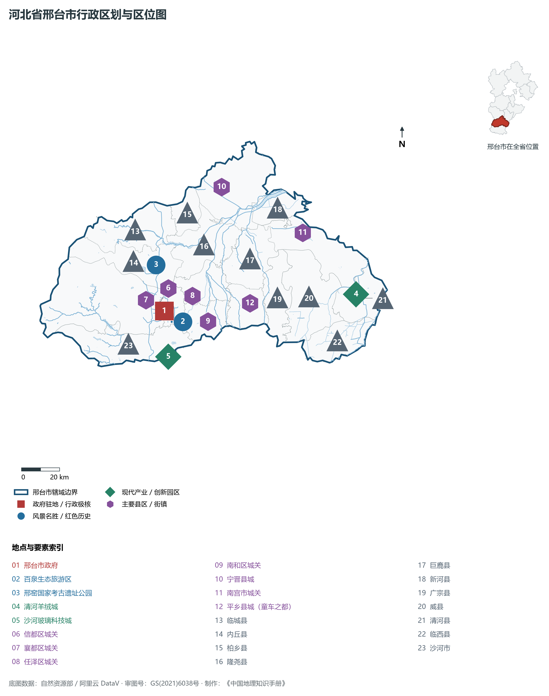
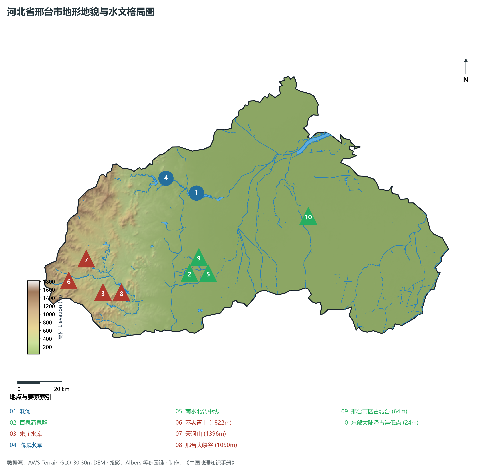
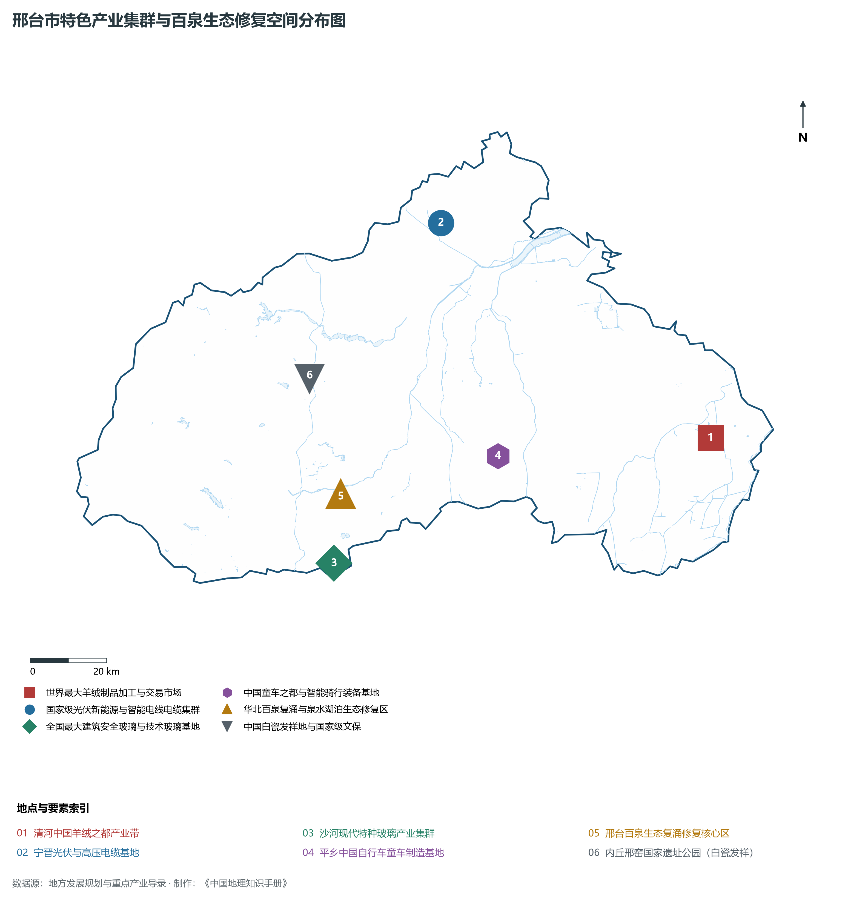
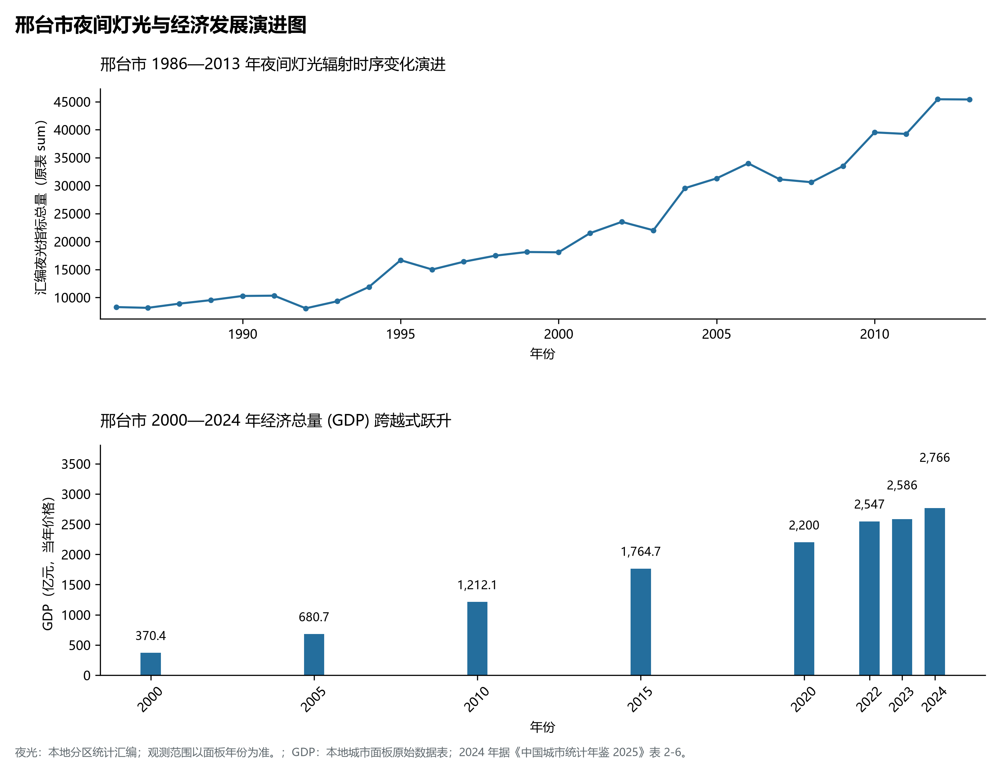
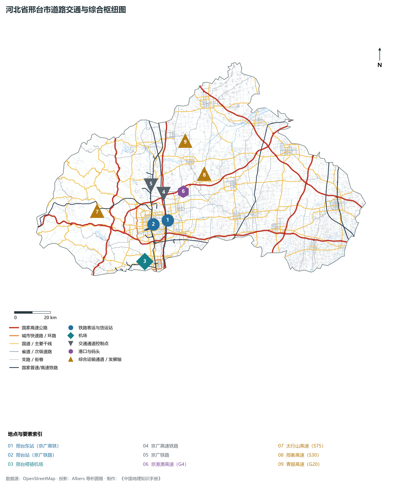

# 3.5 邢台市

邢台，简称“邢”，古称邢国、巨鹿、顺德府，拥有 3 500 年建城史与 600 余年建都史，素有“五邑古都、十朝雄郡”之美誉，是华北历史上第一座有确切文字记载的古都城市，也是闻名全国的特色产业集群之乡与百泉复涌生态奇迹名城。地处河北省西南部、太行山脉中段东麓与冀南平原交汇带，北依省会石家庄，南邻古都邯郸，东接衡水与山东德州，西越太行与山西省左权县、和顺县接壤，地理坐标介于东经 113°52′—115°49′、北纬 36°50′—37°47′ 之间。2024 年常住人口 **688 万人**，常住人口城镇化率 **57.02%**，地区生产总值 **2,766 亿元**（当年价格），人均地区生产总值 **39,989 元**，三次产业构成为 **12.58 : 36.02 : 51.4**。

邢台自然与人文地理底蕴极其深厚。商代祖乙曾迁都于邢；西周成王封周公第四子姬苴于邢，建立邢国；后赵石勒定都于此；隋唐时期，邢窑创烧出“天下无贵贱通用之”的温润白瓷，与越窑青瓷并称“南青北白”，开创中国古代制瓷业划时代格局；元代著名天文学家、水利学家郭守敬在此诞生，创制《授时历》与通惠河水系工程。自然地理上，太行山地表水与地下水向山前断裂倾泻汇集，历史上催生了闻名遐迩的“邢台百泉”群落与大陆泽湿地。新时代，邢台实现了百泉复涌的地学生态奇迹，培育出清河羊绒、宁晋光伏电缆、沙河玻璃、平乡童车等享誉海内外的特色单项冠军产业集群。

---

## 一、市情速览

邢台是太行东麓山前平原生态优良、先进制造与县域特色产业高度集聚的活力之城。

| 核心指标 | 全市数值与空间分布 | 全国/全省定位 |
|:---|:---|:---|
| **行政区划面积** | 12 400 km² | 西部太行山地占 28.5%，山前丘陵占 15.2%，东部平原占 56.3% |
| **常住人口** | 688 万人 | 2024 年，全市；年鉴公布口径 |
| **常住人口城镇化率** | 57.02% | 2024 年，全市；年鉴公布口径 |
| **人口密度** | 573 人/km² | 平原各县在 600—800 人/km²，山区在 120—250 人/km² |
| **地区生产总值 (GDP)** | 2,766 亿元 | 2024 年，全市；年鉴公布口径 |
| **人均 GDP** | 39,989 元/人 | 2024 年，全市；年鉴公布口径 |
| **产业三次结构** | 12.8 : 39.5 : 47.7 | 46 个特色产业集群拉动，高新技术制造业比重达 23% |
| **行政架构** | 4 个市辖区、12 个县、代管 2 个县级市 | 市政府驻襄都区新华南路；襄都、信都、任泽、南和成型 |
| **战略核心定位** | 京津冀先进制造业基地与泉城生态客厅 | 国家特色产业集群之乡、太行东麓生态水源修复区 |

**图 03-05-1 河北省邢台市行政区划与区位图**：图上编号与地点、要素索引对应。

---

## 二、自然地理：太行断裂大峡谷、百泉复涌与大陆泽盆地

邢台由西向东呈现极为壮观的山地、丘陵、平原梯级下降形态，地质构造极其活跃。

### 1. 地貌类型与垂直阶梯
全境地貌划分为三大鲜明板块：

- **西部太行中山峡谷地貌区**：分布于信都区西部及临城、内丘深山区，海拔多在 **800—1 800 m**。全域最高峰为信都区与山西左权交界处的**不老青山**，海拔达 **1 822.0 m**；天河山（1 396 m）、前南峪林海广布，形成了以红石英砂岩垂直断崖为代表的**邢台大峡谷**（中国障石岩地貌国家地质公园），断崖峭壁，奇峰深涧如斧劈刀削；
- **中部丘陵阶地与泉水出露带**：海拔 100—300 m，为太行山大断裂构造带前缘，地下岩溶裂隙极其发育，承压水在此汇聚顶托，是历史名泉百泉群的直接地质成因；
- **东部倾斜冲积平原与大陆泽古洼**：海拔 24—80 m，向东微倾，土层深厚。南部沙河、中部百泉河、北部泜河冲积其上。平原最低洼处为古大陆泽（巨鹿、任泽交界），海拔仅 **24.0 m**，历史上为九河所聚之大湖泽。

**图 03-05-2 河北省邢台市地形地貌与水文格局图**：图上编号与地点、要素索引对应。

### 2. 气候特征：温带半湿润大陆性季风气候

- **气温**：全域年平均气温在 **13.0—14.0 ℃** 之间，西部深山区年均温 9—11 ℃，夏无酷暑，森林覆盖率超 90%，是华北著名的避暑胜地；
- **降水**：年降水量约为 **500—560 mm**，太行山迎风山麓因冷暖气流阻滞常形成华北特大暴雨中心（如 1963 年与 2016 年“7·19”特大暴雨中内丘樟么站降水均超 700 mm/日）。

### 3. 百泉复涌地学奇迹与水系重塑

- **“百泉复涌”地学奇迹**：邢台地下水受太行山三叠纪向斜构造汇流驱动，在市区南部出露形成百泉、达活泉、狗头泉、黑龙潭等数百处涌泉群。20 世纪七八十年代因工业用水与地下水严重超采，泉群一度枯竭干涸近 40 年。随着南水北调中线通水置换水源、全域地下水回补与关井压采，2021 年起狗头泉、百泉相继实现**规模性历史复涌**，地下水水位回升逾 10 余米，形成了数千亩水碧天蓝的百泉湖湿地；
- **骨干河流水库**：流经境内的主要河流有泜河、留客河、滏阳河等；西部修建有**朱庄水库**（总库容 4.16 亿 m³）与**临城水库**（总库容 1.71 亿 m³），有效拦蓄太行山洪并维系常年生态补水。

---

## 三、建置沿革与文化根脉

邢台是中华早期文明演进的重大中枢，“先商发源地、殷商早期都城”在此实证。

### 1. 五邑古都与顺德府城

- **殷商古都与邢国建制**：商代自祖乙至盘庚曾迁都于邢（今市区北）；周成王封周公旦第四子姬苴于邢，筑邢国城，为太行东麓北方屏障；秦置巨鹿郡（项羽巨鹿之战破釜沉舟之地）；隋唐设邢州，宋元升顺德府，明清沿袭；
- **邢台古城清风楼**：顺德府古城地标，始建于唐代，重建于明成化年间，重檐歇山顶巍峨矗立，郭守敬曾在此观测星象；
- **郭守敬科学丰碑**：元代邢台人郭守敬创制简仪、高表等十余种天文观测仪器，编制出比欧洲格里历早 300 余年的《授时历》，并规划开凿元大都通惠河与积水潭水系，联合国将月球背面一座环形山命名为“郭守敬环形山”。

### 2. 中国白瓷发祥地：内丘邢窑
内丘与临城境内的**邢窑遗址**（全国重点文物保护单位），始于北朝，盛于隋唐，是世界上最早成功烧造出透影高白瓷的窑场。其瓷质“类银类雪”，打破了商周以来青瓷一统天下的格局，确立了中国陶瓷史上著名的“南青北白”竞艳版图，唐代陆羽《茶经》盛赞“邢瓷类银，越瓷类玉”。

### 3. 前南峪太行生态文明典范
信都区前南峪村曾是抗日军政大学总校所在地，抗战胜利后，三代人把荒山秃岭治理成林木覆盖率达 90.7% 的“太行山最绿的地方”，被联合国环境规划署评为“全球 500 佳”生态环境保护示范村。

**图 03-05-4 邢台市特色产业集群与百泉生态修复空间分布图**：图上编号与地点、要素索引对应。

---

## 四、经济地理：特色县域产业之乡与单项冠军矩阵

邢台走出了极具韧性的“一县一业、一镇一品”特色产业集群化发展之路，拥有国家级与省级特色产业集群 46 个。

### 1. 享誉全国的特色单项冠军

- **清河中国羊绒之都**：拥有羊绒纺纱、织造、研发、电商全链条，羊绒制品年产销量占全国 60%、原绒交易量占全球 40%，拥有全国著名的清河羊绒城；
- **宁晋光伏新能源与电线电缆**：晶澳科技（全球最大光伏电池与组件巨头之一）发祥与核心制造基地，同时是华北最大高低压电线电缆集聚区；
- **沙河现代安全玻璃之都**：拥有浮法、超白、Low-E 镀膜等先进玻璃生产线，产能占全国原片玻璃逾 15%，加速向光伏玻璃与汽车玻璃升级；
- **平乡与广宗童车产业**：自行车、婴童推车、智能骑行装备年产数亿辆，占国内市场半壁江山、全球市场近 40%。

### 2. 装备制造与绿色能源
襄都区与信都区聚焦重型汽车底盘、特种工程机械、轴承、精密紧固件及工业母机制造，加快向数字化智能制造迭代。

**图 03-05-5 邢台市夜间灯光与经济发展演进图**：各面板按标注的观测年份、指标和单位列示。

---

## 五、交通网络与太行前缘动脉

邢台自古扼守太行山前大道，是南北贯通、东西出山的陆运集散重镇。

### 1. 轨道干线

- **高铁通道**：京广高速铁路纵贯全境，邢台东站实现 1 小时抵石家庄、郑州，2 小时进京；
- **普铁干线**：京广铁路纵贯市区南北，邢和铁路（邢台至山西和顺）横穿太行山，开辟晋煤东运与冀中南出海的全新铁路重载大通道。

### 2. 高速路网与航空口岸

- **高速互通**：京港澳高速（G4）、太行山高速（S75）、青银高速（G20）、邢衡高速（S30）、东吕高速在全境形成“三纵三横”骨干高速路网；
- **邢台褡裢机场**：4C 级民用运输航空机场，2024 年正式通航，开通多条直达华东、华南主要城市的客运航线。

**图 03-05-3 河北省邢台市道路交通与综合枢纽图**：图上编号与地点、要素索引对应。

---

## 六、未来展望：泉城特色名市与先进制造高地

在新时代征程上，邢台聚力擦亮“泉城”品牌，全面迈向高质量发展：

1. **持续做优百泉生态文旅名片**：依托泉水复涌资源，实施环百泉水系生态修复与古泉城更新，建设华北独具魅力的湿地泉湖生态客厅；
2. **推动特色产业集群迈向中高端**：实施羊绒、电缆、玻璃、童车等优势集群“智改数转”，培育世界一流专精特新“小巨人”企业；
3. **太行水源涵养与宜居绿城**：加强太行山前封育保护，深度融入京津冀协同发展大局，谱写太行泉城精彩画卷。

2024 年统计来源：《中国城市统计年鉴 2025》表 2-1、2-6、2-7（2024 年，全市）。其他年份 GDP 据本地城市面板“原始数据”表，单位为亿元、当年价格。
