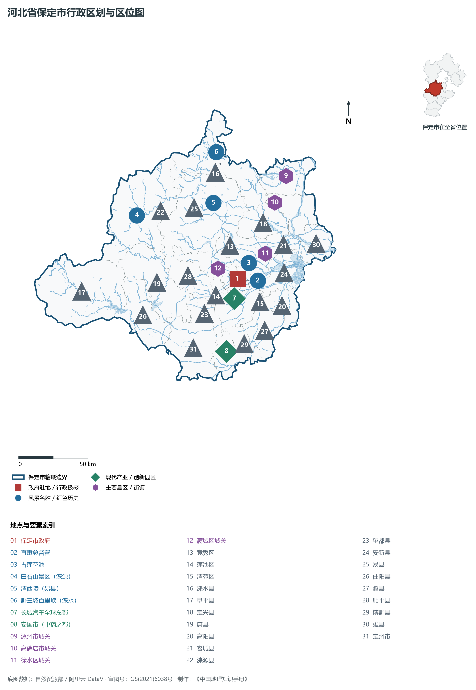
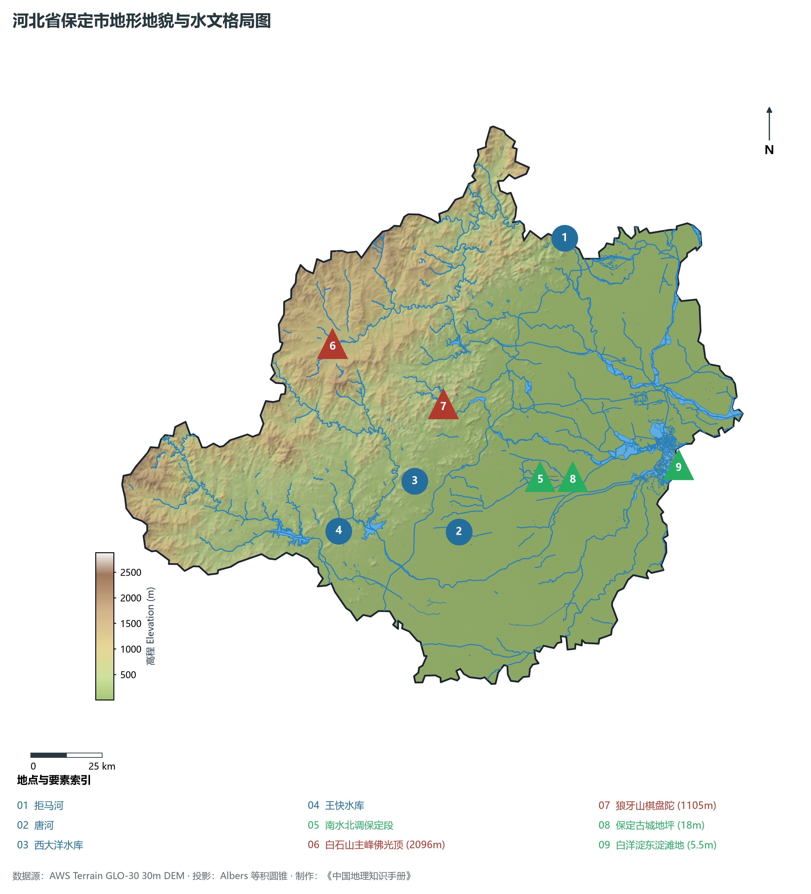
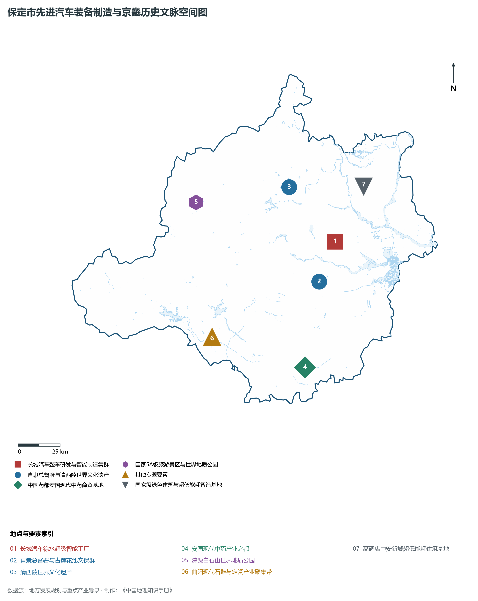
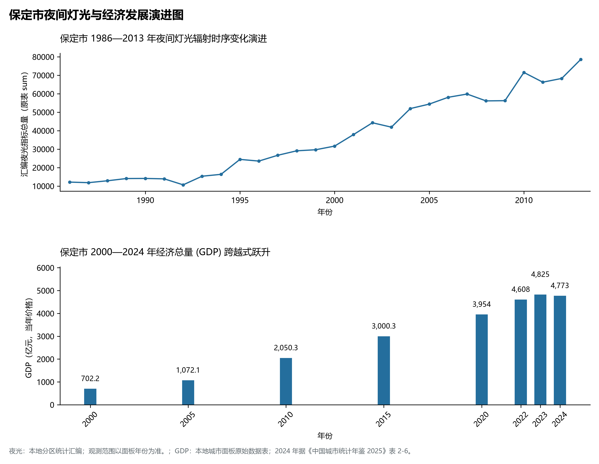
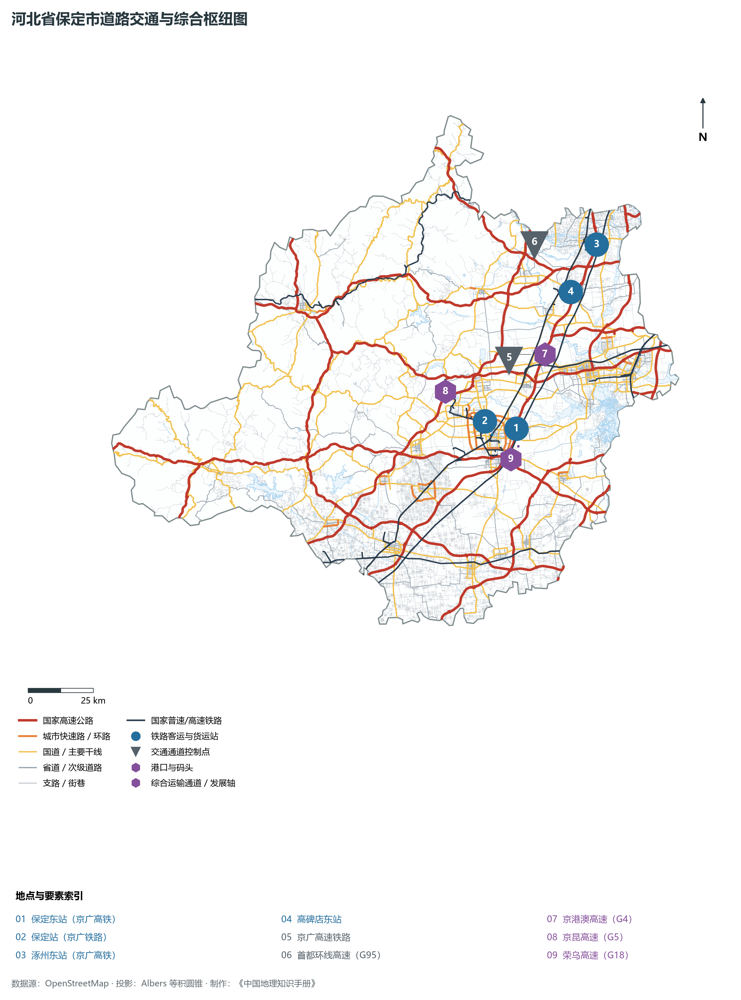

# 3.6 保定市

保定，国家历史文化名城、京畿重地、首都南大门、中国制造 2025 试点示范城市，古称“清苑”、“直隶”。地处华北大平原中北部、太行山脉北段东麓，东北与北京直辖市接壤（距北京仅 140 km），东与廊坊、沧州交界，南邻石家庄，西倚太行与山西省灵丘、繁峙、广灵县接壤，地理坐标介于东经 113°40′—116°20′、北纬 38°10′—40°00′ 之间。2024 年常住人口 **1,013 万人**，常住人口城镇化率 **60.64%**，地区生产总值 **4,773 亿元**（当年价格），人均地区生产总值 **47,830 元**，三次产业构成为 **12.17 : 32.8 : 55.03**。

“北控三村，南达九省，畿辅重地，都南屏翰”。自金元起，保定即为拱卫京师之军事与政治重镇。清代雍正八年（1730年）直隶总督署移驻保定，统领直隶军政大权近两百年，曾国藩、李鸿章、袁世凯先后坐镇于此，兴办洋务、编练新军，保定陆军军官学校培育出数千名近代著名将领，奠定近代中国军事教育摇篮地位。当代保定，既有古莲花池、清西陵之深厚文脉，更有长城汽车、立中集团、英利能源等先进制造业领跑全国。伴随着雄安新区的横空出世，保定迎来千年历史交汇期，形成了“全力服务保障雄安、深度融入京雄协同、加速构建现代化品质生活之城”的崭新空间宏图。

---

## 一、市情速览

保定是连接北京与冀中南各大经济走廊的最核心咽喉重镇。

| 核心指标 | 全市数值与空间分布 | 全国/全省定位 |
|:---|:---|:---|
| **行政区划面积** | 22 185 km² (全域口径) | 西部太行山地占 51.5%，东部华北平原占 48.5% |
| **常住人口** | 1,013 万人 | 2024 年，全市；年鉴公布口径 |
| **常住人口城镇化率** | 60.64% | 2024 年，全市；年鉴公布口径 |
| **人口密度** | 520 人/km² | 竞秀、莲池等核心城区超 4 200 人/km²，涞源、阜平约 100—150 人/km² |
| **地区生产总值 (GDP)** | 4,773 亿元 | 2024 年，全市；年鉴公布口径 |
| **人均 GDP** | 47,830 元/人 | 2024 年，全市；年鉴公布口径 |
| **产业三次结构** | 10.2 : 38.6 : 51.2 | 先进制造业与生产性现代服务业双轮驱动加速成型 |
| **行政架构** | 5 个市辖区、15 个县、代管 4 个县级市 | 市政府驻竞秀区东风西路；含定州市与雄安三县规划版图 |
| **战略核心定位** | 现代化品质生活之城与京雄保一体化极核 | 全国新能源汽车智造基地、国家历史文化名城、太行生态屏障 |

**图 03-06-1 河北省保定市行政区划与区位图**：图上编号与地点、要素索引对应。

---

## 二、自然地理：太行千峰竞秀、拒马横流与白洋淀汇水扇

保定地处太行山脉与华北平原的转换断裂过渡带，山地、丘陵、平原相嵌，由西北向东南呈现极其辽阔的阶梯地貌跨度。

### 1. 地貌分区与高程垂直差异
全域地貌由西向东分为三大类型：

- **冀西太行深中山峡谷区**：分布于涞源、阜平、易县、涞水西部，山体高耸巍峨，海拔多在 **1 000—2 000 m**。著名的**白石山**（主峰佛光顶海拔 **2 096.0 m**）发育有全国极其罕见的大理岩峰林地貌群；狼牙山五勇士跳崖处棋盘陀（1 105 m）悬崖绝壁如锯齿森列；野三坡百里峡（涞水）发育深切嶂谷奇观；
- **中部山前低山丘陵与冲积台地**：海拔 100—500 m，主要分布于满城、顺平、唐县、曲阳，富含石灰石、优质大理石（汉白玉）与高岭土，曲阳石雕与定瓷发祥于此；
- **东部山前倾斜平原与洪泛区**：海拔 10—50 m，由拒马河、易水、漕河、瀑河、唐河、大沙河等十余条河流携带泥沙冲积叠置，呈平缓向心扇面汇聚于白洋淀，淀区滩地海拔仅 **5.2 m**，构成了向心状的大清河水系盆地。

**图 03-06-2 河北省保定市地形地貌与水文格局图**：图上编号与地点、要素索引对应。

### 2. 气候特征：暖温带季风气候与山地立体气候

- **气温特征**：全域年平均气温在 **12.0—13.5 ℃** 之间，西部深山区因海拔高差年均温降至 7—9 ℃，形成明显的垂直气候分带，夏季清凉宜人；
- **降水梯度**：年降水量约为 **500—600 mm**，太行迎风坡山麓带（易县、满城、阜平）为华北暴雨高发区，7、8 月集中暴雨易形成山洪暴发；保定市水库群常年担负防洪削峰与生态调蓄双重职能。

### 3. 水系脉络：大清河水系与太行水库群
保定是海河流域大清河水系的核心集水盆地：

- **拒马河**：源于涞源盆地太行泉群，穿切太行峡谷，在十渡进入北京房山，再折返涿州汇入大清河，是北方常年不涸的清流峡谷；
- **控制性水库集群**：太行山出山口修建了**西大洋水库**（大清河支流唐河上，总库容 11.3 亿 m³）与**王快水库**（大清河支流大沙河上，总库容 13.9 亿 m³），两者通过引水渠与南水北调中线干渠互联互通，构成向白洋淀实施常态化生态补水的最关键水源工程。

---

## 三、建置沿革与文化根脉

“一座总督衙署，半部清史写照”。保定文脉深沉，军政文化、书院文化与世界遗产交织生辉。

### 1. 直隶总督署与古莲花池

- **直隶总督署（全国重点文物保护单位）**：中国现存保存最完整、规模最宏大的清代省级衙署建筑群。坐北朝南，五进四合院落严整对称，李卫、方观承、曾国藩、李鸿章、袁世凯曾在此主政，见证了晚清兴办北洋大学堂、修筑芦汉铁路、创建新式陆军等重大历史拐点；
- **古莲花池**：始建于金元时期（临漪园），元代汝南王张柔在此营建，清雍正时期辟为“莲池书院”，是北方培养近代文教英才的最高学府，池水清幽，奇石林立，名列“中国十大古典历史名园”。

### 2. 世界文化遗产清西陵
位于易县永宁山下的**清西陵**，是中国现存保存最完整、陵寝建筑最宏伟的皇家陵墓群之一。陵区面积逾 800 km²，安葬着雍正（泰陵）、嘉庆（昌陵）、道光（慕陵）、光绪（崇陵）四位皇帝及数以百计的后妃王公。其建筑融合了明清宫殿营造技艺精华，泰陵五孔石拱桥、慕陵楠木金丝雕龙殿、崇陵地宫享誉世界，2000 年列入联合国《世界文化遗产名录》。

### 3. 红色抗战传奇与保定军校

- **保定陆军军官学校**：中国近代第一所正规化高等陆军学堂，先后培养了叶挺、邓演达、顾祝同、白崇禧等数千名军事将领；
- **狼牙山五勇士与地道战**：抗日战争时期，狼牙山五勇士为掩护大部队与百姓撤离舍身跳崖；清苑冉庄地道战闻名世界，展现了冀中平原人民抗击日寇的伟大智慧与不屈气节。

**图 03-06-4 保定市先进汽车装备制造与京畿历史文脉空间图**：图上编号与地点、要素索引对应。

---

## 四、经济地理：汽车智造之都、现代中药与绿色新材料

保定坚持制造业立市，形成了以智能网联与新能源汽车、电力及新能源高端装备、生命健康现代中药为支柱的现代产业体系。

### 1. 全球汽车智造之城：长城汽车

- **自主汽车旗舰航母**：长城汽车全球总部与研发中心扎根保定，徐水智能工厂拥有亚洲领先的高自动化冲压、焊装、涂装与总装车间，哈弗、魏牌、坦克、欧拉、长城炮等品牌风靡海内外，整车及零部件出口全球 170 多个国家和地区；
- **全产业链闭环生态**：带动蜂巢能源（动力电池）、毫末智行（自动驾驶）、精工汽车、曼德电子等数十家上下游产业链核心企业在保定集聚，汽车产业年总产值超 1 500 亿元。

### 2. 中国电谷与绿色超低能耗建筑

- **中国电谷（保定高新区）**：国家级光伏与风电成套设备制造基地，拥有保变电气（超特高压特大变压器制造领头羊）、英利能源等龙头骨干，中国特高压电网重大输电工程变压器半数以上产自保定；
- **超低能耗绿色建筑高地（高碑店）**：拥有世界最大被动式超低能耗建筑示范基地与国际门窗幕墙产业园，引领绿色低碳建筑产业变革。

### 3. 中国药都安国与中药现代化
安国古称祁州，享有“草到安国方成药，药经祁州始生香”之美誉，建有全国最大的现代中药饮片加工与跨境中药材交易中心，年交易额达数百亿元。

**图 03-06-5 保定市夜间灯光与经济发展演进图**：各面板按标注的观测年份、指标和单位列示。

---

## 五、交通网络与京雄保交通骨架

保定地处京津冀“一小时交通圈”核心圈层，海陆空枢纽辐射力极强。

### 1. 轨道与高速铁路

- **京广高速铁路**：贯穿保定南北，设涿州东、高碑店东、保定东、定州东站，保定东站 40 分钟直达北京西站；
- **津保铁路与京雄城际**：津保铁路横向联通保定与天津滨海新区，白沟站与白洋淀站紧密衔接雄安新区；京雄商高铁与雄忻高铁加快建设，构建以雄安为中枢的多向高铁扇形放射。

### 2. 国家骨干高速公路
京港澳高速（G4）、京昆高速（G5）、荣乌高速（G18）、沧榆高速（G1812）与首都环线高速（G95）在保定交汇成多重同心环网，形成了通达北京、天津、雄安、石家庄与山西的快捷交通走廊。

**图 03-06-3 河北省保定市道路交通与综合枢纽图**：图上编号与地点、要素索引对应。

---

## 六、未来展望：现代化品质生活之城与京雄保一体化

在服务保障雄安新区与深化协同发展的战略浪潮中，保定正开启全新征程：

1. **全面构建京雄保一体化发展新格局**：全方位对接服务雄安新区建设，促进科研成果在保定孵化转化，推动与北京高水平教育、医疗资源深度共建共享；
2. **聚力建设国际汽车名城与全国碳中和先行区**：打造新能源汽车、氢能、新型电力装备世界级产业集群；
3. **厚植太行生态底色与名城文化魅力**：守护太行生态水塔，做强古城名胜文旅，全面谱写建设现代化品质生活之城的绚丽华章。

2024 年统计来源：《中国城市统计年鉴 2025》表 2-1、2-6、2-7（2024 年，全市）。其他年份 GDP 据本地城市面板“原始数据”表，单位为亿元、当年价格。
