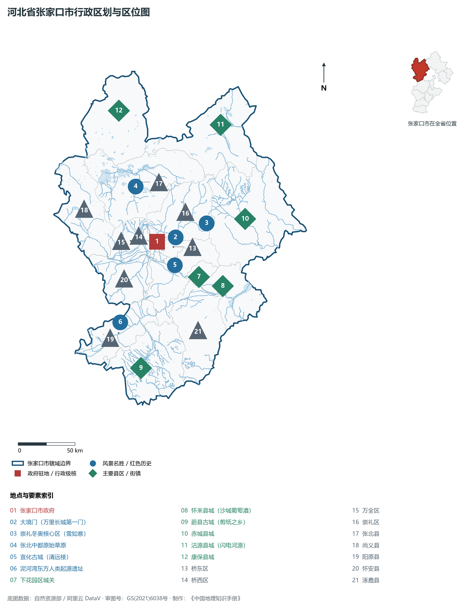
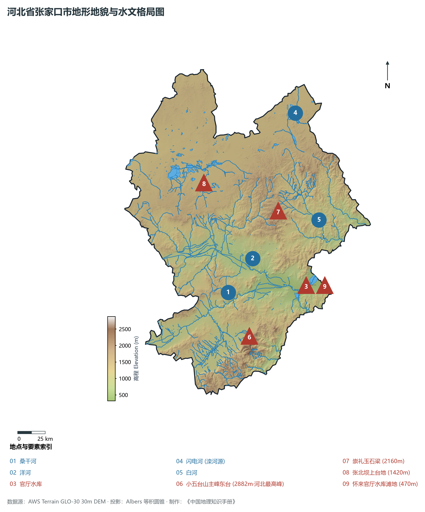
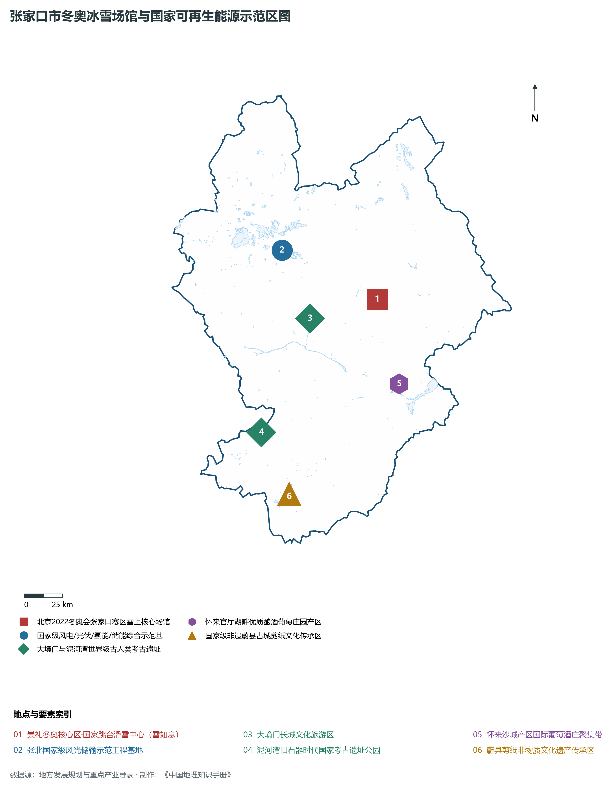
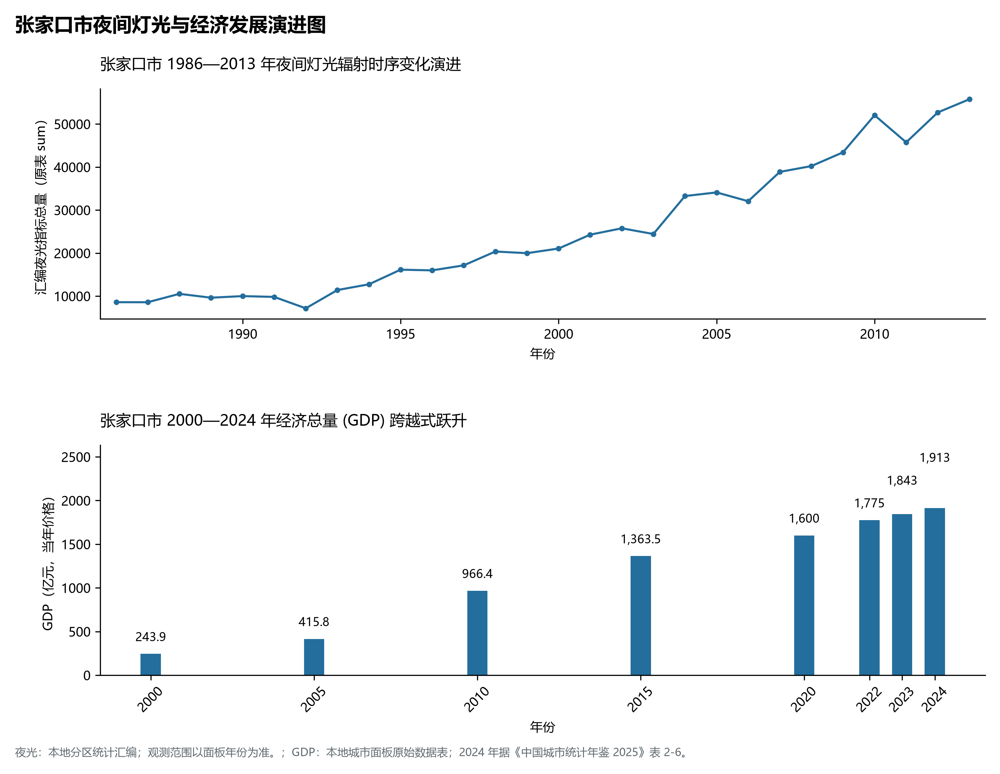
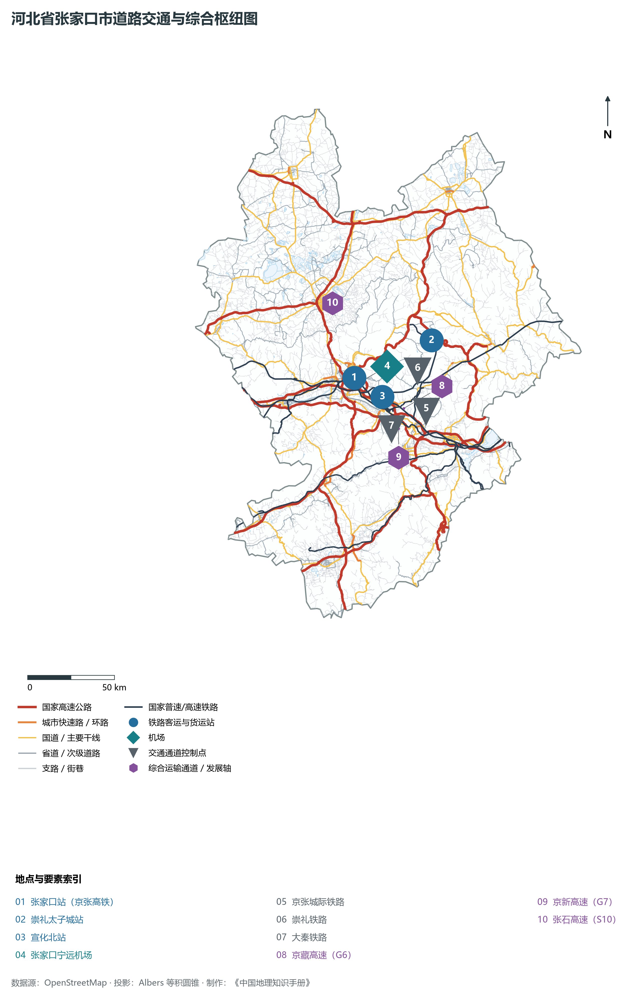

# 3.7 张家口市

张家口，古称“张垣”、“武城”，中国著名冬奥之城、国家级可再生能源示范区、京西北生态涵养支撑区，享有“塞外山城”与“东方人类摇篮”之美誉。地处河北省西北部、内蒙古高原南缘向华北平原过渡的交汇褶皱带，东邻承德，东南与北京接壤，南与保定毗连，西与山西省大同市、朔州市交界，北与内蒙古自治区锡林郭勒盟接壤，地理坐标介于东经 113°50′—116°30′、北纬 39°30′—42°10′ 之间。2024 年常住人口 **403 万人**，常住人口城镇化率 **68.86%**，地区生产总值 **1,913 亿元**（当年价格），人均地区生产总值 **47,344 元**，三次产业构成为 **17.03 : 27.43 : 55.54**。

张家口历史与地理底蕴独一无二。阳原县泥河湾遗址群实证了距今 200 万年前古人类活动遗存，被誉为“东方人类的摇篮”；涿鹿黄帝城是炎黄蚩尤三祖聚落与中华民族融合肇兴之圣地；明清时期，大境门作为万里长城北门，开启了贯通蒙古高原至莫斯科、总长 4 000 余公里的“张库大道”，张家口一跃成为近代中国陆路最大的皮毛交易商埠与国际商贸都会，享有“旱码头”盛名；1909 年詹天佑主持修建的中国第一条自建干线铁路——京张铁路在此通车。2022 年，张家口携手北京圆满举办第 24 届冬季奥林匹克运动会，崇礼雪场惊艳全球。新时代，张家口坚定走出一条生态优先、风光储氢绿色发展、冰雪体育与大数据并举的高质量转型新路。

---

## 一、市情速览

张家口是京西北生态屏障核心区与国家战略级新型清洁能源基地。

| 核心指标 | 全市数值与空间分布 | 全国/全省定位 |
|:---|:---|:---|
| **行政区划面积** | 36 873 km² | 全省第二面积大市；坝上高原占 34.6%，坝下盆地山地占 65.4% |
| **常住人口** | 403 万人 | 2024 年，全市；年鉴公布口径 |
| **常住人口城镇化率** | 68.86% | 2024 年，全市；年鉴公布口径 |
| **人口密度** | 112 人/km² | 桥西、桥东超 1 200 人/km²，康保、尚义等坝上草原约 50—80 人/km² |
| **地区生产总值 (GDP)** | 1,913 亿元 | 2024 年，全市；年鉴公布口径 |
| **人均 GDP** | 47,344 元/人 | 2024 年，全市；年鉴公布口径 |
| **产业三次结构** | 15.8 : 28.4 : 55.8 | 第三产业占主导，冰雪体育文旅与现代服务业贡献突出 |
| **行政架构** | 6 个区、10 个县 | 市政府驻桥东区五一东大街；崇礼区为世界级滑雪胜地 |
| **战略核心定位** | 国际知名冰雪运动与体育文化旅游之都 | 国家级可再生能源示范区、京西北生态水源涵养区、京津冀算力之都 |

**图 03-07-1 河北省张家口市行政区划与区位图**：图上编号与地点、要素索引对应。

---

## 二、自然地理：坝上高原与坝下盆地、“河北屋脊”与桑干河

张家口地形以著名的大断裂陡坎为界，形成地质构造和地貌形态截然迥异的“坝上”与“坝下”两大地理奇观。

### 1. 地貌分区与高程垂直差异
全境地貌分为两大极具特色的板块：

- **坝上高原区（内蒙古高原南缘）**：分布于张北、康保、沽源、尚义四县，平均海拔 **1 300—1 600 m**。地表波状起伏，开阔平缓，内流盆地与淖泊广布。年大风日多达 60—80 天，是不可多得的陆上风能与太阳能宝库；
- **坝下低中山与断陷盆地带**：海拔 500—1 200 m，桑干河与洋河在此切割出蔚县盆地、宣化盆地、怀来盆地等肥沃宽谷。山势磅礴，崇礼翠云山（2 110 m）雪质极优。全域最高峰亦为全省最高峰——蔚县与涞源交界处的**小五台山主峰东台**，海拔高达 **2 882.0 m**，称为“河北屋脊”，顶峰常年云雾蒸腾、积雪迟消；全境最低点位于怀来县官厅水库出境滩地，海拔 **320.0 m**。

**图 03-07-2 河北省张家口市地形地貌与水文格局图**：图上编号与地点、要素索引对应。

### 2. 气候特征：温带大陆性半干旱季风气候与崇礼降雪微气候

- **气温特征**：全域年平均气温在 **3.0—9.5 ℃** 之间，坝上高原年均温仅 3.2 ℃，无霜期仅 90—110 天；
- **降水与天然粉雪奇迹**：全域年降水量约 **350—450 mm**。崇礼区受蒙古冷高压南下与华北平原暖湿气团在太行燕山北麓交汇抬升作用，冬季降雪期长达 **150 天**，年均降雪厚度超 1 m，雪质松散、颗粒饱满，属于国际滑雪界极其推崇的高品质“粉雪”，平均风速小于 2 级，造就了东亚最优质的天然室外滑雪天堂。

### 3. 水系脉络：海河流域与官厅水库水源涵养

- **桑干河与洋河**：桑干河自山西流入蔚县、阳原与怀来，洋河自内蒙古入怀安、宣化，两河在怀来朱官屯汇合为永定河干流；
- **官厅水库**：位于怀来县境内，总库容 **41.6 亿 m³**，是新中国成立后兴建的第一座大型控制性水利工程，承担着首都北京防洪削峰与生态水源战略储备核心职能。

---

## 三、建置沿革与文化根脉

张家口历史纵贯数百万年，是长城要塞、张库茶道与东方人类文明的摇篮。

### 1. 泥河湾与三祖文化圣地

- **泥河湾旧石器时代遗址群**：拥有东谷坨、小长梁、马圈沟等数百处早期人类旧石器文化遗址，出土数万件打制石器与巨型哺乳动物化石，证实距今 200 万年前东亚古人类已在此生息繁衍；
- **涿鹿黄帝城**：炎帝、黄帝、蚩尤在此结盟融合，合符釜山，开辟华夏文明统一认同先河。

### 2. 大境门与张库古商道

- **大境门（万里长城第一门）**：建于清顺治元年（1644年），城门上方题刻“大好河山”四字雄浑苍劲。它是万里长城所有重要关隘中唯一以“门”命名的关口；
- **张库大道（北方丝绸之路）**：以大境门为起点，穿越蒙古高原库伦（今乌兰巴托），延伸至俄罗斯恰克图，全长 4 000 余 km。作为明清两代连接蒙俄的最大国际贸易干线，张家口汇集了全国皮毛、砖茶、丝绸与五金，享有“皮都”与“北方旱码头”美誉。

### 3. 2022 冬奥盛会与“雪如意”地标
崇礼区太子城赛区圆满承办 2022 年北京冬奥会雪上比赛项目：

- **国家跳台滑雪中心（雪如意）**：世界首个在顶部设置大型悬挑圆环景观平台（顶峰俱乐部）的顶级跳台滑雪场馆，建筑轮廓与中国传统如意瑰宝形神相融；
- **绿色办奥典范**：所有场馆 100% 采用张北风光清洁绿电，实现了奥运史上首次全绿电运行的历史突破。

**图 03-07-4 张家口市冬奥冰雪场馆与国家可再生能源示范区图**：图上编号与地点、要素索引对应。

---

## 四、经济地理：绿色绿电之都、冰雪旅游与大数据算力港

张家口彻底告别高碳传统重工，全力构建风光储氢清洁能源、大数据算力、冰雪文旅、高端装备制造四大现代绿色产业支柱。

### 1. 全国首个国家级可再生能源示范区

- **风光储绿能基地**：全市可再生能源装机规模突破 **3 300 万 kW**，居全国地级市第一位。张北柔性直流电网工程突破 12 项世界第一，每年向北京输送 140 亿度清洁绿电，“张家口风点亮北京的灯”成为绿色发展的生动写照；
- **绿色氢能之都**：建成数个万吨级可再生能源制氢工厂，推广数百辆氢燃料电池公交车，成为国家氢燃料电池汽车示范城市群核心极。

### 2. 中国数据算力之都
依托冷凉气候、充沛绿电与紧邻北京三大核心优势，怀来、张北成为“全国一体化算力网络京津冀国家枢纽节点”主承载地，阿里巴巴、腾讯、秦淮数据等投运服务器超 150 万台，算力规模领跑华北。

### 3. 国际冰雪运动旅游全链条
崇礼拥有太舞、万龙、云顶、富龙等 7 大国际一流滑雪场，雪道面积超 400 万 m²，年接待游客超 400 万人次，带动冰雪装备研发制造与高端民宿全面繁荣。

**图 03-07-5 张家口市夜间灯光与经济发展演进图**：各面板按标注的观测年份、指标和单位列示。

---

## 五、交通网络与京张冬奥走廊

张家口打破塞外山峦阻隔，迈入“京津半小时、一小时高铁生活圈”。

### 1. 京张高铁与冬奥专用支线

- **京张高速铁路**：2019 年底全线通车，时速 350 km 智能型复兴号动车组飞驰其间，清河至张家口站仅需 47 分钟；
- **崇礼铁路与太子城站**：高铁直抵崇礼太子城冬奥村核心区，实现“下高铁即进雪场”的无缝滑雪度假体验。

### 2. 高速公路网络
京藏高速（G6）、京新高速（G7）、首都环线高速（G95）、张承高速、张石高速在全境交织成网，四通八达。

### 3. 宁远民航机场
张家口宁远机场（ZQZ）为 4C 级民用支线机场，开通直达上海、广州、石家庄、深圳等多条主要航线。

**图 03-07-3 河北省张家口市道路交通与综合枢纽图**：图上编号与地点、要素索引对应。

---

## 六、未来展望：奥运遗产利用与京西北绿色增长极

在新发展征程上，张家口坚持生态第一，加快推进京张体育文化旅游带建设：

1. **放大冬奥遗产综合效应**：推进冬奥场馆赛后全季运营，打造国际冰雪运动胜地与户外运动休闲名城；
2. **建设世界级新型绿色能源与数据算力基地**：提升风光制氢与绿电外送能级，打造全国绿电与人工智能算力协同枢纽；
3. **守牢首都绿色生态水源屏障**：深化官厅水库与永定河流域生态治理，交出高质量发展优异答卷。

2024 年统计来源：《中国城市统计年鉴 2025》表 2-1、2-6、2-7（2024 年，全市）。其他年份 GDP 据本地城市面板“原始数据”表，单位为亿元、当年价格。
