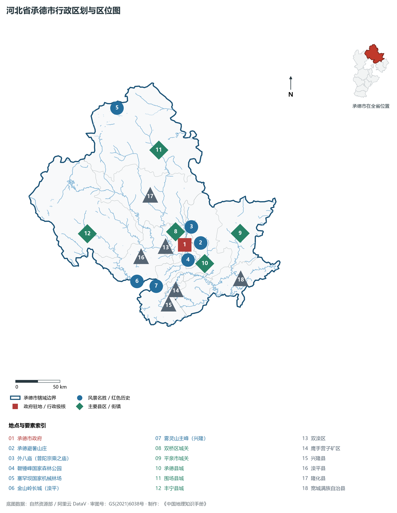
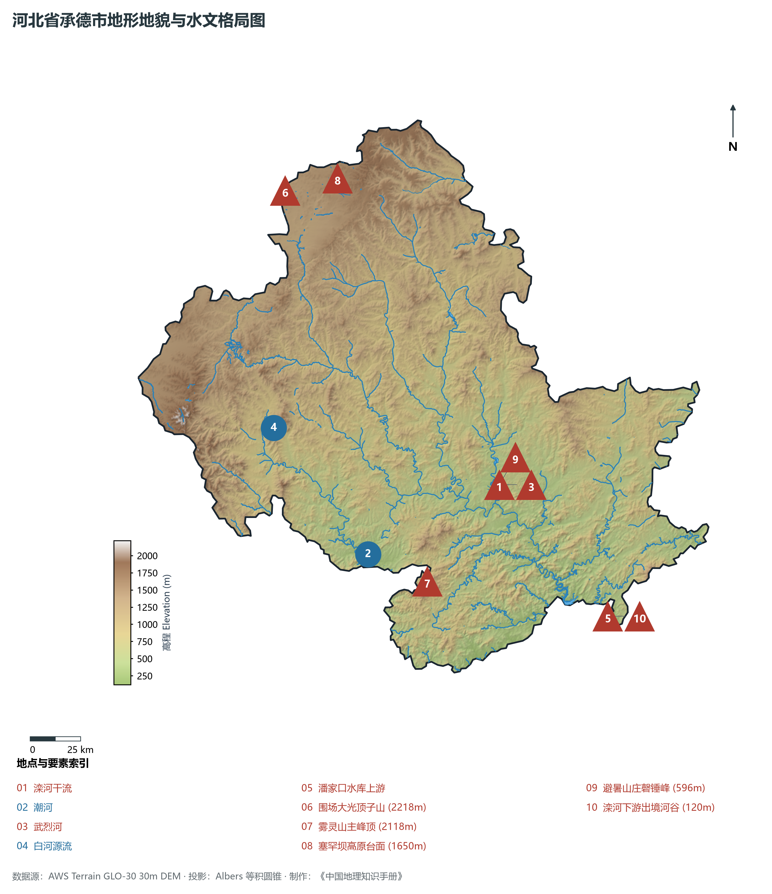
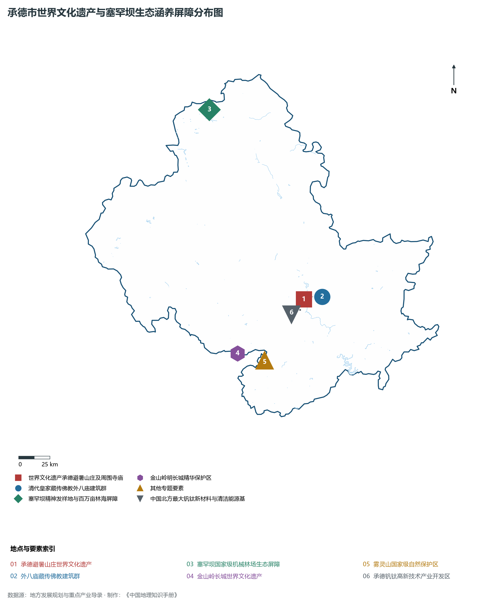
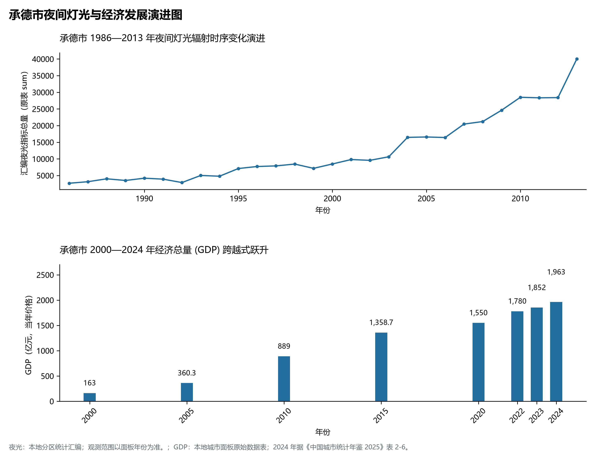
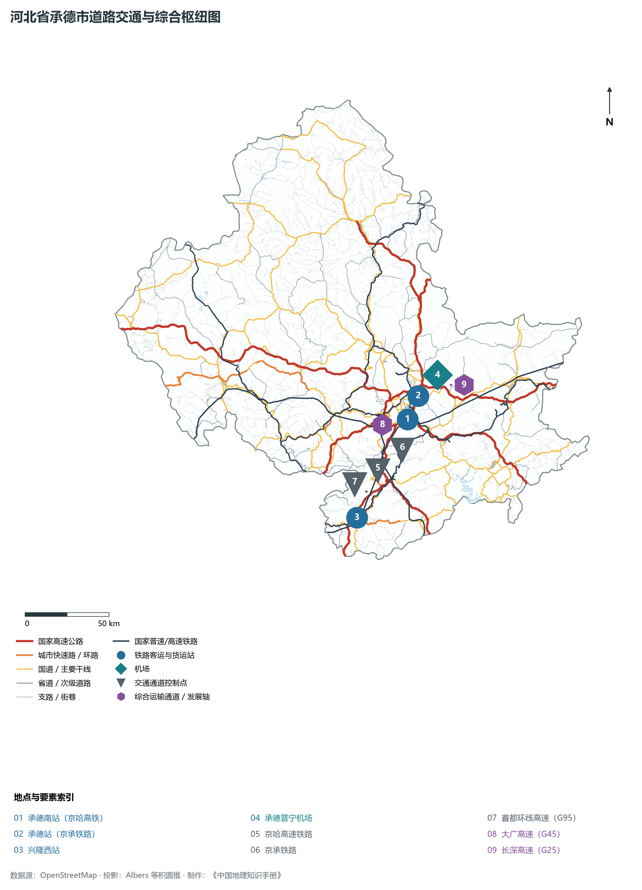

# 3.8 承德市

承德，古称“热河”，国家历史文化名城、中国首批 24 座国家历史文化名城之一、享誉世界的皇家园林文化名城与京津冀水源生态涵养支撑区，享有“避暑胜地”与“塞罕坝精神发祥地”之美誉。地处河北省东北部、燕山山脉腹地与内蒙古高原浑善达克沙地南缘交界带，南邻北京与天津，西南与保定隔界，东与辽宁省朝阳市相连，东北与内蒙古赤峰市毗邻，西接张家口，地理坐标介于东经 115°54′—119°15′、北纬 40°12′—42°40′ 之间。2024 年常住人口 **329 万人**，常住人口城镇化率 **59.77%**，地区生产总值 **1,963 亿元**（当年价格），人均地区生产总值 **59,583 元**，三次产业构成为 **23.33 : 30.75 : 45.92**。

承德是清代中央边疆治理智慧与满汉蒙藏多元民族文化融汇的历史地理巅峰。康熙四十二年（1703年），康熙帝在此肇建热河行宫（避暑山庄），历经康雍乾三代 89 年营建，成为清廷避暑听政、处理边疆民族事务与接见外藩使节的“第二政治中心”；外围环绕依山势而立的八座宏伟藏传佛教寺庙（外八庙），开创了“合内外之心、成巩固之业”的民族团结治理典范，1994 年承德避暑山庄及其周围寺庙被联合国教科文组织列入《世界文化遗产名录》。自然生态上，承德地处“华北水塔”关键区位，一代代塞罕坝人在这片荒原上用半个多世纪建成了 115 万亩世界最大人工林海，铸就了感天动地的“塞罕坝精神”。新时代，承德坚定践行绿水青山就是金山银山理念，加速建设生态优先、文旅康养、钒钛新材料高质量发展的绿色明珠城市。

---

## 一、市情速览

承德是京津冀北部的绿色生态涵养极核与世界知名文化旅游目的地。

| 核心指标 | 全市数值与空间分布 | 全国/全省定位 |
|:---|:---|:---|
| **行政区划面积** | 39 519 km² | 全省面积第一大市，山地丘陵占全域 95% 以上 |
| **常住人口** | 329 万人 | 2024 年，全市；年鉴公布口径 |
| **常住人口城镇化率** | 59.77% | 2024 年，全市；年鉴公布口径 |
| **人口密度** | 85 人/km² | 全省人口密度最低市，人均拥有森林与水资源居华北前列 |
| **地区生产总值 (GDP)** | 1,963 亿元 | 2024 年，全市；年鉴公布口径 |
| **人均 GDP** | 59,583 元/人 | 2024 年，全市；年鉴公布口径 |
| **产业三次结构** | 17.4 : 33.1 : 49.5 | 绿色服务业能级充沛，钒钛高科新材料迈向千亿级 |
| **行政架构** | 3 个区、4 个县、代管 1 个县级市、3 个自治县 | 市政府驻双桥区武烈路；围场、丰宁、宽城为自治县 |
| **战略核心定位** | 京津冀北部生态水源涵养核心区与国际文旅名城 | 塞罕坝精神发祥地、国家绿色发展示范区、北方钒钛新材料基地 |

**图 03-08-1 河北省承德市行政区划与区位图**：图上编号与地点、要素索引对应。

---

## 二、自然地理：燕山叠翠、塞罕浩瀚与京津水塔

承德全境位于燕山山脉核心区与内蒙古高原南缘，山地起伏剧烈，森林与溪谷密布。

### 1. 地貌分区与高程垂直差异
全境地貌分为三大主体构造：

- **北部坝上波状高原区**：主要分布于围场北部塞罕坝与御道口一带，海拔 **1 400—1 900 m**。地表为低缓起伏的砂质沙丘与起伏台地，浑善达克沙地在此向华北阻滞，全域最高峰为围场北部的**大光顶子山**，海拔高达 **2 218.0 m**；
- **中部燕山低中山深切割区**：海拔 500—1 500 m，滦河及其支流武烈河、瀑河在此深切峡谷，奇峰怪石林立，丹霞风貌与喀斯特溶蚀发育，避暑山庄磬锤峰（棒槌山）高达 596 m，石柱拔地而起；
- **南部燕山低山丘陵与长城山脊**：分布于兴隆、滦平、宽城，地势险峻。兴隆县境内的**雾灵山**主峰高达 **2 118.0 m**，被称为“燕山主峰”；全境最低点位于宽城县南部潘家口水库出山口河谷，海拔仅 **120.0 m**。

**图 03-08-2 河北省承德市地形地貌与水文格局图**：图上编号与地点、要素索引对应。

### 2. 气候特征：温带半湿润半干旱大陆性季风气候与清凉避暑气候

- **气温特征**：全域年平均气温在 **4.0—9.5 ℃** 之间，北部坝上年均温仅 1.5—3.0 ℃。中心城区七、八月平均气温仅 **23.5 ℃**，昼夜温差大，夏季清凉无闷热，自古为皇家消夏避暑胜地；
- **降水梯度**：年均降水量约 **500—650 mm**，南部兴隆雾灵山迎风坡年降水量超 750 mm，是华北主要降水丰沛中心之一。

### 3. 水系脉络：“京津大水缸”滦河与潮白河
承德是海河流域滦河与潮白河的核心发源地与水源涵养地：

- **滦河干流**：纵贯全境 400 余 km，向南注入潘家口水库与大黑汀水库，承担向天津、唐山年供水超 15 亿 m³ 重任；
- **潮河与白河**：发源于丰宁满族自治县，奔流南下汇入北京密云水库，年贡献密云水库入库水量的 **56% 以上**，被北京市尊为生命甘泉源头。

---

## 三、建置沿革与文化根脉

承德不仅是世界文化遗产之都，更是中华民族共同体意识形成发展的重要地标。

### 1. 热河行宫与避暑山庄世界文化遗产

- **避暑山庄**：占地 5.64 km²，面积相当于北京颐和园的两倍、故宫的八倍。分宫殿区、湖泊区、平原区、森林区四大板块，融合了江南水乡的秀丽与北方山岭的雄浑，体现了“天人合一、朴素淡雅”的中国皇家造园最高造诣；
- **外八庙藏传佛教瑰宝**：山庄外围环列普陀宗乘之庙（小布达拉宫）、须弥福寿之庙（班禅行宫）、普宁寺（拥有世界最大木雕千手千眼观音像）等十二座皇家寺庙，汉藏建筑艺术融为一体，是清代巩固边疆、联络各族王公首领的宏伟实物见证。

### 2. 塞罕坝精神：荒原变林海的人间奇迹
塞罕坝蒙语意为“美丽的高岭”。清末因开围放垦与山林火灾，塞罕坝逐渐蜕化为千里黄沙。1962 年原林业部在此建立机械林场，半个多世纪以来，三代务林人在极端高寒冻土上攻克育苗造林难关，营造出 **115 万亩世界最大人工林海**，林木蓄积量达 1 036 万 m³，森林覆盖率从 11.4% 跃升至 **82%**，筑起了一道抵御风沙南侵的绿色铁壁，2017 年荣膺联合国最高环境荣誉“地球卫士奖”。

### 3. 金山岭长城世界文化遗产
金山岭长城位于滦平县巴克什营镇，始建于明洪武元年（1368年），由抗倭名将戚继光主持重修。长城蜿蜒于燕山崇山峻岭之巅，全长 10.5 km，拥有障墙、文字砖、挡马墙与密集奇巧的空心敌楼 67 座，被国际长城学者誉为“明代长城之精华”。

**图 03-08-4 承德市世界文化遗产与塞罕坝生态涵养屏障分布图**：图上编号与地点、要素索引对应。

---

## 四、经济地理：绿色生态康养、钒钛高科新材料与清洁能源

承德坚决破除传统矿山依赖，围绕“生态产业化、产业生态化”，做强现代文旅康养、钒钛新材料、清洁能源、绿色食品四大主导产业。

### 1. 钒钛高科材料之都
承德钒钛磁铁矿资源极为丰富，拥有仅次于攀枝花的全国第二大钒钛资源基地：

- **钒钛特钢全链条**：拥有河钢承钢等龙头企业，拥有世界领先的亚熔盐法高效提取高纯氧化钒与金属钛技术，钒氮合金、特种航空航天钛合金年产能居世界前列；
- **储能新材料**：全钒液流电池储能电解液研发制造规模化落地，成为国家新型储能产业的关键材料基地。

### 2. 国际康养文旅与温泉名城
依托凉爽宜人的生态微气候、丰富优质的偏硅酸天然地热温泉与避暑山庄文化IP，承德大力打造“温泉+康养+文旅”全域旅游名片，阿那亚·金山岭、隆化温泉小镇吸纳数百万京津康养客群。

### 3. 百万千瓦级清洁绿电
丰宁抽水蓄能电站总装机容量 **360 万 kW**，为世界最大抽水蓄能电站，承担华北电网削峰填谷与冬奥绿电调峰关键重任；结合风电、光伏，年向京津冀输送清洁绿电逾 100 亿 kWh。

**图 03-08-5 承德市夜间灯光与经济发展演进图**：各面板按标注的观测年份、指标和单位列示。

---

## 五、交通网络与京承立体交通走廊

承德打破了燕山深峡的千年险阻，构筑起融入首都“一小时通勤圈”的现代立体交通网。

### 1. 铁路大动脉

- **京哈高铁（京承段）**：2021 年全线通车，时速 350 km，承德南站至北京朝阳站最快仅需 52 分钟，彻底重塑了承德的时空区位；
- **普铁网络**：京承铁路、锦承铁路、承隆铁路纵横交织，大秦铁路煤运大通道穿经南部山区。

### 2. 高速公路网
大广高速（G45）、长深高速（G25）、首都环线高速（G95）、承秦高速在市区形成环状枢纽，实现了“县县通高速”。

### 3. 承德普宁机场
4C 级民用支线机场，跑道长 2 800 m，开辟了直通上海、石家庄、广州、西安等枢纽城市的航线网络。

**图 03-08-3 河北省承德市道路交通与综合枢纽图**：图上编号与地点、要素索引对应。

---

## 六、未来展望：弘扬塞罕坝精神与建设高质量发展的生态强市

在新发展起点上，承德坚定筑牢生态屏障，向绿而行：

1. **守护好首都北部生态安全屏障**：大力弘扬塞罕坝精神，实施山水林田湖草沙一体化保护修复，确保“一库净水送京津”；
2. **建设国际一流文化旅游与温泉康养名城**：深度融通避暑山庄历史文化与塞罕坝森林康养，打造京津客群首选康养微度假目的地；
3. **打造世界级钒钛新材料与清洁能源基地**：加速钒电池储能示范与绿色低碳先进制造业集群发展，书写“生态美、产业兴、百姓富”的新时代塞外传奇。

2024 年统计来源：《中国城市统计年鉴 2025》表 2-1、2-6、2-7（2024 年，全市）。其他年份 GDP 据本地城市面板“原始数据”表，单位为亿元、当年价格。
