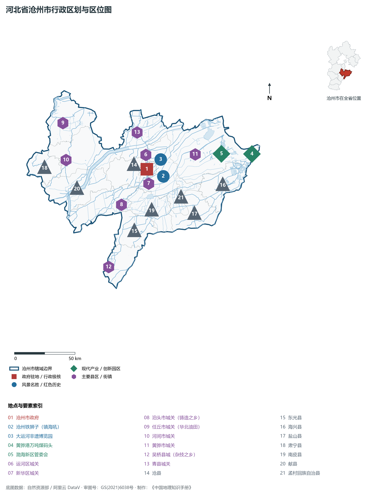
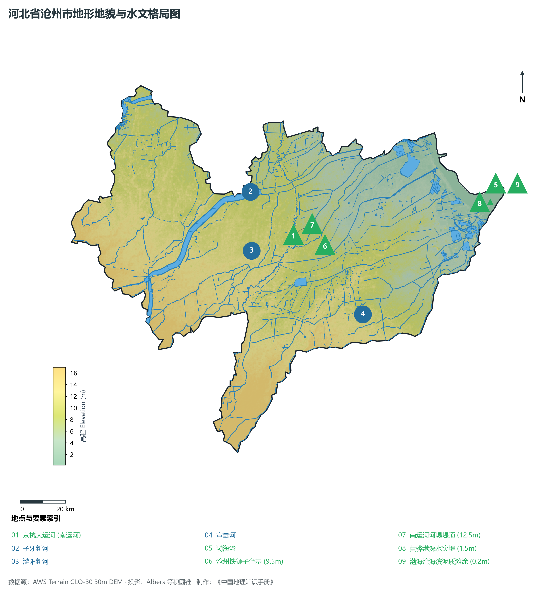
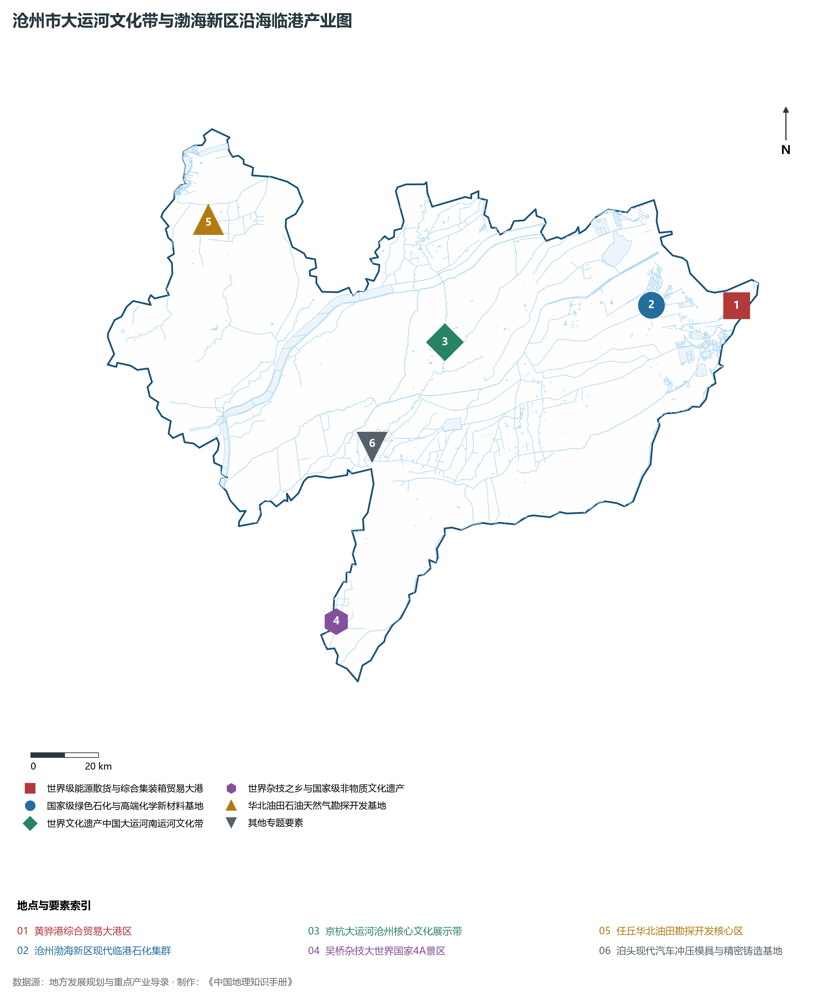
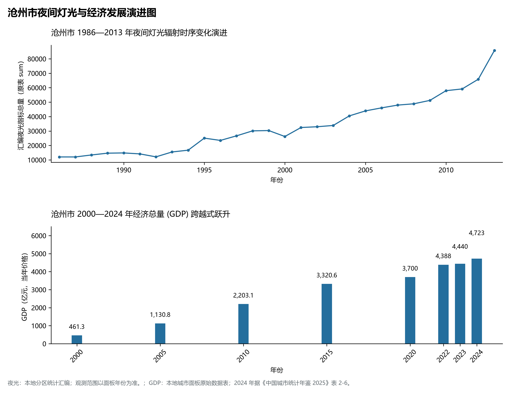
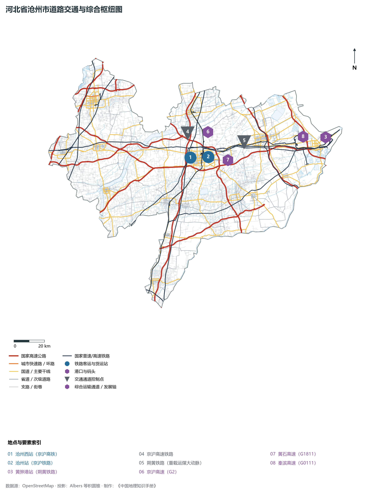

# 3.9 沧州市

沧州，古称“瀛洲”，国家历史文化名城、环渤海大宗散货综合贸易大港之城、中国大运河文化带核心枢纽城市、首批沿海开放城市之一，享有“武术之乡”、“杂技之乡”、“铸造之乡”与“金丝小枣之乡”之盛誉。地处河北省东南部、华北大平原东端、东临浩瀚渤海，北与天津市及廊坊市接壤，西北紧靠雄安新区，西与保定、衡水毗邻，南隔卫运河、漳卫新河与山东省德州、滨州相望，地理坐标介于东经 115°42′—117°50′、北纬 37°29′—38°57′ 之间。大陆海岸线长 **129.7 km**。2024 年常住人口 **723 万人**，常住人口城镇化率 **54.95%**，地区生产总值 **4,723 亿元**（当年价格），人均地区生产总值 **65,177 元**，三次产业构成为 **7.85 : 37.76 : 54.38**。

沧州依运河而生、因海港而兴。京杭大运河自北向南穿城而过，纵贯流经全境 216 km，是流经里程最长、保存原生态风貌最完好的运河城市，九曲八弯的古运河孕育出沧州铁狮子“镇海吼”、捷地减河水利枢纽等世界文化遗产与沧州武术（八极拳、劈挂拳）、吴桥杂技两大世界级非物质文化遗产。新中国成立后，任丘发现大型古潜山油田，华北油田在此扎根；朔黄铁路直达黄骅港出海大通道建成，黄骅港由传统煤炭下水港阔步迈向现代化综合多功能、全方位国际贸易大港。新时代，沧州牢牢把握沿海经济带与大运河文化带建设两大历史机遇，构建起以黄骅港为龙头的渤海新区现代临港产业体系，成为沿海经济带上璀璨的渤海明珠。

---

## 一、市情速览

沧州是华北平原东部海陆双向互济的工商业与沿海大港强市。

| 核心指标 | 全市数值与空间分布 | 全国/全省定位 |
|:---|:---|:---|
| **行政区划面积** | 14 304 km² | 全境为平缓的冲积海积低平原，平原面积占比 100% |
| **常住人口** | 723 万人 | 2024 年，全市；年鉴公布口径 |
| **常住人口城镇化率** | 54.95% | 2024 年，全市；年鉴公布口径 |
| **人口密度** | 510 人/km² | 运河、新华核心城区超 4 500 人/km²，沿海盐碱低密片区空间辽阔 |
| **地区生产总值 (GDP)** | 4,723 亿元 | 2024 年，全市；年鉴公布口径 |
| **人均 GDP** | 65,177 元/人 | 2024 年，全市；年鉴公布口径 |
| **产业三次结构** | 8.5 : 41.2 : 50.3 | 沿海重化工业底蕴深厚，第三产业服务业加速扩张 |
| **行政架构** | 2 个区、9 个县、代管 4 个县级市、1 个自治县 | 市政府驻运河区北京路；渤海新区黄骅市为核心战略极核 |
| **战略核心定位** | 环渤海重要港口城市与现代沿海临港产业基地 | 中国大运河非物质文化遗产保护传承典范、北方煤炭与散货出海大通道 |

**图 03-09-1 河北省沧州市行政区划与区位图**：图上编号与地点、要素索引对应。

---

## 二、自然地理：九河下梢极平原、古运河入海与盐碱沼泽

沧州地势平坦低洼，自西南向东北缓缓微倾，微地貌由河流冲积、海相沉积交替作用形成。

### 1. 极其平缓的地貌坡降与极值高程
全域地貌为典型的华北平原晚第四纪海相与河流冲积相复合地质构架：

- **微地貌平原**：全境地面坡降极其平缓（仅为万分之二至万分之一），海拔普遍在 **2—17 m** 之间。全域最高点位于西南部河间市山前冲积扇末端，海拔仅 **17.0 m**；
- **滨海潮滩与贝壳堤湿地**：沿海发育有宽达数公里的淤泥质潮间带滩涂，海兴、黄骅沿海分布有距今 2 000—5 000 年的世界罕见第四纪古贝壳堤遗迹；全境最低点位于黄骅港潮滩入海口，海拔仅 **0.2 m**；
- **盐渍化土壤分布广泛**：历史上受海水浸渍与内陆蒸发强烈影响，广泛分布有深厚盐碱土，经数十年来农田水利与引黄引温压碱改造，已形成高产旱碱麦等现代特色生态农业区。

**图 03-09-2 河北省沧州市地形地貌与水文格局图**：图上编号与地点、要素索引对应。

### 2. 气候特征：暖温带半湿润大陆性季风气候

- **气温特征**：全域年平均气温在 **12.5—13.5 ℃** 之间，四季分明，春秋干燥多风，夏季炎热多雨，冬季严寒晴朗；
- **降水时空集中**：年平均降水量约 **520—580 mm**，75% 集中于 7、8 月，极易形成平原涝碱灾害；海河流域骨干人工排洪河道（子牙新河、滏阳新河）构建起保障华北平原泄洪安澜的深大人工河渠水网。

### 3. 水系脉络：京杭大运河与人工排洪新河

- **京杭大运河（南运河）**：自东光县入境，流经吴桥、南皮、沧县、市区、青县，北入天津，全长 216 km，河道蜿蜒自然，是原汁原味的大运河生态文化活化石；
- **大型排洪泄洪工程**：为防范子牙河、滏阳河上游山洪，新中国先后人工开挖了**子牙新河**（全长 143 km）与**滏阳新河**，设计排洪能力数千立方米/秒，在沧州南部直接排入渤海湾。

---

## 三、建置沿革与文化根脉

沧州文武并重，文有纪晓岚《阅微草堂笔记》之博古通今，武有八极劈挂行天下，艺有吴桥杂技动乾坤。

### 1. 沧州铁狮子“镇海吼”
位于沧县旧州镇古沧州城遗址内的**沧州铁狮子**，铸造于后周广顺三年（953年），高 5.48 m，长 6.1 m，重达 32 吨，背负巨型莲花宝座，腹内铸有《金刚经》文，为中国古代现存最大、年代最久远的重型铸铁铸造艺术极品，民间相传其“瞋目怒吼，以镇海啸潮灾”，故名“镇海吼”。

### 2. 沧州武术：中国武术之乡
沧州自古民风强悍，镖行天下。乾隆皇帝曾赞誉“镖不喊沧州”。沧州是中华武术八极拳、劈挂拳、燕青拳（迷踪拳）、六合拳、查拳等 53 个著名拳械门派的发祥与繁盛地，名家辈出，被国家体委首批命名为“全国武术之乡”。

### 3. 吴桥杂技与大运河非遗明珠

- **吴桥杂技（人类非遗代表作）**：吴桥被称为世界杂技摇篮，“上至九十九，下至刚会走，吴桥耍杂技，人人有一手”。吴桥国际杂技艺术节为世界三大杂技赛场之一；
- **大运河国家文化公园**：沧州投资数十亿元建成沧州大运河非物质文化遗产博览园、中国大运河非遗展示馆，再现运河重镇昔日帆樯林立、百工竞巧的繁盛景象。

**图 03-09-4 沧州市大运河文化带与渤海新区沿海临港产业图**：图上编号与地点、要素索引对应。

---

## 四、经济地理：向海图强、千亿黄骅大港与现代临港石化

沧州经济加速由内陆走向深蓝，打造沿海经济强市，培育出绿色石化、高端装备制造、现代商贸物流三大支柱产业。

### 1. 黄骅港：面向未来的现代化综合服务港
黄骅港拥有良好的水文航道条件，是我国西煤东运、北煤南运第一大出海口：

- **世界级散货与集装箱大港**：拥有 20 万吨级深水航道与数十个万吨级泊位，2024 年货物吞吐量突破 **3.3 亿吨**，常年煤炭吞吐量逾 2 亿吨；
- **港产城深度融合**：加速拓展原油、液化天然气（LNG）、集装箱、汽车滚装及冷链大宗散货贸易，开辟多条直达欧洲、东南亚的国际集装箱航线。

### 2. 渤海新区现代绿色石化基地
依托华北油田资源与黄骅港进口原油通道，渤海新区形成了从原油炼化、乙烯、丙烯到高端工程塑料、精细化学品的超千亿级现代绿色石化基地，中捷石化、鑫海化工等大型民营龙头企业产值破千亿。

### 3. 特色县域制造业

- **泊头现代模具与汽车冲压部件**：中国汽车冲压模具之乡，产能占全国汽车模具逾 20%；
- **河间保温新材料与玻璃智造**：国内最大建筑保温与微晶玻璃产业基地；
- **沧州旱碱麦现代特色农业**：黄骅旱碱麦面粉筋道麦香浓郁，成为国家级地理标志与特色农产品优势区。

**图 03-09-5 沧州市夜间灯光与经济发展演进图**：各面板按标注的观测年份、指标和单位列示。

---

## 五、交通网络与海陆空枢纽

沧州地处京沪高铁与朔黄重载铁路交汇点，海运、铁路、高速公路网络高度密集。

### 1. 轨道干线走廊

- **京沪高铁与京沪铁路**：纵贯沧州市区，沧州西站 50 分钟直达北京南站，1 小时抵济南；
- **朔黄铁路（重载运煤生命线）**：自山西神池直达黄骅港，全长近 600 km，是我国西煤东运战略重载大动脉，年运力达 3.5 亿吨；
- **邯黄铁路**：连通太行山麓邯郸、邢台与黄骅港，开辟冀中南直接出海通道。

### 2. 高速公路网络
京沪高速（G2）、京台高速（G3）、黄石高速（G1811）、秦滨高速（G0111）、津石高速（G0211）在境内交织成“四纵三横”骨干高速网，实现全域 15 分钟上高速。

**图 03-09-3 河北省沧州市道路交通与综合枢纽图**：图上编号与地点、要素索引对应。

---

## 六、未来展望：沿海开放前沿与大运河文化名城

在京津冀协同发展与沿海高质量发展战略驱动下，沧州奋勇争先：

1. **加快建设多功能、综合性、现代化大港**：提升黄骅港大宗散货保供能力，做强中欧班列与国际集装箱航线；
2. **做强沿海现代绿色石化与高端制造**：打造环渤海具有国际竞争力的临港高端化工新材料产业基地；
3. **保护传承利用好大运河千年文脉**：推动大运河国家文化公园高质量发展，展现武术杂技魅力，谱写运河古都沿海新篇。

2024 年统计来源：《中国城市统计年鉴 2025》表 2-1、2-6、2-7（2024 年，全市）。其他年份 GDP 据本地城市面板“原始数据”表，单位为亿元、当年价格。
