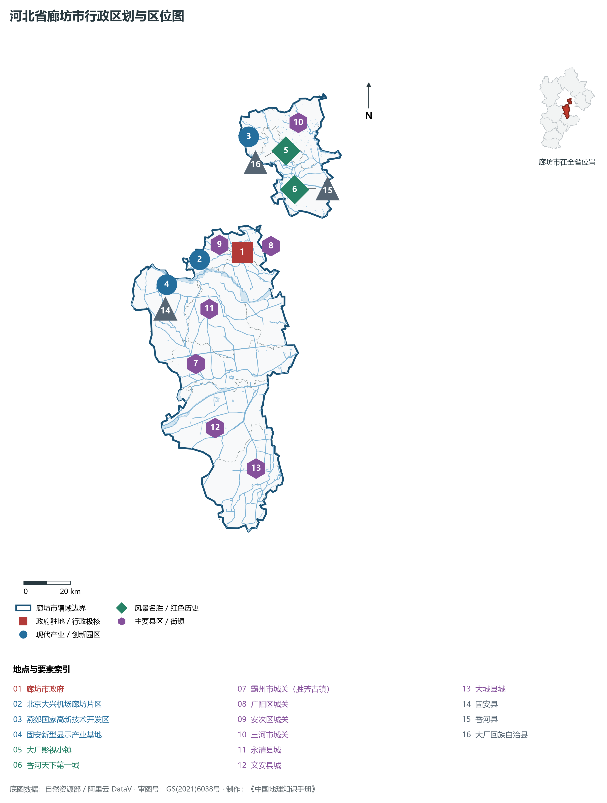
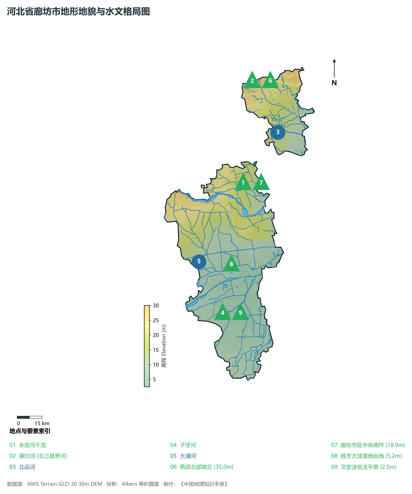
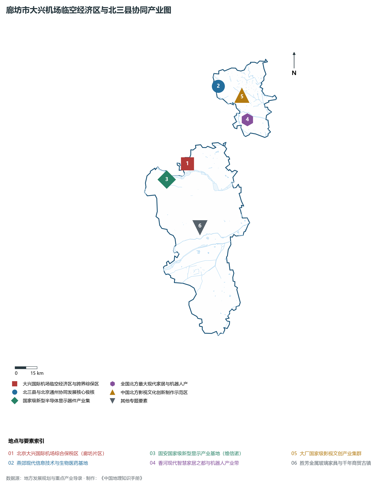
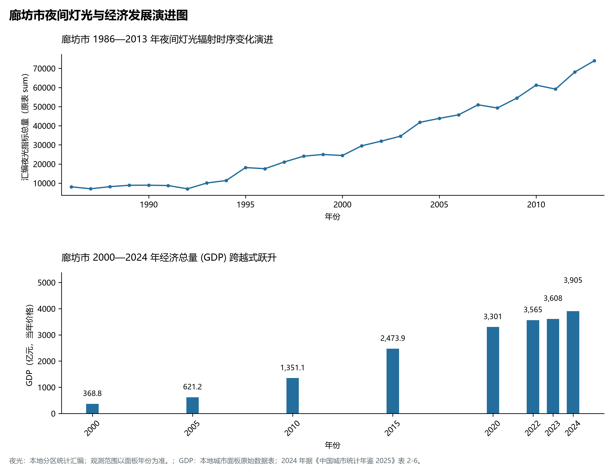
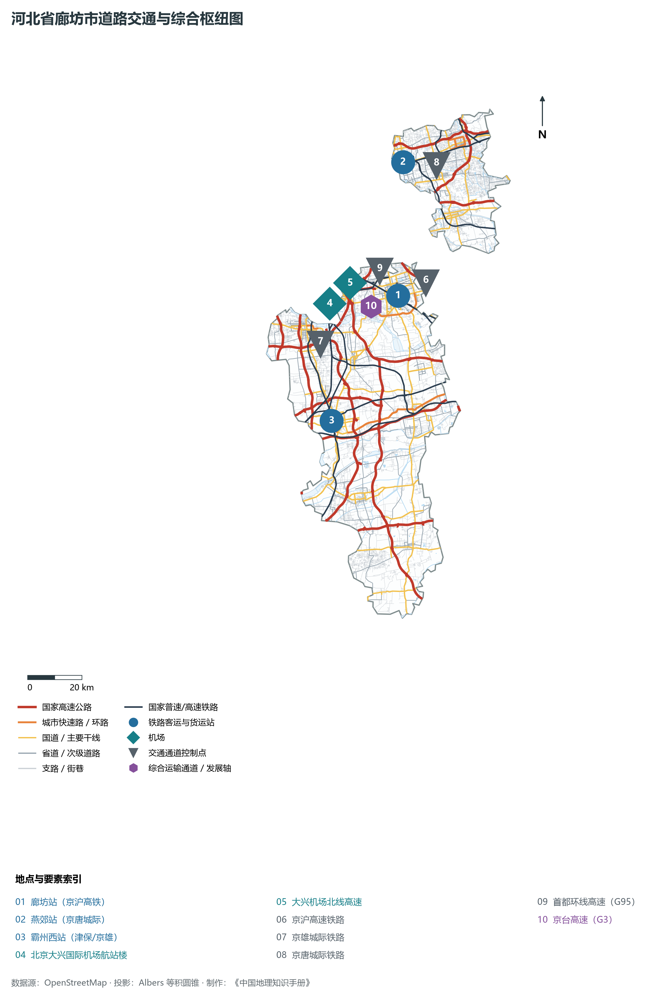

# 3.10 廊坊市

廊坊，地处京津腹心、素有“京津走廊明珠”与“现代商贸物流之都”之美誉，是全国唯一。2024 年常住人口 **547 万人**，常住人口城镇化率 **67.21%**，地区生产总值 **3,905 亿元**（当年价格），人均地区生产总值 **71,333 元**，三次产业构成为 **5.55 : 33.94 : 60.51**。

廊坊是京津冀协同发展重大战略的核心支点与最直接受益区。历史演进上，清光绪二十三年（1897年）京山铁路在此设廊坊站，1900 年义和团在此取得著名的“廊坊大捷”；新中国成立后，由安次县逐步发展为现代化中等城市。新时代，廊坊迎来前所未有的世纪机遇：北京大兴国际机场横空出世，其航站楼及临空经济核心区跨入廊坊片区；“北三县”与北京通州城市副中心实施“统一规划、统一政策、统一标准、统一管控”的一体化高质量发展；中国·廊坊国际经济贸易洽谈会常设于此。当代廊坊，正全面打响“全国现代商贸物流重要基地”金字招牌，成为京津冀世界级城市群中活力澎湃的临空格局与协同创新高地。

---

## 一、市情速览

廊坊是京津走廊上现代商贸物流高度集聚、临空经济与协同发展最为迅猛的现代化名城。

| 核心指标 | 全市数值与空间分布 | 全国/全省定位 |
|:---|:---|:---|
| **行政区划面积** | 6 429 km² | 纯冲积平原地貌，主城区与“北三县”飞地协同并进 |
| **常住人口** | 547 万人 | 2024 年，全市；年鉴公布口径 |
| **常住人口城镇化率** | 67.21% | 2024 年，全市；年鉴公布口径 |
| **人口密度** | 850 人/km² | 全省设区市人口密度之冠，燕郊高新区超 6 500 人/km² |
| **地区生产总值 (GDP)** | 3,905 亿元 | 2024 年，全市；年鉴公布口径 |
| **人均 GDP** | 71,333 元/人 | 2024 年，全市；年鉴公布口径 |
| **产业三次结构** | 6.5 : 29.8 : 63.7 | 现代高端服务业占比全省第一，外向型与临空经济活跃 |
| **行政架构** | 2 个区、5 个县、代管 2 个县级市 | 市政府驻广阳区广阳道；三河、大厂、香河为“北三县” |
| **战略核心定位** | 全国现代商贸物流重要基地与临空经济区 | 北三县与通州一体化示范区、京津冀协同创新先行区 |

**图 03-10-1 河北省廊坊市行政区划与区位图**：图上编号与地点、要素索引对应。

---

## 二、自然地理：永定河冲积扇、潮白河界流与洼淀低平原

廊坊坐落于海河北部冲积平原下游，地形开阔坦荡，自西北向东南缓缓微斜。

### 1. 地貌类型与平原高程
全域地貌主要为第四纪冲积平原：

- **北部三河微丘与倾斜平原**：三河北部靠近燕山余脉，海拔在 20—35 m 之间，全境最高点位于三河蒋福山残丘，海拔约 **35.0 m**；
- **中部永定河、潮白河冲积平原**：海拔 10—20 m，由永定河、潮白河漫滩冲积而成，土层深厚，沙质壤土发育；
- **南部大清河、子牙河泛区洼淀**：海拔在 **2.5—10 m** 之间，地势极其低洼，文安洼、东淀（胜芳）历史上为滞洪区，地面最低点位于文安洼深处，海拔仅 **2.5 m**。

**图 03-10-2 河北省廊坊市地形地貌与水文格局图**：图上编号与地点、要素索引对应。

### 2. 气候特征：暖温带大陆性半湿润季风气候

- **气温特征**：全域年平均气温在 **11.5—12.5 ℃** 之间，四季分明，春秋干燥回温迅速，夏季温热多雨，冬季受偏北干冷风控制；
- **降水**：年降水量约为 **520—580 mm**，70% 以上集中在 7、8 月暴雨季。

### 3. 水系脉络：五河穿境与生态廊道

- **永定河**：首都母亲河由北京大兴入境，流经固安、永清、安次进入天津，百里生态补水实现常态化清水复流；
- **潮白河**：为北三县与北京通州、顺义的天然界河，生态涵养极佳；
- **北运河**：穿流香河县进入天津，香河段实现全线旅游通航，再现运河千帆竞发盛景。

---

## 三、建置沿革与文化根脉

廊坊虽建市较晚，但地脉文脉厚重，是义和团廊坊大捷发祥地与冀派非遗聚落。

### 1. 从铁路驿站到走廊明珠

- **廊坊大捷**：1900 年八国联军自天津乘火车进犯北京，义和团与清军爱国将士在廊坊站设立埋伏，浴血奋战，迫使英国海军中将西摩尔率联军狼狈溃退，史称“廊坊大捷”；
- **建制沿革**：1948 年设立安次县，1981 年设立县级廊坊市，1988 年经国务院批准设立地级廊坊市。

### 2. “北三县”协同文脉与大厂影视之都

- **三河与燕郊**：古称临泃，地处潮白河畔，燕郊自清代为皇帝东巡行宫所在地（清帝出京第一驿）；现代燕郊依托区位成为全国知名的高新技术产业带与国际青年创新创业聚落；
- **大厂影视创意小镇**：建有高规格国际数字影棚集群，承接数十部顶尖电影工业特效制作；
- **香河现代家具文脉**：拥有香河天下第一城与中国北方最大现代家具商贸城。

### 3. 千年商贸古镇胜芳与大城红木非遗

- **胜芳古镇（霸州）**：始建于春秋，盛于明清，古称“聚宝楼”，胜芳大淀苇海苍茫，素有“南有苏杭，北有胜芳”之美誉；
- **大城红木非遗（中国京作古典家具之乡）**：拥有数百年宫廷硬木家具制作传承，产销量居全国北方第一。

**图 03-10-4 廊坊市大兴机场临空经济区与北三县协同产业图**：图上编号与地点、要素索引对应。

---

## 四、经济地理：现代商贸物流中心、临空经济与新型显示

廊坊牢牢牵住疏解北京非首都功能这个“牛鼻子”，形成现代商贸物流、新一代电子信息、高端装备制造三大支柱集群。

### 1. 全国现代商贸物流重要基地

- **物流总部与头部集聚**：圆通速递北方总部、中通、申通、顺丰、京东等全国快递物流头部企业北方核心枢纽全面落户廊坊，全域拥有大型物流仓储基地数十座；
- **中国·廊坊国际经贸洽谈会**：全国唯一以现代商贸物流为主题的国家级国际性展会，年促成跨国与跨区域合作超千亿元。

### 2. 北京大兴国际机场临空经济区与跨界综保区

- **全国首个跨省级行政区自贸试验片区**：北京大兴国际机场综合保税区横跨大兴与廊坊，实现全国首创的跨省域“一个系统、统一监管”通关模式；
- **临空高端产业集聚**：聚焦航空维修、航空物流、高端生命健康、跨境电商等临空前沿科技产业。

### 3. 固安新型显示与先进制造
固安高新区聚集了维信诺科技（中国首条第六代全兼容柔性 AMOLED 生产线）、鼎材科技等链主龙头，形成了从发光材料、驱动芯片、柔性面板到智能终端的完备新型半导体显示产业链。

**图 03-10-5 廊坊市夜间灯光与经济发展演进图**：各面板按标注的观测年份、指标和单位列示。

---

## 五、交通网络与京津走廊枢纽

廊坊地处中国高铁密度最高的区域之一，四通八达的骨干路网将京津与华北平原深度焊接。

### 1. 轨道与城际交通网络

- **京沪高铁与京沪铁路**：贯穿廊坊市区，廊坊站至北京南站仅需 21 分钟；
- **京雄城际铁路**：穿经固安、霸州，直通大兴机场与雄安站；
- **京唐城际铁路**：设燕郊、大厂、香河站，北三县全面融入北京副中心半小时轨道生活圈；
- **津兴城际铁路**：实现天津与大兴机场直连，设安次、永清南站。

### 2. 高速公路网
京哈高速（G1）、京台高速（G3）、大兴机场高速、首都环线高速（G95）、津石高速（G0211）在境内交汇，实现“15 分钟进京入津”。

**图 03-10-3 河北省廊坊市道路交通与综合枢纽图**：图上编号与地点、要素索引对应。

---

## 六、未来展望：京津冀协同发展前沿明珠

在新时代伟大征程上，廊坊正全面构筑区域协同发展新标杆：

1. **加快建设全国现代商贸物流重要基地**：推动商贸物流向数字化、智慧化、供应链金融与国际化高端跃升；
2. **高水平推进临空经济区与北三县协同创新**：打造京津冀区域创新发展新的增长极；
3. **厚植生态绿美底色**：深入推进永定河、潮白河生态修复，建设绿色低碳宜居宜业现代化品质走廊明珠。

2024 年统计来源：《中国城市统计年鉴 2025》表 2-1、2-6、2-7（2024 年，全市）。其他年份 GDP 据本地城市面板“原始数据”表，单位为亿元、当年价格。
