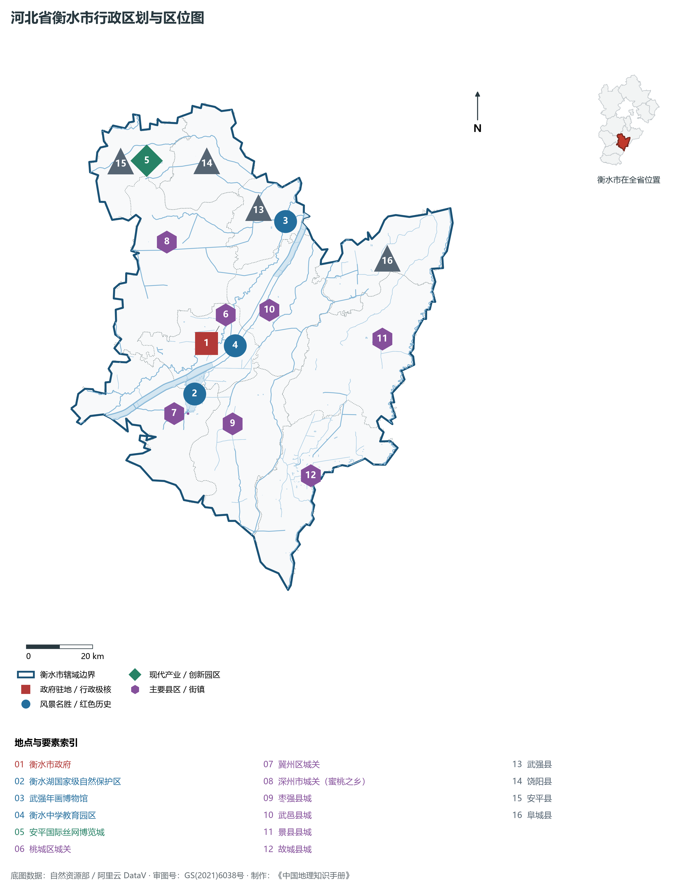
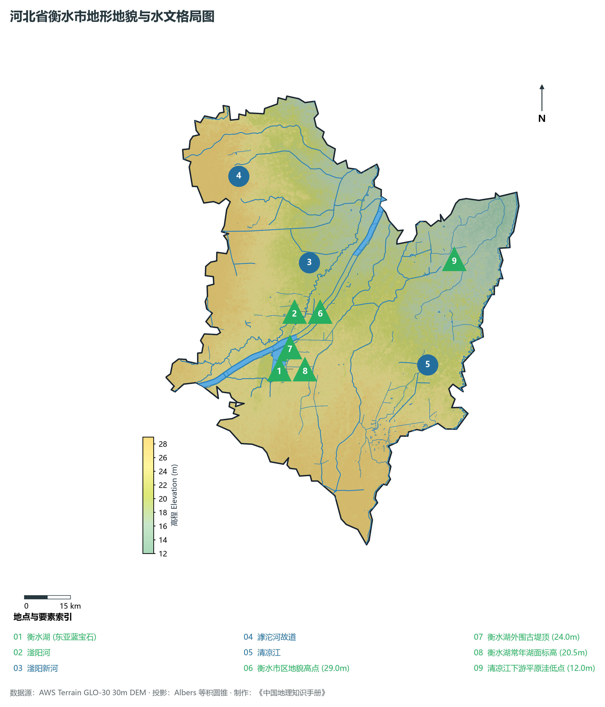
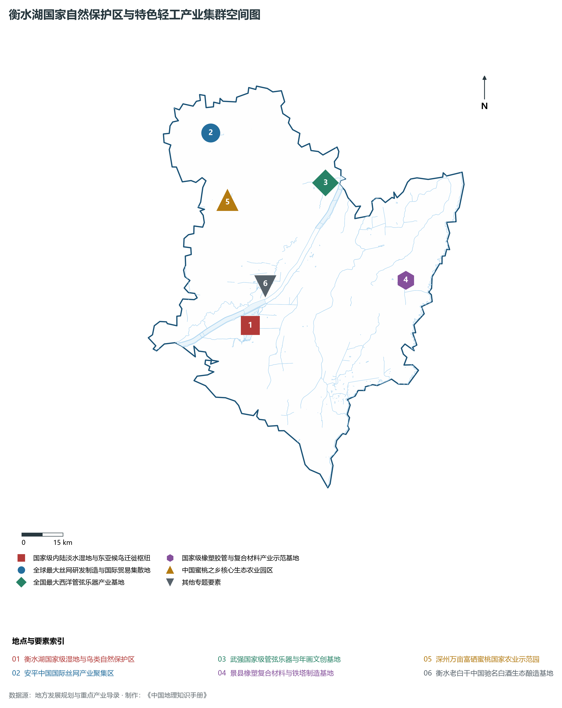
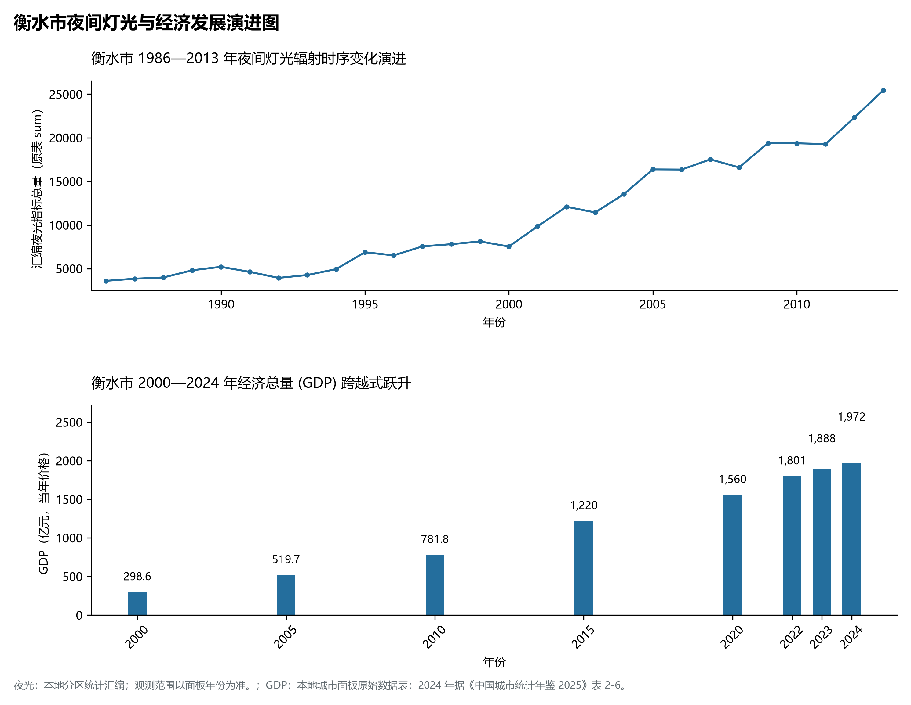
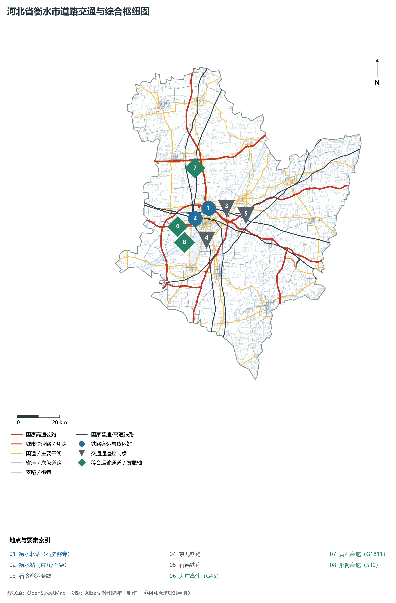

# 3.11 衡水市

衡水，古称“冀州”，国家历史文化名城、华北平原著名湖城、京津冀生态环境支撑区重点湿地城市，享有“东亚蓝宝石”、“中国基础教育品牌之都”与“北方特色轻工之乡”之盛誉。地处河北省东南部、黑龙港流域中游腹地、华北大平原冲积低平原核心带，东邻沧州与山东省德州市，南界邢台，西靠省会石家庄，北依保定，地理坐标介于东经 115°10′—116°34′、北纬 37°03′—38°23′ 之间。2024 年常住人口 **413 万人**，常住人口城镇化率 **58.17%**，地区生产总值 **1,972 亿元**（当年价格），人均地区生产总值 **47,584 元**，三次产业构成为 **13.12 : 33.33 : 53.54**。

衡水地脉悠远。大禹治水划分天下为九州，“冀州统领九州之首”，今冀州区即为古冀州发祥核心；汉设信都国、冀州刺史部，自古为北方农业经济与文化重镇；董仲舒在此诞生，以“罢黜百家、独尊儒术”构建起中国封建大一统正统思想体系；衡水老白干以“地缸发酵”传统酿造技艺传承千年，明代即名扬天下；武强木版年画入选国家首批非物质文化遗产。现代衡水，以衡水湖国家级自然保护区为生态灵魂，孕育出享誉全国的基础教育超级名片（衡水中学），更培育了安平丝网、景县橡塑、武强西洋管弦乐器、深州蜜桃等享誉全球的单项冠军产业集群。

---

## 一、市情速览

衡水是平原湖城生态典范、全国基础教育名牌与特色县域集群高度密集的经济活力之区。

| 核心指标 | 全市数值与空间分布 | 全国/全省定位 |
|:---|:---|:---|
| **行政区划面积** | 8 815 km² | 全域为平坦开阔冲积平原，水系湿地占比 8.5% |
| **常住人口** | 413 万人 | 2024 年，全市；年鉴公布口径 |
| **常住人口城镇化率** | 58.17% | 2024 年，全市；年鉴公布口径 |
| **人口密度** | 478 人/km² | 桃城区超 2 200 人/km²，平原农区在 400—550 人/km² |
| **地区生产总值 (GDP)** | 1,972 亿元 | 2024 年，全市；年鉴公布口径 |
| **人均 GDP** | 47,584 元/人 | 2024 年，全市；年鉴公布口径 |
| **产业三次结构** | 14.2 : 36.5 : 49.3 | 现代农业底蕴深厚，特色轻工与新材料占工业比重超 70% |
| **行政架构** | 2 个区、8 个县、代管 1 个县级市 (深州) | 市政府驻桃城区育才南大街；桃城与冀州环抱衡水湖 |
| **战略核心定位** | 华北平原生态滨湖宜居宜业宜游名城 | 全球最大丝网制造贸易中心、全国基础教育创新名片 |

**图 03-11-1 河北省衡水市行政区划与区位图**：图上编号与地点、要素索引对应。

---

## 二、自然地理：广袤冲积平原、东亚蓝宝石衡水湖与滏阳河网

衡水地势平坦低洼，由西南向东北微缓倾斜，地表形态平坦无垠。

### 1. 极其和缓的平原地貌与极值高程
全境地貌为黄河、海河水系历代泛滥冲积平原：

- **平缓微地貌**：地面平均坡降仅为万分之二左右，海拔在 **12.0—29.0 m** 之间。全境最高点位于西南部冀州区古堤残丘地坪，海拔 **29.0 m**；
- **洼淀低地**：流经境内的古河道与槽状洼地交织，全境最低点位于东北部景县、阜城交界的清凉江平原洼地，海拔仅 **12.0 m**。

**图 03-11-2 河北省衡水市地形地貌与水文格局图**：图上编号与地点、要素索引对应。

### 2. 气候特征：温带大陆性半湿润季风气候

- **气温特征**：全域年平均气温在 **12.5—13.5 ℃** 之间，四季分明，光照充足，无霜期约 195—205 天；
- **降水**：年降水量约为 **500—550 mm**，70% 集中于盛夏，受夏季季风摆动影响降水年际变化较大。

### 3. 水系脉络：东亚蓝宝石衡水湖与黑龙港水网

- **衡水湖国家级自然保护区**：总面积达 **75 km²**，常年蓄水蓄水容积逾 1.2 亿 m³。它是华北平原唯一保留完整内陆淡水湿地生态系统的国家级自然保护区，拥有沼泽、水域、滩涂、草甸等多种生境，被誉为“华北平原最美湿地”与“东亚候鸟迁徙线上的蓝宝石”，常年栖息鸟类 333 种，青头潜鸭、白枕鹤等极危珍禽在此越冬繁衍；
- **滏阳河干流**：流贯市区南北，经全流域生态清淤与“一河两岸”景观治理，成为贯穿桃城的核心亲水生态景观廊道；
- **引黄入冀补淀工程**：自河南濮阳渠村引黄河水，穿流衡水全境向北补给白洋淀，年向衡水湖与沿线湿地补充优质生态水逾数亿立方米。

---

## 三、建置沿革与文化根脉

衡水历史深厚，儒学正统文脉、非遗木版年画与千年传统酿酒技艺享誉华夏。

### 1. 儒学鼻祖董仲舒与九州之首古冀州

- **古冀州故城**：大禹定九州之首，西汉设信都国，汉高祖刘邦、光武帝刘秀曾驻跸于此，城内保存有古冀州城垣遗址；
- **董仲舒故里（景县广川）**：西汉大儒董仲舒提出“天人感应”、“大一统”与“五常”学说，奠定了中国两千余年儒家正统思想基石，广川建有董子故里与董子祠。

### 2. 武强木版年画与西洋乐器之都

- **武强木版年画（国家级首批非遗）**：中国四大木版年画之一，始于宋元，盛于明清，题材包罗万象，线条粗犷豪放，色彩艳丽醇厚，被誉为“农耕时代中国民间社会的百科全书”；
- **中国西洋管弦乐器之都（武强）**：金音乐器为全球最大西洋乐器研发制造基地之一，小号、萨克斯等乐器产销量占全球市场逾 30%。

### 3. 衡水老白干千年地缸酿造技艺
衡水老白干始于汉代，兴于唐宋，以优质红高粱为原料，采用独一无二的传统“地缸发酵、混蒸混烧”工艺，酒质清澈透明、醇香幽雅，1915 年巴拿马万国博览会荣获最高甲等金奖。

**图 03-11-4 衡水湖国家自然保护区与特色轻工产业集群空间图**：图上编号与地点、要素索引对应。

---

## 四、经济地理：世界丝网之都、特色新材料与现代都市农业

衡水县域经济极具活力，走出了一条由传统手工业迈向现代先进特色集群的高质量发展之路。

### 1. 全球最大丝网制造与交易中心：安平丝网

- **全球丝网航母**：安平拥有丝网工贸企业超 1.3 万家，从业人员逾 21 万人，丝网产销量和出口量占全国的 **80% 以上**，年产值突破 1 000 亿元，产品广泛应用于国防、航空航天、石油化工、矿业与环保过滤，畅销全球 190 多个国家；
- **国家级创新平台**：拥有国家级丝网产品质量监督检验中心与中国国际丝网博览会永久会址。

### 2. 景县橡塑复合材料与特种铁塔
景县为全国著名的工程胶管、特种密封件与特高压电力通信铁塔制造基地，高压胶管占国内工程机械配套市场逾 40%。

### 3. 深州蜜桃与现代富硒绿色农业
深州蜜桃曾为皇家贡品，万亩桃花海构成华北平原著名农旅景观；全域作为京津冀重要“菜篮子”与“粮袋子”，绿色无公害果蔬常年稳产保供。

**图 03-11-5 衡水市夜间灯光与经济发展演进图**：各面板按标注的观测年份、指标和单位列示。

---

## 五、交通网络与冀东南铁路枢纽

衡水地处京九与石德两大干线铁路十字交会黄金节点，交通集散辐射能力充沛。

### 1. 轨道与高速铁路网络

- **石济客运专线**：横穿衡水北部，设衡水北站，实现 30 分钟抵石家庄、济南，全面融入国家“八纵八横”青银高铁大动脉；
- **京九铁路与石德铁路**：在衡水站呈“黄金十字”交会，是我国南北客货运与晋煤东运出海的传统干线大动脉；
- **雄商高铁规划建设**：京港台高铁主骨架雄商段在衡水设站，进一步拉近与雄安新区、北京核心区的时空距离。

### 2. 国家高速公路网络
大广高速（G45）、黄石高速（G1811）、邢衡高速（S30）交织成网，与周边各大枢纽城市形成一小时互通网络。

**图 03-11-3 河北省衡水市道路交通与综合枢纽图**：图上编号与地点、要素索引对应。

---

## 六、未来展望：湖城水韵与特色产业创新名城

面对新时代高质量发展，衡水正聚力谱写现代化生态湖城新篇章：

1. **打造华北生态安全标杆与湿地花园名城**：坚持生态护湖、环湖塑城，打造蓝绿交织、人水和谐的京津冀生态后花园；
2. **推动传统特色集群全面迈向千亿级能级**：依托安平丝网、景县橡塑、特色轻工，深化科技赋能与品牌打造，培育国家级专精特新产业集群；
3. **擦亮基础教育与历史文旅名片**：放大董子儒学、衡水老白干、武强年画核心价值，建设现代化富美秀丽新衡水。

2024 年统计来源：《中国城市统计年鉴 2025》表 2-1、2-6、2-7（2024 年，全市）。其他年份 GDP 据本地城市面板“原始数据”表，单位为亿元、当年价格。
