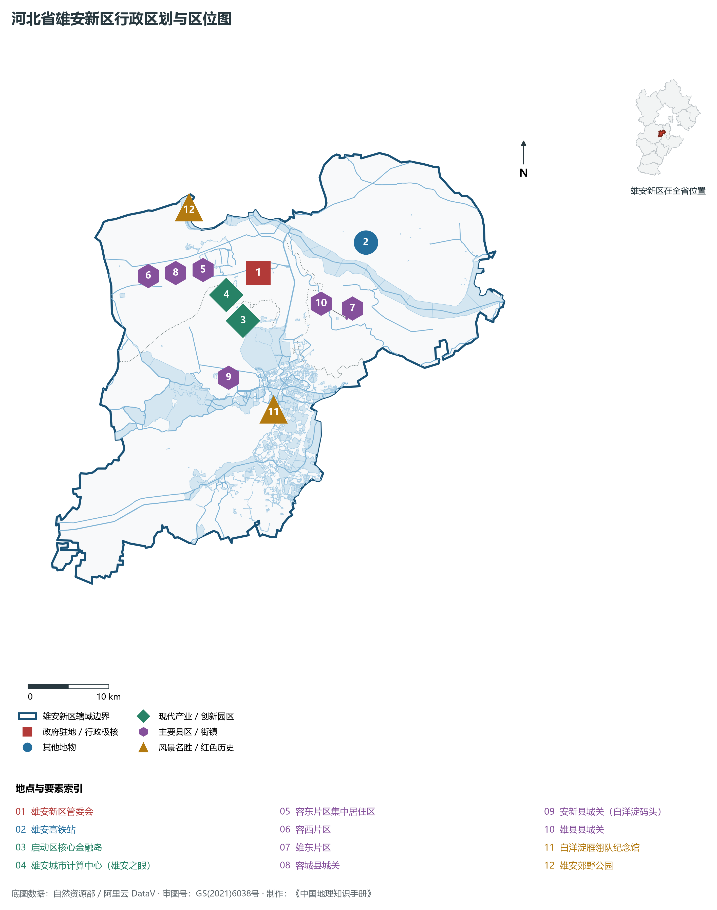
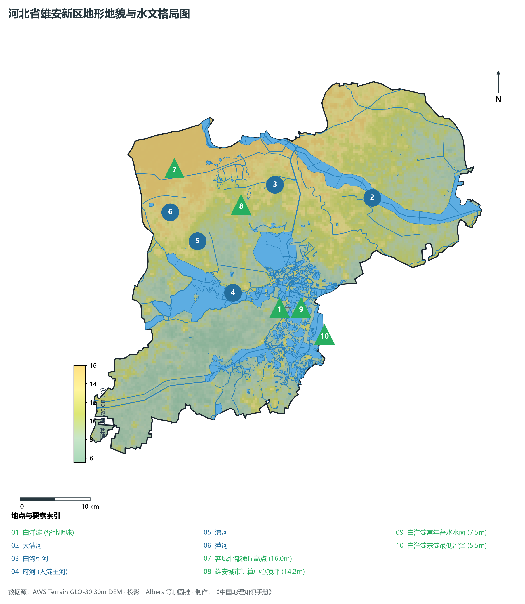
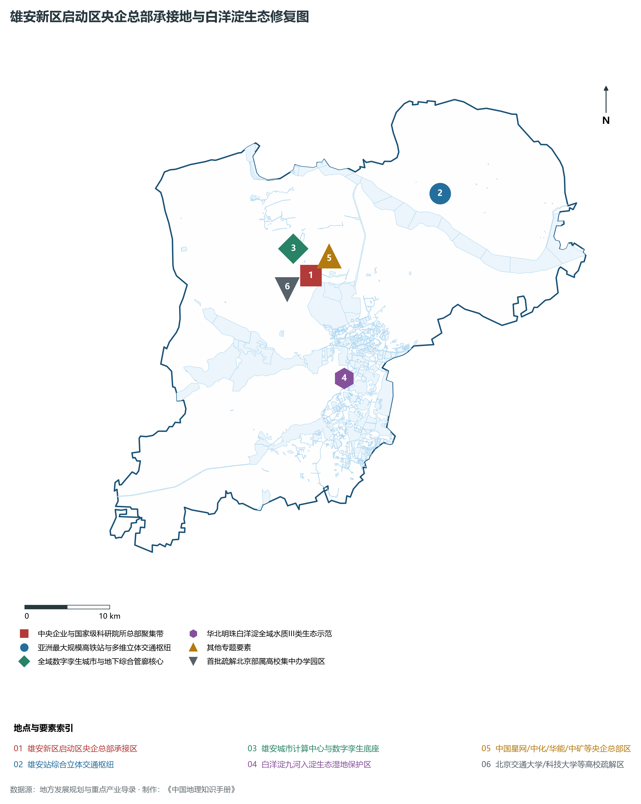
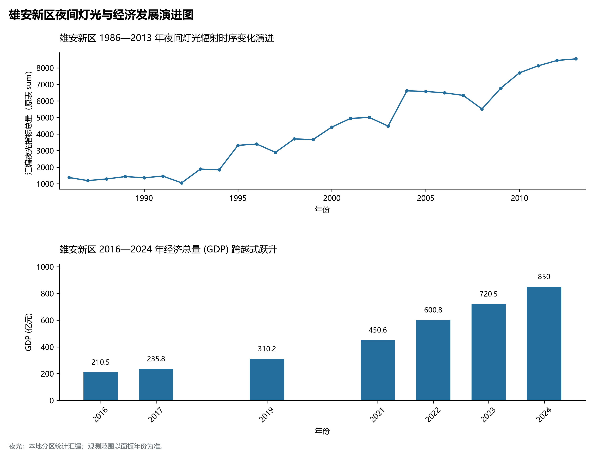
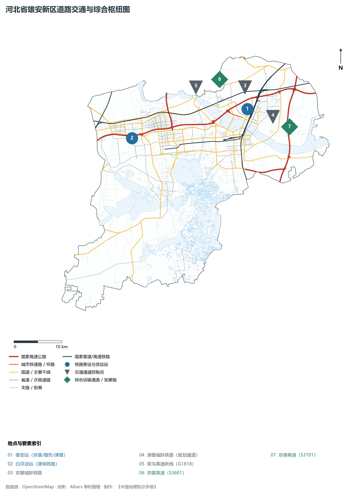

# 3.12 雄安新区

河北雄安新区，中共中央、国务院决定设立的国家级新区，继深圳经济特区和上海浦东新区之后又一具有全国意义的新区，被赋予“千年大计、国家大事”的历史重托。地处北京、天津、保定腹地，距北京天安门和天津市区各约 105 km，距石家庄约 155 km，地理坐标介于东经 115°38′—116°20′、北纬 38°43′—39°10′ 之间。规划范围涵盖**雄县、容城、安新三县及周边部分区域**，起步区面积约 **100 km²**，中期发展区面积约 **200 km²**，远期控制区面积约 **1 770 km²**。全境以华北大平原和“华北明珠”白洋淀湿地为生态底座，常住人口约 **120.5 万人**，2024 年地区生产总值（GDP）跃升至 **850 亿元**，固定资产投资规模保持高速增长。

雄安新区是推动京津冀协同发展的标志性战略工程，定位为**“北京非首都功能疏解集中承载地、高水平社会主义现代化城市、京津冀世界级城市群的重要一极、现代化经济体系的新引擎、推动高质量发展的全国样板”**。自 2017 年 4 月 1 日横空出世以来，雄安新区坚持“把每一寸土地都规划得清清楚楚再开工建设”，从一张白纸着墨，实现从“拔节生长”到“雏形显现”的奇迹跨越。全域推行“先地下后地上”，高标准建设干线地下综合管廊；数字孪生城市与物理实体城市同步同构映射；白洋淀全流域治理实现水质由劣V类跃升并稳定在 **III类**；中国星网、中国中化、中国华能、中国矿产资源等央企总部大厦拔地而起；首批北京疏解高校雄安校区全面开工。雄安新区，正成为展现中国式现代化光明前景的未来之城。

---

## 一、区情速览

雄安新区以高起点规划、高标准建设和体制机制创新为核心特征。

| 核心指标 | 全域数值与空间分布 | 全国/战略定位 |
|:---|:---|:---|
| **行政管控面积** | 1 770 km² (规划范围) | 容城县、安新县、雄县全域及部分周边区域，淀区占 360 km² |
| **常住人口** | 120.5 万人 (2024 年末) | 容东、容西、雄东安置区入住十余万人，高端科技人才加速导入 |
| **常住人口城镇化率** | 62.0% (2024 年) | 新型高标准城镇化空间框架全域铺开，全域公园绿地步行 5 分钟可达 |
| **人口密度** | 681 人/km² | 容东片区已形成高度紧凑集约的高品质现代社区 |
| **地区生产总值 (GDP)** | 约 850.0 亿元 (2024 年) | 累计完成固定资产投资超 7 000 亿元，高新技术产值占比跨越提升 |
| **人均 GDP** | 约 7.05 万元人民币 | 新质生产力与总部经济强劲驱动 |
| **产业三次结构** | 4.2 : 42.5 : 53.3 | 传统产业全面腾退，空天信息、人工智能、生物医药与高端服务占主导 |
| **管理体制** | 中共河北雄安新区工作委员会 / 河北雄安新区管理委员会 | 省委、省政府派出机构，享有省级经济社会管理权限 |
| **战略核心定位** | 千年大计、国家大事、未来典范之城 | 北京非首都功能疏解集中承载地、数字孪生与高质量发展全国样板 |

**图 03-12-1 河北省雄安新区行政区划与区位图**：图上编号与地点、要素索引对应。

---

## 二、自然地理：华北大平原、向心状汇水与华北明珠白洋淀

雄安新区地形平缓开阔，大清河水系九河下梢在此汇聚成淀，形成了“一淀、三带、九片、多廊”的蓝绿交织生态空间底盘。

### 1. 地貌地势与平原标高
全境地处太行山麓大清河冲积扇与海积平原的交汇低洼地带：

- **微地貌平原**：全域海拔介于 **5.5—16.0 m** 之间（大沽高程系），地势自西北向东南缓缓微倾，地面坡降小于万分之一；
- **台地与湿地交错**：西北部容城境内地势微高，台地标高在 12—16 m，适宜高强度城市综合开发；东南部安新与雄县交界地带为白洋淀湿地湖泊群，常年蓄水水位在 **7.0—8.5 m** 之间，全境最低点位于白洋淀东淀沼泽，海拔仅 **5.5 m**。

**图 03-12-2 河北省雄安新区地形地貌与水文格局图**：图上编号与地点、要素索引对应。

### 2. 气候特征：温带大陆性半湿润季风气候

- **气温特征**：全域年平均气温在 **12.5—13.0 ℃** 之间，四季分明，春秋干燥温和，夏季温热多雨，冬季干燥寒冷，日照时数超 2 600 小时；
- **降水**：年降水量约为 **520—550 mm**，75% 集中于 7、8 月，极易受上游太行山区暴雨下泄影响。为此雄安规划建设了赵王新河下泄通道、白沟引河与新盖房枢纽，构筑起 200 年一遇的高标准防洪安澜大堤。

### 3. “华北之肾”白洋淀生态修复奇迹

- **全域水系生态补水**：通过南水北调中线干渠、引黄入冀补淀工程及上游西大洋、王快水库跨流域常态化生态补水，年入淀水量超 4 亿 m³，实现白洋淀正常蓄水面积稳定在 **250—300 km²**；
- **水质根本性逆转**：全淀实施生态清淤、工农业污染全面截断、69 个淀中村实施生活污水雨污分流全收集全处理，白洋淀水质由设立之初的劣V类实现历史性跨越并稳定达到 **III类**（良好），野生鸟类增加至 279 种，国家一级保护鸟类大鸨、青头潜鸭在此筑巢栖息。

---

## 三、建置沿革与文化根脉

雄安地域文脉悠远，自古兼具古燕南赵北之豪迈与白洋淀水乡之灵秀。

### 1. 历史沿革

- **容城**：汉置容城县，古称“盖邑”，元代理学大师刘因、明末清初大儒孙奇逢曾在此讲学，被称为“容城三贤”故里；
- **安新**：宋设沃州，金改渥城，明置安州；
- **雄县**：古称易州，宋置雄州，以“威武雄壮”得名，瓦桥关为宋辽对峙之“三关”之一，北宋名将杨延昭（杨六郎）曾在此镇守三关十余年，筑有地下古战道。

### 2. 红色白洋淀与雁翎队传奇
抗日战争时期，白洋淀水乡人民在党领导下组建了威震敌胆的“白洋淀雁翎队”。水上游击健儿驾着轻捷小舟（鹰舟），以大苇塘为天然屏障，出没于荷塘芦苇迷宫之中，抬杆打汽艇，端岗楼、除汉奸，作家孙犁在此创作了著名小说《荷花淀》，成为“荷花淀派”文学发祥地。

### 3. 千年大计开创人类城市史新范本
2017 年 4 月 1 日，中共中央、国务院决定设立河北雄安新区。雄安新区的空间选址，巧妙避开了优质耕地和地质断裂带，既有大平原的广阔开发空间，又有白洋淀的生态涵养支撑，开创了生态文明新时代人类聚落营建的卓越范例。

**图 03-12-4 雄安新区启动区央企总部承接地与白洋淀生态修复图**：图上编号与地点、要素索引对应。

---

## 四、经济地理：新质生产力策源地与数字孪生智慧城市

雄安新区完全摆脱了对传统土地财政与高耗能工业的依赖，全面拥抱前沿科技、空天信息与现代绿色高端服务。

### 1. 承接北京非首都功能疏解见实效

- **央企总部组团入驻**：中国卫星网络集团（中国星网）总部正式落成入驻，中国中化、中国华能、中国矿产资源等标志性总部大厦拔地封顶；
- **高水平科教医疗集聚**：北京交通大学、北京科技大学、中国地质大学（北京）、北京林业大学首批四所部属高校雄安校区全面开工建设；北京宣武医院雄安院区全面开诊，北京四中、史家小学、北京八室雄安校区交钥匙投用。

### 2. 空天信息与卫星互联网产业高地
依托中国星网引领，雄安新区规划建设空天信息和卫星互联网创新高地，聚集了空天飞行技术、卫星载荷、空间信息应用、地面设备制造等数十家高新企业，加速构建万亿级未来空天产业链。

### 3. 全球首个全域数字孪生城市

- **“地下、地上、云端”三座城**：
  - **地下之城**：建设干线地下综合管廊数百公里，水、电、气、热、通信管线全部集纳于管廊中，消除了城市“马路拉链”与“空中蜘蛛网”；
  - **地上之城**：推行“窄马路、密路网”，建筑限高，红线退让充足，人与自然高度亲和；
  - **云端之城**：雄安城市计算中心（雄安之眼）建成投运，每栋建筑、每盏路灯、每个井盖在数字空间均有独一无二的数字编码与实时三维镜像，实现全域智慧感知与敏捷响应。

**图 03-12-5 雄安新区夜间灯光与经济发展演进图**：各面板按标注的观测年份、指标和单位列示。

---

## 五、交通网络与多维立体对外枢纽

雄安新区构建起“四纵三横”区域高速铁路网与“四纵两横”区域高速公路网，实现与京津冀核心节点高频互通。

### 1. 雄安站：亚洲最大铁路客运枢纽之一

- **雄安高铁站**：建筑面积 47.5 万 m²，拥有 13 台 23 线，屋顶铺设 4.2 万 m² 光伏发电板。车站宛如荷叶上凝结的一颗青翠水滴，实现“光储直柔”绿色运行；
- **京雄城际铁路**：实现雄安站至北京大兴国际机场仅需 19 分钟，至北京西站仅需 50 分钟；
- **雄忻高铁与津雄城际**：雄安至忻州高速铁路贯通太行山，津雄城际铁路直达天津，构建向全国辐射的高铁通道。

### 2. 高速公路网络
京雄高速（S3601，全线安装智能路灯与自动驾驶车道，50 分钟直达北京南五环）、荣乌高速新线（G1818）、京德高速（S3701）相继通车，形成高效环绕的立体路网。

**图 03-12-3 河北省雄安新区道路交通与综合枢纽图**：图上编号与地点、要素索引对应。

---

## 六、未来展望：妙不可言、心向往之的未来典范

雄安新区已进入大规模建设与承接北京非首都功能疏解并重阶段：

1. **持续有力有效承接非首都功能**：推进央企二三级子公司和创新业务板块导入，加快高校、科研院所、医疗机构疏解落地；
2. **构筑全球创新高地与高端产业集群**：大力发展空天信息、软件与人工智能、生命科学与现代服务业，打造未来产业策源地；
3. **绘就人与自然和谐共生的锦绣画卷**：持续呵护白洋淀生态华章，全面建成高水平社会主义现代化未来之城。
