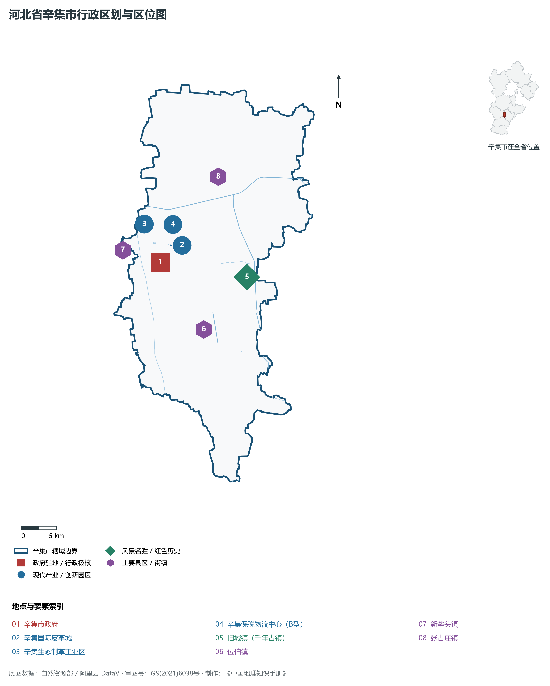
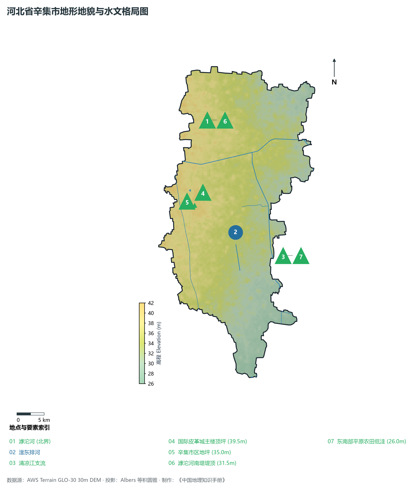
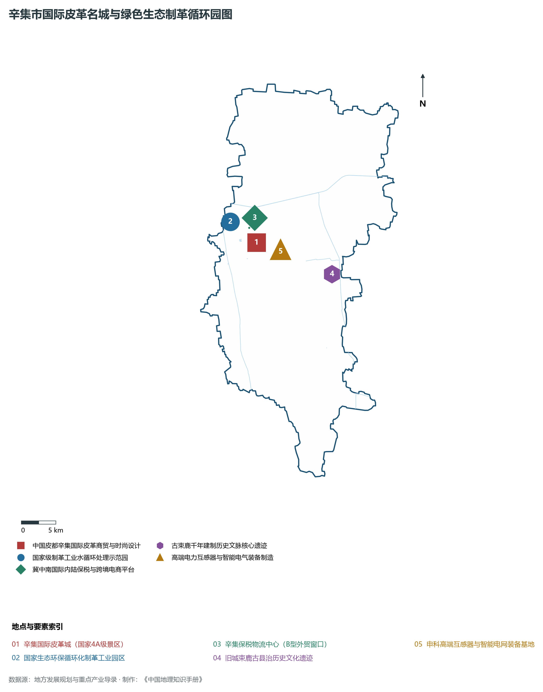
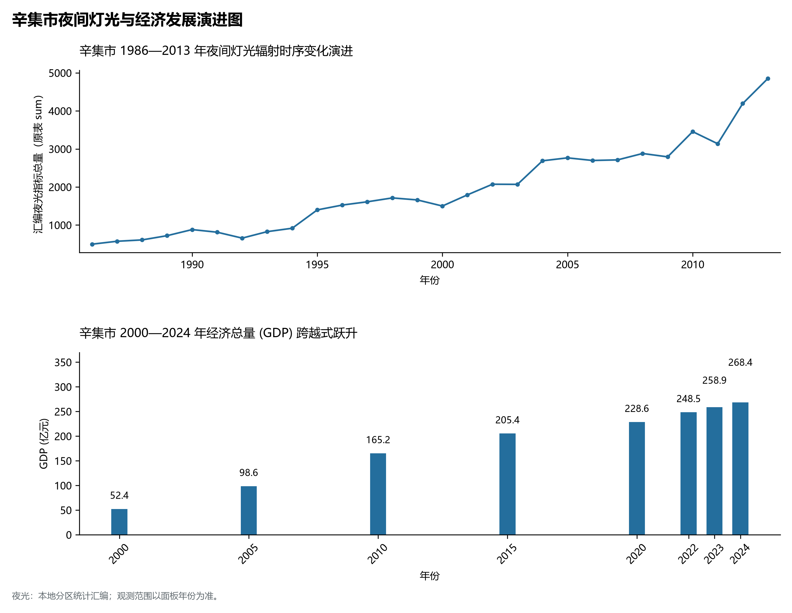
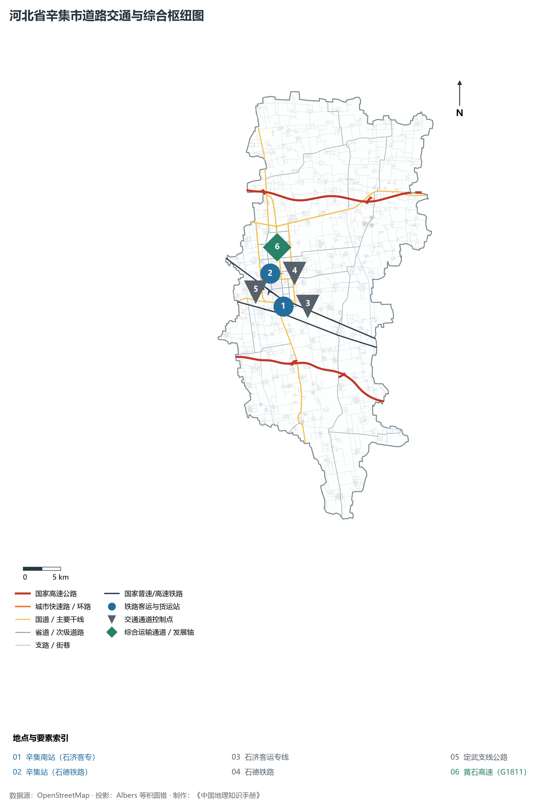

# 3.13 辛集市

辛集市，河北省省直管县级市（原属石家庄市），享有“中国皮都”与“冀中明珠”之盛誉，中国最大的皮革皮毛集散地与现代生态皮革研发制造中心。地处华北大平原中南部、石家庄市东部、滹沱河南岸，东邻衡水市深州，南与衡水市冀州区、邢台市宁晋县接壤，西与石家庄市晋州、赵县相连，北与石家庄市无极县隔滹沱河相望，地理坐标介于东经 115°06′—115°30′、北纬 37°40′—38°08′ 之间。全境幅员开阔，地势平坦。全域土地总面积 **951 km²**，常住人口 **59.4 万人**，2024 年地区生产总值（GDP）达 **268.4 亿元**，人均 GDP 逾 **4.5 万元**。

辛集历史悠久，商贸繁盛。秦置鄡县，西汉设束鹿县（取“因水害屡迁，聚落束于鹿马”之意），1986 年撤县设辛集市，2013 年被河北省确定为首批省直管县级市，享有地级市同等经济社会管理权限。自明清以来，辛集皮毛皮革业便名扬天下，清代享有“辛集皮毛名天下”与“日进斗金之商埠”美名；当代建成了集设计研发、商贸展示、旅游购物于一体的国家 4A 级景区——辛集国际皮革城。新时代，辛集坚定不移推进制革工业绿色环保循环化改造，大力发展现代皮革时尚设计、高端智能装备制造、精密互感器与精细化工，走出了一条生态优先、特色鲜明、产城融合的县域高质量发展示范道路。

---

## 一、市情速览

辛集市是全省省直管体制改革先行区与特色县域先进制造名城。

| 核心指标 | 全市数值与空间分布 | 全国/全省定位 |
|:---|:---|:---|
| **行政区划面积** | 951 km² | 纯冲积平原地形，耕地面积占比高，农业基础深厚 |
| **常住人口** | 59.4 万人 (2024 年末)；七普 59.40 万人 | 辛集镇中心城区人口集聚，旧城、位伯为重点城镇 |
| **常住人口城镇化率** | 61.5% (2024 年) | 高于全省县域平均水平，产城融合充分 |
| **人口密度** | 625 人/km² | 冀中南人口密度高值平原区，中心城区超 3 200 人/km² |
| **地区生产总值 (GDP)** | 268.4 亿元 (2024 年，现价) | 工业增加值占 GDP 逾 43%，特色产业集群产值超 500 亿元 |
| **人均 GDP** | 约 4.52 万元人民币 | 稳居冀中南县级市前列 |
| **产业三次结构** | 12.5 : 43.8 : 43.7 | 现代生态制革、装备制造与商贸服务业并重 |
| **行政架构** | 辖 8 个镇、7 个乡，市政府驻市府街 | 省直管体制赋予地级市经济社会管理权限 |
| **战略核心定位** | 中国生态皮革之都与冀中南先进制造基地 | 国家级外贸转型升级示范基地、保税物流中心开放平台 |

**图 03-13-1 河北省辛集市行政区划与区位图**：图上编号与地点、要素索引对应。

---

## 二、自然地理：滹沱河南岸平原、滏东排河与平缓微地貌

辛集坐落于滹沱河冲积平原中南部，地貌坦荡如砥，土壤肥沃。

### 1. 极其平缓的地貌坡降与极值高程
全域地貌为典型的太行山前倾斜平原向中部低平原过渡形态：

- **微地貌特征**：全境地面坡降在千分之零点二左右，海拔介于 **26.0—42.0 m** 之间；
- **极值高程**：全境最高点位于西北部新垒头镇冲积平原高阶地地坪，海拔 **42.0 m**；全境最低点位于东南部旧城镇与宁晋交界的农田低洼地，海拔仅 **26.0 m**。

**图 03-13-2 河北省辛集市地形地貌与水文格局图**：图上编号与地点、要素索引对应。

### 2. 气候特征：暖温带半湿润季风气候

- **气温特征**：全域年平均气温在 **12.8—13.2 ℃** 之间，四季分明，光照充足，无霜期约 195 天；
- **降水**：年降水量约为 **480—530 mm**，70% 集中于 7、8 月，属于典型的冀中平原农业丰水季与防洪平衡期。

### 3. 水系脉络：滹沱河与滏东排河

- **滹沱河**：流经辛集市北部边界，是辛集与无极、深泽的天然分界线；
- **滏东排河**：流贯辛集南部，承担全域防洪排涝与生态景观功能；
- **工业污水全循环中水回用**：生态制革工业区建设了国际先进的制革工业污水集中深度处理与中水回用厂，实现工业中水循环利用率达 80% 以上。

---

## 三、建置沿革与文化根脉

辛集商贸文脉源远流长，是古代燕赵皮毛加工交易中心。

### 1. 束鹿古邑与辛集得名

- **建制沿革**：汉设鄡县，隋唐设束鹿县，治所位于今旧城镇（城垣遗迹与古砖井仍存）；明正统年间，商贾在城东设新集市，逐渐演化为商业大镇“辛集”；清末民初成为华北著名的皮毛、棉花集散交易大集；
- **辛集农民画（国家非遗）**：辛集是中国著名现代民间绘画画乡，辛集农民画扎根乡土，造型夸张生动，色彩浓烈炽热，多次赴美、日、法等国展览。

### 2. 中国皮都：辛集国际皮革城
辛集国际皮革城占地面积达 1.5 km²，建筑面积逾 150 万 m²，集皮革皮草服装、裘皮、皮鞋、箱包展示销售与工业旅游于一体，是中国最大的皮革皮草商贸展示综合体、国家 4A 级旅游景区，年接待国内外商客与游客超 500 万人次。

**图 03-13-4 辛集市国际皮革名城与绿色生态制革循环园图**：图上编号与地点、要素索引对应。

---

## 四、经济地理：绿色生态皮革、高端装备与外贸保税

辛集坚定走特色集群绿色循环与新型工业化之路。

### 1. 生态皮革工业全链条跃升
拥有规模以上皮革企业数百家，彻底淘汰小作坊与重污染环节，形成“制革—研发—设计—成衣—辅料—展销—检测”完整产业链，被中国轻工业联合会、中国皮革协会命名为“中国皮革皮衣之都”。

### 2. 精密仪器装备与智能电网
申科科技等高新技术企业在电力互感器、智能传感器与高压开关领域打破垄断，互感器产品占领国内智能电网配套重点市场份额。

### 3. 辛集保税物流中心（B型）
辛集保税物流中心封关运营，拥有保税仓储、转口贸易、国际采购分拨、跨境电商核心功能，成为冀中南腹地企业直接开展跨国贸易的开放前沿窗口。

**图 03-13-5 辛集市夜间灯光与经济发展演进图**：各面板按标注的观测年份、指标和单位列示。

---

## 五、交通网络与干线通达

辛集地处石家庄与衡水两大节点之间，路网密布通达。

### 1. 铁路干线

- **石济客专**：辛集南站 18 分钟直达省会石家庄，1 小时抵济南；
- **石德铁路**：传统客货运大动脉，辛集站承担繁重货运编组任务。

### 2. 高速与干线公路
黄石高速（G1811）横贯东西，定武支线、衡井线纵贯南北，构建起“一横两纵”快捷公路网。

**图 03-13-3 河北省辛集市道路交通与综合枢纽图**：图上编号与地点、要素索引对应。

---

## 六、未来展望：国际皮都与先进制造新标杆

新时代辛集正加快高质量转型：

1. **打造国际一流皮革时尚设计之都**：推动皮革服装与数字时尚、米兰巴黎国际时装设计联动，提升品牌附加值；
2. **大力发展高端装备与生物科技**：做大做强互感器、智能农机、精细化工产业链；
3. **高标准建设宜居宜业品质小城市**：深化产城融合，谱写冀中南示范名城新篇章。
