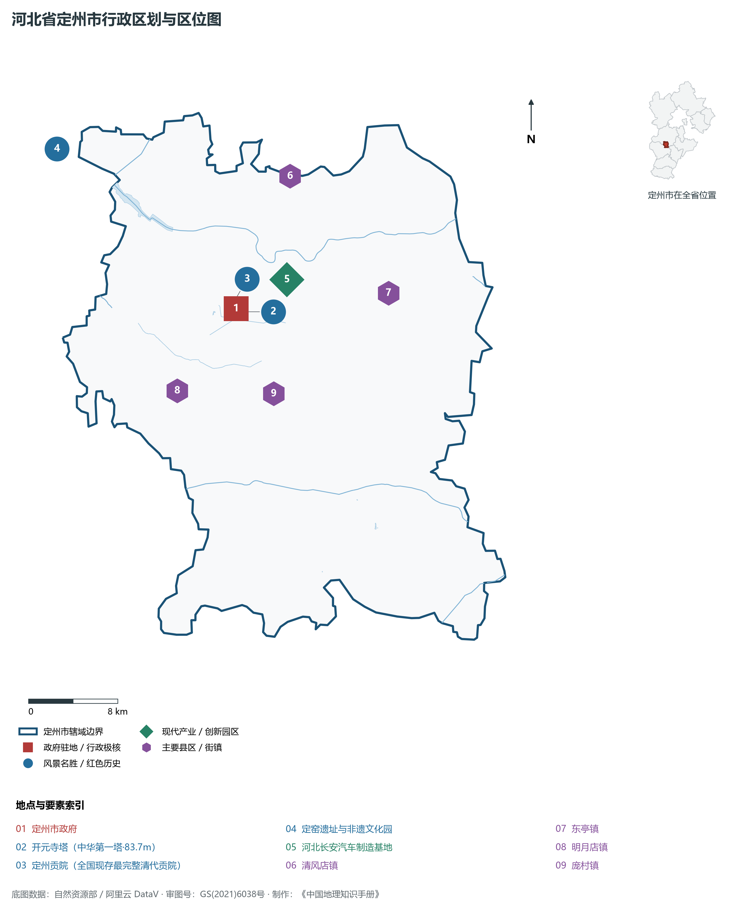
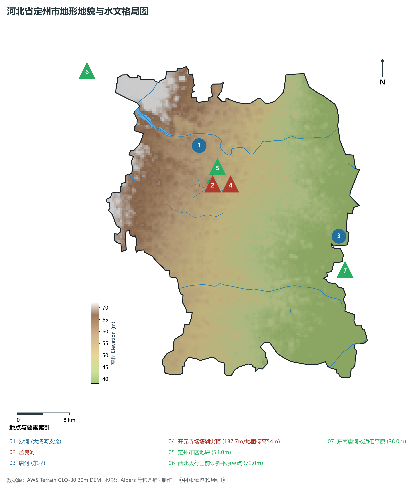
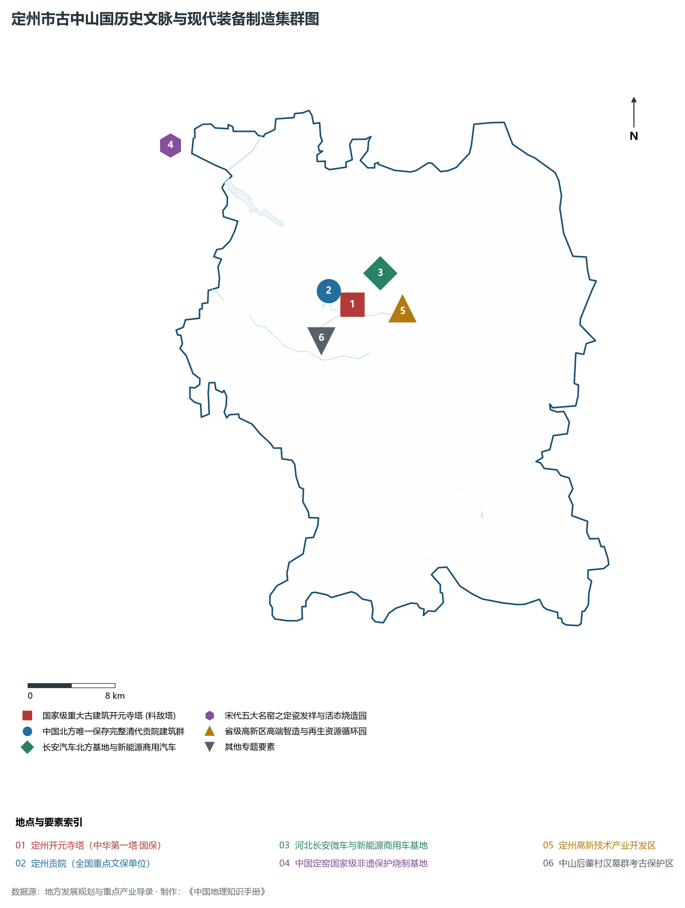
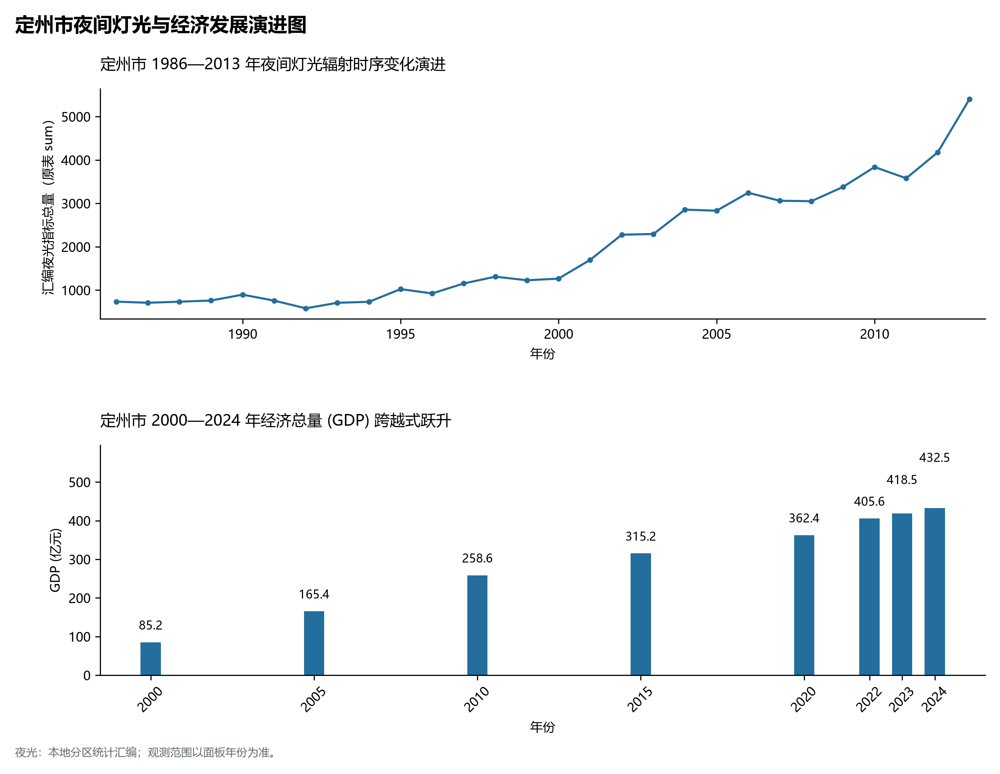
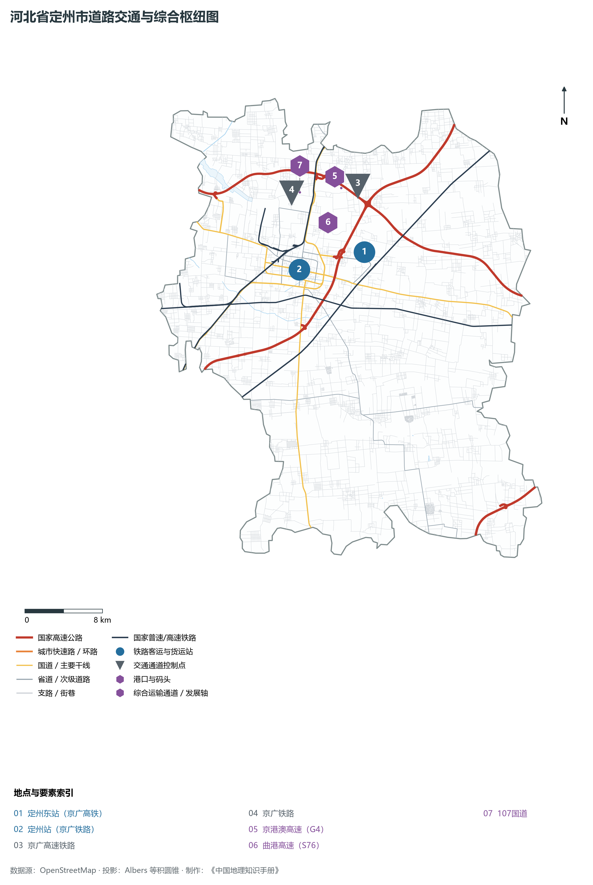

# 3.14 定州市

定州市，河北省省直管县级市（原属保定市），国家历史文化名城、华北地区历史最悠久的古都城市之一、京津冀关键物流节点与先进制造业基地，享有“中山古都”、“中华第一塔之乡”与“定瓷发祥地”之盛誉。地处华北大平原中北部、太行山东麓倾斜平原，西依巍巍太行，东南向冀中平原展开，东北距北京约 190 km，南距省会石家庄约 65 km，北距保定市区约 60 km，地理坐标介于东经 114°48′—115°23′、北纬 38°14′—38°40′ 之间。全境幅员广袤，土地肥沃，沙河横贯全境。全域土地总面积 **1 284 km²**，常住人口 **109.6 万人**，2024 年地区生产总值（GDP）跨越 **432.5 亿元**，人均 GDP 近 **4.0 万元**。

定州文脉璀璨夺目，是古中山国璀璨文明的最高历史载体。战国时期，中山国在此定都（顾成），开创了“千乘之国”的辉煌历史；汉封中山国，汉景帝之子中山靖王刘胜在此分封，满城汉墓出土的金缕玉衣名震天下；北宋时期，苏轼曾任定州知州，在此留下了雪浪斋与千古名篇；宋代五大名窑之首的**定窑**以“白如玉、薄如纸、声如磬”的刻花白瓷享誉全球；北宋咸平年间建成的**开元寺塔（料敌塔）**，高达 **83.7 m**，是中国现存最高的大型砖木结构古代佛塔，享有“中华第一塔”之崇高美誉。新中国成立后，定州作为京广干线咽喉重镇，形成了长安汽车微车与新能源汽车、高端铸造与再生资源利用先进产业集群。2013 年被确定为河北省省直管市，开启了跨越发展的崭新篇章。

---

## 一、市情速览

定州市是冀中平原上人口超百万、文化底蕴极深、现代工业生机勃勃的省直管战略节点城市。

| 核心指标 | 全市数值与空间分布 | 全国/全省定位 |
|:---|:---|:---|
| **行政区划面积** | 1 284 km² | 太行山前缓倾平原，优质连片耕地面积占全域 78% |
| **常住人口** | 109.6 万人 (2024 年末)；七普 109.63 万人 | 河北省人口规模最大的县级市之一，劳动力资源极充沛 |
| **常住人口城镇化率** | 56.8% (2024 年) | 中心四区城镇人口密集，古城与新城融合发展 |
| **人口密度** | 854 人/km² | 全省人口密度极高值区域，中心城区超 4 500 人/km² |
| **地区生产总值 (GDP)** | 432.5 亿元 (2024 年，现价) | 稳居全省省直管与经济强县前列 |
| **人均 GDP** | 约 3.95 万元人民币 | 工业转型升级拉动经济总量加速跨越 |
| **产业三次结构** | 14.8 : 39.2 : 46.0 | 汽车整车制造、先进再制造与商贸文旅多轮驱动 |
| **行政架构** | 辖 4 个街道、16 个镇、5 个乡 (含 1 个民族乡) | 市政府驻南城区街道中山中路；享有地级市经济管理权限 |
| **战略核心定位** | 京津冀先进制造业基地与中山文化历史名城 | 全国新能源商用汽车制造基地、国家历史文化名城 |

**图 03-14-1 河北省定州市行政区划与区位图**：图上编号与地点、要素索引对应。

---

## 二、自然地理：太行山前倾斜平原、沙河滋养与平缓高程

定州全境地处太行山东麓冲洪积扇倾斜平原，地表起伏平缓，土层深厚。

### 1. 地貌分区与极值高程
全域地貌为典型的山前冲积倾斜平原向中部冲积平原过渡形态：

- **地势西北高、东南低**：地面平均坡降在千分之零点五至千分之一之间；
- **极值高程跨度**：全域海拔介于 **38.0—72.0 m** 之间。全境最高点位于西北部唐河出山口阶地地坪，海拔 **72.0 m**；全境最低点位于东南部沙河故道出境平原，海拔仅 **38.0 m**；开元寺塔塔尖海拔标高达到 **137.7 m**，成为冀中平原上耸立千年的大地航标。

**图 03-14-2 河北省定州市地形地貌与水文格局图**：图上编号与地点、要素索引对应。

### 2. 气候特征：暖温带半湿润季风气候

- **气温特征**：全域年平均气温在 **12.5—13.2 ℃** 之间，四季分明，夏季湿热多雨，冬季干燥寒冷，无霜期约 200 天；
- **降水**：年降水量约为 **500—550 mm**，大部分集中于盛夏 7、8 月，有利于夏秋大宗粮食与果品生长。

### 3. 水系脉络：沙河干流与南水北调中线供水

- **沙河（大清河支流）**：自曲阳流经定州北部，横贯全境东流入安国；
- **孟良河**：古代水利河道，横贯市区南部；
- **南水北调中线干渠**：经定州西部穿流，年分配定州指标水量数千万立方米，全面替代工业与居民深井地下水，有力保障水生态安澜。

---

## 三、建置沿革与文化根脉

定州文化遗存极度丰饶，拥有国家级重点文保单位 9 处，素有“九州咽喉地，神京南大门”之称。

### 1. 中山古都与开元寺塔“中华第一塔”

- **开元寺塔（料敌塔）**：建于北宋咸平四年至至和二年（1001—1055年），为八角十三层密檐式砖石仿木楼阁式塔，通高 **83.7 m**，是中国古代现存最高的砖木结构古塔。宋辽对峙时期，宋军登塔可俯瞰契丹军情，故又称“料敌塔”。塔内保存有大型宋代彩绘壁画与斗拱榫卯构造，气吞山河，被誉为“中华第一塔”；
- **定州贡院**：中国北方唯一保存最完整的清代科举考场（清乾隆年间所建），占地面积逾 2 万 m²，号舍与魁阁巍峨严整，为国家级重点文保单位。

### 2. 中国定窑：宋代五大名窑白瓷之冠
定窑发祥于定州曲阳一带（古属定州管辖），创烧于唐，极盛于北宋：

- **刻花划花独步天下**：定瓷胎质坚硬细腻，釉色温润柔和如象牙白，独创“芒口裹铜”覆烧技法与行云流水般的萱草游鱼刻花艺术，被金朝诗人刘祁评为“定州花瓷瓯，颜色天下白”；
- **活态传承**：定州建有定窑文化产业园，定瓷烧制技艺被列入国家级非物质文化遗产。

### 3. 苏东坡与雪浪石传奇
宋哲宗元祐八年（1093年），苏轼被贬知定州，在定州整顿军纪、兴修水利。在中山后圃得一黑质白纹之奇石，石纹如万马奔腾之水波浪花，苏轼狂喜，名之曰“雪浪石”，并筑“雪浪斋”，作《雪浪石诗》，留下千古文人雅事。

**图 03-14-4 定州市古中山国历史文脉与现代装备制造集群图**：图上编号与地点、要素索引对应。

---

## 四、经济地理：汽车制造之都、循环经济与现代食品

定州依托优越的京广干线交通枢纽区位，打造现代装备制造、再生资源循环利用、现代食品医药三大主导产业集群。

### 1. 长安汽车北方基地

- **整车智造龙头**：河北长安汽车制造基地扎根定州数十载，具备年产整车 30 万辆以上能级，主导生产轻型商用车、多功能微卡、冷链物流专用车及新能源纯电商用车，带动数十家冲压、底盘、内饰配套零部件企业在周边集聚；
- **新能源转型**：加速布局氢能源商用车与智能网联货运平台。

### 2. 国家级再生资源循环经济示范区
定州拥有国家级再生资源循环利用基地，在废旧橡胶再生橡塑、报废汽车拆解与稀贵金属二次提炼领域处于全国领先水平。

### 3. 特色食品与现代农业
定州为全国产粮大县与生猪调出大县，粮油加工、苗木花卉（华北最大绿化苗木基地）、乳制品工业规模领先。

**图 03-14-5 定州市夜间灯光与经济发展演进图**：各面板按标注的观测年份、指标和单位列示。

---

## 五、交通网络与京广中枢通衢

定州自古为太行通达中原之锁钥，当代更是京广走廊上关键的公铁立体大枢纽。

### 1. 铁路干线走廊

- **京广高速铁路**：定州东站日均停靠高铁近 50 列，20 分钟抵石家庄、保定，1 小时进京；
- **京广铁路与朔黄铁路联络线**：定州站为京广普铁重要货运大站，朔黄铁路定州电厂支线保障国家能源调配。

### 2. 高速公路网
京港澳高速（G4）、曲港高速（S76）、107 国道纵横贯穿全境，形成“一纵一横一国道”骨干路网格局。

**图 03-14-3 河北省定州市道路交通与综合枢纽图**：图上编号与地点、要素索引对应。

---

## 六、未来展望：京津冀先进制造基地与名城复兴

在新时代伟大征程上，定州正奋力谱写高品质省直管发展新篇：

1. **加快打造京津冀先进制造业基地**：提升长安汽车整车及新能源车核心竞争力，发展高端装备与低碳循环经济；
2. **全面推进国家历史文化名城复兴**：擦亮“中华第一塔”与中山古都文化品牌，促进定瓷非遗与文化创意深度融合；
3. **构筑石保协同关键发展极**：发挥京广廊道中枢承载力，建设现代化高品质中等城市。
