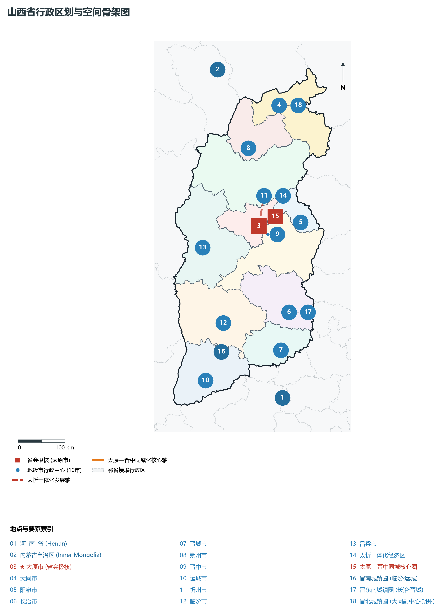
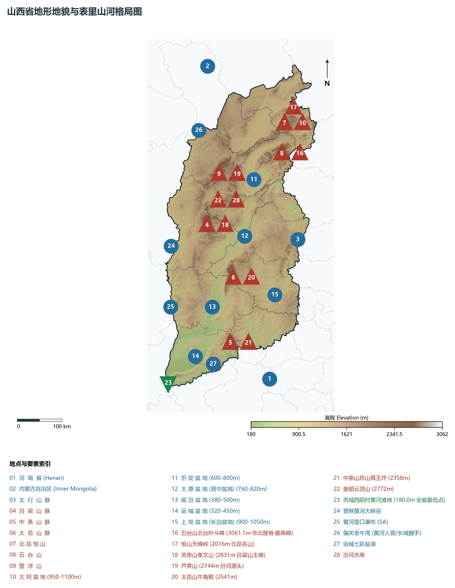
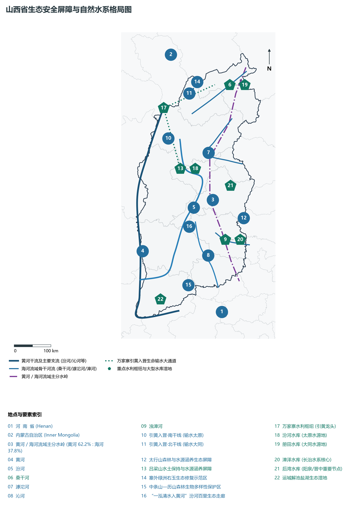
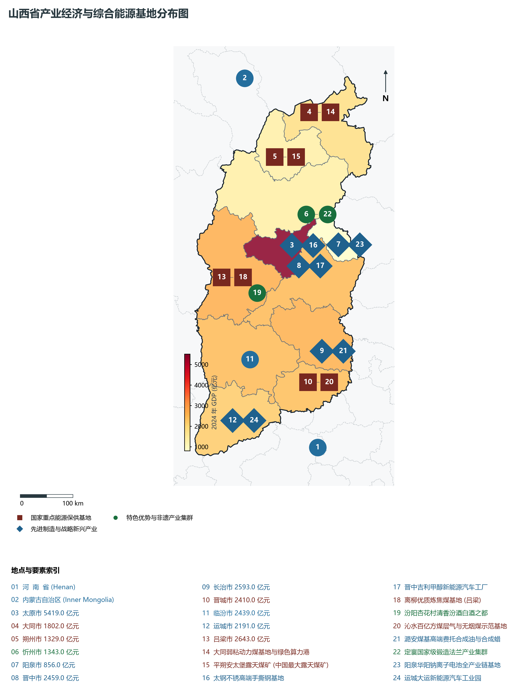
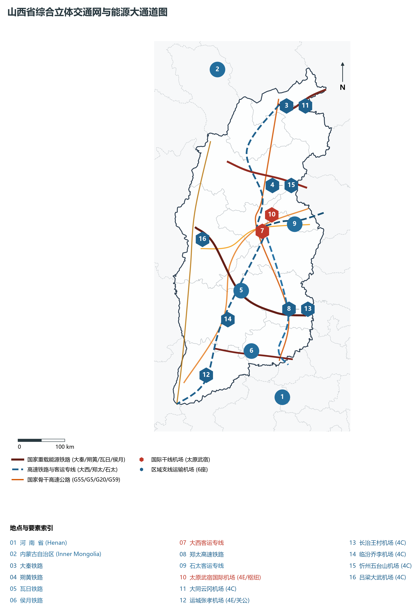

# 第四章 山西省地理统揽与“表里山河”国家综合能源基地

山西，简称“晋”，中华人民共和国省级行政区，省会太原市。地处华北西部的黄土高原东翼，东依巍巍太行与河北省拔地对峙，西隔滔滔黄河与陕西省深峡相望，南越中条山与河南省洛阳、三门峡接壤，北跨内外长城与内蒙古自治区毗连。全省地理坐标介于东经 110°14′—114°33′、北纬 34°34′—40°44′ 之间，南北纵长约 682 km，东西宽约 385 km，全域土地面积 **15.67 万平方公里**，是黄河流域与海河流域的重要分水岭和生态屏障。

“左柳林，右太行，表里山河，外阻内峙。”自古以来，山西因太行山与吕梁山南北合围、黄河大峡谷环绕西南，天然形成一座隆起于华北大平原之上的巨型山原城堡。这里是华夏文明破晓的最早舞台之一：丁村人点燃古人类之火，陶寺遗址照亮“最早中国”的文明曙光，尧都平阳、舜耕历山、禹都安邑在此奠定中原政权雏形；西周桐叶封弟开启晋国六百载春秋霸业，韩赵魏三家分晋拉开战国风云；北魏平城（大同）开凿云冈石窟，拓跋鲜卑在此激荡起空前的民族大融合；明清五百年，晋商手握日升昌票号，“汇通天下”，开辟贯穿亚欧大陆的万里茶道。近代以来，八路军三大主力挺进太行山、吕梁山，创建晋察冀、晋冀鲁豫、晋绥革命根据地，铸就了光照千秋的太行精神与吕梁精神。

当代山西，作为国家重要的能源重化工基地和资源型经济转型综合配套改革试验区，下辖 11 个地级市，常住人口超 **3 465 万人**，2024 年地区生产总值（GDP）超过 **2.54 万亿元**。全省以占全国 1.6% 的国土面积，生产了全国超四分之一的煤炭，累计外调原煤超 140 亿吨，年送电量突破 1 500 亿千瓦时，源源不断地输往华北、华东与华中各省市，被尊为保障国家能源安全的“压舱石”与“动力源”。

在新时代区域协调发展与黄河流域生态保护和高质量发展重大国家战略指引下，山西紧扣中央赋予的“国家资源型经济转型综改试验区”与“全国能源革命综合改革试点”双重使命，坚持“五大任务”与产业转型升级，高标准推进太原国家区域中心城市与太忻一体化经济区建设，加快推动“一泓清水入黄河”生态攻坚，构建“煤电铝材、特钢不锈、光伏半导体、绿色算力与文旅康养”现代化产业体系，展现出三晋大地在新时代破茧成蝶、迈向高质量发展的壮丽新图景。

---

## 一、省情速览与全省基础指标

山西省版图呈自东北向西南倾斜的平行四边形，地貌起伏剧烈，山地与丘陵占全省总面积逾 80%，各大盆地如同一串明珠镶嵌在汾河与太行吕梁之间。

| 核心指标 | 全省数值与空间分布 | 全国/战略定位 |
|:---|:---|:---|
| **行政区划面积** | 156 700 km² | 山地占 40.1%，丘陵占 40.2%，断陷盆地与平原占 19.7%，“七山一水二分田”典型内陆山原 |
| **常住人口** | 3 465.99 万人 (2024 年末)；七普 3 491.56 万人 | 太原市常住人口突破 543 万人，运城超 471 万人，临汾超 390 万人，人口集中于盆地城市带 |
| **常住人口城镇化率** | 65.2% (2024 年) | 太原突破 90.4% 位居全省首位，阳泉 (71.5%)、晋城 (64.2%)、大同 (64.5%) 稳步提升 |
| **人口密度** | 221 人/km² | 汾河谷地各盆地超 500—800 人/km²，吕梁山、太行山腹地及高寒山区低于 100 人/km² |
| **地区生产总值 (GDP)** | 25 484.0 亿元 (2024 年，现价) | 国家能源保供大省；太原 (5 419 亿元) 领跑，吕梁 (2 643 亿元)、长治 (2 593 亿元) 紧随其后 |
| **人均 GDP** | 约 7.35 万元人民币 | 晋城超 11.0 万元、太原超 9.9 万元位居前列，能源工业支撑与现代转型成效显著 |
| **产业三次结构** | 5.2 : 50.1 : 44.7 | 工业增加值占 GDP 逾 45%，能源原材料、先进装备、新材料与数字经济加速融合 |
| **行政架构** | 11 个地级市 | 共 117 个县级行政区 (26 市辖区、11 县级市、80 县)；省会太原市 |
| **战略核心定位** | “两区一基地”与能源革命排头兵 | 国家资源型经济转型综改试验区、全国能源革命综合改革试点、黄河流域绿色生态走廊 |

**图 04-00-2 山西省行政区划与空间骨架图**：图上编号与地点、要素索引对应。

---

## 二、自然地理基底：太行吕梁合围、梯级断陷与表里山河

山西的地质构造历史是一部极其壮丽的大陆聚散史。全省主体位于华北克拉通中部造山带，经历了太古宙结晶基底形成、古生代巨厚海陆交互相煤系地层沉积，以及中新生代以来强烈的断块差异升降与黄土堆积，造就了全国最为独特的“两山夹一川、盆地相贯通”的地貌格局。

### 1. 三大地貌骨架与空间格局
全省地势由东北向西南倾斜，自然地理空间由四大板块系统构成：

1. **东翼太行山脉隆起带**：
   - 纵贯山西东界，北起北京拒马河口，南抵黄河边，全长 400 余公里，主脊海拔在 1 500—2 000 m 以上。太行山在山西侧呈和缓的高原台地，向东侧河北华北平原剧烈断落，形成落差达千米的壮观断崖绝壁。太行八陉中有井陉、滏口陉、白陉、太行陉等穿行其间，历来为连通晋冀鲁豫的陆上咽喉；
2. **西翼吕梁山脉屏障带**：
   - 纵贯山西西部，北起管涔山，南抵中条山北端，主峰芦芽山（2 744 m）、关帝山孝文山（2 831 m）雄踞其中。山势由花岗岩、变质岩与厚层碳酸盐岩构成，植被茂密，构筑了阻挡黄土高原西风沙尘侵袭的绿色生态长城；
3. **中央串珠状断陷裂谷盆地带（“三晋走廊”）**：
   - 受新生代地幔热柱上涌与喜马拉雅构造应力场拉张控制，太行与吕梁两大隆起带之间陷落形成一条呈“S”形展布的巨型新生代裂陷盆地走廊，自北向南由 6 大盆地相串联：
     - **大同盆地**：海拔 950—1 100 m，桑干河贯穿其中，以第四纪火山群与广袤煤田著称；
     - **忻定盆地**：海拔 600—800 m，滹沱河汇聚其间，是晋北连接太原的核心过渡平原；
     - **太原盆地（晋中盆地）**：全省最大的核心裂陷盆地，面积约 5 000 km²，海拔 760—820 m，汾河与潇河交汇其间，为山西经济人口的核心高地；
     - **临汾盆地**：海拔 380—500 m，汾河下游冲积平原，气候温和，土层深厚，自古为华夏农耕发祥沃土；
     - **运城盆地**：海拔 320—450 m，涑水河流贯，南临中条山，拥有著名的七彩解池盐湖；
     - **上党盆地（长治盆地）**：地处太行山腹地的高原盆地，海拔 900—1 050 m，漳河滋养，为中太行首屈一指的富庶之区。
4. **南部中条山与太岳山屏障**：
   - **中条山**横亘于运城盆地以南，北陡南缓，控扼风陵渡黄河天堑；**太岳山**横卧晋中、临汾与长治之间，主峰牛角鞍海拔 2 541 m，是汾河水系与沁河水系的天然分水岭。

**图 04-00-1 山西省地形地貌与表里山河格局图**：图上编号与地点、要素索引对应。

### 2. “华北屋脊”五台山与全省极值高差
全省最高峰为位于忻州市五台县境内的五台山北台**叶斗峰**，海拔达到 **3 061.1 m**，素有“华北屋脊”之称。五台山由早前寒武纪变质结晶基底构成，保存着古元古代“五台运动”地质遗迹，其主脊终年寒凉，夏季常有降雪积冰。
全省最低点位于运城市芮城县风陵渡西陌村黄河出境处，海拔仅为 **180.0 m**。全省地貌最大绝对垂直高差达 **2 881.1 m**，造就了华北内陆梯度最大、最为丰富的垂直自然带谱与生物避难所。

### 3. 气候特征：温带大陆性半干旱季风气候
山西地处中纬度内陆腹地，山脉环峙阻隔海洋水汽，季风气候大陆度极高：

- **年均气温**：全省年平均气温在 **4.2—14.2 ℃** 之间，由北向南、由山地向盆地递增。北部大同、朔州高寒少热，年均温仅 4—7 ℃，冬季漫长严寒，无霜期仅 110—130 天；南部运城、临汾盆地年均温达 12—14 ℃，无霜期长达 200—220 天，光热资源充沛，盛产冬小麦与优质苹果、红枣；
- **降水空间与季节剧烈分异**：全省年降水量在 **350—650 mm** 之间：
  - **空间分布**：受东南季风影响，太行山东坡迎风面及晋东南太岳山区（晋城、长治）降水量可达 550—650 mm；而背风面的晋西北及忻州、朔州部分区域年降水骤减至 350—420 mm，蒸发量高达 1 800 mm 以上；
  - **季节分配**：具有“冬长干冷、春旱多风、夏热雨聚”的显著特点，6—8 月降水占全年总量的 **60%—70%**，多以局地短历时强对流暴雨形式出现，极易诱发黄土沟壑区山洪泥石流。

---

## 三、水文水系与“两山夹一川、黄河入晋大峡谷”

山西省是典型的内陆山区分水岭省份，境内河流分属两大流域：西侧与南部汇入**黄河流域**（占全省总面积 62.2%），东北侧与东部诸水穿太行山东流入海，汇入**海河流域**（占全省总面积 37.8%）。全省流域面积在 100 km² 以上的河流有 240 余条，呈现出“外河环绕、内河纵贯、太行诸水东出”的水系骨架。

### 1. 母亲河汾河与三晋内流水系

- **汾河（山西母亲河）**：全长 **716 km**，流域面积 3.97 万 km²（占全省面积四分之一），是黄河第二大支流。汾河发源于宁武县管涔山芦芽山麓雷鸣寺泉，南流贯穿忻定盆地、太原盆地、临汾盆地，于万荣县庙前村汇入黄河。沿途接纳潇河、文峪河、浍河等数十条支流。历史上汾河水量充沛、“汾河流水哗啦啦”，滋养了半数山西人口与耕地；当代实施全流域生态攻坚，实现“一泓清水入黄河”；
- **涑水河**：运城盆地内流地表廊道，源于绛县，向西南穿经闻喜、运城市区流入黄河，沿途滋养解池盐湖周边沃野；
- **沁河**：黄河下游重要支流，源于沁源县太岳山深处，南流切穿晋城太行峡谷，在河南武陟汇入黄河。水质清澈，两岸分布着著名的沁河古堡群。

### 2. 晋陕黄河大峡谷与壶口瀑布
黄河在偏关县老牛湾由内蒙古长城脚下正式奔涌入晋，至运城风陵渡向东折流，山西段干流全长达到 **965 km**。

- **晋陕黄河大峡谷**：长达 725 km，是黄河干流最长的一段连续峡谷地貌。黄河在晋陕之间切穿黄土高原与巨厚砂页岩层，河宽由数百米骤然缩紧至几十米；
- **黄河壶口瀑布**（吉县）：国家 5A 级景区。巨澜奔腾的黄河在壶口由 300 余米宽的河面骤缩进仅 30—50 米宽的“十里龙槽”，水势跌落 30 余米，掀起惊天狂澜，“千里黄河一壶收”，是中华民族百折不挠、勇往直前精神的地理图腾；
- **乾坤湾与风陵渡**：黄河在永和县绕出优美壮阔的蛇曲巨弯（乾坤湾），而在芮城风陵渡接纳渭河、洛河，形成晋陕豫黄河金三角汇流之势。

### 3. 海河流域太行诸源与万家寨引黄入晋工程

- **太行诸源水系**：
  - **桑干河**：大同盆地的母亲河，由恢河与源子河在朔州汇合而成，东流切穿大同峡谷注入官厅水库，为永定河正源；
  - **滹沱河**：源于繁峙泰戏山，贯穿忻定盆地，穿太行山井陉峡谷注入河北岗南、黄壁庄水库；
  - **漳河（清漳河/浊漳河）**：源于长治上党高地，东下汇流注入岳城水库，滋养冀南大平原；
- **超级引水水利：万家寨引黄入晋工程**：
  - 为化解太原、大同等工业核心区极度缺水困局，国家在偏关万家寨黄河峡谷建设万家寨水利枢纽，修筑地下隧洞、大型泵站梯级扬水，总干线长 44 km，分南线（输水至太原汾河水库，年引水 6.4 亿 m³）与北线（输水至大同平旺水库，年引水 5.6 亿 m³），彻底扭转了太原盆地与大同盆地深层地下水超采引发的生态恶化。

**图 04-00-5 山西省生态安全屏障与自然水系格局图**：图上编号与地点、要素索引对应。

---

## 四、历史文脉与三晋大地时空演进

山西是中华文明未曾中断的坚实承载地。黄河与汾河冲积平原最早培育了耐旱的粟黍农业，厚重的黄土地层记录了文明演进的每一步脚印。

### 1. 华夏文明之源与春秋晋国霸业

- **远古曙光**：芮城西侯度遗址发现了距今约 243 万年的早期人类用火与石器遗迹，将中国境内人类用火历史推向前所未有的高古深度；襄汾丁村遗址代表了旧石器时代中期的典型石器工业；
- **最早中国·陶寺遗址**：位于临汾襄汾县城东北的陶寺遗址（距今约 4300—3900 年），发掘出规模宏大的古城墙、早期宫殿基址、大型墓葬、朱书陶壶（见“文”“尧”字样）以及世界最早的古观象台，被学术界公认为与“帝尧陶唐氏之都”高度契合的核心实证，是探索华夏文明起源与早期国家形成的基石；
- **晋侯霸业与三家分晋**：公元前 1040 年，成王封幼弟叔虞于唐（后改称晋）。春秋时期，晋献公假道伐虢、晋文公践土会盟称霸中原，晋国雄踞北方 150 余年。公元前 453 年赵魏韩三家灭智伯，公元前 403 年周天子正式册封三家为诸侯，成为中国历史由春秋步入战国的分水岭，太原、邯郸、大梁由此登上封建大变革舞台。

### 2. 塞北游牧与中原农耕的融合熔炉

- **北魏平城时代（大同）**：公元 398 年，鲜卑拓跋珪定都平城（今大同），统治长达 97 年。这里聚集了近百万人口，汇聚汉儒士大夫、西域胡商与中亚佛教高僧。文成帝时期在武周山开凿**云冈石窟**，气势磅礴的大佛兼具古印度犍陀罗艺术与汉魏传统神韵；孝文帝在此推行太和改制、颁布均田令，最终南迁洛阳，推动中华民族血脉与文化走向空前大融合；
- **大唐龙兴与并州风华**：公元 617 年，李渊、李世民父子自太原起兵反隋，开创盛唐伟业。唐王朝视并州（太原）为“北京”与北都龙兴之地，李白曾在此赞叹“时时出向城西望，晋祠流水如碧玉”。

### 3. 晋商汇通天下与古建艺术王国

- **五百年晋商奇迹**：明清两代，晋商借“开中制”贩盐崛起，平遥、太谷、祁县商人纵横亚欧大陆。清道光三年（1823年），平遥商人创立中国第一家票号——**日升昌**，发明以纸质汇票替代沉重白银运送的汇兑体制，“汇通天下、信义立足”，在全国各重镇及俄、日、东南亚设立分号数百家，成为近代中国金融史的前驱；开辟的“万里茶道”自福建武夷山北上，穿山西、越蒙古高原直抵恰克图与莫斯科，成为连接欧亚大陆的世纪贸易大动脉；
- **中国古代建筑博物馆**：山西是中国地面古建筑遗存密度最高、品类最全的省份，现存全国重点文物保护单位达 **531 处**，稳居全国第一。全国仅存的 3 座唐代木结构建筑全在山西（五台山佛光寺大殿、南禅寺大殿、芮城广仁王庙）；拥有世界现存最高古木塔——应县木塔（高 67.31 m），世界最高古琉璃塔——洪洞广胜寺飞虹塔，以及晋祠圣母殿、隰县小西天悬塑、平遥双林寺彩塑等东方雕塑与营造绝品。

---

## 五、经济地理：国家能源保供基石、先进智造与绿色转型

当代山西经济正在彻底跳出“因煤而兴、因煤而困”的资源诅咒，全省以“双碳”目标为牵引，坚决扛起国家综合能源保供与绿色转型双重重任，形成“深耕能源压舱石、做强高端制造业、培育绿色算力与文旅双支柱”的产业空间新轴线。

### 1. 国家能源战略保供核心矩阵

- **全国最大原煤生产与外运基地**：山西煤炭储量占全国近三分之一，已探明保有储量超 2 700 亿吨。全省煤炭年产量稳定在 **13 亿吨** 以上水平，日均外送原煤超 200 万吨，承担着全国 16 个省份的电煤保供兜底重任；
- **六大煤田全域分布**：大同煤田（优质弱粘动力煤）、宁武煤田、西山煤田（优质焦煤）、沁水煤田（全国最大无烟煤与煤层气基地）、霍西煤田、河东煤田，形成了晋能控股、焦煤集团、潞安化工、华阳新材料等巨型能源航母；
- **煤层气（非常规天然气）“领头羊”**：全省煤层气探明储量占全国 90% 以上，年抽采量突破 **130 亿立方米**，建成沁水盆地与鄂尔多斯盆地东缘两大世界级非常规天然气产业示范区；
- **晋电外送超级通道**：依托特高压交流输电（长治—荆门、晋北—南京、蒙西—晋中）与直流输电工程，年外送电量达 1 500 亿千瓦时，实现“煤从空中走、电送全中国”。

### 2. 传统制造业高端化与新兴智造崛起
全省坚定不移推动制造业振兴：

- **太钢特种不锈钢**：太原太钢不锈拥有全球领先的不锈钢研发生产基地，“手撕钢”（厚度仅 0.015 mm）、笔尖钢、高铁轮轴钢等核心关键材料彻底打破国际技术垄断；
- **现代装备制造与新能源乘用车**：以太重集团（大型挖掘机与风电齿轮箱）、吉利晋中绿色甲醇乘用车工厂、大运汽车新能源商用车为引领，打造中西部先进装备高地；
- **现代煤化工高精尖跃迁**：潞安化工现代煤基合成油与高纯费托合成蜡打破国外技术壁垒，华阳新材料由传统煤矿迈向钠离子电池全产业链；
- **绿色低碳数据算力产业**：大同充分发挥气候凉爽（年均温仅 5.5 ℃）、电力充沛价廉、邻近北京的区位优势，引进秦淮数据、中联数据等超大规模数据中心，绿色算力规模跃居华北前列。

**图 04-00-4 山西省产业经济与综合能源基地分布图**：图上编号与地点、要素索引对应。

---

## 六、交通网络与能源大动脉

山西是连接我国西北能源重镇与华东、华北沿海消费核心的交通“中转大枢纽”。以特重载铁路、纵横高铁与国家干线高速为支柱的立体交通体系，构成了共和国经济循环最强劲的动力血管。

### 1. 国家重载能源铁路通道群
山西是世界上重载铁路运输技术最成熟、运量最密集的区域：

1. **大秦铁路（中国重载第一路）**：西起大同湖东，东至河北秦皇岛港，全长 653 km。采用双机重联万吨、两万吨单元重载列车，开创全自动微机控制牵引，年最高运量达 **4.5 亿吨**，为世界上单条铁路货运量之最；
2. **朔黄铁路**：西起神池南，横跨晋冀直抵沧州黄骅港，全长近 600 km，是中国第二条西煤东运重载货运专线；
3. **瓦日铁路（晋中南铁路通道）**：西起兴县瓦塘，东至山东日照港，全长 1 260 km，是我国第一条按 30 吨轴重标准建设的万吨重载铁路，横贯吕梁山、太行山直抵黄海之滨；
4. **侯月铁路/侯阎铁路**：横跨晋南中条山、太岳山，是晋煤外运南通道的关键支柱。

### 2. “十字交叉、南北大贯通”的高铁与城际网络

- **大西客运专线（大同至西安）**：自大同南站出发，经朔州、忻州、太原、晋中、临汾、运城，穿越三晋全境六大盆地直通陕西西安，全长 859 km，构筑了山西省域“最繁忙的南北客运黄金中轴”；
- **郑太高铁（太原至郑州）**：穿越太行山、太岳山隧道群，经晋中、长治、晋城直抵中原郑州，将晋东南与中原城市群通勤时间压缩至 2 小时以内；
- **石太客运专线**：穿越太行山井陉峡谷，是连接太原与北京、石家庄的高铁大动脉；
- **集大原高铁**：连通内蒙古集宁、大同与原平，实现蒙西与三晋高铁网的全面并轨。

### 3. 国家高速公路骨架与民航机场群

- **骨干高速公路**：二广高速（G55）自北向南贯通大同、忻州、太原、长治、晋城；京昆高速（G5）、青银高速（G20）东西向横切太行；呼北高速（G59）沿吕梁山西麓纵贯黄河峡谷；
- **航空枢纽网络**：全省形成以**太原武宿国际机场**（4E级，三期改扩建加快推进）为国际干线枢纽，大同云冈、运城关公、长治王村、忻州五台山、吕梁大武、临汾乔李等支线机场协同联动的立体航网格局。

**图 04-00-3 山西省综合立体交通网与能源大通道图**：图上编号与地点、要素索引对应。

---

## 七、未来展望：资源型经济转型综合改革与高质量发展新图景

面对高质量发展与“双碳”战略的新历史要求，山西省坚持深化全方位转型，全面破除对单一资源要素的过度依赖，奋力走出一条资源型地区经济转型发展新路：

1. **纵深推进能源革命综合改革试点**：
   - 推动煤炭绿色智能开采，建设智能化矿山与绿色煤化工产业链；大力发展风电、光伏、抽水蓄能与地热能，加快建设浑源、垣曲、蒲县大型抽水蓄能电站群，推动非化石能源装机占比大幅跨越 50%；
2. **太原国家区域中心城市与太忻一体化双轮驱动**：
   - 做强太原都市圈，推动太原与晋中基础设施、科教资源、产业园区深度同城化一体化；高标准建设太忻一体化经济区，打造连通京津冀与雄安新区的向东向北开放新走廊；
3. **“一泓清水入黄河”与生态修复攻坚**：
   - 实施汾河流域全生命周期生态补水与污染深度治理，全面消除劣V类水质断面上游隐患，让汾河重现碧波荡漾；高标准修筑黄河一号、长城一号、太行一号“三大旅游一号公路”，推动黄土高原水土流失区重披绿装；
4. **文旅康养与数字经济双向赋能**：
   - 放大“地上文物看山西”金字招牌，以云冈石窟、平遥古城、五台山三大世界遗产为核心，推动古建木构、晋商大院、关公忠义与红色太行文化全景活化；依托凉爽气候与绿电优势做大绿色算力集群，打造中国北方最具韧性与活力的现代化绿色文明新高地。
