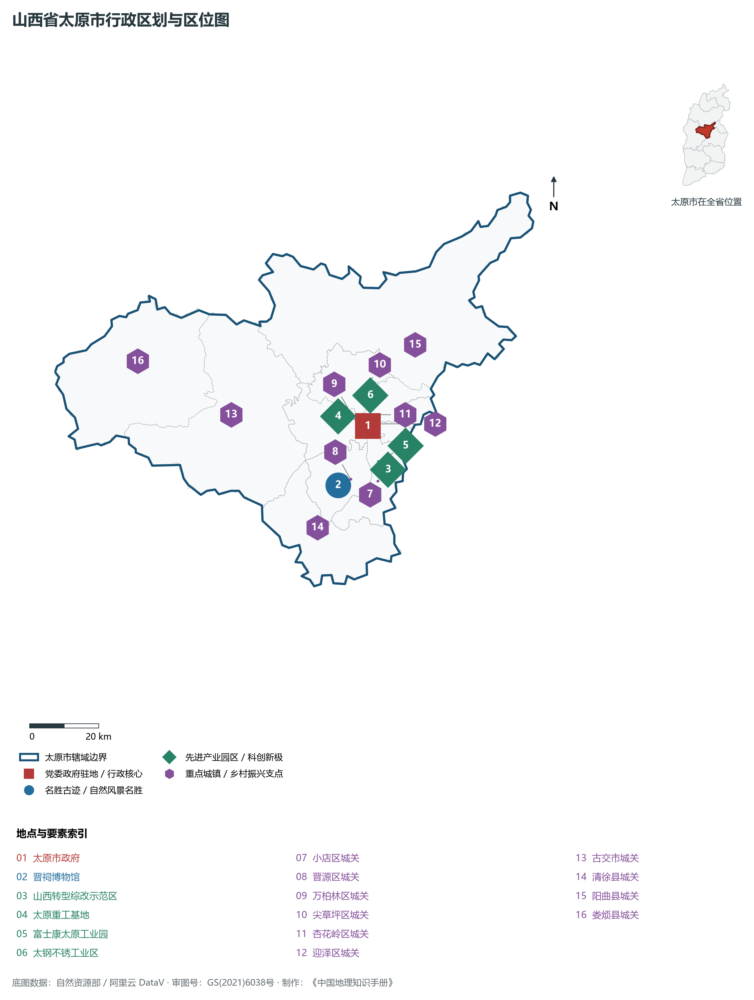
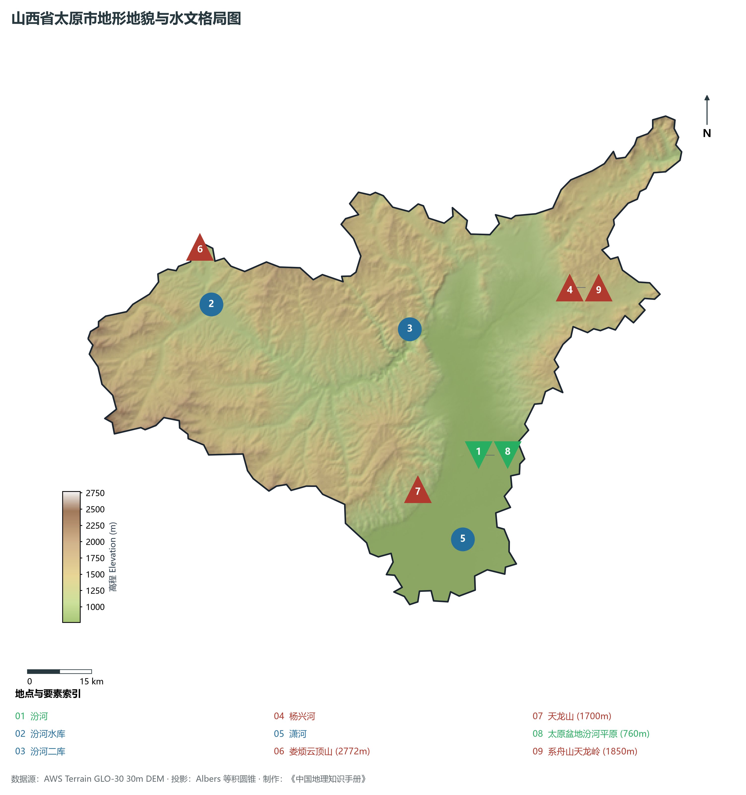
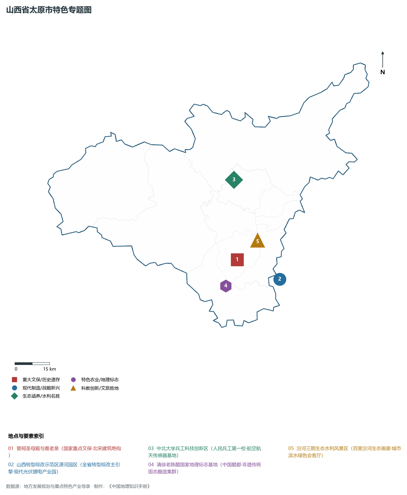
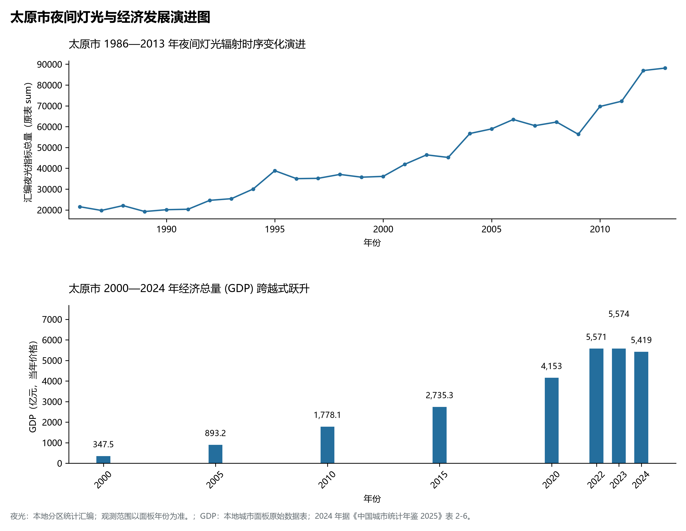
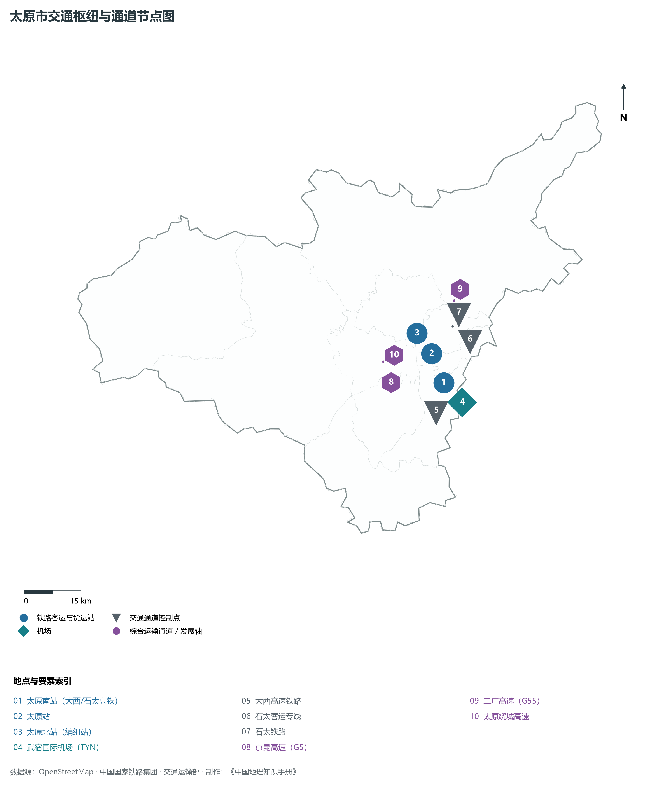

# 4.1 太原市

太原，山西省省会，全省政治、经济、科技、金融、文化和信息中心，国务院批复确定的中部地区重要中心城市、国家历史文化名城与全国重要的现代先进制造业基地。地处华北黄土高原东部、太原盆地北端，地理坐标介于东经 111°30′—113°09′、北纬 37°27′—38°25′ 之间。西依巍峨吕梁山余脉西山，东障太行支脉系舟山，北跨二龙山峡谷，南接晋中沃野平川，母亲河汾河自北向南纵贯。2024 年常住人口 **551 万人**，常住人口城镇化率 **89.67%**，地区生产总值 **5,419 亿元**（当年价格），人均地区生产总值 **98,803 元**，三次产业构成为 **0.88 : 30.76 : 68.36**。

太原古称晋阳、并州，自古享有“锦绣太原城”与“九朝龙城”之盛誉。自公元前 497 年赵简子营建晋阳古城以来，太原已有逾 2 500 年建城史。春秋末期赵国在此奠定霸业，北齐视其为“别都”，盛唐尊其为“北都”“北京”，五代十国时期后唐、后晋、后汉、北汉相继在此发端龙兴。宋太宗火烧水灌晋阳城后，潘美移筑并州新城（今太原旧城），明清时期并州商贾云集，奠定商贸重镇格局。近代以来，阎锡山在此创立西北炼钢厂（太钢前身）、西北机车厂，拉开中国内陆近代重工业先声；新中国成立后，太原汇聚全国“一五”时期 11 个重点项目，成长为全国闻名的“钢城”“重机之都”与化学工业重地；新时代以来，太原历经治山治水治气与转型综改蝶变，崛起为拥有百里汾河生态画廊、国家区域中心城市与绿色低碳先进智造极核的现代化都市。

---

## 一、市情速览

太原是三晋大地的经济极核与科教中心，集空港、高铁、国家干线铁路、高速路网与现代物流于一体。

| 核心指标 | 全市数值与空间分布 | 全国/全省定位 |
|:---|:---|:---|
| **行政区划面积** | 6 988 km² | 山地丘陵占 82.2%，平原河谷盆地占 17.8% |
| **常住人口** | 551 万人 | 2024 年，全市；年鉴公布口径 |
| **常住人口城镇化率** | 89.67% | 2024 年，全市；年鉴公布口径 |
| **人口密度** | 778 人/km² | 小店、迎泽、杏花岭等中心城区高达 5 000—9 500 人/km² |
| **地区生产总值 (GDP)** | 5,419 亿元 | 2024 年，全市；年鉴公布口径 |
| **人均 GDP** | 98,803 元/人 | 2024 年，全市；年鉴公布口径 |
| **产业三次结构** | 1.1 : 37.8 : 61.1 | 工业底盘扎实，特钢、高端装备、现代信息技术与现代服务业双轮驱动 |
| **行政架构** | 辖 6 区、3 县、代管 1 县级市 | 6 城区 (小店、迎泽、杏花岭、尖草坪、万柏林、晋源)，清徐、阳曲、娄烦 3 县，代管古交市 |
| **战略核心定位** | 国家区域中心城市与太原都市圈极核 | 国家资源型经济转型综改主引擎、太忻一体化南引擎、黄河流域生态中心 |

**图 04-01-1 山西省太原市行政区划与区位图**：图上编号与地点、要素索引对应。

---

## 二、自然地理：太原盆地、汾河纵贯与西山屏障

太原地跨黄土高原丘陵沟壑区与断陷盆地平原两大单元，地势总体呈**北高南低、西陡东和缓、中央凹陷**的簸箕状断陷构造格局。

### 1. 地形地貌：崇山阻水与汾河冲积平川
全境地貌由山地、丘陵和盆地平原三大部分组成：

- **北部与西北中山峡谷区**：主要分布于娄烦县、古交市及阳曲县西北部，山地海拔普遍在 **1 200—2 500 m** 之间。全境最高峰为娄烦县与静乐、交城交界处的**云顶山**，主峰海拔高达 **2 772.0 m**。山体由寒武奥陶系石灰岩与前寒武纪变质岩构成，山顶发育大面积亚高山草甸，森林密布，为太原北部重要水源涵养绿肺；
- **东西两翼山地丘陵带**：
  - **西山山脉**：属于吕梁山脉东翼分支，包括天龙山（1 700 m）、棋盘山、庙前山等，富含石炭二叠纪优质主焦煤与无烟煤，自古被誉为“西山煤海”；
  - **东山山脉**：系舟山南延余脉，主要由低山丘陵与黄土阶地构成，海拔 1 000—1 500 m；
- **中部汾河冲积断陷平原（太原盆地北段）**：由汾河及其支流潇河、杨兴河等长期冲洪积泥沙淤积而成，地势平坦微向南倾，海拔由北郊出山口的 **820 m** 缓缓降至清徐县南界的 **760.0 m**（全省最低平原低点之一）。盆地土层深厚，地下水富集，是太原城市建设与现代商贸集聚的核心承载区。

**图 04-01-2 山西省太原市地形地貌与水文格局图**：图上编号与地点、要素索引对应。

### 2. 气候特征：暖温带大陆性季风气候
太原深居内陆腹地，山地环抱，气候温和，四季分明，光照充足：

- **气温特征**：全域年平均气温在 **9.5—11.0 ℃** 之间，平原盆地年均温约 10.5 ℃，西北山区（娄烦、古交）较盆地偏低 3—5 ℃。冬季受蒙古干冷高压控制，盛行西北风，寒冷干燥，1 月平均气温 -5.5 ℃；夏季受副热带暖湿气流影响，7 月平均气温 23.8 ℃，昼夜温差大，夏季气候较为凉爽宜人；
- **降水分布与蒸发**：全域年均降水量约 **430—480 mm**，呈自西北向东南逐渐递增态势。太原迎风坡山地（如西山和东山迎风面）降水偏多可超 520 mm，70% 以上降水集中在 7、8、9 三个月，暴雨集中时极易引发山溪山洪暴发；年蒸发量达 1 600—1 800 mm，春季干燥多风，水资源供需矛盾较为突出。

### 3. 河流水系：母亲河汾河与引黄济晋
太原全境属于黄河流域汾河水系：

- **汾河穿城与生态画廊**：汾河由阳曲县上安入境，流经娄烦、古交穿峡而出，自北向南纵穿太原城区达 43 km，横贯尖草坪、杏花岭、万柏林、迎泽、晋源、小店六区，在清徐县西南出境注入晋中。历史上由于工业废水排放与上游截流，汾河太原段一度干涸污染；近年来太原实施百里汾河生态综合治理一、二、三、四期工程，筑起 9 级橡胶坝，形成全长数十公里的宽阔水面与万亩湿地绿岛，实现清水复流；
- **骨干水源水库**：上游建有大型控制性水利枢纽——**汾河水库**（总库容 7.2 亿 m³）与**汾河二库**（库容 1.3 亿 m³），承担着太原防洪安全屏障与工农业生态供水；
- **引黄济太工程**：万家寨引黄工程南干线将黄河水穿山越岭引入汾河水库，年引水逾 6 亿 m³，自呼延水厂输往千家万户，彻底终结了太原抽取深层地下水引发的地面沉降历史。

---

## 三、建置沿革与文化根脉

太原文化积淀深厚，龙城文化、三晋文脉与红色革命记忆深度交织。

### 1. 地名考略与建城演进

- **晋阳古城的沧桑兴衰**：公元前 497 年，晋国卿相赵简子命家臣董安于在悬瓮山麓、汾水西畔依山傍水营建晋阳城。城池坚固，战国初年智伯引汾水水淹晋阳三年不克，最终赵襄子反灭智伯，奠定赵国三百年基业；北齐高欢扩建晋阳城，称“别都”；唐朝尊晋阳为“北都”，李白赞叹其为晋阳富庶天下闻；五代十国时期，刘知远、石敬瑭、刘崇等在此相继称帝，晋阳因此被称为“潜龙之地”；
- **宋代焚城与并州新城移筑**：公元 979 年，宋太宗赵光义攻破北汉，因惧怕晋阳“龙气”再次诞生反叛割据政权，下令彻底焚毁晋阳城并引汾水、晋水冲灌古城遗址；三年后（公元 982 年），命大将潘美在晋阳城以北三十里唐代行宫基础上修筑并州新城，后明代重臣谢成扩筑太原府城，奠定了现代太原市中心旧城区格局；
- **现代省会确立**：1927 年设太原市，新中国成立后太原成为山西省省会，城市空间由老城区向南、向汾河两岸磅礴扩张。

### 2. 晋祠博物馆与周柏唐碑宋塑
位于悬瓮山麓晋水发源处的**晋祠**，是中国现存最早的皇家祭祀园林，为纪念晋国开国诸侯叔虞而建。

- **宋代圣母殿与泥塑彩绘**：建于北宋天圣年间（1023—1032年），重檐歇山顶，进深宽博，前廊八根立柱缠绕八条怒目蟠龙，是我国现存最早的木雕盘龙柱；殿内供奉的 43 尊宋代侍女彩塑，神态生动各异，衣纹流畅，被誉为中国古代泥塑艺术的巅峰极品；
- **难老泉与三晋名泉**：晋水主源难老泉水常年水温保持 17 ℃，长流不息，“时时出向城西望，晋祠流水如碧玉”；
- **周柏与唐太宗手书碑**：晋祠内周代古柏苍劲古朴树龄逾三千年；唐太宗李世民亲撰并手书的《晋祠之铭并序》碑，开创了中国行书刻碑之先河。

### 3. 红色印记与革命星火
太原是华北重要的工人运动策源地与抗战指挥中枢。1924 年中共太原支部成立，高君宇在此播撒马克思主义火种；抗日战争全面爆发后，周恩来、朱德、彭德怀在此与阎锡山谈判，建立第二战区民族革命统一战线，八路军驻晋办事处在太原设立；解放战争时期，太原战役历经 6 个月浴血鏖战，人民解放军最终攻克全副现代化武装工事防守的太原要塞，迎来了三晋大地的彻底解放。

**图 04-01-4 山西省太原市特色专题图**：图上编号与地点、要素索引对应。

---

## 四、经济地理：特种不锈钢、高端装备与数字算力

太原坚定破除“一煤独大”的传统结构，加速构建高端装备制造、特种金属材料、新一代信息技术与现代服务业协同驱动的现代化产业集群。

### 1. 太钢不锈：“手撕钢”引领世界材料巅峰

- **全球最大不锈钢领军基地**：中国宝武太钢集团拥有年产千万吨级特种钢材能力，是全球规模最大、工艺技术装备最先进的不锈钢研发生产中心；
- **尖端产品打破国际垄断**：成功研发出厚度仅 **0.015 mm**、宽度 600 mm 的精密箔材（俗称“手撕钢”），广泛应用于航空航天、折叠屏高端手机柔性传感器；自主攻克笔尖钢、高铁轮轴钢、核电用不锈钢管与超低温 LNG 储罐厚板，彻底打破西方少数国家的长期技术封锁。

### 2. 重型机械装备与新能源制造

- **大国重器基地太重集团**：中国最大的重型机械制造企业之一，自主研制出 75 立方米特大型矿用挖掘机、500 吨桥式起重机及世界领先的风电增速齿轮箱，产品出口数十个国家和地区；
- **富士康太原科技工业园**：全球顶尖的精密模具、智能手机零部件制造基地，常年带动数万人高端制造就业；
- **现代生物酿造与中国醋都**：清徐县为“中国老陈醋之都”，拥有紫林醋业、水塔醋业等国家龙头，老陈醋年产量占全国六分之一，古法固态发酵非遗技艺走向全球。

### 3. 山西转型综改示范区与数字创新极核

- **全省转型综改“主引擎”**：横跨太原、晋中两市交界，重点布局潇河现代产业园、学府新兴产业园、唐槐电子信息园，聚集了晶科能源 56GW 垂直一体化超级大基地、中电科半导体芯片材料等数百亿级战略性新兴产业项目；
- **信息技术自主创新走廊**：依托百信科技、长城计算机与华为（太原）软件学院，构建起从信创整机、操作系统到安全软件的全链条自主可控生态体系。

**图 04-01-5 太原市夜间灯光与经济发展演进图**：各面板按标注的观测年份、指标和单位列示。

---

## 五、交通网络与区域枢纽

太原自古为中原通达西北之门户，当代是中国铁道网与高速路网中的重要枢纽节点。

### 1. 骨干铁路与高速铁路客运大枢纽

- **大西客运专线（大同至西安）**：南北贯通全境，太原南站为特大型现代化高铁枢纽，拥有 10 台 22 线，日均开行动车组近 200 对，实现 1 小时直达忻州、晋中，2 小时通达大同、临汾、运城；
- **石太客运专线与石太铁路**：向东穿越太行山井陉峡谷，是太原直达石家庄与首都北京的高铁生命线，实现 2.5 小时直通北京西站；
- **郑太高铁**：向南穿越太行太岳，实现 2 小时直达郑州，深度拥抱中原城市群；
- **太中银铁路**：向西穿越吕梁山直达陕西延安、宁夏银川，连通广袤西北大后方。

### 2. 国家干线高速公路网络
二广高速（G55）、京昆高速（G5）、青银高速（G20）在太原形成复合交汇，配合太原绕城高速（G2003）及太原西北二环高速，形成环形放射状公路大动脉。

### 3. 空港与轨道交通立体网络

- **太原武宿国际机场（TYN）**：4E 级民用国际机场，年旅客吞吐量峰值超 1 350 万人次，三期改扩建工程建设全新的 T3 航站楼与第二跑道，设计年旅客吞吐能力 3 000 万人次，定位为区域枢纽机场与国际航空口岸；
- **太原城市轨道交通**：太原地铁 2 号线（贯穿尖草坪、杏花岭、迎泽、小店）已成熟运营，1 号线（串联客运西站、太原站、太原南站与武宿机场）实现空铁轨道交通无缝接驳。

**图 04-01-3 太原市交通枢纽与通道节点图**：图上编号与地点、要素索引对应。

---

## 六、未来展望：太原都市圈建设与国家区域中心城市跨越

在新时代发展起点上，太原全面提升城市能级与核心竞争力，坚定迈向具有国际影响力的国家区域中心城市：

1. **做强做大太原都市圈核心极核**：
   - 深入推进“太忻一体化经济区”向北连通忻州，深度融入京津冀协同发展与雄安新区供应链；加速“太原晋中同城化”向南拓展，推进大学城、潇河新城基础设施无缝并轨与公共服务一体化；
2. **挺起先进制造业转型脊梁**：
   - 聚焦特种不锈钢、碳基新材料、新能源汽车、现代氢能装备与半导体核心芯片，构建千亿级战略性新兴产业集群，推动传统“资源型工业基地”向“先进智造创新高地”跨越；
3. **厚植“锦绣太原城”生态与文旅底色**：
   - 持续深化汾河百里画廊生态保育与东西两山万亩生态园绿化，构筑国家生态园林城市；统筹晋阳古城国家考古遗址公园、天龙山石窟保护与古县城活化，全力绘就新时代“锦绣太原城”的盛世繁华。

2024 年统计来源：《中国城市统计年鉴 2025》表 2-1、2-6、2-7（2024 年，全市）。其他年份 GDP 据本地城市面板“原始数据”表，单位为亿元、当年价格。
