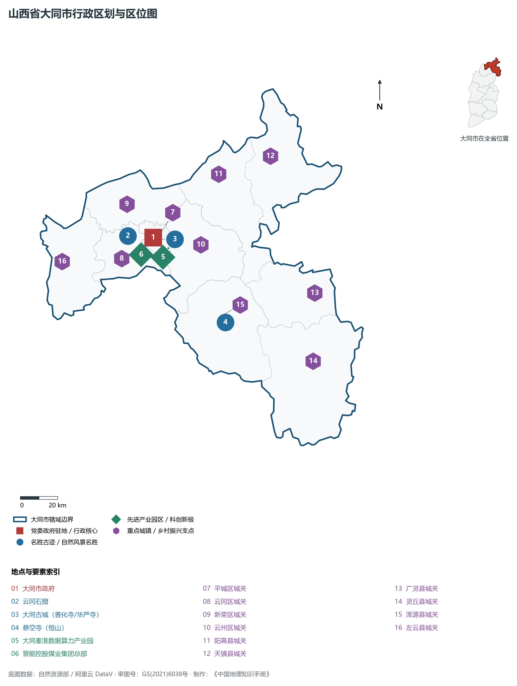
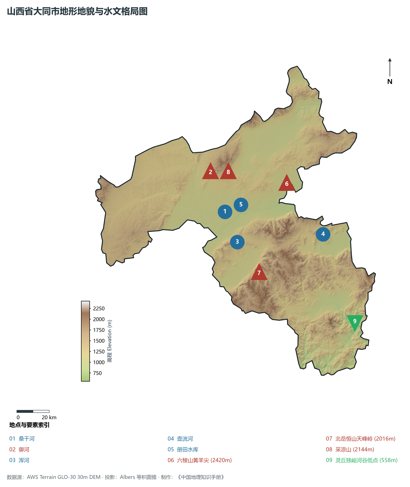
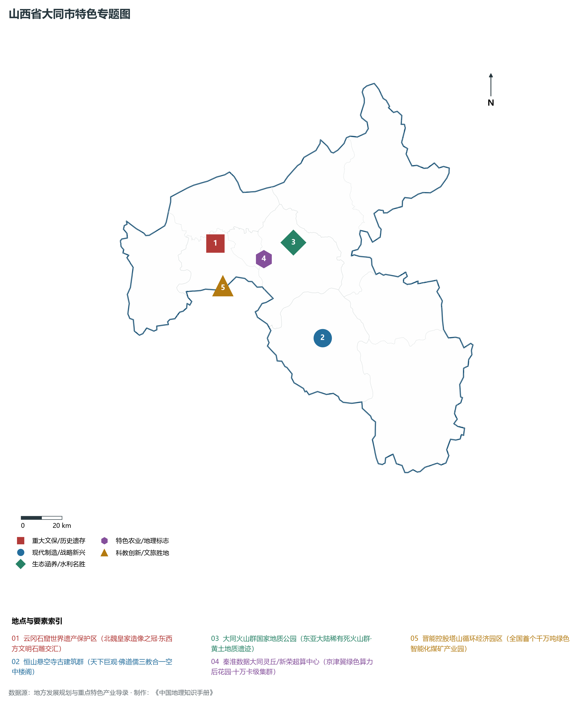
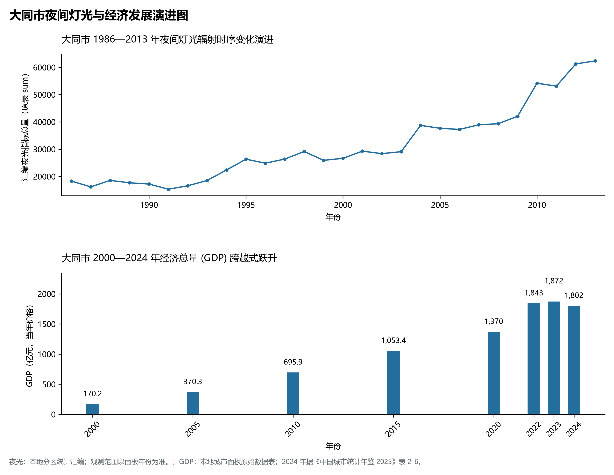
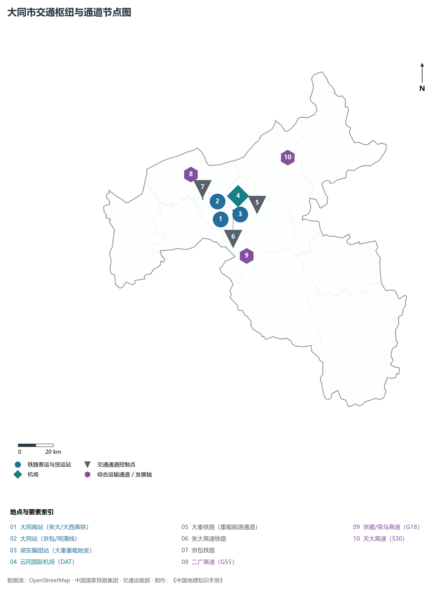

# 4.2 大同市

大同，山西省省域副中心城市，国务院批复确定的中国晋冀蒙交界地区中心城市、国家历史文化名城与全国重要的综合能源保供基地。地处华北北部、大同盆地东北核心区，地理坐标介于东经 112°34′—114°33′、北纬 39°43′—40°44′ 之间。东扼内外长城之险，西接晋北雁门之关，北屏内蒙古高原，南控桑干河谷大通道，素有“北方锁钥”与“三晋门户”之称。2024 年常住人口 **305 万人**，常住人口城镇化率 **75.33%**，地区生产总值 **1,802 亿元**（当年价格），人均地区生产总值 **58,813 元**，三次产业构成为 **6.65 : 33.87 : 59.48**。

大同是一座浸透着游牧文明与农耕文明深度交融印记的千年古都，享有“北魏帝都、辽金陪都、明清重镇”的辉煌历史声誉。公元 398 年，鲜卑拓跋珪建都平城，北魏在此定都达 97 年，开创了东西方文明大汇聚、丝绸之路向东延伸的宏阔气象，武周山崖壁上雕凿的**云冈石窟**被誉为世界石雕艺术的绝世瑰宝；辽金时期，大同升为“西京陪都”，华严寺、善化寺留下辽代木构与辽金彩塑珍品；明代大同成为“九边重镇”之首，修筑坚固的砖包城墙与七十二城堡。新中国成立后，大同因蕴藏极其丰富的侏罗纪、石炭二叠纪优质动力煤而闻名遐迩，被誉为“中国煤都”；大秦铁路自此始发，累计向全国输送电煤数十亿吨；进入新时代，大同实现由“煤都”向“算都”“新能源之都”的历史性蜕变，崛起为京津冀绿色算力枢纽与文旅古都名城。

---

## 一、市情速览

大同是晋冀蒙交汇处的区域经济枢纽，拥有集高铁、航空、重载铁路与高速公路于一体的塞北立体交通网络。

| 核心指标 | 全市数值与空间分布 | 全国/全省定位 |
|:---|:---|:---|
| **行政区划面积** | 14 176 km² | 山地占 49.2%，丘陵占 31.7%，盆地平原占 19.1% |
| **常住人口** | 305 万人 | 2024 年，全市；年鉴公布口径 |
| **常住人口城镇化率** | 75.33% | 2024 年，全市；年鉴公布口径 |
| **人口密度** | 219 人/km² | 平城区高达 3 500—4 800 人/km²，灵丘、广灵等冀晋交界山区约 100—140 人/km² |
| **地区生产总值 (GDP)** | 1,802 亿元 | 2024 年，全市；年鉴公布口径 |
| **人均 GDP** | 58,813 元/人 | 2024 年，全市；年鉴公布口径 |
| **产业三次结构** | 6.2 : 41.5 : 52.3 | 能源原材料筑底，绿色算力、现代装备制造与文旅大康养三足鼎立 |
| **行政架构** | 辖 4 区、6 县 | 4 区 (平城、云冈、新荣、云州)，6 县 (阳高、天镇、广灵、灵丘、浑源、左云) |
| **战略核心定位** | 省域副中心城市与晋冀蒙协同枢纽 | 国家绿色能源与算力示范基地、京津冀绿色农产品输出地、世界级历史文旅古都 |

**图 04-02-1 山西省大同市行政区划与区位图**：图上编号与地点、要素索引对应。

---

## 二、自然地理：大同盆地、桑干横贯与火山遗迹

大同全境跨越阴山余脉、太行山北段与恒山山脉，地处大同断陷盆地核心，地貌形态复杂多样，总体地势**西北与东南两侧高、中央盆地低平**。

### 1. 地形地貌：群峰屏峙与盆地火山
全境地貌由山地、盆地平原与第四纪火山群构成：

- **四周环绕山地屏障**：
  - **北部阴山余脉采凉山**：横亘于平城、新荣与阳高之间，主峰海拔 **2 144 m**，由古老花岗岩构成，山顶平坦多积雪，自古有“采凉积雪”之景；
  - **东南六棱山与太行北支**：阳高、广灵、灵丘境内的六棱山拔地而起，主峰**黄羊尖**海拔高达 **2 420.0 m**，为大同市最高峰，山势峭拔，林海苍茫；
  - **南部北岳恒山**：横亘于浑源县境内，主峰天峰岭海拔 **2 016.1 m**，由厚层奥陶系石灰岩构成，危峰错峙，金龙峡悬崖绝壁夹峙，悬空寺凌空筑于绝壁腰际；
  - **最低河谷出口**：灵丘县独峪河出境处，海拔降至 **558.0 m**，全境最大垂直落差达 **1 862.0 m**；
- **中部大同冲积湖积盆地**：
  - 面积达 4 000 km²，平均海拔 950—1 050 m。受新构造断裂下陷影响，地表接受巨厚第四系松散沉积物与桑干河水系冲积，土质肥沃，为塞北最重要的粮糖产区；
- **大同火山群国家地质公园**：
  - 分布于云州区聚乐堡至昊天寺一带，发育有金山、狼窝山、黑山等 30 余座保存完好的第四纪死火山锥。火山口呈圆锥形、马蹄形，喷溢熔岩形成的熔岩被与黄土层交织，是东亚大陆最为典型稀有的板内黄土地貌火山遗迹。

**图 04-02-2 山西省大同市地形地貌与水文格局图**：图上编号与地点、要素索引对应。

### 2. 气候特征：温带大陆性半干旱季风气候
大同地处中温带半干旱区，塞外高海拔导致气温偏低、温差大、日照充足：

- **气温特征**：全域年平均气温仅为 **5.5—7.5 ℃**，是全省气候最为凉爽的城市之一。冬季漫长寒冷，常受来自西伯利亚的极地大陆气团袭击，1 月平均气温低至 -10.5 ℃，极端最低温曾跌破 -30 ℃；夏季短促温和，7 月平均气温仅 21.8 ℃，昼夜温差常超 12 ℃，无酷暑炎热，被誉为天然“避暑胜地”；这种常年冷凉干燥的气候条件，使其成为建设超大型绿色算力数据中心的绝佳“天然冷库”；
- **降水与风能资源**：年均降水量仅 **380—440 mm**，呈自东南向西北递减趋势，主要集中在 7、8 月；全境年日照时数长达 2 800—3 000 小时，大风天数多，风能与太阳能辐射强度位居全国前列，具备发展千万千瓦级大型风电光伏基地的得天独厚禀赋。

### 3. 河流水系：桑干河生命之轴与册田水库
大同全境主要属于海河流域永定河水系（东南小部属于海河大清河水系）：

- **桑干河（大同母亲河）**：由恢河与源子河在朔州境内汇流而成，自西向东横穿大同盆地，在云州区汇纳御河、浑河、壶流河等支流，经阳高、阳原流入官厅水库，境内干流长逾 120 km，为首都北京永定河最重要的上游生态涵养源头；
- **御河**：纵穿大同市区中心，自北向南将大同古城与御东新区天然界开，近年来实施全线水环境治理与生态绿道建设，重现一泓碧水环古都；
- **册田水库（塞外明珠）**：位于云州区与阳高县交界处，总库容 **5.8 亿 m³**，是大同最大的人工蓄水工程，常年承担着向北京永定河实施生态补水的重大政治任务。

---

## 三、建置沿革与文化根脉

大同是多元民族融合与世界宗教艺术交汇的璀璨之都，遗存有密度极高的北魏、辽金与明代物质文化瑰宝。

### 1. 从鲜卑拓跋平城到辽金西京

- **北魏平城建都与丝路繁荣**：西汉置平城县。公元 398 年北魏拓跋珪自内蒙古盛乐迁都平城，在此营建太极殿、天华殿等皇家宫阙，设立太学，融汇西域胡风与中原典章。平城成为当时丝绸之路东端的国际化大都会，波斯萨珊王朝玻璃器、中亚胡人商队在此络绎不绝；
- **辽金西京与明代重镇**：五代时期石敬瑭将燕云十六州割让契丹，辽在此设西京大同府，修筑上华严寺与下华严寺；女真建立金朝后沿袭为西京，营建善化寺大雄宝殿与三圣殿；明洪武年间大将军徐达在此督筑大同城垣，周长 7.24 km，高 14 m，角楼控扼，成为塞外明长城“九边之冠”。

### 2. 世界文化遗产云冈石窟
位于大同城西武周山南麓的**云冈石窟**，由北魏高僧昙曜奉旨于公元 460 年主持开凿。

- **东西方石雕艺术的绝世巅峰**：现存主要洞窟 45 个，造像 5.9 万余尊。早期开凿的“昙曜五窟”（第16至20窟）气势雄伟磅礴，主佛高达 13—17 m，面容丰满深目高鼻，既蕴含古印度犍陀罗艺术与笈多风格，又流淌着鲜卑拓跋骑兵的豪迈雄浑气魄；中期洞窟（第9至13窟）汉化特征明显，转为褒衣博带、秀骨清象；晚期洞窟小巧繁复，开创了北魏龙门石窟汉式造像之先河；2001 年被联合国教科文组织列入《世界文化遗产名录》。

### 3. 辽金古建珍品：华严寺与悬空寺

- **大同华严寺**：依辽代契丹族“日出东方、以东为尊”的传统坐西朝东修建。大雄宝殿面阔九间，进深五间，单檐庑殿顶，是我国现存古代木结构中面积最大的佛殿之一；薄伽教藏殿内遗存有“合掌露齿菩萨”彩塑，神态娴雅脱俗，被郑振铎先生赞为“东方维纳斯”；
- **恒山悬空寺**：始建于北魏后期，悬挂于北岳恒山金龙峡西峰翠屏峰的悬崖峭壁之上，距谷底近 50 m。全寺依崖借势，由木桩横梁深嵌岩石、立木支撑，错落排列楼阁殿宇 40 余间，巧夺天工，被金庸先生誉为“危楼高百尺、手可摘星辰”的天下奇观。

**图 04-02-4 山西省大同市特色专题图**：图上编号与地点、要素索引对应。

---

## 四、经济地理：绿色算力大底座、新能源与现代煤化工

大同正全面告别“一煤独大”的历史包袱，全力实施“融入京津冀、打造桥头堡”战略，构建多极支撑的高质量现代产业矩阵。

### 1. “东数西算”京津冀绿色算力枢纽后花园
大同充分将高寒干燥气候、充沛绿色电力、低地震风险与距北京仅 300 km 的区位优势转化为算力优势：

- **超大规模算力基地集群**：引育秦淮数据、中联数据、京东智算、抖音超算等头部数据企业，建成灵丘环首都数据产业园、新荣算力园区与平城数字经济产业园；
- **算力能级跻身全国前列**：累计投入运营服务器超百万台，算力规模突破 **10 000 PFlops**，超 80% 的算力直接服务于北京国家人工智能、大模型训练与自动驾驶应用，实现由“输煤电”向“输算力、输数据”的历史性跃迁。

### 2. 晋能控股与重载煤炭保供基石

- **晋能控股煤业集团总部所在地**：依托塔山、同忻等特大型智能化示范矿井，全域煤炭先进产能占比超 90%，原煤年产量稳定在 **1.5 亿吨** 以上；
- **循环经济标杆园区**：塔山煤矿构筑了“煤—电—热—建材—氧化铝—高岭土”循环产业链，煤矸石用于坑口电厂发电，粉煤灰制成新型环保建材，走出了一条资源高价值全利用的绿色开采新路。

### 3. 千万千瓦级新能源与现代制造基地

- **风光储氢多能互补示范区**：利用采煤沉陷区与荒山秃岭建设大同采煤沉陷区国家先进技术光伏示范基地，新能源装机总量突破 **1 000 万 kW**；浑源抽水蓄能电站（装机 150 万 kW）加快建设；
- **高端装备与医药健康**：中车大同电力机车公司自主研发先进电力机车与氢燃料混合动力机车；大同黄花成为全域乡村振兴地理标志黄金产业，种植面积超 26 万亩。

**图 04-02-5 大同市夜间灯光与经济发展演进图**：各面板按标注的观测年份、指标和单位列示。

---

## 五、交通网络与区域枢纽

大同自古为晋、冀、蒙三省区交界的交通枢纽，更是国家能源西煤东运的核心策源地。

### 1. 大秦铁路：世界重载货运第一通道

- **年运量超 4 亿吨的国家经济主动脉**：大秦铁路自大同湖东编组站始发，全线采用双线电气化与重载微机联锁系统，两万吨级超长重载列车常态化平稳运行，日均开行重载列车超 90 列，保障了全国沿海电厂六成以上的电煤供给，创造了全球重载货运单线运量的最高世界纪录。

### 2. “米”字型高速铁路骨干网络

- **张大高铁与张呼高铁联络线**：自大同南站出发经阳高、天镇直达张家口，接入京张高铁，实现大同 1 小时 40 分钟直抵北京清河站，全面融入首都“2 小时高铁经济圈”；
- **大西高铁（大同至原平段/太原段）**：向南贯通忻州、太原直达西安，实现全省南北中心城市 2 小时高铁互联；
- **集大原高铁**：北连内蒙古乌兰察布（集宁），南接大同、原平，贯通呼包鄂榆与中原腹地的客运大动脉。

### 3. 国家干线公路与航空枢纽
二广高速（G55）、荣乌高速（G18）、天大高速（S30）与孙右高速构筑起四通八达的公路网络；**大同云冈国际机场（DAT）**为 4C 级民用国际机场，航线直通全国主要枢纽城市。

**图 04-02-3 大同市交通枢纽与通道节点图**：图上编号与地点、要素索引对应。

---

## 六、未来展望：融入京津冀协同发展与世界文化名城建设

站在迈向现代化的新征程上，大同紧扣“融入京津冀协同发展桥头堡”战略定位，坚定推动高水平开放与高质量跨越：

1. **构筑京津冀协同发展桥头堡**：
   - 深度承接北京非首都功能疏解与产业转移，强化与张家口、乌兰察布城际协作，在绿色算力、新能源装备、冰雪文旅与特色农产品领域构建深度互补的京晋产业共赢圈；
2. **建设全亚洲领先的“绿色算力之都”**：
   - 加快推进源网荷储一体化试点，推动算力数据中心 100% 绿电消纳，加快算力调度网络与人工智能应用场景落地，打造以数字新质生产力为支撑的现代产业新名片；
3. **擦亮“世界古都·文旅大同”金字招牌**：
   - 深入实施大同古城整体文保活化与云冈石窟学术研究保护工程，联动恒山悬空寺、大同火山群与平型关战役遗址，打造世界级文化旅游与生态康养度假目的地。

2024 年统计来源：《中国城市统计年鉴 2025》表 2-1、2-6、2-7（2024 年，全市）。其他年份 GDP 据本地城市面板“原始数据”表，单位为亿元、当年价格。
