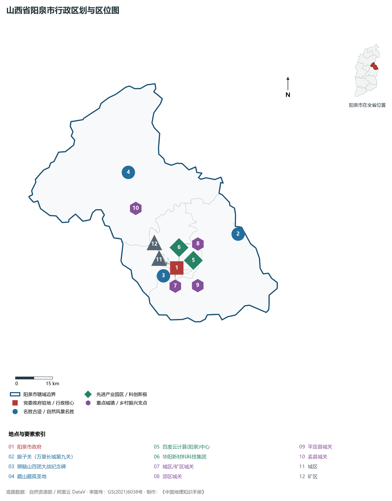
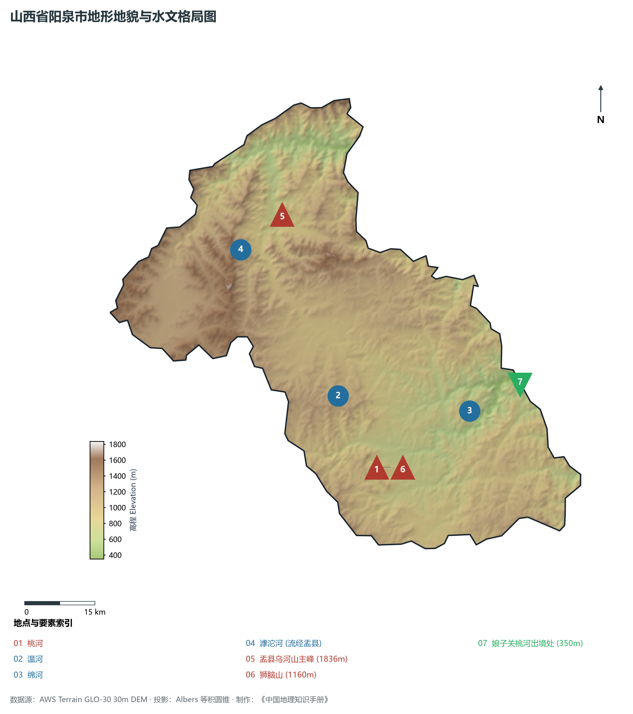
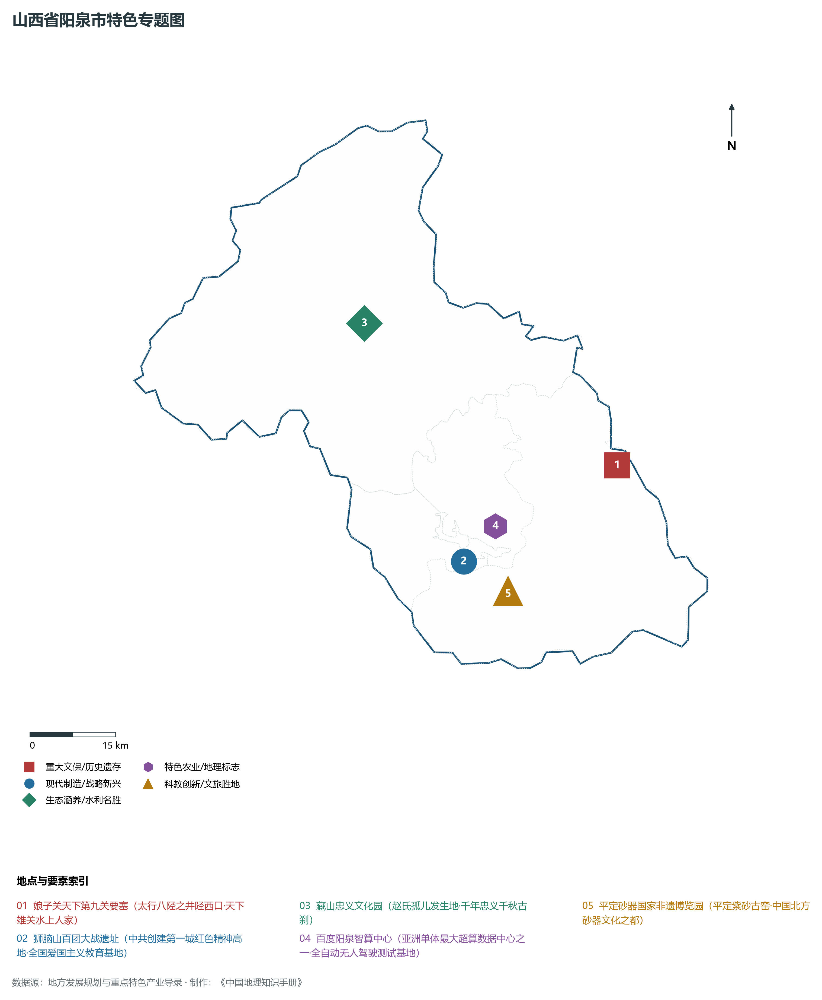
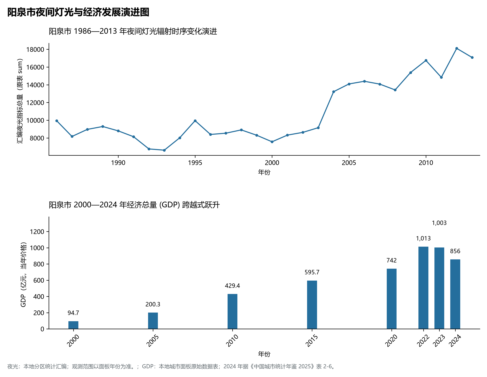
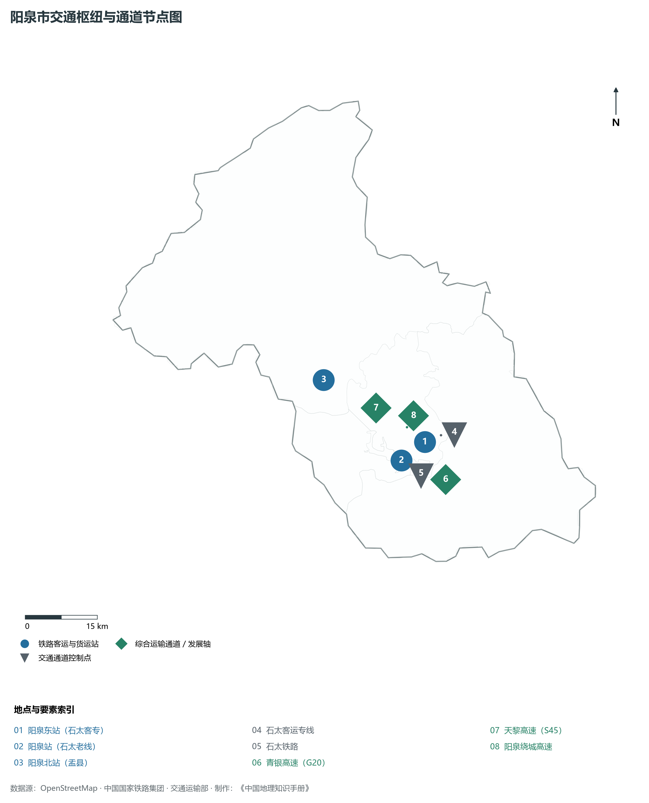

# 4.3 阳泉市

阳泉，山西省地级市，中国共产党亲手创建的第一座人民城市，国家新型工业化产业示范基地与晋东区域中心城市。地处华北黄土高原东翼、太行山中段西麓，地理坐标介于东经 113°10′—114°08′、北纬 37°40′—38°31′ 之间。东扼“天下第九关”娘子关天堑与河北省井陉县为邻，西接并州太原与晋中盆地，南连昔阳大寨，北临滹沱河与忻州交界。2024 年常住人口 **128 万人**，常住人口城镇化率 **73.92%**，地区生产总值 **856 亿元**（当年价格），人均地区生产总值 **66,274 元**，三次产业构成为 **2.02 : 44.44 : 53.54**。

阳泉是一座在烽火岁月与近代工业浪潮中崛起的英雄城市。春秋时期，赵氏孤儿赵武在此避难藏匿，“藏山”由此得名并成为中华忠义文化的精神地标；隋唐时期，平阳公主率领“娘子军”在此镇守苇泽关，后人感念其巾帼英烈改称“娘子关”；1907 年正太铁路通车并在此设站，阳泉煤铁手工业迅速转向近代机械化开采；1940 年抗日战争相持阶段，彭德怀指挥八路军在狮脑山等太行关隘打响名震中外的“百团大战”；1947 年 5 月阳泉解放，中共冀晋区党委批准设立“阳泉市”，成为党在夺取全国政权前夕亲手创建并全面自主领导管理的第一座新型工业城市。当代阳泉，依托充沛优质的无烟煤资源成长为国家重要的无烟煤和铝矾土基地；进入新时代，阳泉坚定实施工业强市与数智赋能战略，百度云计算中心、华阳钠离子电池新材料与智能网联车城网加速落地，实现由传统“煤炭之都”向“数智新城”与“新材料基地”的深刻蝶变。

---

## 一、市情速览

阳泉地处太行山前沿隆起带，是石太发展轴线上关键的枢纽节点。

| 核心指标 | 全市数值与空间分布 | 全国/全省定位 |
|:---|:---|:---|
| **行政区划面积** | 4 559 km² | 山地占 60.5%，丘陵占 31.2%，山间小盆地与河谷占 8.3% |
| **常住人口** | 128 万人 | 2024 年，全市；年鉴公布口径 |
| **常住人口城镇化率** | 73.92% | 2024 年，全市；年鉴公布口径 |
| **人口密度** | 287 人/km² | 核心城区人口密度超 2 600 人/km²，盂县北部山区约 80—110 人/km² |
| **地区生产总值 (GDP)** | 856 亿元 | 2024 年，全市；年鉴公布口径 |
| **人均 GDP** | 66,274 元/人 | 2024 年，全市；年鉴公布口径 |
| **产业三次结构** | 2.8 : 46.2 : 51.0 | 传统无烟煤、耐火材料升级，现代信息技术与智能网联服务业破茧成蝶 |
| **行政架构** | 辖 3 区、2 县 | 城区、矿区、郊区 3 个市辖区，平定县、盂县 2 县；市政府驻城区南大街 |
| **战略核心定位** | 中共第一城与数智转型示范新城 | 国家级无烟煤与铝矾土基地、晋东先进新材料基地、京津冀绿色算力前哨 |

**图 04-03-1 山西省阳泉市行政区划与区位图**：图上编号与地点、要素索引对应。

---

## 二、自然地理：太行西坡、峡谷深切与地貌极差

阳泉全境地处太行山脉主脊西侧的斜坡隆起地带，地势**西北高、东南低**，山峦起伏，沟壑纵横，属于典型的山地侵蚀剥蚀地貌。

### 1. 地形地貌：崇山阻隔与峡谷泉流
全境由三大地貌单元组合而成：

- **北部中山与深切割山地区（盂县北部）**：分布于盂县与忻州、河北平山接壤带，海拔普遍在 **1 200—1 800 m** 之间。全境最高峰为位于盂县西北部的**乌河山主峰（北坪梁）**，海拔高达 **1 836.0 m**，峰峦叠嶂，植被茂密，基岩主要为古老变质岩与太古代结晶片麻岩；
- **中部低山丘陵与黄土梁峁带**：海拔 700—1 200 m，主要为石炭二叠纪煤系地层和三叠纪砂岩构成的低山，黄土覆盖深厚，侵蚀剧烈；狮脑山（海拔 1 160 m）扼守市区南部，地势险要，成为俯瞰阳泉盆地与正太铁路的天然屏障；
- **东部断陷峡谷与最低出口（娘子关峡谷）**：桃河、绵河在此切穿太行山巨厚寒武奥陶纪石灰岩岩溶地层，形成深达数百米的险峻峡谷。全境最低点位于娘子关村桃河、绵河汇合出省处，海拔仅为 **350.0 m**。全境最大垂直落差达 **1 486.0 m**，形成了强烈的山地气候与植被垂直梯度。

**图 04-03-2 山西省阳泉市地形地貌与水文格局图**：图上编号与地点、要素索引对应。

### 2. 气候特征：暖温带半湿润大陆性季风气候
阳泉地处太行山迎风坡与背风坡交界过渡带，季风气候鲜明，光热充足：

- **气温特征**：全域年平均气温在 **8.7—11.5 ℃** 之间，市区河谷盆地年均温约 11.0 ℃，北部盂县山区年均温仅 8.5—9.0 ℃。冬季寒冷干燥，1 月平均气温 -4.2 ℃；夏季温热多雨，7 月平均气温 23.5 ℃，昼夜温差大；
- **降水时空特征**：全域年平均降水量约 **450—550 mm**，太行山东坡山地受夏季偏东暖湿气流遇山阻挡剧烈抬升影响，易触发局地特大山洪暴雨（如平定东部娘子关附近年降水可超 600 mm）；70% 以上降水量集中在 6、7、8 三个月，年蒸发量达 1 700 mm，冬春季节多干燥大风。

### 3. 河流水系：海河流域子牙河水系与娘子关大泉
阳泉全境水系完全属于海河流域子牙河水系：

- **骨干河流：桃河与温河**：
  - **桃河**：阳泉市区的母亲河，源于寿阳县，向东穿经市区核心段，在平定县与温河交汇注入绵河，全长 80 余公里；近年来太原阳泉协同实施全流域生态清淤与“清水入城”景观改造，形成十里生态河道公园；
  - **温河**：源于寿阳北部，流经盂县、平定汇入绵河；
  - **绵河与滹沱河**：绵河穿娘子关峡谷流入河北井陉，与冶河汇合；滹沱河则切穿盂县西北部边界，形成秀丽的高山峡谷湿地；
- **北方最大岩溶泉：娘子关泉群**：
  - 娘子关泉是由太行山巨厚奥陶系石灰岩深层地下喀斯特溶洞水汇聚而成的天然承压自流大泉，常年平均出水流量达 **10—12 m³/s**，水质甘冽清澈。泉水自半山腰悬崖峭壁倾泻而下，形成壮丽的娘子关瀑布，素有“水上人家”与“塞上小江南”的美称，更是引娘入并、保障阳泉工农业城市供水的生命泉源。

---

## 三、建置沿革与文化根脉

阳泉是红色精神沃土与中华传统忠义文化的交相辉映之地。

### 1. 中共创建的第一座城市
1947 年 5 月 2 日，晋察冀军区与晋冀鲁豫军区部队协同发起正太战役，一举攻克工矿要塞阳泉镇。为巩固解放区工业命脉、探索党领导管理现代大中城市的执政经验，1947 年 5 月 4 日，中共冀晋区党委、行署决定设立阳泉市（初期为县级市），直接归冀晋行署管辖。
党在阳泉接管了保晋矿务公司、铁厂与铁路设施，建立起新型工矿民主管理体制，保障了华北野战军的大宗煤炭、军工铁件与炸药供给。1949 年毛泽东进京赶考前夕，阳泉的工矿城市管理经验被广泛推广，成为中国共产党由农村转向城市执政的光辉起点。

### 2. 娘子关天下第九关与巾帼传奇
位于平定县东部晋冀咽喉要道上的**娘子关**（古称苇泽关），地处太行八陉之第五陉——井陉西口。

- **万里长城第九关**：关城依山傍水，城楼高耸，下临百仞绝壁与奔腾绵河，“一夫当关，万夫莫开”；
- **娘子军抗暴驻防**：隋唐交替之际，唐高祖李渊第三女平阳昭公主统领由各路豪杰组成的数万人“娘子军”驻守此关，严防窦建德、刘黑闼等割据势力西犯关中，威震关东。后人为纪念这位中国封建历史上唯一以军礼下葬的巾帼英雄，将苇泽关正式定名为“娘子关”；
- **民俗奇观“水上人家”**：娘子关泉水自泉眼喷涌，穿街过户，村民家家流水、户户石桥，水磨水碾飞旋，展现出北方罕见的江南水乡韵味。

### 3. 百团大战主战场狮脑山与藏山赵孤传说

- **百团大战狮脑山战斗**：1940 年 8 月，八路军副总司令彭德怀、副参谋长左权指挥发起破袭正太铁路的“百团大战”。八路军一二九师三八五旅在狮脑山阵地血战七昼夜，顶住了日军数十次步炮空协同狂暴进攻，牢牢扼死正太路交通咽喉，为百团大战第一阶段全面胜利立下头功。如今狮脑山顶巍然屹立着百团大战纪念馆与纪念碑，成为全国重点爱国主义教育基地；
- **藏山忠义古刹**：位于盂县城北 18 公里处的藏山，相传春秋时期晋国大夫屠岸贾灭绝赵氏九族，门客程婴身背赵氏孤儿赵武潜逃匿藏于此山深谷洞窟十五载，最终报仇复立。藏山因此成为中华传统忠义舍生取义精神的发祥地。

**图 04-03-4 山西省阳泉市特色专题图**：图上编号与地点、要素索引对应。

---

## 三、经济地理：新材料先导、数字算力前哨与绿色智造

阳泉立足坚实工业底盘，全面推进“数智双碳”协同转型，传统无烟煤优势正在向钠电新材料、节能环保材料与超大规模算力全速跃迁。

### 1. 华阳新材料与高端功能性材料矩阵

- **全国最大无烟煤生产基地转型典范**：华阳新材料科技集团（前身为世界 500 强阳煤集团）坚定破除原煤依赖，全面向新能源新材料战略新兴产业进军；
- **全产业链布局钠离子电池**：成功构建起全国首条万吨级钠离子电池正负极材料、电芯与 Pack 储能电池全链条生产线，产品应用于新能源储能电站与低速轻型两轮车；
- **气凝胶与气凝胶绝热材料**：打造国内规模领先的气凝胶隔热阻热新材料生产基地，广泛装备于国家深海油管、新能源汽车动力电池隔热阻燃防护；
- **平定耐火材料与紫砂古都**：平定县富含铝土矿与高岭土，耐火耐磨材料产量占全国重要份额；“平定砂器”为国家级非物质文化遗产，历经千年薪火相传，正在向现代日用陶瓷与艺术文创转型。

### 2. 百度云计算中心：北方数字算力标杆

- **超大规模绿色数据中心**：百度云计算（阳泉）中心占地逾 360 亩，建筑面积超 12 万 m²，拥有数十万台高性能服务器，是百度自建的首个大型绿色超算中心，年均 PUE 低至 1.08，达到全球顶尖能效水准；
- **自动驾驶车城网示范标杆**：阳泉依托百度 Apollo 自动驾驶技术，率先全域开放自动驾驶出行服务，建成全国首个全域智能网联汽车测试示范区，无人驾驶出租车（Robotaxi）、无人公交与自动配送车成为常态化城市街景，被授予“中国智能网联自动驾驶之城”。

**图 04-03-5 阳泉市夜间灯光与经济发展演进图**：各面板按标注的观测年份、指标和单位列示。

---

## 四、交通网络与石太走廊咽喉

阳泉地处山西东大门，是连接太原经济圈与京津冀协同发展轴的最前哨。

### 1. 骨干铁路网络与高铁枢纽

- **石太客运专线**：穿越太行山峡谷，阳泉东站（原阳泉北站）实现 20 分钟直达石家庄，1 小时 15 分钟通达北京西站，30 分钟抵达太原南站，使阳泉深度嵌入京津冀“一小时通勤朋友圈”；
- **石太铁路与阳涉铁路**：石太铁路为中国早期重要干线铁路之一，承担着晋东大宗能源与新材料外运重任；阳涉铁路南连邯长线，构筑起太行山前能源铁路动脉。

### 2. 国家高速公路骨架与“太旧精神”

- **太旧高速公路（青银高速 G20 山西段）**：全长 140.7 km，于 1996 年全线建成通车，是山西省第一条山岭重丘区全封闭高速公路。当年全省数万筑路大军战风雪、战塌方凿穿太行天堑，锻造了“艰苦奋斗、勇于争先”的太旧精神；
- **天黎高速（S45）与阳泉绕城高速**：纵贯南北，打通平定、郊区与盂县，实现市域全域 30 分钟上高速通达网络。

**图 04-03-3 阳泉市交通枢纽与通道节点图**：图上编号与地点、要素索引对应。

---

## 五、未来展望：建设晋东区域中心城与新材料绿色智造基地

站在新发展起点上，阳泉市立足“小而精、专而强”的城市特质，加快推进产业与城市能级全面跃升：

1. **构筑京津冀协同发展太行门户**：
   - 全面融入太忻一体化经济区与山西中部城市群，深度承接京津冀先进制造、数字经济与科创成果产业化转移，打造晋冀交界一流现代物流商贸港；
2. **挺进千亿级新材料与数字能源高地**：
   - 聚焦钠离子储能电池、气凝胶绿色建材、功能性特种纤维与半导体石英材料，做强做优华阳现代新材料产业集群；深化百度大模型与车路协同赋能，打造国家级智能物联网与工业互联网标杆；
3. **厚植“红色精神·天下雄关”文旅名片**：
   - 统筹娘子关水上人家、百团大战纪念地、藏山风景区与平定紫砂非遗体验，擦亮“中共创建第一城”红色地标，将阳泉建设成为太行山峡谷深处宜居宜业宜游的生态现代化山水名城。

2024 年统计来源：《中国城市统计年鉴 2025》表 2-1、2-6、2-7（2024 年，全市）。其他年份 GDP 据本地城市面板“原始数据”表，单位为亿元、当年价格。
