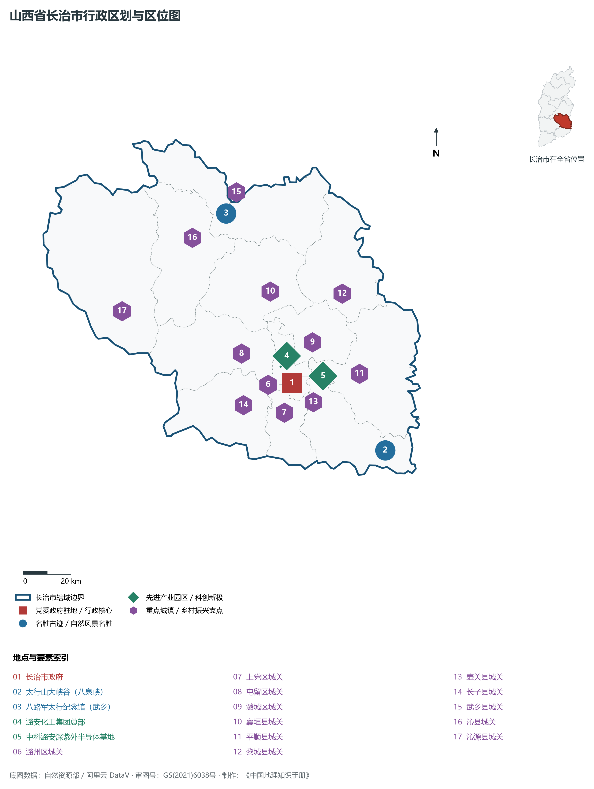
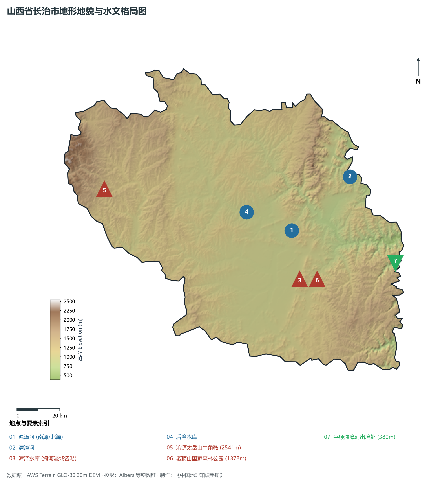
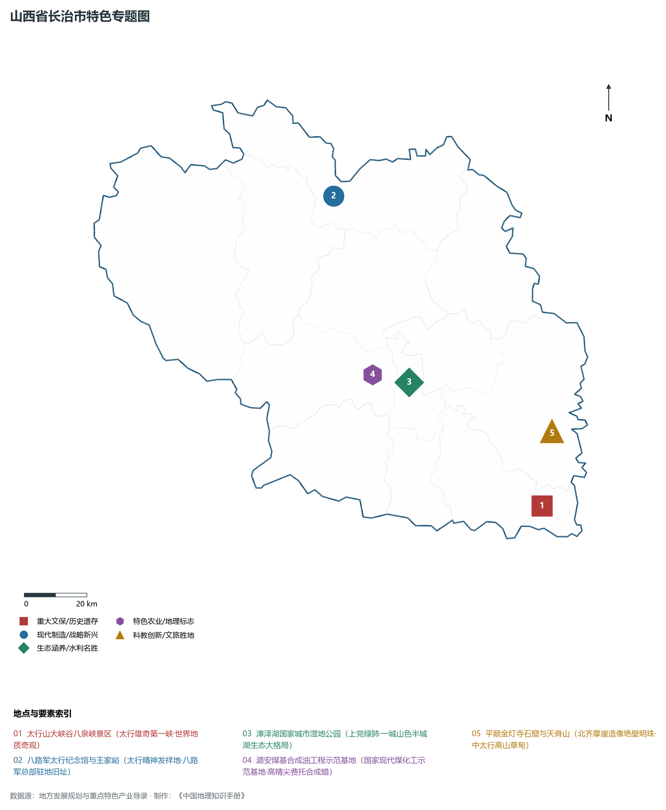
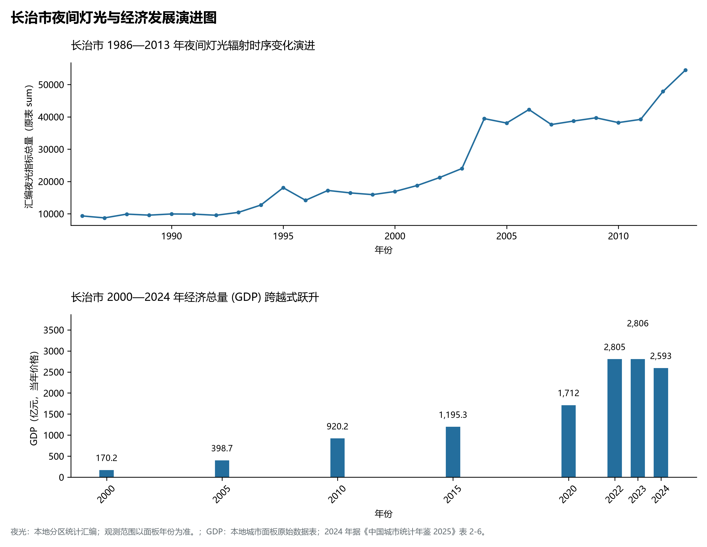
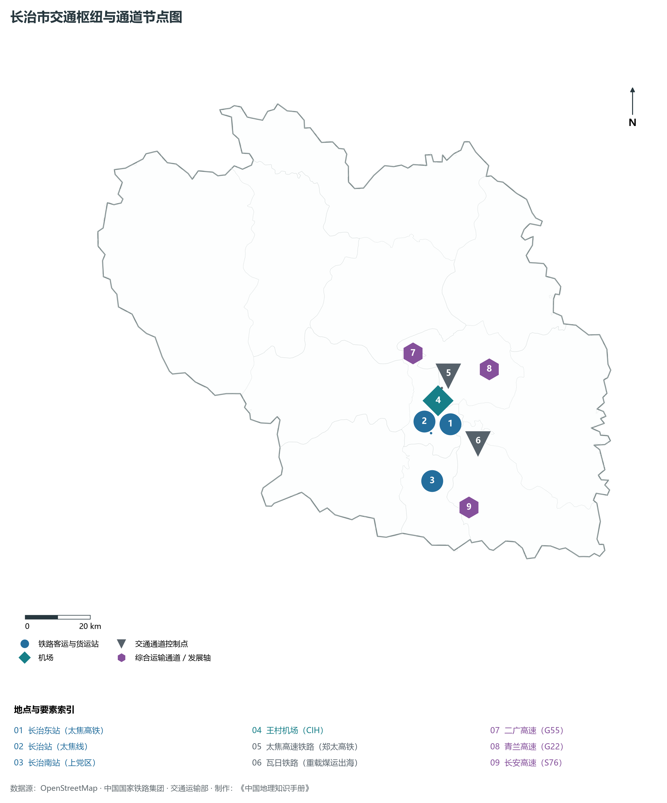

# 4.4 长治市

长治，山西省地级市，晋东南区域中心城市，全国首批老工业城市和资源型城市产业转型升级示范区，国家历史文化名城与著名的生态文旅避暑胜地。地处华北黄土高原东南部、上党盆地核心区，地理坐标介于东经 111°58′—113°44′、北纬 35°49′—37°08′ 之间。东倚八百里巍巍太行与河北邯郸、河南安阳拔地对峙，西峙苍茫太岳山与临汾相连，南界丹朱中条与晋城为邻，北枕系舟余脉与晋中毗连。2024 年常住人口 **310 万人**，常住人口城镇化率 **60.65%**，地区生产总值 **2,593 亿元**（当年价格），人均地区生产总值 **83,333 元**，三次产业构成为 **3.84 : 57.03 : 39.13**。

长治古称“上党”，因其地势居太行山之巅，“居高俯下，与天为党”，自古享有“上党高地”与“天下咽喉”之称。这里是神农炎帝尝百草、得五谷的始祖故里，也是精卫填海、后羿射日、女娲补天等上古创世神话的重要流传地。战国初期长平之战爆发于此，秦置上党郡为全国三十六郡之一；东晋十六国时慕容氏建都于此；隋唐开皇年间更名潞州，明嘉靖八年（1529年）取“长治久安”之意升设“长治县”，长治之名由此肇始。抗日战争时期，八路军一二九师司令部长期驻扎武乡、涉县一带，朱德、彭德怀、刘伯承、邓小平在此开辟晋冀豫革命根据地，太行八年烽火锻造出伟大的“太行精神”；新中国成立后，长治建成了全国闻名的潞安煤基重化工业基地；进入新时代，长治高擎生态转型火炬，全国首批产业转型示范区硕果累累，现代化光伏锂电、深紫外半导体与太行大峡谷文旅康养崛起为闪亮的三晋新地标。

---

## 一、市情速览

长治是晋东南经济体量最大的经济极核，拥有辐射中原与华北的立体化交通网络。

| 核心指标 | 全市数值与空间分布 | 全国/全省定位 |
|:---|:---|:---|
| **行政区划面积** | 13 955 km² | 中山丘陵占 70.8%，山间盆地高原占 29.2% |
| **常住人口** | 310 万人 | 2024 年，全市；年鉴公布口径 |
| **常住人口城镇化率** | 60.65% | 2024 年，全市；年鉴公布口径 |
| **人口密度** | 225 人/km² | 潞州区高达 1 800—2 400 人/km²，沁源、平顺等高山林区约 40—70 人/km² |
| **地区生产总值 (GDP)** | 2,593 亿元 | 2024 年，全市；年鉴公布口径 |
| **人均 GDP** | 83,333 元/人 | 2024 年，全市；年鉴公布口径 |
| **产业三次结构** | 4.2 : 54.8 : 41.0 | 煤焦化工向高精尖费托合成蜡演进，光伏储能与半导体破局起势 |
| **行政架构** | 辖 4 区、8 县 | 潞州、上党、屯留、潞城 4 区，襄垣、平顺、黎城、壶关、长子、武乡、沁县、沁源 8 县 |
| **战略核心定位** | 全国老工业城市产业转型示范区 | 国家现代煤化工示范基地、中太行文旅康养核心区、晋东南商贸物流枢纽 |

**图 04-04-1 山西省长治市行政区划与区位图**：图上编号与地点、要素索引对应。

---

## 二、自然地理：太行之巅、漳水汇流与高山峡谷

长治全境处于太行山与太岳山两大陆块剧烈抬升挤压形成的上党断陷断隆盆地之中，平均海拔在 **1 000 m** 以上，四周群山环抱，中央平畴广阔。

### 1. 地形地貌：东西双峰与上党沃野
全境地貌自西向东分为三大单元：

- **西部太岳山中山林海区（沁源、沁县）**：主脊北起霍山，南延中条，山高林密，森林覆盖率居全省首位。全境最高峰为沁源县境内的**太岳山主峰牛角鞍**，海拔高达 **2 541.0 m**，群峰插天，古木参天，是重要的国家级褐马鸡自然保护区与太原晋中南部生态屏障；
- **中部上党冲积侵蚀盆地**：面积约 2 500 km²，海拔 900—1 050 m。地势坦荡，漳泽湖水泊如镜，黄土沉积层肥厚深广，气候温凉湿润，自古为华夏早期农耕最发达的高原沃壤；
- **东部太行大峡谷与险峰断崖区（平顺、壶关、黎城）**：太行山主脊向东急剧跌落至华北大平原，河流深切形成举世闻名的岩溶与石英砂岩嶂谷地貌（太行山大峡谷八泉峡、红豆峡、天脊山），绝壁千仞。全境最低点位于平顺县东北部浊漳河出境处，海拔降至 **380.0 m**。全境最大垂直落差达 **2 161.0 m**。

**图 04-04-2 山西省长治市地形地貌与水文格局图**：图上编号与地点、要素索引对应。

### 2. 气候特征：温带大陆性半湿润季风气候（“无夏之城”）
长治由于海拔居高（市区海拔约 950 m），形成了夏季凉爽宜人的典型高原温凉气候：

- **气温特征**：全域年平均气温在 **9.0—10.5 ℃** 之间。冬季寒冷但少暴风雪，1 月平均气温 -5.0 ℃；夏季气候温和凉爽，最热月 7 月平均气温仅 **22.5 ℃**，日照充足，无酷暑潮热，年无霜期 160—180 天，被中国气象局授予“中国避暑宜居名城”与太行避暑第一港；
- **降水充沛度位居全省前列**：全域年平均降水量达 **550—650 mm**，是山西省水资源最为丰沛的区域之一。太行山东坡与太岳山迎风面降水极易受季风地形云抬升，6—8 月降水占全年 65% 以上，汛期山洪暴发时漳水洪峰迅猛。

### 3. 河流水系：海河流域漳河水系与漳泽湖
长治绝大部分地域属于海河流域漳河水系（西南部小部归黄河流域沁河水系）：

- **浊漳河（长治母亲河）**：分为南源、西源、北源，在上党盆地襄垣县合流后横切东部太行山峡谷，全长 218 km，河水深切峡谷古寺林立，滋养了千亩稻花与沿线梯田；
- **清漳河**：自晋中昔阳流经黎城出境汇入漳河干流；
- **漳泽湖（上党明珠）**：位于市区西北郊，由浊漳河南源拦截蓄水而成，水域湿地面积达 **58 km²**，总蓄水量 1.15 亿 m³。长治实施全流域生态清淤与国家城市湿地公园建设，形成“一城山色半城湖”的秀丽北国水乡图景。

---

## 三、建置沿革与文化根脉

长治是神农炎帝农耕文化的发祥地与八路军抗战太行精神的红色之都。

### 1. 神农故里与上党古郡

- **炎帝神农拓荒播谷**：长治羊头山（高平与上党交界）相传为神农炎帝得嘉禾、尝百草、教民耕织之圣地。境内遗存有炎帝庙、神农井等上古祭祀遗址数十处；
- **上党战火与长平悲歌**：公元前 262 年秦赵长平之战在上党盆地南缘爆发，赵将赵括纸上谈兵，秦将白起坑杀赵降卒四十万，成为决定战国最终走向的惨烈大决战；汉代置上党郡，治所长子；隋唐设潞州，城池繁华；明代改设潞安府，名产“潞绸”与丝绸、瓷器同为朝廷贡品，畅销大江南北。

### 2. 红色太行丰碑与太行精神
抗日战争全面爆发后，长治成为中国共产党在敌后开辟的最重要抗战基地之一。

- **八路军总部驻地**：八路军总部曾先后设立于武乡县王家峪、砖壁村等地，朱德总司令、彭德怀副总司令在此指挥了百团大战等数百次战役，刘伯承、邓小平在此领导一二九师驰骋太行，创立了晋冀豫边区抗日根据地；
- **太行精神铸魂**：无数太行儿女“最后一碗米送去做军粮、最后一尺布送去做军装”，形成了“不怕牺牲、不畏艰险、百折不挠、艰苦奋斗、万众一心、敢于胜利”的伟大太行精神，武乡八路军太行纪念馆与太行干部学院成为全国弘扬革命传统的核心圣地。

### 3. 古代建筑遗存与漳河绝壁艺术
长治是全国早期古代木结构建筑保存密度最高的地区之一：

- **五代后唐古建孤品**：平顺县龙门寺拥有全国唯一的五代木结构殿堂——西配殿（建于后唐同光三年公元 925 年）；平顺大云院弥陀殿建于后晋天福五年，保存着极其罕见的五代壁画原迹；
- **金灯寺石窟**：位于平顺县与河南林州交界的太行绝壁之上，开凿于北齐至明代，寺宇悬于绝壁千仞之间，千佛环列，泉水滴沥，被誉为“中太行石窟雕刻最高峰”。

**图 04-04-4 山西省长治市特色专题图**：图上编号与地点、要素索引对应。

---

## 四、经济地理：现代煤化工示范、半导体光伏与文旅康养

长治作为全国首批产业转型升级示范区，坚定走“绿色低碳、智造赋能”新路，构建起现代煤化工、光伏半导体、先进装备与大健康文旅多元支撑的支柱产业格局。

### 1. 潞安化工现代煤基高端示范

- **国家级现代煤化工领头雁**：潞安化工集团年产数千万吨优质煤炭，自主攻克煤基费托合成世界级难题，建成国内规模最大的百万吨级煤制油综合示范工程；
- **高端精细化学品与高熔点蜡**：开发出高纯度费托合成石蜡、超低黏度特种润滑油基础油与特种高分子发泡材料，彻底打破西方化工巨头垄断，实现了由“卖燃料”向“卖高端化学品与航天特种材料”的惊艳跨越。

### 2. 中科潞安深紫外 LED 与光伏产业集群

- **全球深紫外半导体高地**：与中科院半导体所深度合作，创立山西中科潞安半导体技术公司，建成全球首条中试深紫外 UV-LED 芯片与封装全自动化生产线，广泛应用于空气杀菌、医疗净化与工业固化；
- **光伏新能源整链崛起**：依托潞宝集团、日盛新能源等龙头，形成从工业硅、多晶硅切片到高效光伏组件的大规模先进制造走廊。

### 3. 太行大峡谷全域旅游与康养之都

- **大太行山水旅游龙头**：壶关太行山大峡谷八泉峡（国家 5A 级景区）凭借悬崖绝壁高空索道、立体观光电梯与峡谷游船，成为华北山岳旅游顶流；
- **全国康养度假胜地**：依托夏季 22 ℃ 无夏凉爽气候与太岳山原始森林负氧离子资源，全域打造避暑度假休闲小镇，夏季京津冀豫游客纷至沓来。

**图 04-04-5 长治市夜间灯光与经济发展演进图**：各面板按标注的观测年份、指标和单位列示。

---

## 五、交通网络与太行枢纽

长治自古扼守太行上党咽喉，当代形成了连接华北平原与中原大地的大通道格局。

### 1. 郑太高铁与“一纵一横”铁路网络

- **太焦高速铁路（郑太高铁）**：全线贯通全境，长治东站日均开行动车数十对，实现 1 小时通达太原南站，1 小时 30 分钟直抵河南郑州东站，彻底结束太行高地“不通高铁”的封闭历史；
- **瓦日重载铁路（西煤东运第三通道）**：自西向东横贯长治全境，年货运量达数千万吨，直达山东日照港出海；
- **太焦铁路与邯长铁路**：连通太原、焦作与河北邯郸，为晋东南工矿能源外运主骨架。

### 2. 国家高速公路主骨干
二广高速（G55）纵贯南北，青兰高速（G22）横穿东西，在长治市区形成互通大立交；配合长延高速、长安高速，构筑起太行山前辐射四方的公路快道网络。

### 3. 民航王村机场
**长治王村机场（CIH）**为 4C 级民用航空机场，拥有 2 600 m 跑道与现代化航站楼，航线直通北京、上海、广州、深圳、成都等全国主要干线枢纽。

**图 04-04-3 长治市交通枢纽与通道节点图**：图上编号与地点、要素索引对应。

---

## 六、未来展望：转型升级示范与现代化太行名城

站在新时代发展起点上，长治市紧扣高质量转型战略总纲，全面建设全国一流产业转型示范区与太行高地现代化中心城市：

1. **持续深耕现代煤化工与半导体光伏产业高地**：
   - 聚力发展费托合成精细化学品与高熔点蜡全产业链，加快深紫外 LED 芯片规模化商用与光伏新能源全产业链集群化，打造国家级战略性新兴产业示范基地；
2. **构筑晋东南与中原城市群协作桥头堡**：
   - 放大郑太高铁时空压缩效应，全面深化与郑州都市圈、中原城市群在科技研发、现代物流、农副产品供给上的深度融合；
3. **绘就“壮美太行·生态长治”锦绣山水**：
   - 持续实施漳泽湖水系连通与太行山生态林修复工程，将生态文旅康养培育成千亿级支柱产业，让“太行神韵、长治久安”的名片光耀全国。

2024 年统计来源：《中国城市统计年鉴 2025》表 2-1、2-6、2-7（2024 年，全市）。其他年份 GDP 据本地城市面板“原始数据”表，单位为亿元、当年价格。
