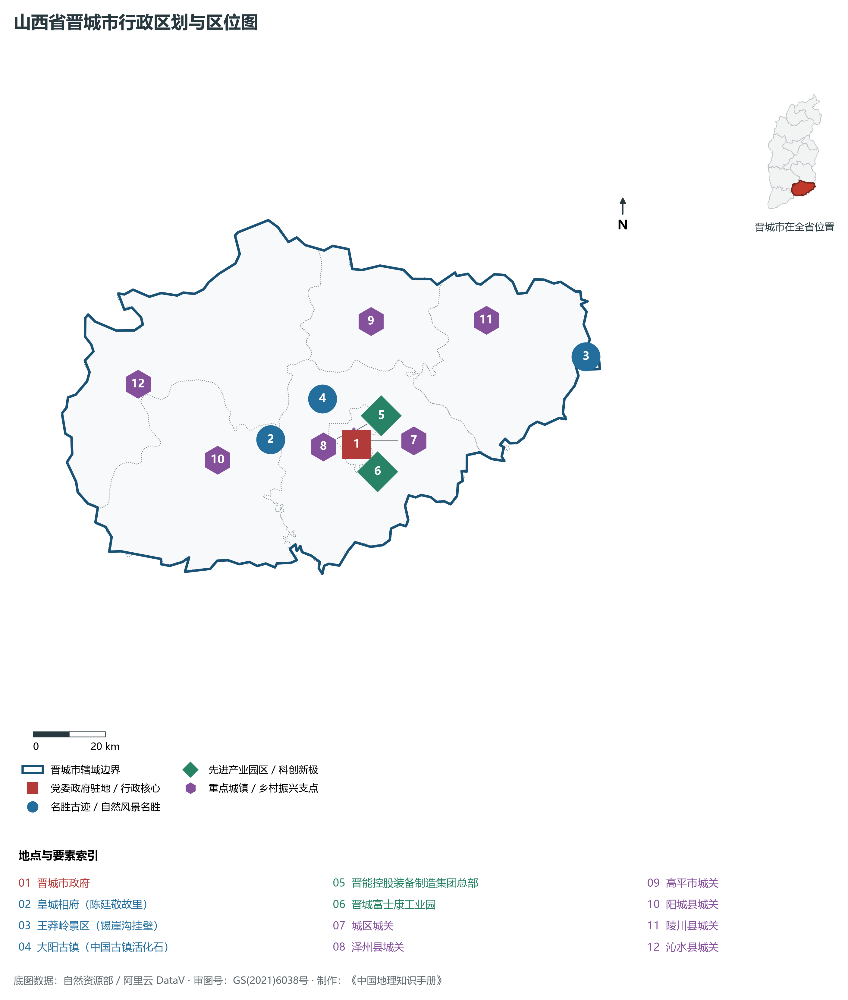
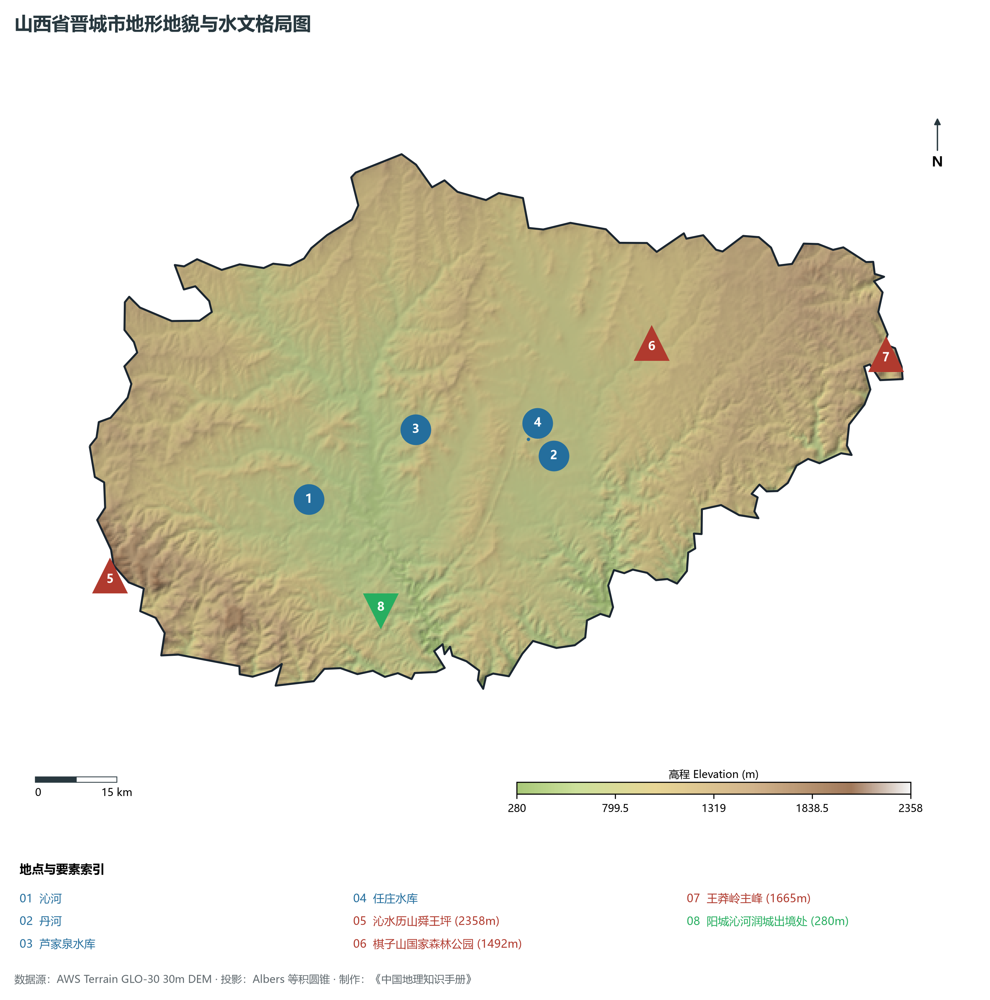
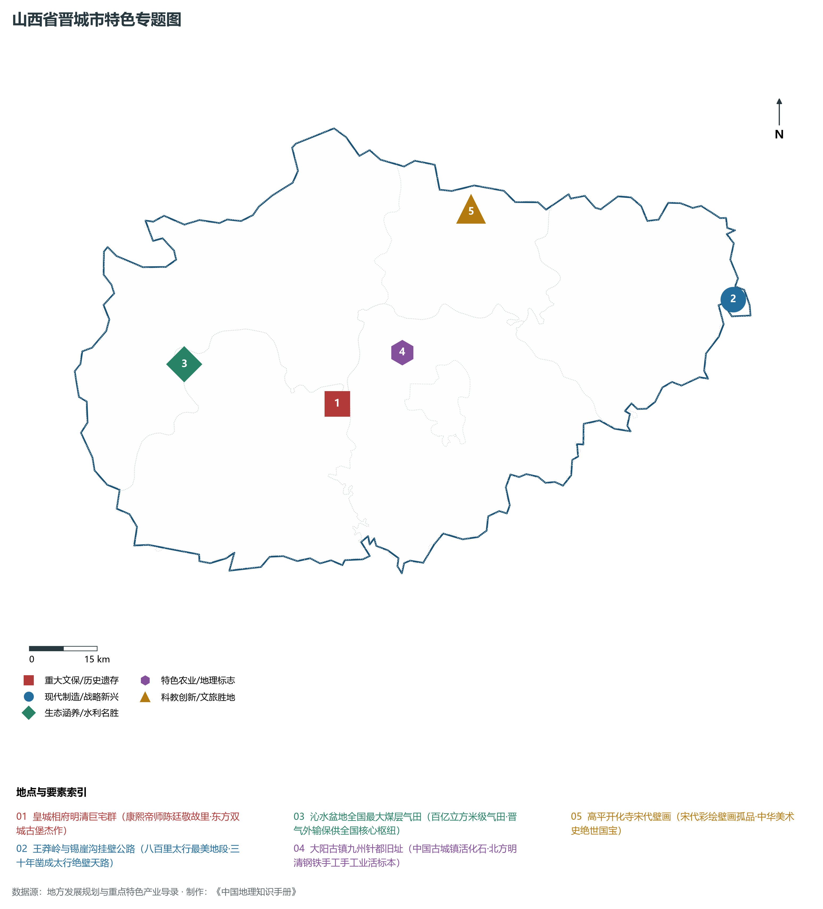
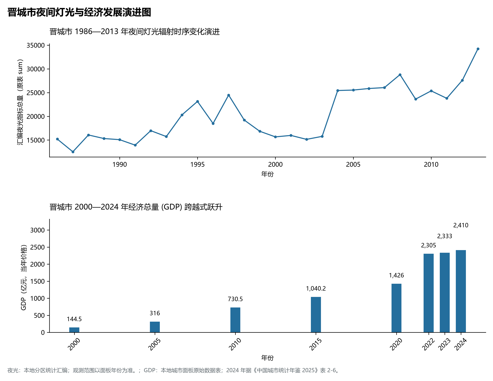
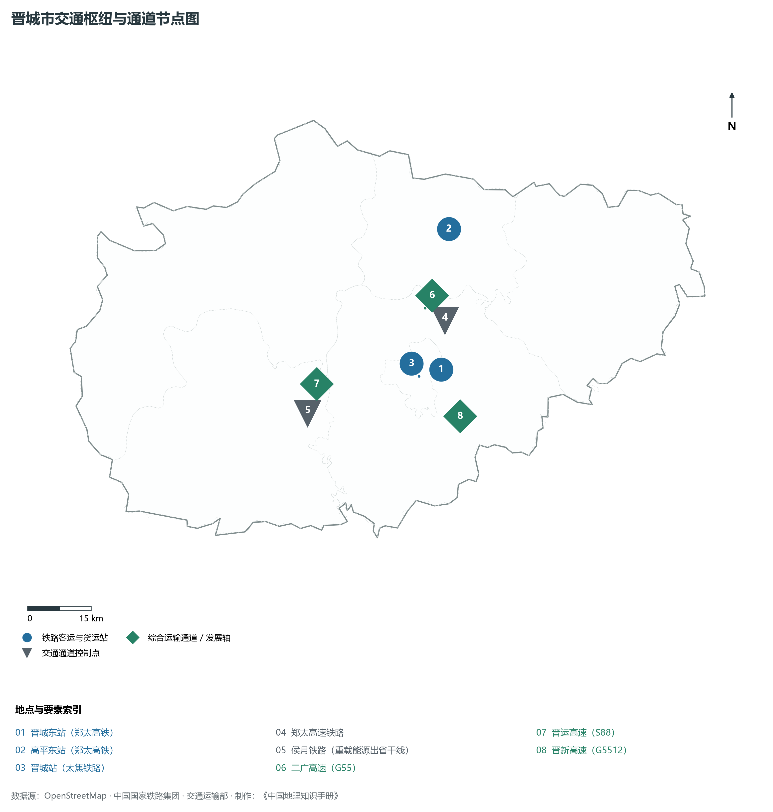

# 4.5 晋城市

晋城，山西省地级市，晋豫交界地区中心城市，全国重要的无烟煤和煤层气新能源基地，中原城市群核心发展区重要成员与著名的太行古堡文旅名城。地处华北黄土高原东南边缘、太行山脉南端西麓，地理坐标介于东经 111°55′—113°37′、北纬 35°11′—36°04′ 之间。东与长治市及河南省安阳、鹤壁接壤，南与河南省焦作、济源紧密毗邻，西隔中条山与运城市相依，北依高平盆地与长治市相连。2024 年常住人口 **216 万人**，常住人口城镇化率 **66.37%**，地区生产总值 **2,410 亿元**（当年价格），人均地区生产总值 **111,320 元**，三次产业构成为 **3.39 : 57.92 : 38.7**。

晋城古称“泽州”“建兴”，自古有“河东屏翰、冀南锁钥”之美誉。这里是女娲补天、愚公移山等上古神话的重要传说地；战国时期长平之战的指挥中枢与前沿设于高平境内；隋开皇十六年（596年）设泽州，明洪武二年（1369年）置泽州直隶州，清雍正十三年（1735年）升为泽州府。晋城铁矿与煤炭冶炼手工业源远流长，明清时期大阳古镇曾以“九州针都”享誉海内，大运河与丝绸之路上流淌着泽州生铁与钢针的传奇；陈廷敬故里“皇城相府”与湘峪古堡、郭峪古城构成了享誉世界的“太行古堡建筑群”。新中国成立后，晋城依托品质冠绝全国的热值高、低硫低灰“兰花炭”无烟煤，建设成为国家重要的无烟煤能源基地；进入新时代，晋城探明并商业化开采了全国最大的沁水盆地煤层气田，打造“中国煤层气第一市”，郑太高铁全线贯通、富士康工业互联精益制造与中原城市群一体化全面提速，展现出太行南麓生机勃勃的现代化新气象。

---

## 一、市情速览

晋城是山西向南对接中原经济圈的开放南大门，拥有极高的工业人均产出与富饶的矿产禀赋。

| 核心指标 | 全市数值与空间分布 | 全国/全省定位 |
|:---|:---|:---|
| **行政区划面积** | 9 490 km² | 中低山丘陵占 87.9%，山间盆地谷地占 12.1% |
| **常住人口** | 216 万人 | 2024 年，全市；年鉴公布口径 |
| **常住人口城镇化率** | 66.37% | 2024 年，全市；年鉴公布口径 |
| **人口密度** | 230 人/km² | 城区达 2 200—3 000 人/km²，沁水西部、陵川东部高山区约 60—90 人/km² |
| **地区生产总值 (GDP)** | 2,410 亿元 | 2024 年，全市；年鉴公布口径 |
| **人均 GDP** | 111,320 元/人 | 2024 年，全市；年鉴公布口径 |
| **产业三次结构** | 3.5 : 59.8 : 36.7 | 第二产业增加值近六成，煤层气、高端铸造与光机电新兴产业高增 |
| **行政架构** | 辖 1 区、4 县、代管 1 县级市 | 城区，泽州、阳城、陵川、沁水 4 县，代管高平市；市政府驻城区凤台西街 |
| **战略核心定位** | 全国煤层气产业示范基地与中原融合门户 | 国家现代煤化工/煤层气全产业链基地、太行古堡世界级文旅康养胜地 |

**图 04-05-1 山西省晋城市行政区划与区位图**：图上编号与地点、要素索引对应。

---

## 二、自然地理：太行南麓、沁丹纵贯与岩溶峡谷

晋城处于太行山南段与中条山东段交汇的高原峡谷区，地势**西北高、东南低**，山川错落，岩溶喀斯特与砂岩绝壁发育极其完整。

### 1. 地形地貌：高山台地与太行断崖
全境地貌由西向东展开三大差异显著的单元：

- **西部中条山余脉与历山高山区（沁水县）**：为黄河流域与海河流域的分水岭。全境最高峰为沁水县西南部的**历山舜王坪**，海拔高达 **2 358.0 m**。山体由寒武奥陶纪石灰岩与前寒武纪变质岩构成，舜王坪顶为万亩平坦的高山草甸，云蒸霞蔚，相传为上古虞舜躬耕之所；
- **中部泽州断陷盆地与丘陵区（城区、泽州、高平、阳城）**：海拔 600—850 m，丹河与沁河两岸发育多级河流阶地与黄土台原，盆地平缓，为晋城市区建设、现代煤炭开采与现代农耕的核心走廊；
- **东部太行绝壁嶂谷区（陵川县王莽岭）**：太行山在此向河南焦作、新乡陡降数百米至千米，形成壮观的太行大断裂带。全境最低点位于阳城县南部润城镇沁河出省口处，海拔降至 **280.0 m**。全境最大垂直落差达 **2 078.0 m**，造就了全国最为惊险雄奇的挂壁公路群与悬崖峡谷地貌。

**图 04-05-2 山西省晋城市地形地貌与水文格局图**：图上编号与地点、要素索引对应。

### 2. 气候特征：暖温带半湿润大陆性季风气候
晋城地处太行南端迎风坡，气候温和，四季分明，雨量较为充沛：

- **气温特征**：全域年平均气温在 **10.2—12.0 ℃** 之间，平原盆地年均温约 11.5 ℃，西部高山区约 8.5—9.5 ℃。冬季受偏北冷气团阻隔，寒而不酷，1 月平均气温 -3.5 ℃；夏季温热多雨，7 月平均气温 24.2 ℃，夜间凉爽；年无霜期长达 180—200 天，光热水土条件优越；
- **降水优势明显**：全域年平均降水量达 **580—680 mm**，是山西省降水量最为充沛的地区之一。夏季来自太平洋的东南季风受太行山南坡强烈抬升，极易形成暴雨中心（陵川、阳城年降水部分年份可突破 800 mm），汛期 6—8 月降水占全年总量的 70%，具有显著的山地迎风面水热聚积效应。

### 3. 河流水系：黄河流域沁河与海河流域丹河
全境河流分属黄河流域（占 85%）与海河流域（占 15%）：

- **沁河（晋城母亲河）**：自长治入境，纵穿沁水、阳城两县，全长 170 余公里，穿行于峡谷深山之中，水质清澈透明，在阳城润城峡谷出境流入河南。沁河两岸土壤肥沃、防御险要，密布着明清时期修筑的皇城相府、湘峪古堡等数十座雄奇城堡；
- **丹河**：源于高平市寺庄镇丹朱岭，南流贯穿高平、泽州和城区东部，全长 128 km，在河南博爱汇入沁河；丹河上建有任庄水库（库容 3 000 万 m³），构成了城市东部丹河新城优美的滨水生态走廊；
- **芦家泉水库**：位于沁水县境内，为沁水盆地煤层气开发与沿线城乡提供洁净水源支撑。

---

## 三、建置沿革与文化根脉

晋城是一座古堡林立、文风鼎盛的太行名城，享有“中国北方古建第一市”之盛誉。

### 1. 泽州古地与大阳“九州针都”

- **泽州千载文脉**：晋城自隋唐设泽州以来，文风炽盛，科第辈出。北宋程颢、程颐在此讲学，开河东理学之风；金元时期医学家窦默、李杲在此行医授徒；
- **大阳古镇与手工炼铁传奇**：位于泽州县的大阳古镇建镇逾 2 600 年，明清时期凭借周边丰富的铁矿石与优质无烟煤，家家打铁、户户制针，“大阳钢针”细如发丝、坚韧不折，行销大江南北并远销中亚与欧洲，被御赐为“九州针都”，古镇内保留着长达五里的明清贯穿古街，被建筑学界誉为“中国古城镇活化石”。

### 2. 皇城相府与东方古堡群落

- **皇城相府（陈廷敬故里）**：位于阳城县北留镇，是清代康熙朝文渊阁大学士兼吏部尚书、《康熙字典》总阅官陈廷敬的故居。全宅由内城（建于明崇祯六年公元 1633 年的“斗筑居”）与外城（建于清康熙四十二年的“中道庄”）组成，拥有七层高耸入云的“河山楼”防御碉堡与藏兵洞，依山就势，层楼叠院，错落有致，被誉为中国北方防御型民居城堡的巅峰绝品；
- **沁河太行古堡群**：在沁河两岸方圆数十里内，还保存着湘峪古堡（被称为“中国民间第一地下军事防御要塞”）、郭峪古城、砥洎城（以废弃铁坩埚填土筑成的铜墙铁壁城堡）等数十座明清抗匪城堡，其密度之高、规模之大、防御功能之完备，在世界民居建筑史上独一无二。

### 3. 王莽岭与锡崖沟挂壁公路奇迹
位于陵川县东部的**王莽岭**，相传西汉末年王莽追赶刘秀曾驻军于此。

- **三十年凿穿绝壁天路**：处于王莽岭深谷之中的锡崖沟村，四周悬崖绝壁环抱，自古与世隔绝。自 1962 年起，全村男女老少凭着钢钎大锤、腰系麻绳悬于千仞绝壁，历经三代人整整 30 年艰苦卓绝的劈山凿石，在垂直落差达数百米的太行红岩绝壁上，硬生生镂空凿出一条全长 7.5 公里的“挂壁公路”，宛若一条悬挂于悬崖腰际的神奇天路，成为当代太行儿女自力更生、征服自然的壮丽史诗。

**图 04-05-4 山西省晋城市特色专题图**：图上编号与地点、要素索引对应。

---

## 四、经济地理：煤层气第一市、绿色铸造与光机电新城

晋城市立足无烟煤与非常规天然气资源优势，坚持“煤炭筑底、气化晋城、光机电成林”的多元高质量转型路径。

### 1. “中国煤层气第一市”与能源保供高地

- **沁水盆地全国最大煤层气田**：晋城煤层气探明储量超 3 600 亿立方米，年抽采量突破 **60 亿立方米**，占全国煤层气总产量的半壁江山；
- **全产业链现代能源走廊**：依托中石油、中联煤层气及晋能控股装备制造集团，形成了集煤层气勘探开发、高压管网输送、液化 LNG/CNG、燃气发电及高端化工利用于一体的全产业链，管道直通中原各省，成为国家西气东输管网重要的大型调峰储气基地；
- **全国最大无烟煤生产基地**：晋城无烟煤（“兰花炭”）发热量高达 7 500—8 000 大卡/千克，是优质的高炉喷吹煤、化肥化工原料煤与民用无烟块煤，年产量稳定在 1 亿吨以上。

### 2. 富士康工业互联与光机电产业高地

- **富士康晋城科技工业园**：深耕精密制造、光学模组与工业机器人领域，拥有世界领先的纳米超精加工与自动化组装生产线；
- **“晋城光机电”新兴产业带**：围绕“光纤光缆、新型显示、精密五金、机器人集成”四大集群，引进富晋精密、康硕智能等数十家产业链龙头企业，打造中原城市群最具竞争力的光机电先进制造集聚地。

### 3. 高平传统铸造向绿色精密压铸跨越
依托数千年冶铁底蕴，高平市传统铁铸产业全面向汽车发动机缸体、风电轮毂、高端铸管等绿色精密铸造升级，产品直供奔驰、宝马及国内外大型工程机械装备。

**图 04-05-5 晋城市夜间灯光与经济发展演进图**：各面板按标注的观测年份、指标和单位列示。

---

## 五、交通网络与晋豫门户

晋城地处太行南端重要咽喉，是连接山西经济走廊与中原城市群的交通枢纽。

### 1. 郑太高铁与客货运输大通道

- **郑太高速铁路（太焦客专）**：纵贯全境南北，设晋城东站、高平东站。晋城东站至焦作仅需 25 分钟，至郑州东站仅需 55 分钟，至太原南站约 1 小时 15 分钟，使晋城全方位融入郑州国家中心城市“1 小时通勤生活圈”；
- **侯月铁路（重载运煤大干线）**：自西向东横穿沁水、阳城、泽州直通河南月山，年货运量数千万吨，是连接晋南煤田与华东沿海消费中心的重载铁路大血管；
- **太焦铁路**：承担着晋东南大宗煤炭、钢铁与化工产品的常规干线运输。

### 2. 国家干线高速公路网络
二广高速（G55）纵贯南北，晋新高速（G5512）横向直连河南新乡、焦作，晋运高速（S88）直达运城，构筑起太行南端连接中原大平原的高速公路枢纽立交体系。

**图 04-05-3 晋城市交通枢纽与通道节点图**：图上编号与地点、要素索引对应。

---

## 六、未来展望：建设光机电新城与太行古堡世界级文旅目的地

站在新发展起点上，晋城市紧扣绿色低碳与高质量转型主题，全力建设绿色转型示范城市与现代化品质名城：

1. **做强做优“全国煤层气产业示范基地”**：
   - 持续推动煤层气深层增储上产与非常规天然气改革试点，深化非常规天然气与绿电、抽水蓄能多能互补，构建绿色低碳现代能源体系；
2. **加速崛起千亿级“光机电产业新城”**：
   - 依托富士康等领军链主企业，狠抓视觉模组、机器人系统集成、精密半导体构件研发生产，建设中西部一流的高端光机电产业创新高地；
3. **打造“东方古堡·太行圣境”世界级康养文旅品牌**：
   - 整合皇城相府、湘峪古堡、郭峪古城、王莽岭挂壁天路等全域古堡山水资源，深化太行一号旅游公路带，打造全国一流的全域旅游示范区与避暑康养新胜地。

2024 年统计来源：《中国城市统计年鉴 2025》表 2-1、2-6、2-7（2024 年，全市）。其他年份 GDP 据本地城市面板“原始数据”表，单位为亿元、当年价格。
