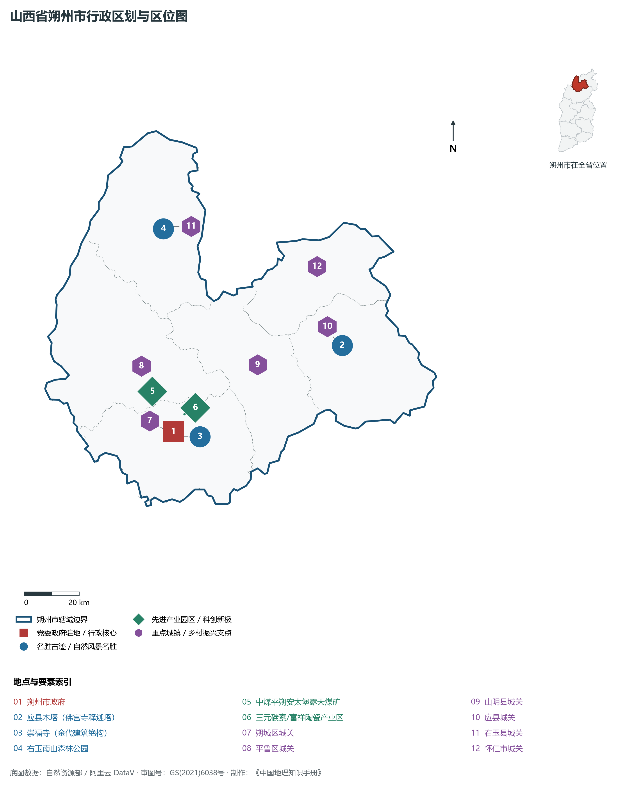
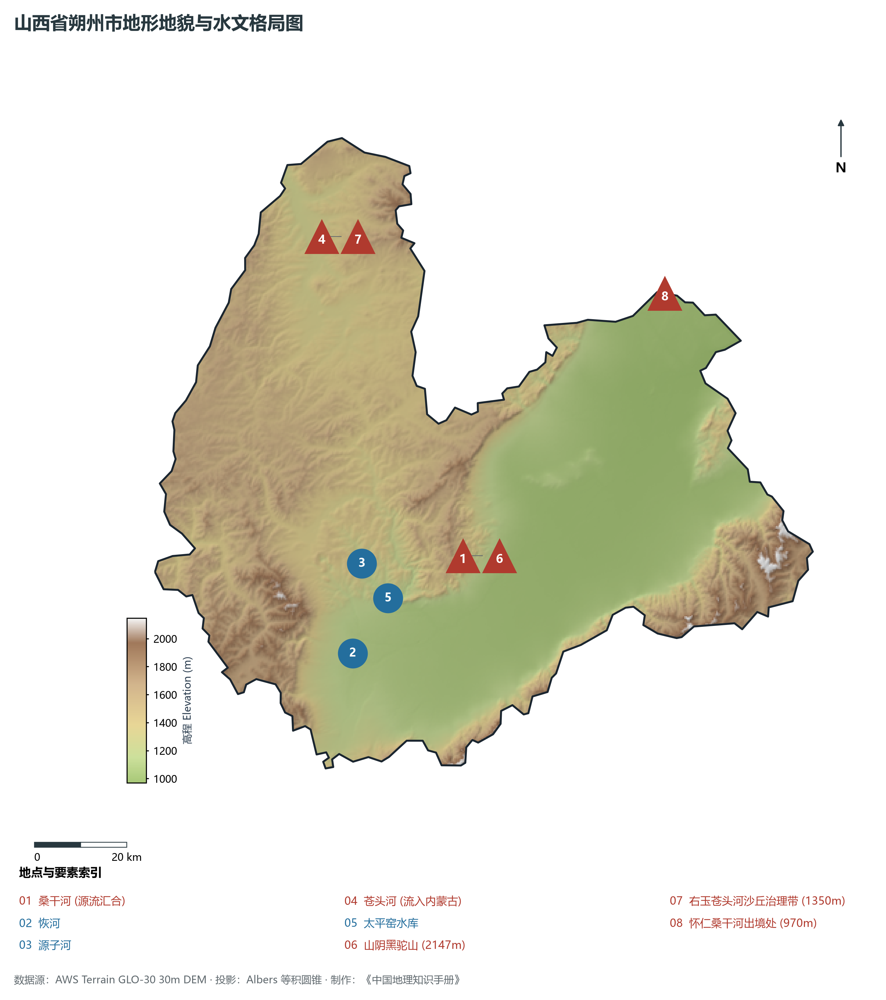
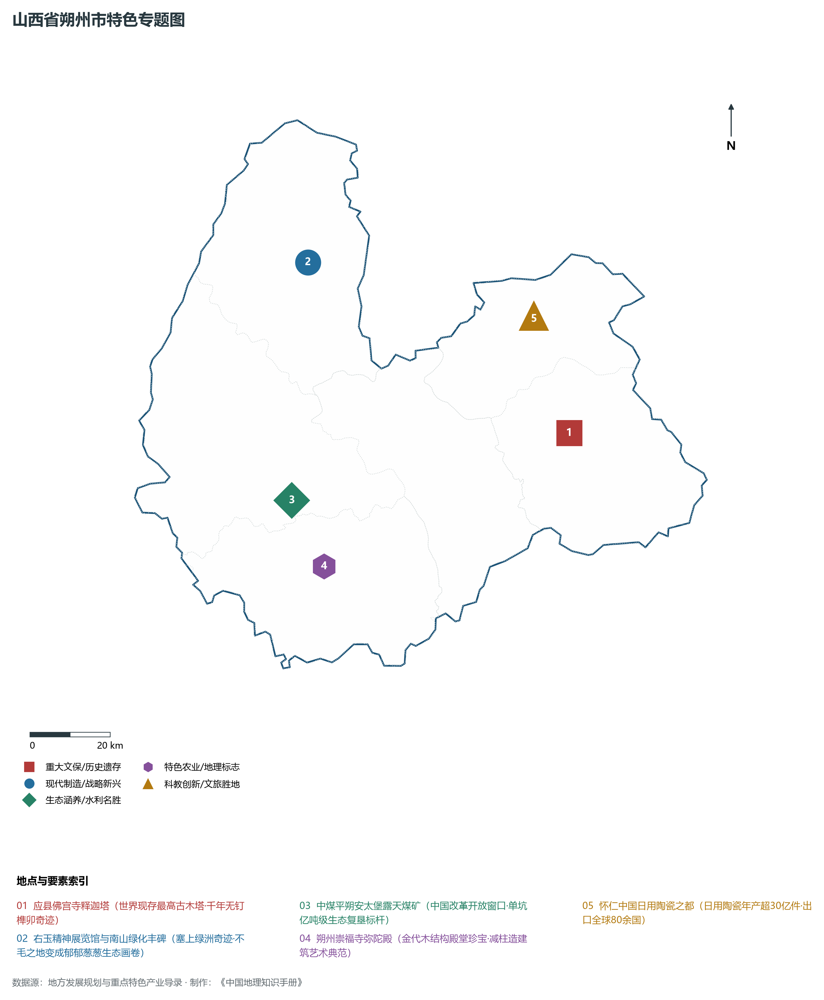
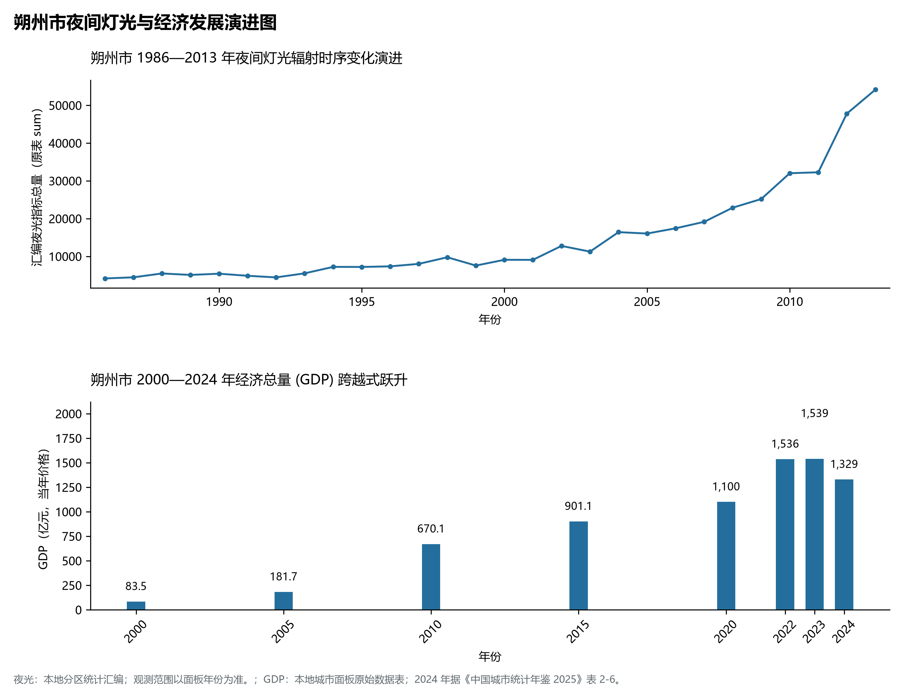
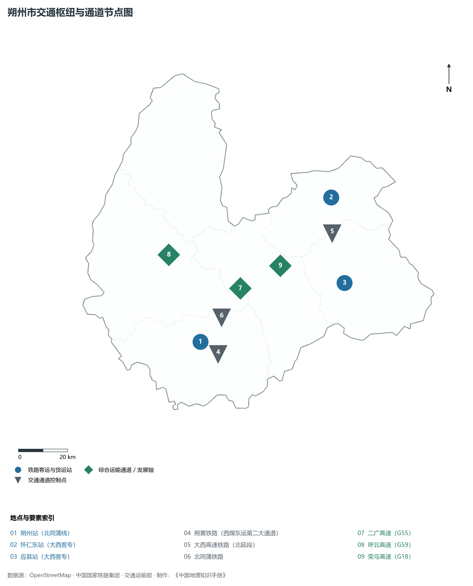

# 4.6 朔州市

朔州，山西省地级市，晋西北重要的能源与现代工业基地，全国著名的右玉精神发源地与塞外生态绿洲名城。地处华北黄土高原北部、大同盆地南端与晋蒙边界交错带，地理坐标介于东经 111°53′—113°34′、北纬 39°05′—40°17′ 之间。南依巍巍雁门关、管涔山与忻州市紧密相连，北越内外长城与内蒙古呼和浩特、乌兰察布接壤，东临桑干河谷与大同市连成一体，西界洪涛山与偏关相望。2024 年常住人口 **157 万人**，常住人口城镇化率 **65.61%**，地区生产总值 **1,329 亿元**（当年价格），人均地区生产总值 **84,439 元**，三次产业构成为 **7.23 : 41.14 : 51.63**。

朔州是一座铭刻着塞北长城风云与新时期艰苦创业奇迹的英雄之城。战国时期赵武灵王在此胡服骑射、开疆拓土，西汉置马邑县，著名的“马邑之谋”揭开汉匈百年大战序幕；唐代名将尉迟恭故里；辽金时期在此修建佛宫寺释迦塔（应县木塔），以纯木榫卯构筑起世界古代木构建筑的绝世奇迹；金代崇福寺弥陀殿开创减柱造大木作巅峰。近代以来，塞外右玉县饱受风沙侵袭，新中国成立后右玉历届县委班子带领全县干部群众久久为功、迎难而上，历经七十余年战风沙、拔穷根，将昔日寸草不生的风沙之源浇灌成林木覆盖率超 56% 的塞上绿洲，铸就了全国闻名的“右玉精神”；改革开放之初，邓小平同志亲自推动中美合作建设平朔安太堡露天煤矿，引进国际先进采煤技术与生态复垦工艺，成为中国改革开放和中外合作的标志性窗口。新时代以来，朔州由单一传统“煤电之都”加速向“现代陶瓷之都”“固废综合利用示范基地”与“塞北现代绿色生态名城”全速转型。

---

## 一、市情速览

朔州地处晋陕蒙能源金三角前沿，拥有发达的重载货运铁路与现代矿山机械制造体系。

| 核心指标 | 全市数值与空间分布 | 全国/全省定位 |
|:---|:---|:---|
| **行政区划面积** | 10 625 km² | 低山丘陵占 59.8%，平原盆地占 32.5%，高寒山地占 7.7% |
| **常住人口** | 157 万人 | 2024 年，全市；年鉴公布口径 |
| **常住人口城镇化率** | 65.61% | 2024 年，全市；年鉴公布口径 |
| **人口密度** | 149 人/km² | 朔州盆地平原约 220—300 人/km²，右玉北部与山阴高山区低于 75 人/km² |
| **地区生产总值 (GDP)** | 1,329 亿元 | 2024 年，全市；年鉴公布口径 |
| **人均 GDP** | 84,439 元/人 | 2024 年，全市；年鉴公布口径 |
| **产业三次结构** | 5.5 : 51.2 : 43.3 | 煤炭采选洗选为基石，现代日用陶瓷、固废新材料与高端装备破局 |
| **行政架构** | 辖 2 区、3 县、代管 1 县级市 | 朔城区、平鲁区，山阴、应县、右玉 3 县，代管怀仁市；市政府驻朔城区振华西街 |
| **战略核心定位** | 右玉精神发源地与国家能源保供基石 | 国家煤电铝材气循环经济基地、全国日用陶瓷出口基地、塞外生态绿洲名城 |

**图 04-06-1 山西省朔州市行政区划与区位图**：图上编号与地点、要素索引对应。

---

## 二、自然地理：雁门关外、桑干源流与生态绿洲

朔州地处山西高原北部断陷带，西倚管涔山与洪涛山，东枕恒山与翠微山，南控雁门关峡谷，地势**西北高、东南低**，中央平坦宽广。

### 1. 地形地貌：崇山环峙与平川沃野
全境地貌由山地丘陵、大同盆地南段冲积平原和黄土台原组成：

- **四周边缘山地屏障**：
  - **南部管涔山与雁门关岭**：横亘于朔州与忻州之间，山势险峻，长城要塞依山蜿蜒修筑；
  - **东部黑驼山山脉（山阴县）**：为恒山山脉西支。全境最高峰为山阴县境内的**黑驼山主峰**，海拔高达 **2 147.0 m**，峰峦陡峭，石骨嶙峋；
  - **西北洪涛山与右玉丘陵沙地**：海拔 1 300—1 600 m，历史上曾为风沙侵蚀严重的荒山秃岭与半固定沙丘，经过七十余年植树造林，现已形成连绵数百里的塞上落叶松与樟子松人工防护林海；
- **中部山前冲积与桑干河谷平原（大同盆地南缘）**：
  - 面积约 3 400 km²，海拔 970—1 100 m，平原广阔坦荡，地下煤层埋藏浅、厚度大，为朔州主要农耕区与特大型露天煤矿集中区；
  - **最低河谷出口**：怀仁市东北部桑干河出境处，海拔降至 **970.0 m**。全境最大垂直落差为 **1 177.0 m**。

**图 04-06-2 山西省朔州市地形地貌与水文格局图**：图上编号与地点、要素索引对应。

### 2. 气候特征：温带半干旱大陆性季风气候
朔州地处晋北高海拔内陆，气候寒冷干燥，风大日照长，无霜期短：

- **气温特征**：全域年平均气温在 **5.5—7.5 ℃** 之间，北部右玉县年均温仅 4.8 ℃。冬季寒风呼啸，极其漫长寒冷，1 月平均气温 -10.8 ℃，极端最低温跌破 -32 ℃；夏季短促温和，7 月平均气温 21.5 ℃，气候凉爽宜人，是京津冀居民避暑度假的天然胜地；全域年无霜期仅 **110—130 天**；
- **日照与风能优势**：年均降水量仅 **360—430 mm**，集中于 7、8 月；年蒸发量高达 1 700—2 000 mm；全域年日照时数长达 2 800—3 100 小时，大风天数居全省前列，是国家千万千瓦级大型风电光伏复合外送基地。

### 3. 河流水系：桑干河之源与引黄补水
朔州全境属于海河流域永定河桑干河水系（右玉县北部苍头河向北流入内蒙古黄河水系）：

- **桑干河之源（恢河与源子河）**：
  - **恢河（西源）**：发源于宁武县管涔山分水岭，自西南向东北横穿朔城区，全长 105 km；
  - **源子河（北源）**：发源于左云县，流经平鲁区，在朔城区马邑村与恢河汇合，正式定名为**桑干河**，滔滔东流孕育了大同盆地的万亩良田，著名小说《太阳照在桑干河上》便以此水系为创作背景；
- **太平窑水库**：位于山阴县与朔城区交界处，为桑干河干流大型水库，总库容 4 200 万 m³，承担着农田灌溉、工业供水与向下游大同、北京永定河实施生态补水的重要职能。

---

## 三、建置沿革与文化根脉

朔州是塞北名刹古塔的建筑艺术丰碑与“右玉精神”红色生态奇迹的承载之地。

### 1. 世界木构第一塔：应县木塔
位于应县城内佛宫寺内的**释迦塔**（俗称应县木塔），建于辽清宁二年（公元 1056 年），金明昌六年（1195年）增修完毕。

- **全木榫卯的世界建筑巅峰**：木塔总高 **67.31 m**，底层直径 30.27 m，重达数百吨，全部采用红松木料咬合搭接，全塔无一钉一铆；
- **斗栱博物馆与千古抗震传奇**：木塔全塔共使用斗栱 54 种，被梁思成先生尊为“斗栱博物馆”；全塔外观五层、内部设有平座暗层四层，实为九层构架。近千年来历经多次 8 级以上特大地震、风雨雷击与军阀混战炮击，依然巍然挺立，与意大利比萨斜塔、巴黎埃菲尔铁塔并称“世界三大奇塔”，是世界现存最高大、最古老的纯木结构佛塔。

### 2. 辽金寺庙建筑绝品：朔州崇福寺
位于朔城区东街的**崇福寺**，始建于唐高宗麟德二年（665年），金代天德年间扩建。

- **金代大木作巅峰弥陀殿**：主殿弥陀殿建于金皇统三年（1143年），面阔七间，进深四间，单檐歇山顶。殿内大胆采用“减柱造”营造手法，减去前槽金柱四根，营造出开阔无碍的巨大礼佛室内空间；殿内保存着金代塑像、满壁金代壁画与雕镂极精的透雕格子门，被中国建筑界誉为金代建筑与雕塑艺术的“集大成者”。

### 3. 生态文明奇迹：右玉精神
右玉县地处毛乌素沙地东缘与黄土丘陵过渡带。新中国成立之初，全县森林覆盖率仅为 0.3%，全境沙化严重，“白天点灯、黑夜土堵门”，联合国专家曾断言“这里不适宜人类生存”。
自 1949 年第一任县委书记起，右玉历届县委领导班子初心不改、一张蓝图绘到底，坚持“迎难而上、艰苦奋斗、久久为功、利在长远”，团结带领全县党员干部和人民群众坚持不懈植树治沙造林七十余载，营造人工林海 170 万亩，森林覆盖率跃升至 **56%** 以上，将昔日漫天黄沙的荒漠变成了塞上绿洲，创造了荒漠化治理的人间奇迹，铸就了习近平总书记亲自点赞推广的“右玉精神”。

**图 04-06-4 山西省朔州市特色专题图**：图上编号与地点、要素索引对应。

---

## 四、经济地理：国家特大露天煤矿、日用陶瓷之都与风光大基地

朔州坚持煤炭先进产能开采与绿色低碳多元转型齐头并进，加速构建“煤电铝硅、现代陶瓷、新能源与生态文旅”现代化产业体系。

### 1. 中煤平朔安太堡：中国现代露天采煤的标杆

- **中国改革开放的合作地标**：由中煤集团投资运营的平朔矿区，涵盖安太堡、安家岭、东露天三大特大型露天煤矿，煤炭核定年产能达 **8 000 万吨** 以上，是全国最大的露天采煤基地之一；
- **生态复垦世界典范**：坚持“采煤与生态复垦同步”，累计投入数十亿元实施排土场复垦绿化，复垦土地达 6 万余亩，昔日千疮百孔的剥离深坑被改造为郁郁葱葱的国家矿山公园与现代生态农业基地，植被覆盖率由采前的不足 10% 提升至采后的 65% 以上。

### 2. 怀仁“中国日用陶瓷之都”

- **全国日用陶瓷重要输出基地**：怀仁市依托优质高岭土与天然气清洁能源，聚集陶瓷企业 50 余家，日用陶瓷生产线超百条，年产日用瓷突破 **35 亿件**，占全省三分之二以上；
- **行销全球八十国**：产品涵盖骨质瓷、色釉瓷、宾馆瓷、耐热瓷全谱系，畅销欧美、中东、东南亚 80 多个国家和地区，形成了集高岭土精炼、模具制造、烤花包装、会展跨境电商于一体的百亿级陶瓷现代产业集群。

### 3. 千万千瓦级塞北新能源与绿色电网

- **全国风光储大基地前沿**：全域新能源装机突破 **800 万 kW**，风电、集中式光伏遍布平鲁、山阴、右玉山头；
- **晋电送浙晋电送苏关键始发站**：雁同特高压变电站与平鲁换流站常年承担着“晋电外送”超负荷电量输出，为华东、京津冀源源不断提供绿色清洁能源。

**图 04-06-5 朔州市夜间灯光与经济发展演进图**：各面板按标注的观测年份、指标和单位列示。

---

## 五、交通网络与能源大动脉

朔州地处晋北塞上能源外运主通道，大运量重载铁路与高速公路网络交织成网。

### 1. 朔黄铁路：西煤东运第二大动脉

- **年运量近 3 亿吨的国家战略通道**：朔黄铁路自神池南站始发，穿平鲁、朔城横贯太行山直抵河北黄骅港，全长近 600 km，采用万吨重载列车高密度开行，为国家能源集团煤电联营的大血管；
- **北同蒲铁路与大秦支线**：北同蒲线纵贯全境，韩原线连通大同、太原，形成煤炭客货双网分流格局。

### 2. 大西客专高铁时代
大西客运专线北延段设**怀仁东站**、**应县站**，集大原高铁全线通车后实现朔州 1 小时 30 分钟直抵太原南站，1 小时通达大同，彻底接入全国高铁路网。

### 3. 国家高速公路骨架
二广高速（G55）自大同经怀仁、山阴穿雁门关直达太原；荣乌高速（G18）横贯应县、山阴，呼北高速（G59）穿平鲁、右玉直达内蒙古呼和浩特，构筑起塞北公路立体通道。

**图 04-06-3 朔州市交通枢纽与通道节点图**：图上编号与地点、要素索引对应。

---

## 六、未来展望：弘扬右玉精神与建设塞上绿洲现代产业名城

站在新发展起点上，朔州市坚定不移弘扬右玉精神，全速推进现代能源保供与绿色生态高质量转型发展：

1. **做深做透现代煤电能源与非常规绿电基地**：
   - 加快煤炭绿色智能化开采与煤炭清洁高效利用，推动风光储氢一体化源网荷储协同，建设晋北重要的国家综合能源保障中心；
2. **擦亮“中国日用陶瓷之都”与新材料智造名片**：
   - 推动怀仁陶瓷向高附加值艺术瓷、工业特种功能陶瓷升级，做大做强三元碳素、固废综合利用新材料产业集群；
3. **厚植“弘扬右玉精神·共享塞外绿洲”绿色康养胜地**：
   - 保护好应县木塔、崇福寺等绝世古建瑰宝，统筹右玉生态林海与桑干河湿地风光，高质量建设国家生态文明建设示范市，将朔州建设成为生态秀美、产业强劲的现代塞北明珠。

2024 年统计来源：《中国城市统计年鉴 2025》表 2-1、2-6、2-7（2024 年，全市）。其他年份 GDP 据本地城市面板“原始数据”表，单位为亿元、当年价格。
