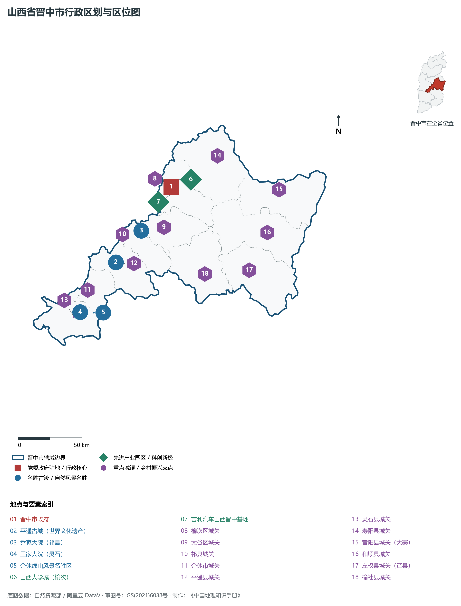
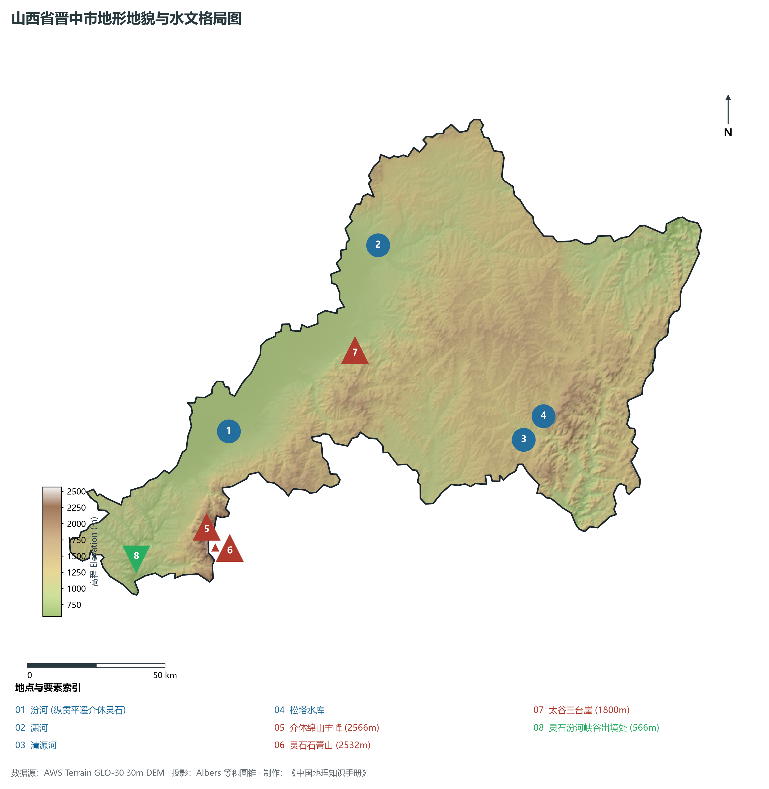
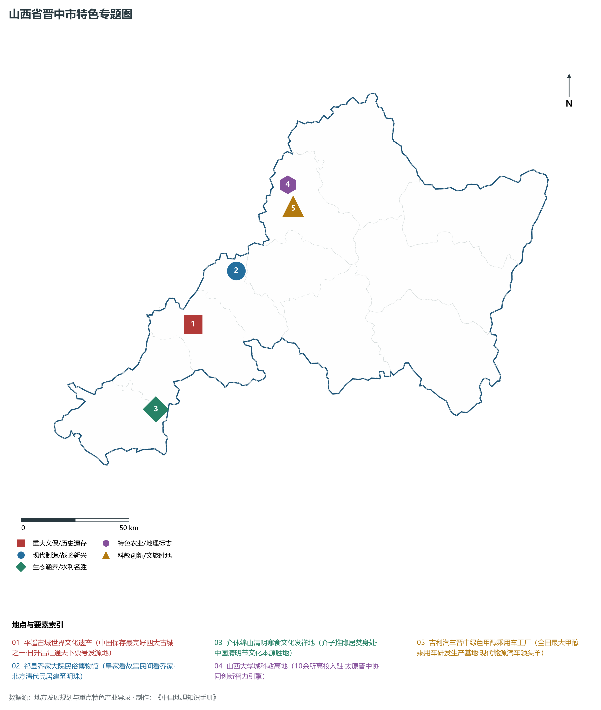
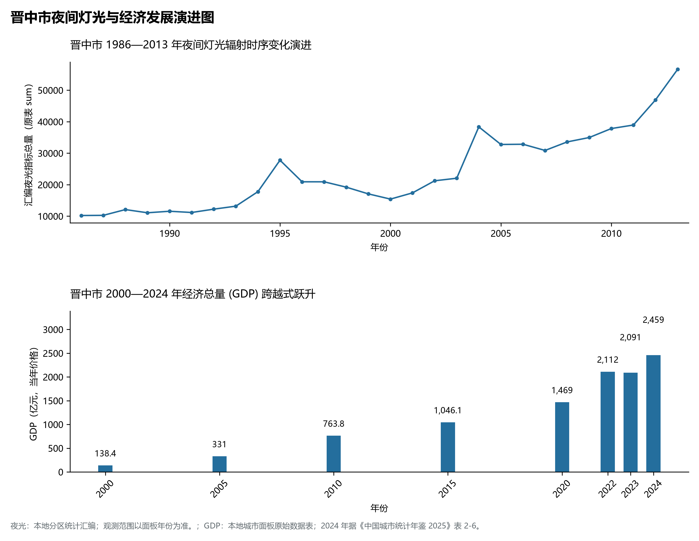
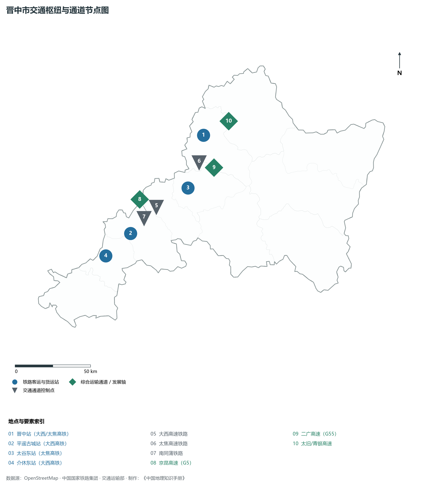

# 4.7 晋中市

晋中，山西省地级市，晋商文化的核心发祥地与三晋腹地重要的现代工贸城市，太原都市圈南翼核心副中心，国家历史文化名城与全国著名的。2024 年常住人口 **334 万人**，常住人口城镇化率 **63.96%**，地区生产总值 **2,459 亿元**（当年价格），人均地区生产总值 **73,232 元**，三次产业构成为 **6.26 : 42.77 : 50.97**。

晋中是一部沉甸甸镌刻在黄土地与砖瓦深处的“晋商百科全书”。这里是晋商精神的发源地与中国近代金融票号的摇篮：明清两代，平遥、太谷、祁县商人手握日升昌票号，“汇通天下、信义为本”，在全国乃至欧亚各重镇设立分号，主导了中国北方乃至跨国陆路贸易达五百年之久，留下了乔家大院、王家大院、曹家三多堂等富丽堂皇的晋商巨宅城堡群；**平遥古城**完整保留了明清县城城墙、街巷、店铺与民居风貌，被联合国教科文组织列入中国第一批世界文化遗产；介休绵山因春秋晋国名臣介子推隐居焚身而闻名，成为中国传统节日清明节与寒食节的起源地。新中国成立后，晋中建立了全国知名的纺织机械基地（经纬纺机）；进入新时代，晋中依托紧邻省会太原的独特地缘区位，高标准建设山西大学城，引育吉利新能源汽车、国家农高区与现代数字物流，实现了从“晋商故里”向太原都市圈科技创新策源地与现代智造高地的深刻跨越。

---

## 一、市情速览

晋中是太原都市圈经济体量最大的南向支点，全省科教资源与历史文旅高密度聚集区。

| 核心指标 | 全市数值与空间分布 | 全国/全省定位 |
|:---|:---|:---|
| **行政区划面积** | 16 392 km² | 东部太行太岳山地占 73.4%，西部太原盆地平川占 26.6% |
| **常住人口** | 334 万人 | 2024 年，全市；年鉴公布口径 |
| **常住人口城镇化率** | 63.96% | 2024 年，全市；年鉴公布口径 |
| **人口密度** | 206 人/km² | 榆次、太谷、平遥盆地平原超 450—650 人/km²，和顺、左权东部山区低于 80 人/km² |
| **地区生产总值 (GDP)** | 2,459 亿元 | 2024 年，全市；年鉴公布口径 |
| **人均 GDP** | 73,232 元/人 | 2024 年，全市；年鉴公布口径 |
| **产业三次结构** | 6.8 : 48.5 : 44.7 | 传统焦化煤电向高端装备、甲醇汽车、现代农科与文旅康养转型 |
| **行政架构** | 辖 2 区、8 县、代管 1 县级市 | 榆次区、太谷区，祁县、平遥、灵石、寿阳、昔阳、和顺、左权、榆社 8 县，代管介休市 |
| **战略核心定位** | 晋商故里与太原都市圈南翼副中心 | 山西大学城科创基地、国家现代农业高新技术示范区、世界级晋商文旅目的地 |

**图 04-07-1 山西省晋中市行政区划与区位图**：图上编号与地点、要素索引对应。

---

## 二、自然地理：太行太岳雄峙、汾河纵贯平川

晋中地势**东高西低、山川相间**，东部由太行山主脊与太岳山环绕，西部由汾河冲积形成广袤平坦的太原盆地南段。

### 1. 地形地貌：崇山台地与盆地平川
全境地貌由山地、丘陵和盆地平原三大部分构成：

- **东部太行山与太岳山中山区**：
  - **东部太行山中山林区（昔阳、和顺、左权）**：山峦重叠，地势险峻，海拔普遍在 **1 200—1 800 m** 之间，清漳河流贯其间；
  - **南部太岳山脉（介休、灵石）**：横亘于晋中与长治、临汾之间，为汾河与漳河、沁河的分水岭。全境最高峰为介休市南部的**绵山主峰**，海拔高达 **2 566.0 m**，危岩壁立，林壑幽秀；灵石石膏山海拔达 **2 532.0 m**，太谷三台崖海拔达 1 800 m；
- **西部汾河冲积盆地平原（太原盆地中南段）**：
  - 面积约 4 300 km²，海拔 760—850 m。地表平整，土层深厚肥沃，水源便利，榆次、太谷、祁县、平遥、介休五大名邑沿汾河两岸呈带状串联，为著名的“晋商发祥地”与三晋粮仓；
- **全境最低河谷出口**：
  - 汾河在灵石县南端切穿韩侯岭峡谷流入临汾盆地，出境处海拔降至 **566.0 m**。全境最大垂直落差达 **2 000.0 m**。

**图 04-07-2 山西省晋中市地形地貌与水文格局图**：图上编号与地点、要素索引对应。

### 2. 气候特征：暖温带大陆性半干旱季风气候
晋中受太岳山与太行山屏障阻隔，季风气候大陆性特征鲜明，雨热同期：

- **气温特征**：全域年平均气温在 **9.4—11.5 ℃** 之间，西部盆地平原年均温约 10.8 ℃，东部和顺、左权高山区年均温仅 8.0—9.0 ℃。冬季寒冷干燥，1 月平均气温 -5.2 ℃；夏季温热多雨，7 月平均气温 23.6 ℃，昼夜温差大，无霜期 150—180 天；
- **降水时空分异**：全域年均降水量约 **460—550 mm**，呈自西北向东南太行山迎风面逐渐递增的趋势。东部太岳山与太行山区受暖湿气流抬升年降水可达 600 mm，汛期 7、8 月暴雨集中，占全年降水总量的 65% 以上。

### 3. 河流水系：黄河流域汾河与海河流域清漳河
全境河流分属黄河流域（占 62.5%）与海河流域（占 37.5%）：

- **汾河干流（三晋母亲河）**：自太原清徐入境，自东北向西南纵穿祁县、平遥、介休、灵石四县市，境内干流长达 130 km，沿途汇纳潇河、文峪河等支流，是支撑晋中盆地农耕灌溉与工业供水的命脉；
- **潇河**：源于昔阳县，流经寿阳、榆次注入汾河，是山西大学城与潇河新城的生态景观中轴；
- **清漳河**：发源于昔阳，纵穿和顺、左权流入河北涉县，是海河流域漳河的重要支系；
- **松塔水库**：位于左权县清漳河上游，库容 9 740 万 m³，为晋东重要的水源控制工程。

---

## 三、建置沿革与文化根脉

晋中是晋商大院古堡建筑体系的集大成者，拥有世界级文化遗产平遥古城与深厚革命传统的太行红色大寨。

### 1. 平遥古城：世界文化遗产典范
位于平遥县境内的**平遥古城**，始建于西周周宣王时期，明洪武三年（1370年）全面重筑砖石城墙。

- **中国汉民族县城建筑的活态样本**：古城占地 2.25 km²，现存城墙周长 6.16 km，高 12 m，垛口 3 000 个，敌楼 72 座，象征孔子三千弟子与七十二贤人；城内完整保留了明清时期的县衙、文庙、城隍庙、市楼与“四大街、八小街、七十二条蚰蜒巷”的棋盘状街巷肌理；
- **中国第一家票号：日升昌**：清道光三年（1823年），平遥西裕成颜料庄东家李大全与掌柜雷履泰在西大街创立**日升昌票号**，开创了中国金融史上纸质汇票替代白银押运的划时代变革，“日升昌，汇通天下”，分号遍及全国大中商埠，被誉为中国现代银行业的开山鼻祖；
- **双林寺与镇国寺双璧**：平遥古城外的双林寺拥有两千余尊明代彩塑，天王、菩萨神态栩栩如生，被誉为“东方彩塑艺术宝库”；镇国寺万佛殿建于五代后汉天福十二年（947年），是我国现存最古老的木结构建筑之一。

### 2. 乔家大院与王家大院民居奇迹

- **祁县乔家大院（在中堂）**：晋商巨贾乔致庸故居，占地 8 724 m²，由 6 个大院、20 个小院、313 间房屋组成。全宅呈双“喜”字形城堡式封闭布局，高墙耸立，砖雕、木雕、石雕工艺精湛绝伦，素有“皇家看故宫，民间看乔家”的美誉；
- **灵石王家大院（归来堂/视履成堂）**：静升王氏家族经明清两代 300 余年修筑而成，总建筑面积达 **25 万 m²**，由高家崖、红门堡等多组城堡式建筑群构成，其规模之宏大远超故宫，被誉为“中国民间故宫”与“华夏民居第一宅”。

### 3. 介休绵山寒食文化与昔阳大寨红色记忆

- **介休绵山清明寒食源头**：春秋时期晋国公子重耳流亡十九载，忠臣介子推割股奉君。重耳即位为晋文公后，介子推不慕名利，偕母隐居绵山，文公焚山逼其出仕，子推抱木焚死。文公悲恸，下令焚山之日禁火寒食，并定次日为清明节，绵山由此成为中国清明节文化的发祥地；
- **昔阳大寨与艰苦奋斗精神**：昔阳县大寨村地处太行山七沟八梁一面坡的恶劣自然环境中，新中国成立后陈永贵等大寨人民战天斗地，手凿肩挑修筑层层石梯田，锻造了闻名全国的“艰苦奋斗、自力更生”大寨精神。

**图 04-07-4 山西省晋中市特色专题图**：图上编号与地点、要素索引对应。

---

## 四、经济地理：大学城创新智库、甲醇汽车与现代农科高地

晋中坚定实施工业立市、数智赋能与文旅主导战略，深度融入太原都市圈一体化大局，形成先进装备、新能源整车、现代农业与数字文旅协同并进的产业空间。

### 1. 山西大学城与太原都市圈科创极核

- **全省最高密度大学聚集地**：位于榆次区北部，占地约 15 km²，聚集了太原理工大学、山西师范大学、山西医科大学、太原师范学院、山西中医药大学等 10 余所重点高等学府，在校师生突破 **20 万人**；
- **产教城深度融合走廊**：依托大学城智力资源，建设晋中科创团队孵化器与智能制造产业园，在人工智能算法、特种无人机、生物医药新药研发领域培育战略新兴产业。

### 2. 吉利新能源整车与绿色甲醇汽车标杆

- **吉利晋中新能源乘用车基地**：年产能突破 20 万辆，形成了包括纯电动、甲醇乘用车、混动在内的完整整车制造产业链；
- **全国最大甲醇汽车研发制造基地**：晋中立足煤焦化副产氢与二氧化碳资源，大力发展甲醇汽车，自主研发的第四代甲醇乘用车与重卡畅销国内外，率先在全国实现甲醇出租车与公交车常态化商业运营，成为国家能源替代与交通脱碳的排头兵。

### 3. 现代农业科技示范（国家农高区）
以太谷区为核心建设的**山西农谷**（山西晋中国家农业高新技术产业示范区），是全国首批国家级农高区之一。聚焦北方旱作农业关键核心技术攻关，在有机旱作谷子、冷凉蔬菜、优质酿酒高粱与智能温室领域树立国家级标杆。

**图 04-07-5 晋中市夜间灯光与经济发展演进图**：各面板按标注的观测年份、指标和单位列示。

---

## 五、交通网络与晋中枢纽

晋中处于山西省南北交通与东西出省咽喉的十字交汇点，是全省铁道网与高铁路网密度最高的区域之一。

### 1. 骨干铁路与高速铁路客运走廊

- **大西高速铁路（南北干线）**：自太原南下贯通榆次、太谷、祁县、平遥、介休、灵石，设晋中站、太谷西站、祁县东站、平遥古城站、介休东站、灵石东站，密度居全国地级市前列，平遥至太原仅需 35 分钟，至西安仅需 2.5 小时；
- **郑太高速铁路（太焦客专）**：设晋中站、太谷东站，实现 1 小时 30 分钟通达河南郑州；
- **南同蒲铁路与太中银铁路**：承担着大宗货运与跨省客运的基础支撑。

### 2. 国家干线高速公路网络
京昆高速（G5）、二广高速（G55）、青银高速（G20）在晋中境内纵横交错，配合太原二环高速与昔榆高速，实现全域县县通高速、30 分钟直达太原武宿国际机场的同城通勤网络。

**图 04-07-3 晋中市交通枢纽与通道节点图**：图上编号与地点、要素索引对应。

---

## 六、未来展望：推进太原晋中同城化与建设国际文旅典范城

站在新发展起点上，晋城市紧扣太原都市圈一体化战略，加快推动产业转型与城市能级全面跃升：

1. **全面加速“太原晋中一体化”深度融城**：
   - 推动榆次区、太谷区与太原小店、潇河新城在交通、规划、产业、公共服务全面并轨，打造三晋经济第一极核心增长板块；
2. **挺进绿色新能源与先进智造新蓝海**：
   - 做强做优吉利甲醇汽车全产业链，做大做强山西农谷旱作农业科技引擎，加快现代物流枢纽与高端纺机装备智能化升级；
3. **擦亮“晋商故里·汇通天下”世界级文旅金名片**：
   - 深入实施平遥古城整体保护与学术活化，统筹乔家大院、王家大院、介休绵山与左权太行抗战遗迹，打造中华优秀传统文化传承创新典范城与国际知名旅游胜地。

2024 年统计来源：《中国城市统计年鉴 2025》表 2-1、2-6、2-7（2024 年，全市）。其他年份 GDP 据本地城市面板“原始数据”表，单位为亿元、当年价格。
