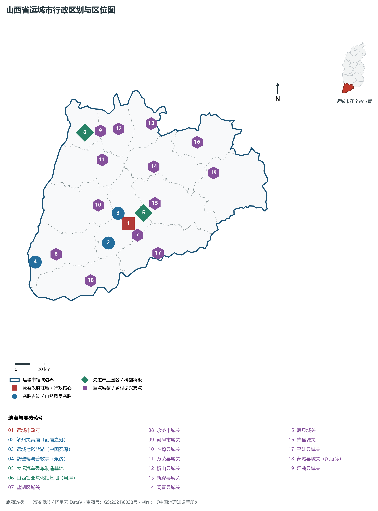
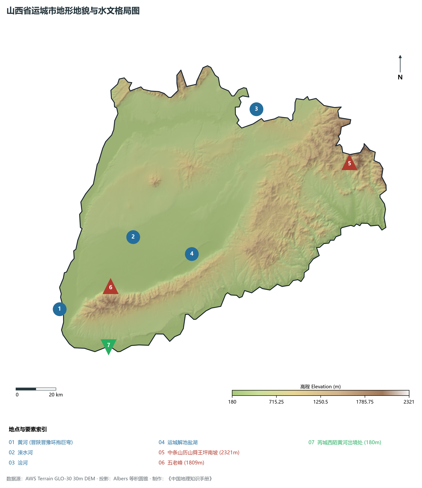
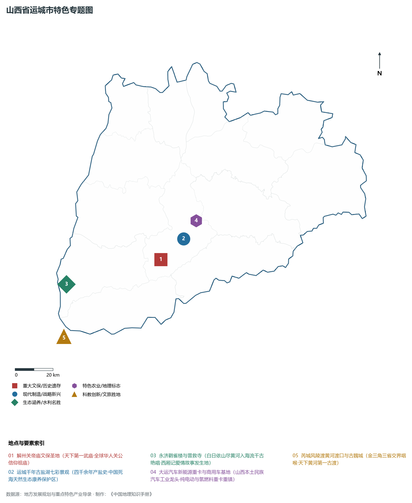
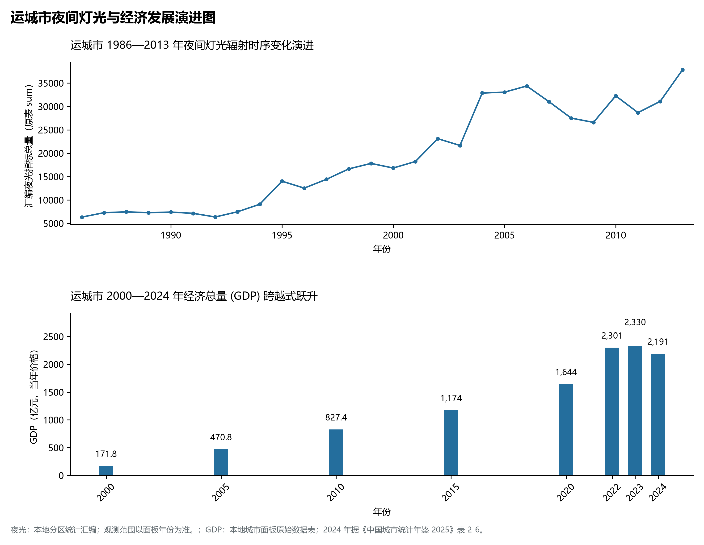
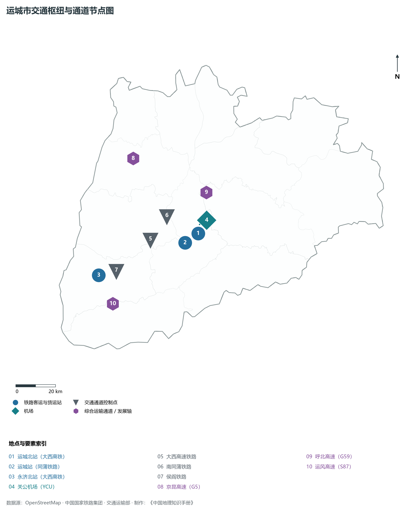

# 4.8 运城市

运城，山西省地级市，晋陕豫黄河金三角经济协作区中心城市，华夏农耕文明与华夏民族的重要发祥地，国家历史文化名城与著名的“中国果品第一市”。地处华北黄土高原南部、运城盆地核心区，地理坐标介于东经 110°15′—112°04′、北纬 34°35′—35°40′ 之间。西隔滔滔黄河与陕西省韩城、合阳相望，南越中条山临黄河与河南省三门峡、洛阳为邻，东接晋东南晋城市，北连晋南临汾市。2024 年常住人口 **467 万人**，常住人口城镇化率 **54.47%**，地区生产总值 **2,191 亿元**（当年价格），人均地区生产总值 **46,721 元**，三次产业构成为 **15.92 : 34.02 : 50.06**。

运城古称“河东”，因境内“因盐而运、设使建城”而得名，享有“华夏文明摇篮”之称。这里是中华民族最早点燃文明星火的圣地：西侯度遗址发现了距今 243 万年的早期人类用火证据；后稷在此教民稼穑，嫘祖在此始制丝绸，蚩尤与黄帝在此展开版泉、逐鹿之战；尧舜禹相继建都于此（舜耕历山、禹都安邑）；春秋时期荀息假道伐虢，战国时期魏国建都安邑；三国蜀汉名将关羽诞生于解州常平村，关公忠义仁勇精神传遍海内外，“解州关帝庙”被尊为天下武庙之冠；中唐柳宗元以“河东先生”自居，北宋司马光在此著述《资治通鉴》；王之涣在永济鹳雀楼吟诵出“白日依山尽，黄河入海流。欲穷千里目，更上一层楼”的千古绝唱；芮城永乐宫保存着中国古代宗教壁画艺术的巅峰巨构。新中国成立后，运城建成了国家重要的粮棉基地与铝工业基地；进入新时代，运城依托黄河金三角枢纽区位，加快推进现代农业果业出口、大运新能源汽车整车制造与黄河一号文旅生态长廊建设，谱写了“盐湖生态蝶变、新兴智造跃升”的高质量跨越新篇章。

---

## 一、市情速览

运城是山西省人口第二大市与农业农村经济最发达的南部经济重镇。

| 核心指标 | 全市数值与空间分布 | 全国/全省定位 |
|:---|:---|:---|
| **行政区划面积** | 14 182 km² | 平原盆地占 58.2%，山地丘陵占 41.8%，平原占比全省第一 |
| **常住人口** | 467 万人 | 2024 年，全市；年鉴公布口径 |
| **常住人口城镇化率** | 54.47% | 2024 年，全市；年鉴公布口径 |
| **人口密度** | 332 人/km² | 盐湖区、临猗县达 450—600 人/km²，垣曲、平陆等山区低于 150 人/km² |
| **地区生产总值 (GDP)** | 2,191 亿元 | 2024 年，全市；年鉴公布口径 |
| **人均 GDP** | 46,721 元/人 | 2024 年，全市；年鉴公布口径 |
| **产业三次结构** | 12.5 : 42.1 : 45.4 | 现代农业底盘坚实，新能源汽车、绿色有色与精细化工多轮驱动 |
| **行政架构** | 辖 1 区、10 县、代管 2 县级市 | 盐湖区，临猗、万荣、闻喜、稷山、新绛、绛县、垣曲、夏县、平陆、芮城 10 县，代管永济、河津 2 市 |
| **战略核心定位** | 晋陕豫黄河金三角经济协作区中心城市 | 全国现代农业强市、国家新能源商用车基地、华夏文明寻根圣地 |

**图 04-08-1 山西省运城市行政区划与区位图**：图上编号与地点、要素索引对应。

---

## 二、自然地理：中条横亘、黄河环抱与解池盐湖

运城全境地处山西高原西南断陷带，北临汾河下游谷地，南枕中条山主脊，西、南两面被波涛汹涌的黄河干流呈半环形大包围，地势**东北高、西南低**。

### 1. 地形地貌：平原坦荡与两山屏障
全境地貌自东北向西南由三大单元构成：

- **南部中条山高山屏障带（垣曲、平陆、芮城）**：横亘于运城盆地南缘，主峰历山舜王坪南坡位于垣曲境内，海拔高达 **2 321.0 m**，为运城市最高峰。山势高峻，植被苍翠，蕴藏着丰富的铜矿、铝矾土与森林资源；永济五老峰海拔 1 809 m，为道教名山；
- **中部运城冲积湖积断陷盆地**：面积达 8 200 km²，平均海拔 350—450 m。地表覆盖巨厚更新世风成黄土与冲洪积泥沙，地势开阔坦荡，土壤疏松肥沃，涑水河穿流其间，是华北著名的粮棉高产区与温带水果之乡；
- **全省地貌最低点：芮城风陵渡西陌村（180.0 m）**：
  - 黄河穿经晋陕大峡谷后，在芮城风陵渡受中条山阻挡急剧东折，河谷宽阔，滩涂广袤。黄河干流流出山西省境处的西陌村滩地，海拔仅为 **180.0 m**，为**山西省全域绝对地理最低点**；
  - 全市最高峰（2 321.0 m）至最低点（180.0 m）的绝对相对落差达 **2 141.0 m**。

**图 04-08-2 山西省运城市地形地貌与水文格局图**：图上编号与地点、要素索引对应。

### 2. 气候特征：暖温带大陆性半湿润季风气候（“山西光热之冠”）
运城地处山西最南端，纬度最低、海拔相对较低，水热条件冠绝全省：

- **气温特征**：全域年平均气温在 **12.5—14.2 ℃** 之间，是全省年均温最高、积温最丰沛的地区。夏季炎热多雨，7 月平均气温达 26.5—27.5 ℃；冬季温和短促，1 月平均气温 -1.5 ℃；全域年无霜期长达 **205—225 天**，是山西省唯一能够稳定实现冬小麦、夏玉米一年两熟的农业高产区；
- **降水与蒸发**：年均降水量约 **500—600 mm**，中条山迎风坡降水较多，主要集中于 7、8、9 月；年蒸发量高达 1 800—2 100 mm，夏季强烈的高温日照与大风蒸发，构成了历史上解池盐湖天然晒盐的根本气候条件。

### 3. 水文奇观：黄河大回折与千年解池七彩盐湖

- **黄河大回折**：黄河自河津禹门口奔涌入运城，沿河津、万荣、临猗、永济、芮城、平陆、垣曲七县市边缘奔腾流淌达 **395 km**，在风陵渡与渭河、洛河汇流形成大折角，造就了黄河金三角肥沃的黄河湿地；
- **运城解池盐湖（中国死海）**：位于市区南郊中条山北麓断陷洼地，总面积达 **132 km²**，长约 30 km，宽约 3—5 km。盐湖形成于新生代喜马拉雅构造期，湖水中富含高浓度的硫酸钠、氯化钠与镁盐，开采历史长达 4 600 余年。近年来运城实施“退盐还湖、生态修复”，停止一切工业采盐，盐湖重现红、绿、橙、蓝交织的“七彩盐湖”生态奇观，大批越冬火烈鸟、大天鹅在此安家，被誉为黄河流域生态治理的典范。

---

## 三、建置沿革与文化根脉

运城是华夏文明破晓的核心腹地与关公精神的祖源圣地。

### 1. 华夏农耕与始祖文明溯源

- **西侯度用火遗址**：位于芮城县风陵渡镇西侯度村，距今约 243 万年，遗址中出土了大量人工打击石器、烧骨与带切痕的鹿角，是目前欧亚大陆已知人类使用火的最早实证；
- **后稷稼穑与后土祠**：万荣县庙前村黄河绝壁之上耸立着著名的“万荣后土祠”，汉武帝曾六次亲临祭祀后土娘娘，并在此泛舟黄河作《秋风辞》；稷山县为周人始祖后稷教民种植粟米五谷之圣地；
- **禹都安邑与夏文化遗址**：夏县东下冯遗址、安邑古城为夏代重要都邑遗存，证实了“禹都安邑”的历史文献记载。

### 2. 关公故里与武庙之冠
位于盐湖区解州镇的**解州关帝庙**，始建于隋开皇九年（589年），宋、元、明、清各代屡加扩建重修。

- **天下第一武庙**：占地达 22 万 m²，是我国现存规模最大、保存最完整、建筑品阶最高的武庙古建筑群。由结义园与主庙两大部分组成；
- **春秋楼与崇宁殿绝构**：主殿崇宁殿重檐歇山顶，前廊置有八根高浮雕盘龙石柱，雕工精巧绝伦；春秋楼内供奉关公夜读《春秋》坐像，楼上设有罕见的“悬空吊柱”回廊隔架，被誉为中国古代悬架木构建筑的绝品；关公信俗被列入国家级非物质文化遗产名录，成为凝聚全球华人的精神纽带。

### 3. 鹳雀楼与永乐宫元代壁画

- **永济鹳雀楼**：坐落于黄河东岸蒲州古城旁，始建于北周，因时有鹳雀栖息其上而得名。唐代王之涣一首《登鹳雀楼》使其名扬四海，与黄鹤楼、岳阳楼、滕王阁并称为“中国四大名楼”；蒲州故城旁还保存着黄河大铁牛（开元铁牛，铸于唐开元十二年，每尊铁牛重达 40 余吨）与西厢记发生地普救寺；
- **芮城永乐宫（大纯阳万寿宫）**：始建于元宪宗二年（1253年），为纪念吕洞宾而建。宫内三清殿、纯阳殿、重阳殿内保存着面积达 **1 005 m²** 的元代道教工笔壁画。《朝元图》描绘了 286 位神仙朝拜元始天尊的壮阔场面，线条如行云流水，设色富丽典雅，代表了中国古代工笔重彩人物壁画的巅峰极品。

**图 04-08-4 山西省运城市特色专题图**：图上编号与地点、要素索引对应。

---

## 四、经济地理：中国果都名品、大运新能源汽车与铝业精工

运城坚定实施工业强市、果品立市、文旅活市战略，深度融入晋陕豫黄河金三角经济协作区，形成现代高质农业、新能源汽车、铝镁新材料齐头并进的发展格局。

### 1. 优质果品之乡与现代特色农业

- **全国地级市水果产量第一大市**：运城光热水土优越，温带水果种植面积超 200 万亩，年产量稳定在 **700 万吨** 以上；
- **“运城苹果”香飘全球**：临猗、万荣、芮城为全国优质红富士核心基地，“运城苹果”获得国家地理标志认证，鲜果常态化直接出口至美国、澳大利亚、东南亚等全球 75 个国家和地区，出口量占山西省鲜苹果出口量的八成以上。

### 2. 大运汽车新能源商用车智造极核

- **山西民营制造业旗舰**：大运集团在盐湖区建立了现代化重卡、中卡、轻卡及新能源汽车整车研发生产基地；
- **新能源重卡领跑全国**：大运纯电动重卡与氢燃料电池重卡广泛装备于全国港口集疏运、矿山运输与干线绿色物流，跻身全国新能源重卡销量第一阵营；自主打造的高端新能源乘用车品牌“远航汽车”实现全自动化总装投产。

### 3. 现代铝工业与黄河金三角化工走廊
依托中条山铝土矿资源与河津水煤优势，中铝山西新材料公司拥有庞大的氧化铝与电解铝基地；运城盐化工深度向高纯元明粉、医药级氯化钠及阻燃级无机盐材料演进。

**图 04-08-5 运城市夜间灯光与经济发展演进图**：各面板按标注的观测年份、指标和单位列示。

---

## 五、交通网络与金三角枢纽

运城地处晋陕豫三省交通十字枢纽，是大西客专进入陕西西安的咽喉门户。

### 1. 大西高铁客运大通道

- **大西高速铁路**：南北纵贯临猗、盐湖、永济，设**运城北站**、**永济北站**。运城北站至太原南站仅需 2 小时，至西安北站仅需 55 分钟，运城全方位融入西安关中平原城市群“1 小时高铁经济圈”；
- **南同蒲铁路与侯阎铁路**：构成大宗物资与普速客运的骨干网络。

### 2. 国家干线公路网络
京昆高速（G5）、呼北高速（G59）在运城纵横交错，配合晋运高速（S88）、运风高速（S87），构筑起连通西安、郑州、洛阳与太原的四通八达高速网络；全线修通的**黄河一号旅游公路**蜿蜒近 400 公里，串联起沿黄七县所有景区名胜。

### 3. 空港运城关公机场
**运城关公国际机场（YCU）**为 4E 级民用航空机场，拥有 3 200 m 跑道与现代化国际航站楼，年旅客吞吐量突破 250 万人次，航线直通北京、上海、广州、深圳、曼谷等国内外大中城市，是黄河金三角区域规模最大的区域干线航空口岸。

**图 04-08-3 运城市交通枢纽与通道节点图**：图上编号与地点、要素索引对应。

---

## 六、未来展望：建强黄河金三角中心城与华夏文明寻根圣地

站在新发展起点上，运城市紧扣“建设黄河流域生态保护和高质量发展示范区”战略使命，加快推动综合实力跨越式升级：

1. **做深做优“晋陕豫黄河金三角协作区中心城市”**：
   - 强化与三门峡、渭南深度跨省协同，加快产业转移协作、交通互联互通与生态环境共保共治，建设中西部内陆区域高水平协同开放新枢纽；
2. **加速崛起高端智造与现代果业新高地**：
   - 聚力发展大运新能源重卡与乘用车全产业链，做强做优运城苹果、冬枣、油桃国家地理标志金字招牌，打造全国一流的现代农业农村现代化样板；
3. **厚植“华夏之根·诚信关公”世界文旅品牌**：
   - 全面推进解州关帝庙申报世界文化遗产与 5A 级景区提质，持续深化七彩盐湖生态保育与永乐宫壁画保护，将运城打造为全球华人回乡寻根问祖的世界级文旅胜地。

2024 年统计来源：《中国城市统计年鉴 2025》表 2-1、2-6、2-7（2024 年，全市）。其他年份 GDP 据本地城市面板“原始数据”表，单位为亿元、当年价格。
