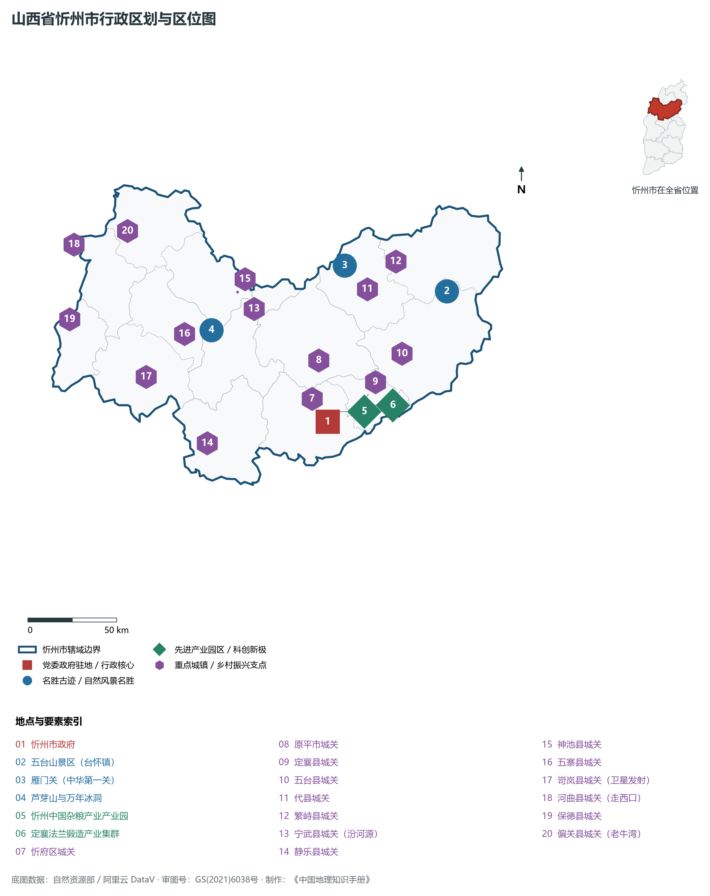
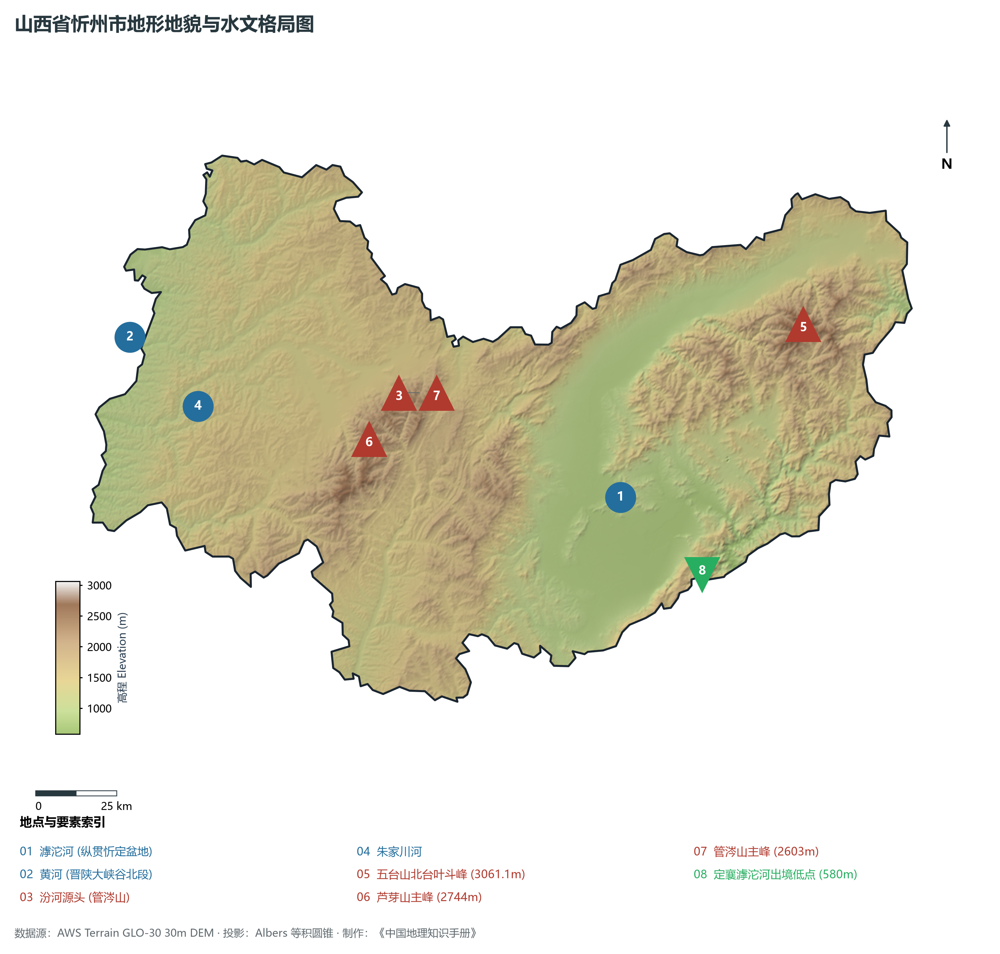
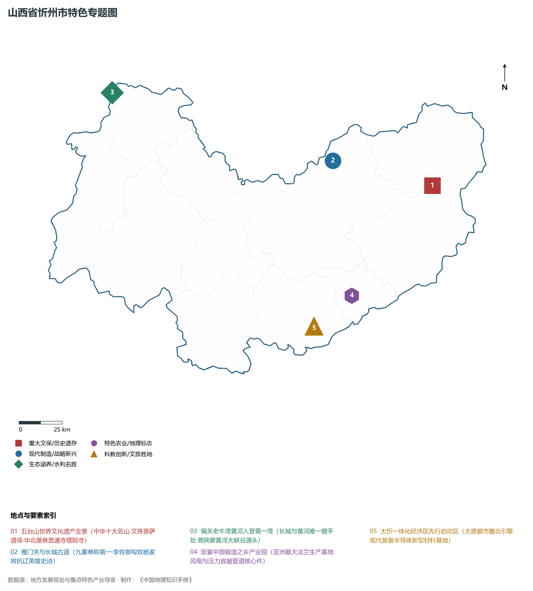
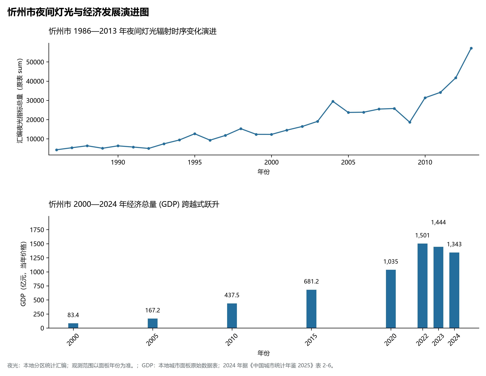
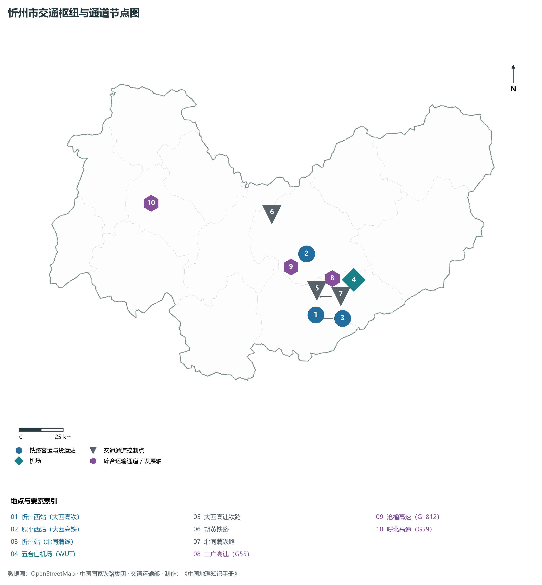

# 4.9 忻州市

忻州，山西省地级市，山西省陆地面积第一大市，太忻一体化经济区核心北引擎，国家历史文化名城，世界佛教圣地五台山所在地与“中国杂粮之都”。地处华北黄土高原北部、忻定盆地与晋西北高山峡谷区，地理坐标介于东经 110°53′—113°58′、北纬 38°06′—39°40′ 之间。东隔巍巍太行山与河北省保定、石家庄为邻，西隔深邃黄河与陕西省神木、府谷及内蒙古准格尔旗隔河相望，南接省会太原与吕梁山，北界恒山、雁门关与朔州、大同相依。2024 年常住人口 **260 万人**，常住人口城镇化率 **58.09%**，地区生产总值 **1,343 亿元**（当年价格），人均地区生产总值 **51,281 元**，三次产业构成为 **9.5 : 40.64 : 49.87**。

忻州素有“晋北锁钥”与“三晋咽喉”之称。自古为中原农耕帝国与塞北游牧文明碰撞交融的战略前沿，长城纵横千里，内长城与外长城在此交汇，偏关“老牛湾”见证了长城与黄河唯一一次磅礴握手；“天下九塞，雁门为首”，战国赵将李牧破匈奴十余万骑、汉高祖刘邦白登之围经此突围、北宋杨家将前仆后继血战金沙滩，铸就了荡气回肠的边塞英雄史诗；五台山作为文殊菩萨应化道场，自东汉永平年间始建寺院，绵延两千年香火不绝，成为汉藏佛教文化交汇圣地，中国仅存的三座唐代木结构殿堂有两座（佛光寺东大殿、南禅寺大殿）矗立其间，被梁思成先生誉为“中国第一国宝”；宁武管涔山不仅是三晋母亲河汾河的发源地，更孕育了极其罕见的三百万年高山“万年冰洞”奇观。新中国成立后，忻州建立了国家重要的航天重地（岢岚卫星发射中心）；进入新时代，忻州紧抓太忻一体化经济区建设重大战略机遇，打造定襄“世界法兰之都”、国家级“中国杂粮之都”与全域世界级文旅康养高地，展现出“华北屋脊”跨越发展的勃勃生机。

---

## 一、市情速览

忻州是山西省版图最辽阔的生态与文旅大市，拥有贯通晋冀蒙的立体交通走廊。

| 核心指标 | 全市数值与空间分布 | 全国/全省定位 |
|:---|:---|:---|
| **行政区划面积** | 25 152 km² | 山地占 58.7%，丘陵占 28.5%，平原盆地占 12.8%，全省面积最大地级市 |
| **常住人口** | 260 万人 | 2024 年，全市；年鉴公布口径 |
| **常住人口城镇化率** | 58.09% | 2024 年，全市；年鉴公布口径 |
| **人口密度** | 105 人/km² | 忻定盆地平原约 220—300 人/km²，偏关、神池、五寨等晋西北山区低于 60 人/km² |
| **地区生产总值 (GDP)** | 1,343 亿元 | 2024 年，全市；年鉴公布口径 |
| **人均 GDP** | 51,281 元/人 | 2024 年，全市；年鉴公布口径 |
| **产业三次结构** | 9.5 : 46.2 : 44.3 | 特色有机旱作农业坚实，法兰锻造、煤电铝与世界级文旅三足鼎立 |
| **行政架构** | 辖 1 区、12 县、代管 1 县级市 | 忻府区，定襄、五台、代县、繁峙、宁武、静乐、神池、五寨、岢岚、河曲、保德、偏关 12 县，代管原平市 |
| **战略核心定位** | 太忻一体化经济区北引擎与中国杂粮之都 | 世界级文化旅游康养目的地、全国法兰锻造基地、黄河入晋绿色生态屏障 |

**图 04-09-1 山西省忻州市行政区划与区位图**：图上编号与地点、要素索引对应。

---

## 二、自然地理：华北屋脊、三水分流与盆地高山

忻州地貌起伏极其剧烈，全境跨越太行山脉、恒山山脉、系舟山与管涔山、芦芽山等巨型山脉，形成了**东西高耸挺拔、南北群山夹峙、中央断陷盆地开阔**的宏伟地形格局。

### 1. 地形地貌：群峰耸立与“华北屋脊”
全境地貌自东向西呈现鲜明的三大地形阶梯：

- **东部五台山高山中山区（五台、繁峙、代县）**：
  - 由古老前寒武系变质岩系构成，主脊五峰耸峙，形如五座高台。全境最高峰、亦为**山西省全域绝对最高峰**——五台山北台**叶斗峰**，海拔高达 **3 061.1 m**，素享“华北屋脊”之尊号。五台山顶发育第四纪冰缘地貌，石海漫溢，古树参天，夏日清凉积雪；
- **中部忻定冲积断陷盆地（忻府、原平、定襄）**：
  - 面积约 2 800 km²，海拔 600—800 m。地势坦荡开阔，滹沱河自北向南穿流滋养，土质肥美，为晋北最为富饶的核心平原粮仓与城市带；
- **西部管涔山—芦芽山中山高原带（宁武、岢岚、五寨、神池）**：
  - 芦芽山主峰海拔 **2 744.0 m**，管涔山主峰海拔 2 603 m。森林覆盖率极高，发育有华北落叶松原始林，为汾河发源地与国家级褐马鸡自然保护区；
- **西部黄河晋陕大峡谷与最低点**：
  - 黄河沿偏关、河曲、保德边界奔流而下，深切黄土高原形成绝壁深峡；全境最低点位于定襄县东南部滹沱河出境处，海拔降至 **580.0 m**。全省全境最大相对垂直高差达到罕见的 **2 481.1 m**。

**图 04-09-2 山西省忻州市地形地貌与水文格局图**：图上编号与地点、要素索引对应。

### 2. 气候特征：温带大陆性高寒半干旱季风气候
忻州因地形垂直落差极大，气候具有显著的“高寒、干旱、山地垂直带谱完整”特点：

- **气温特征**：全域年平均气温在 **4.5—9.0 ℃** 之间，忻定盆地年均温约 8.5 ℃，而五台山台顶年均温仅 **-4.2 ℃**（年均温低于 0 ℃，为华北极端低温极核），7 月最热月均温仅 9.5 ℃，终年无夏，素称“清凉山”；冬季漫长严寒，大风日数多；盆地无霜期约 140—165 天，高寒山区仅 80—100 天；
- **降水时空分异**：年均降水量在 **400—580 mm** 之间。五台山东坡迎风面受季风抬升降水可达 650 mm，而西部偏关、河曲降水锐减至 380 mm 左右；降水集中于 7、8 月，干湿季节界线极其鲜明。

### 3. 河流水系：三水分流与母亲河汾河之源
忻州是黄河流域与海河流域的重要源头水塔：

- **汾河源头（三晋之根）**：三晋母亲河汾河发源于宁武县管涔山芦芽山麓雷鸣寺泉。泉水自石洞奔涌而出，清澈见底，顺峡谷南下流经静乐县，贯通三晋大地；
- **滹沱河（横贯忻定）**：源于繁峙县泰戏山孤山村，向西贯穿繁峙、代县、原平，在忻府区与定襄县汇合牧马河、云中河东折，穿切太行山深峡注入河北岗南水库，是海河流域大清河的重要源流；
- **黄河大峡谷偏关老牛湾**：黄河自内蒙古托克托县奔涌南下，在偏关县老牛湾正式注入山西，形成了万家寨特大型水利枢纽库区，水库碧波如镜，两岸黄土崖壁直插云天。

---

## 三、建置沿革与文化根脉

忻州是佛教石雕建筑国宝的圣殿与中华军事要塞文明的长卷。

### 1. 五台山世界文化遗产与唐代木构双绝
位于五台县境内的**五台山**，与四川峨眉山、安徽九华山、浙江普陀山并称为中国佛教四大名山，为大智文殊师利菩萨道场，2009 年被列入《世界文化遗产名录》。

- **千年古刹群落**：拥有台怀镇显通寺、塔院寺（标志性大白塔高 56.4 m）、菩萨顶、罗睺寺等完整寺庙群，融合了汉传佛教青庙与藏传佛教黄庙的建筑艺术精髓；
- **佛光寺东大殿：第一国宝**：建于唐大中十一年（公元 857 年），面阔七间，单檐庑殿顶。巨大的七铺作斗栱、雄健的梁架结构、唐代精美彩塑、唐代壁画与唐代柱额题字被梁思成、林徽因夫妇赞为“四位一体”的唐代艺术孤品，打破了日本学者所谓“中国境内已无唐代木构建筑”的断言；
- **南禅寺大殿**：建于唐建中三年（公元 782 年），比佛光寺早 75 年，是我国现存最古老的木结构建筑。

### 2. 万里长城第一关：代县雁门关
位于代县北部的**雁门关**（古称陉岭、勾注山），横亘于恒山山脉勾注山之巅。

- **中华第一关要塞**：南控中原，北锁塞外，两山对峙，双峰如门。历经赵武灵王破胡、汉高祖北征、李广射虎、昭君出塞、杨业抗辽血战金沙滩，享有“得雁门而得天下、失雁门而失中原”的军事铁律；现存关城为明洪武七年（1374年）所筑，瓮城、敌楼、关署气势万千。

### 3. 偏关老牛湾与万里长城黄河握手
偏关县老牛湾地处晋陕大峡谷开端。明长城自偏关一路蜿蜒奔赴黄河岸边，在老牛湾悬崖陡壁上筑起烽火望台（望河楼）。滚滚黄河水在此环绕成巨大的深碧半岛，长城与黄河在此深情交汇，构成了中华大地最具象征意义与雄浑史诗感的地理自然人文图腾。

**图 04-09-4 山西省忻州市特色专题图**：图上编号与地点、要素索引对应。

---

## 四、经济地理：中国杂粮之都、定襄法兰与太忻一体化

忻州坚定实施工业强市、太忻协同与特色农业富民战略，现代化高新装备、国家外贸特色产业与现代有机旱作农业蓬勃成势。

### 1. “中国杂粮之都”与特色现代农业

- **全国唯一的“中国杂粮之都”称号**：忻州高寒温凉、光照充沛、昼夜温差大，生产谷子、糜黍、燕麦、红芸豆、藜麦、甜糯玉米等杂粮作物数十种，种植面积常年达 350 万亩；
- **高附加值精深加工走廊**：建成了全省最大的杂粮交易市场与国家杂粮质检中心，引育红芸豆提取物、有机藜麦麦片、甜糯玉米即食深加工全产业链，红芸豆出口量占全国三分之一以上。

### 2. 定襄：亚洲最大的法兰锻造出口基地

- **中国锻造之乡**：定襄县法兰锻造业源于汉代铁器冶炼，当代拥有法兰锻造企业 300 余家，年锻钢能力超 120 万吨，法兰产量占全国三成以上；
- **高端风电核电关键环件**：产品涵盖大型风电塔筒法兰、核电深海管道锻件与航天航空环锻件，出口美国、德国、日本等 40 余个国家和地区，是国家首批外贸转型升级示范基地。

### 3. 太忻一体化经济区起步飞跃
作为全省构建“群升区进”战略的核心抓手，太忻一体化经济区忻州启动区聚焦半导体新材料、高端智能装备、医药健康大产业，与省会太原在交通互通、产业链协同、科创成果转化上实现一体化裂变。

**图 04-09-5 忻州市夜间灯光与经济发展演进图**：各面板按标注的观测年份、指标和单位列示。

---

## 五、交通网络与晋北枢纽

忻州是连接晋西北、晋北与省会太原的咽喉孔道，拥有纵贯南北的高铁与跨省干线高速路网。

### 1. 骨干铁路与大西高铁走廊

- **大西客运专线（太原至大同段）**：全线贯通忻定盆地，设**忻州西站**、**原平西站**。忻州西站至太原南站仅需 28 分钟，全面融入太原“半小时都市经济圈”；
- **朔黄铁路与北同蒲铁路**：朔黄铁路横穿神池、宁武、原平，承担着神府煤田直达黄骅港的重载运输重任；北同蒲铁路为晋北干线普铁主动脉。

### 2. 国家高速公路骨架
二广高速（G55）纵贯南北，沧榆高速（G1812）横贯东西直达河北保定沧州与陕西榆林，配合呼北高速（G59）与灵河高速（S40），构筑起横跨太行山直抵黄河的“米”字型公路网络。

### 3. 空港五台山机场
**五台山机场（WUT）**位于定襄县宏道镇，为 4C 级军民合用支线机场，航线直通北京、上海、广州、成都、杭州等国内核心枢纽，极大拉动了五台山世界遗产与晋北现代商贸的跨省联通。

**图 04-09-3 忻州市交通枢纽与通道节点图**：图上编号与地点、要素索引对应。

---

## 六、未来展望：建强太忻经济区北引擎与世界级文旅康养胜地

站在新发展起点上，忻州市坚定不移推进产业转型与生态文明建设相融互促，奋力绘就高质量发展新图景：

1. **全面挺起“太忻一体化经济区”北引擎**：
   - 聚焦高端装备、半导体新材料、节能环保产业，深度融入太原都市圈创新链，打造向东融入京津冀协同发展的新走廊；
2. **做强做大“中国杂粮之都”与特优农业强市**：
   - 聚力发展杂粮功能性健康食品研发精深加工，做强定襄法兰智能制造国家产业集群，构建特色鲜明的现代制造业底座；
3. **厚植“华夏屋脊·五台圣境”世界文化旅游品牌**：
   - 深入推进五台山景区文物保护与环境提质，统筹雁门关长城、偏关老牛湾、芦芽山万年冰洞全域大生态大景区联动，建设中国北方最具震撼力的国际知名文旅康养胜地。

2024 年统计来源：《中国城市统计年鉴 2025》表 2-1、2-6、2-7（2024 年，全市）。其他年份 GDP 据本地城市面板“原始数据”表，单位为亿元、当年价格。
