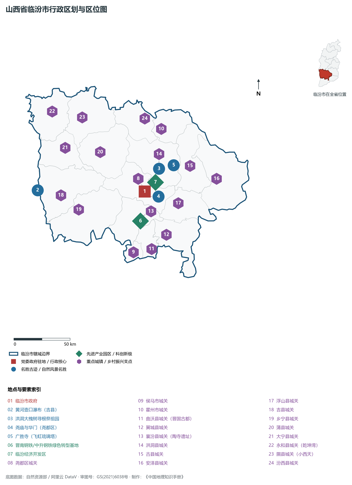
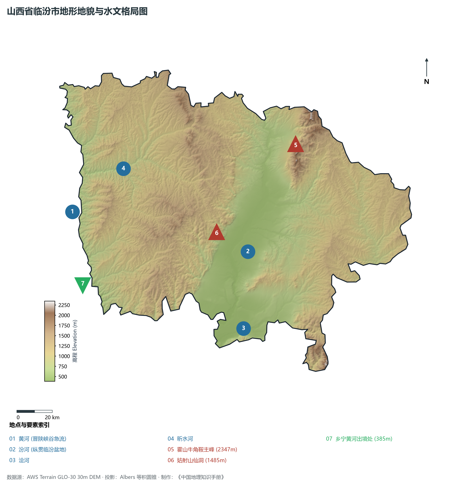
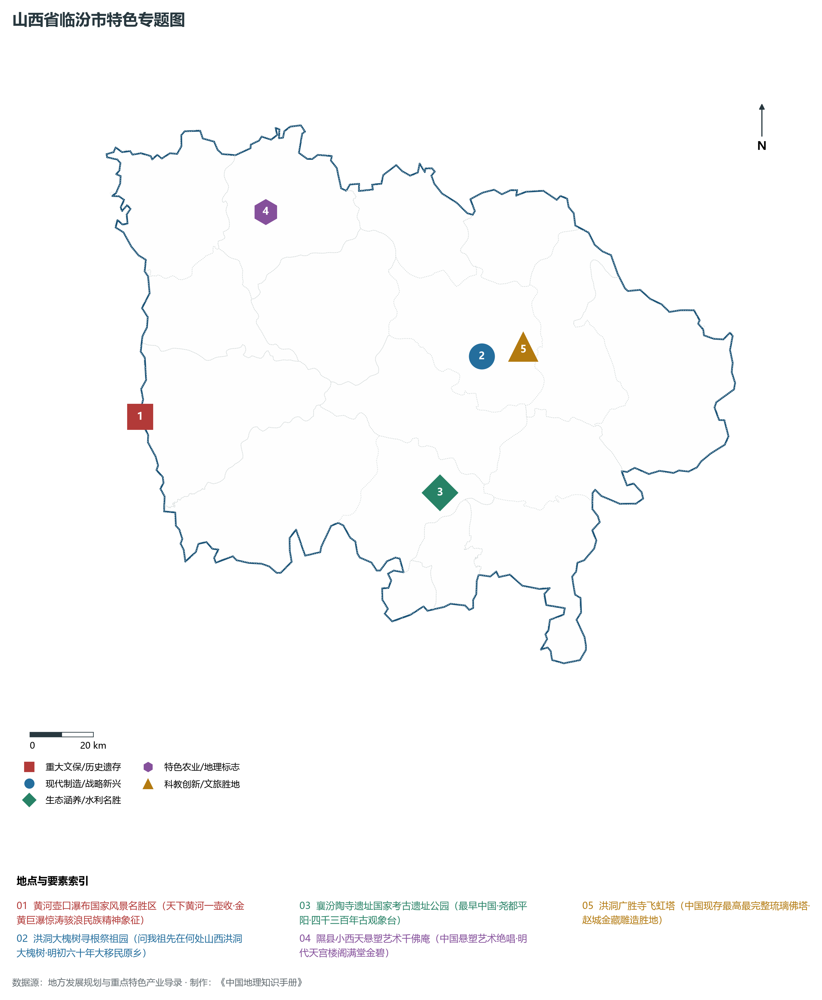
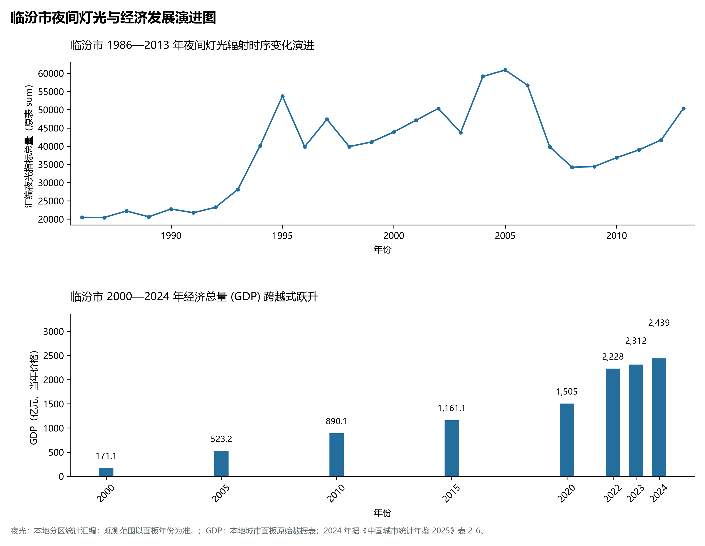
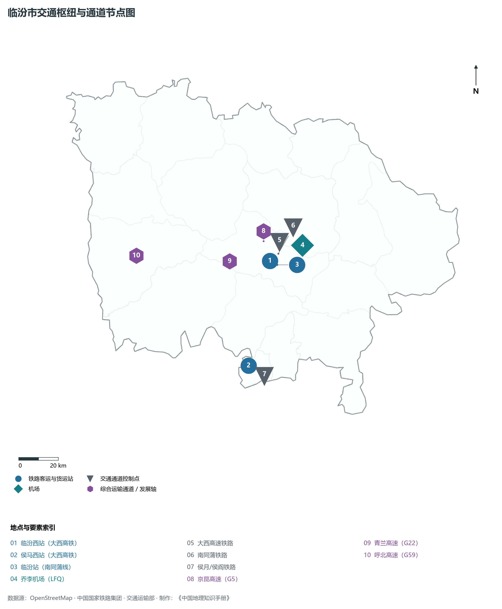

# 4.10 临汾市

临汾，山西省地级市，晋南区域中心城市，华夏农耕文明与早期国家制度的重要起源地，国家历史文化名城与全国著名的。2024 年常住人口 **386 万人**，常住人口城镇化率 **57.5%**，地区生产总值 **2,439 亿元**（当年价格），人均地区生产总值 **62,994 元**，三次产业构成为 **7.8 : 43.57 : 48.63**。

临汾古称“平阳”，享有“华夏第一都”与“最早中国”之至高赞誉。四千三百年前，帝尧在此建都立极，敬授民时、定四时成岁，开启了华夏五千年文明的大幕；襄汾**陶寺遗址**发现了距今约 4300—3900 年的宏伟城址、早期国家宫殿、世界上最早的古观象台以及朱书陶文，成为中华文明探源工程实证“最早中国”的关键原点；西周与春秋时期，晋国在此称霸中原，曲沃代翼、晋文公励精图治写下浓墨重彩的篇章；明初洪武至永乐年间，朝廷在大槐树下组织了规模宏大的十八次跨省大移民，迁徙军民数百万，遍及大江南北十八省，铸就了全球华人魂牵梦萦的根祖文化图腾；黄河奔涌至吉县，在**壶口瀑布**骤缩掀起滔天怒浪，成为中华民族百折不挠、勇往直前伟大精神的地理象征；隰县小西天千佛庵保存着中国古代悬塑艺术的绝世巅峰，洪洞广胜寺飞虹琉璃塔巍然屹立八百年。新中国成立后，临汾建设成为国家重要的焦煤和钢铁重工业基地；进入新时代，临汾统筹生态环保与新质生产力培育，沿汾生态经济带拔地而起，绿色焦化、低碳精品钢铁与全域全季文旅康养深度融合，实现由传统“重化重工之城”向“绿色生态文旅宜居名城”的华丽蝶变。

---

## 一、市情速览

临汾是三晋南部重要的经济、商贸与文化中心，沿汾河两岸人口产业高度集聚。

| 核心指标 | 全市数值与空间分布 | 全国/全省定位 |
|:---|:---|:---|
| **行政区划面积** | 20 275 km² | 山地占 51.4%，丘陵占 29.2%，临汾盆地平原占 19.4% |
| **常住人口** | 386 万人 | 2024 年，全市；年鉴公布口径 |
| **常住人口城镇化率** | 57.5% | 2024 年，全市；年鉴公布口径 |
| **人口密度** | 193 人/km² | 盆地平原核心区达 450—600 人/km²，吉县、大宁等沿黄深山区低于 60 人/km² |
| **地区生产总值 (GDP)** | 2,439 亿元 | 2024 年，全市；年鉴公布口径 |
| **人均 GDP** | 62,994 元/人 | 2024 年，全市；年鉴公布口径 |
| **产业三次结构** | 7.2 : 51.5 : 41.3 | 优质炼焦煤与绿色特钢筑底，现代装备、生物医药与全域文旅协同 |
| **行政架构** | 辖 1 区、14 县、代管 2 县级市 | 尧都区，曲沃、翼城、襄汾、洪洞、古县、安泽、浮山、吉县、乡宁、蒲县、大宁、永和、隰县、汾西 14 县，代管侯马、霍州 2 市 |
| **战略核心定位** | 华夏古都根祖圣地与晋南现代装备基地 | 全国焦煤清洁高效利用基地、黄河壶口世界级文旅名片、沿汾现代生态走廊 |

**图 04-10-1 山西省临汾市行政区划与区位图**：图上编号与地点、要素索引对应。

---

## 二、自然地理：太岳吕梁夹峙、汾水奔流与壶口惊涛

临汾地处山西高原西南断陷带核心，地貌形态呈鲜明的“两山夹一盆”结构，东部为太岳山脉，西部为吕梁山脉南端，中央为宽阔平坦的临汾断陷盆地。

### 1. 地形地貌：崇山对峙与千里沃野
全境地貌由山地、盆地平原与黄河峡谷三部分组成：

- **东部太岳山中山区（霍州、古县、安泽、浮山、翼城）**：山势雄奇，林木葱郁。全境最高峰为位于霍州市与洪洞县交界处的**太岳山霍山主峰牛角鞍**，海拔高达 **2 347.0 m**，峰峦叠嶂，古柏苍劲，自古为北方中镇名山；
- **中部临汾冲积断陷平原（尧都、洪洞、襄汾、曲沃、侯马）**：面积约 4 000 km²，海拔 380—500 m。汾河纵贯其间，地势平坦微向西南倾斜，土层深厚肥沃，为华夏农耕最早发育的沃野粮仓；
- **西部吕梁山南段与晋陕黄河峡谷（吉县、大宁、永和、乡宁）**：山峦破碎，黄土塬梁沟壑深切。全境最低点位于乡宁县西南角黄河出境处，海拔降至 **385.0 m**。全境最大垂直落差达 **1 962.0 m**；
- **水文地貌绝观：黄河壶口大峡谷**：黄河由北向南深切晋陕峡谷，流经吉县壶口镇时，河面由 300 米骤然收束至仅 30 余米，巨澜倾泻进深达数十米的十里龙槽，形成震撼人心的深切峡谷跌水景观。

**图 04-10-2 山西省临汾市地形地貌与水文格局图**：图上编号与地点、要素索引对应。

### 2. 气候特征：暖温带半湿润大陆性季风气候
临汾地处晋南盆地，气候温和，光热充沛，无霜期长：

- **气温特征**：全域年平均气温在 **10.5—13.2 ℃** 之间，盆地平原年均温约 12.6 ℃，属于全省较为温暖宜人的区域。冬季短促温和，1 月平均气温 -2.8 ℃；夏季温热多雨，7 月平均气温 25.8 ℃，极端最高温可超 38 ℃；全域年无霜期长达 **180—210 天**，是山西省重要的小麦、玉米、棉花高产核心带；
- **降水分布**：全域年均降水量约 **480—580 mm**，呈自西北向东南太岳山区逐渐递增趋势，降水集中于 7、8、9 三个月，雨热同期极利于秋粮生长。

### 3. 河流水系：黄河流域干流与母亲河汾河
临汾全境完全属于黄河流域：

- **汾河干流（临汾段）**：自霍州入境，自北向南纵穿霍州、洪洞、尧都区、襄汾、侯马，在曲沃出境，境内干流长达 140 余公里，沿途接纳浍河、涝洰河等支流。临汾实施“汾河百里生态长廊”建设，形成了宽阔优美的市区生态水面湿地公园；
- **黄河干流（晋陕大峡谷南段）**：沿永和、大宁、吉县、乡宁四县西界奔腾流淌达 **155 km**，永和乾坤湾优美大蛇曲与吉县壶口瀑布相映生辉；
- **昕水河**：源于蒲县，西穿大宁注入黄河，是黄河干流在晋南的重要支流。

---

## 三、建置沿革与文化根脉

临汾是实证“五千年文明看山西”的核心地理支点，古都文化、根祖文化与古代雕塑造像艺术光耀古今。

### 1. 最早中国：帝尧古都与陶寺遗址

- **帝尧都平阳与尧庙尧陵**：相传帝尧在此建立都城平阳，“其仁如天，其知如神，就之如日，望之如云”。市区南郊建有巍峨壮丽的尧庙，巍然耸立着广运殿与五凤楼，为后人祭拜华夏始祖之地；
- **陶寺遗址：最早中国的文明坐标**：位于襄汾县城东北的陶寺遗址，总面积约 280 万 m²。发掘出规模庞大的城垣、阶级分化的贵族大型墓葬、铜齿轮、彩绘蟠龙陶盘，以及世界上最早的 13 根夯土柱组成的“古观象台”（准确测定冬至、夏至、春分、秋分节气，距今 4 100 余年）。2024 年陶寺遗址博物馆正式落成开放，以无可辩驳的考古实证奠定了临汾作为“最初中国”的圣地地位。

### 2. 洪洞大槐树：全球华人的大移民图腾
位于洪洞县贾村的**洪洞大槐树寻根祭祖园**，是全国规模最大的移民寻根纪念圣地。

- **明初大移民与民俗印记**：明洪武六年（1373年）至永乐十五年（1417年）近半个世纪内，因战乱中原赤地千里，朝廷在大槐树下的广济寺设局驻官，先后 18 次组织将山西平阳、太原人口大规模外迁至京、冀、鲁、豫、皖、苏等 18 个省区 500 余县。民间流传的“问我祖先在何处，山西洪洞大槐树。祖先故居叫什么，大槐树下老鹳窝”、“背手小解”与“足小趾复甲”等民俗胎记，构成了全球亿万华人寻根归宗的精神信物。

### 3. 绝世壁画与雕塑宝库：广胜寺与小西天

- **洪洞广胜寺飞虹琉璃塔**：建于明正德十年至嘉靖六年（1515—1527年），八角十三层，通高 **47.31 m**。全塔用五彩琉璃构件严丝合缝镶嵌而成，佛像、菩萨、飞天金碧辉煌、晶莹剔透，历经数百年风雨依然光彩夺目，是我国现存最高大、最完美的古代琉璃佛塔；寺内曾珍藏举世闻名的金代《赵城金藏》佛经木雕孤本；
- **隰县小西天（千佛庵）**：始建于明崇祯七年（1634年）。大雄宝殿内不足 170 m² 的空间中，四壁、梁架与山墙满布立体悬塑佛像近两千尊，层楼叠阁、飞天仙乐、天宫妙境纤毫毕现，通体贴金描彩，被艺术史学者赞为“中国悬塑艺术独一无二的绝唱孤品”。

**图 04-10-4 山西省临汾市特色专题图**：图上编号与地点、要素索引对应。

---

## 四、经济地理：焦煤基地转型、沿汾先进制造与全域文旅

临汾坚持推动传统优势产业迭代升级与新兴高端产业培育，加快构建“沿汾先进制造业走廊”与“沿黄文旅康养产业带”。

### 1. 全国优质焦煤与绿色特钢基地

- **国家级焦煤能源重镇**：乡宁、蒲县、汾西蕴藏着世界罕见的高热值低硫特级主焦煤，是全国钢铁高炉不可或缺的炼焦原料；
- **传统钢铁焦化绿色蝶变**：以晋南钢铁、中升钢铁为骨干龙头，在曲沃、翼城建设现代钢铁生态工业园，推行氢能高炉冶炼与碳捕集（CCUS）综合利用，打造全国绿色低碳冶金标杆。

### 2. 沿汾现代先进制造业走廊
依托临汾经济开发区与侯马经济技术开发区，聚力发展高端装备制造、精密汽车零部件、轨道交通配套及现代生物医药，引进普华讯光、华翔集团等上市企业，形成以精密机加工为特色的先进制造集群。

### 3. 全域文旅与黄河文化金名片
统筹壶口瀑布、陶寺遗址、大槐树、小西天与云丘山（国家 5A 级景区，拥有华夏最大万年古冰洞群），黄河一号旅游公路全线串联，文旅康养产业迈向千亿级战略支柱。

**图 04-10-5 临汾市夜间灯光与经济发展演进图**：各面板按标注的观测年份、指标和单位列示。

---

## 五、交通网络与晋南枢纽

临汾地处晋南交通中枢，自古为沟通太原与关中西安的陆路咽喉。

### 1. 高速铁路客运黄金中轴

- **大西客运专线**：自北向南纵贯霍州、洪洞、尧都、襄汾、侯马，设**临汾西站**、**侯马西站**、**霍州东站**。临汾西站至太原南站仅需 1 小时 15 分钟，至西安北站仅需 1 小时 30 分钟，实现“高铁半小时同城化、两小时通达双枢纽”；
- **南同蒲铁路与侯月/侯阎铁路**：侯马为华北重要的普速铁路编组站，侯月重载铁路直通中原出海。

### 2. 国家干线高速公路网络
京昆高速（G5）纵贯全境平原，青兰高速（G22）横穿东西经吉县黄河大桥直达陕西延安，配合呼北高速（G59）与临汾绕城高速，构建起“十字相交、环状放射”的高速公路骨架。

### 3. 空港临汾乔李机场
**临汾乔李机场（LFQ）**为 4C 级民用航空机场，拥有 2 600 m 跑道与现代化航站楼，航线直通北京、上海、广州、深圳、杭州、海口等核心城市。

**图 04-10-3 临汾市交通枢纽与通道节点图**：图上编号与地点、要素索引对应。

---

## 六、未来展望：建强晋南区域中心城与世界级根祖文化圣地

站在新时代发展起点上，临汾市紧扣全方位高质量转型发展目标，全面建设黄河流域绿色崛起示范城与现代化品质名城：

1. **构筑沿汾现代化先进制造业走廊**：
   - 深化高端钢铁、煤焦化深加工与氢能综合利用，大力引育智能装备、光电芯片与新能源汽车配套产业，构建晋南现代工业新极核；
2. **擦亮“最初中国·根祖临汾”世界级文化金名片**：
   - 高质量推进陶寺国家考古遗址公园与尧庙尧陵大景区联动，提质黄河壶口瀑布与小西天、广胜寺全域文旅服务，打造全球华人寻根向往的文化圣地；
3. **厚植“一泓清水入黄河”生态名城底色**：
   - 持续实施汾河全流域生态系统保护与修复，筑牢太岳山生态水源涵养林屏，将临汾建设成为蓝天常在、碧水长流、产业兴旺的现代幸福之城。

2024 年统计来源：《中国城市统计年鉴 2025》表 2-1、2-6、2-7（2024 年，全市）。其他年份 GDP 据本地城市面板“原始数据”表，单位为亿元、当年价格。
