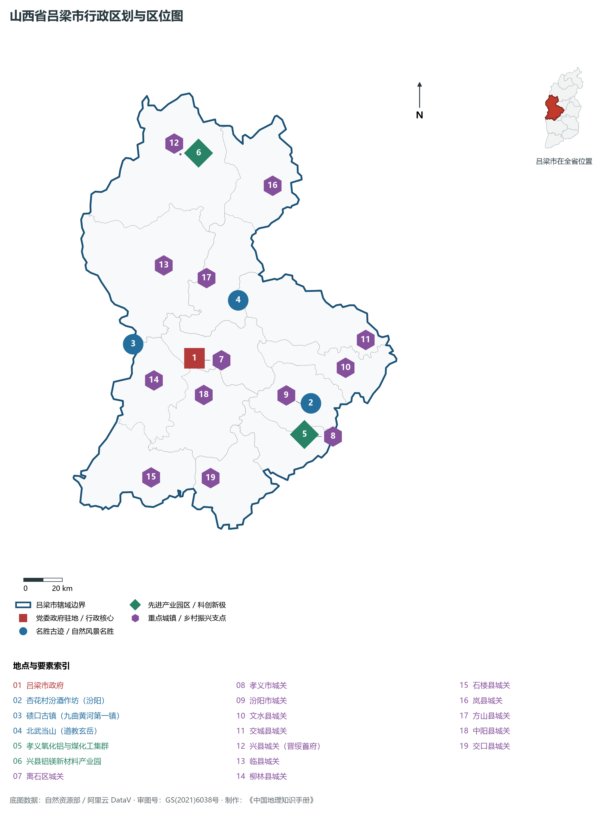
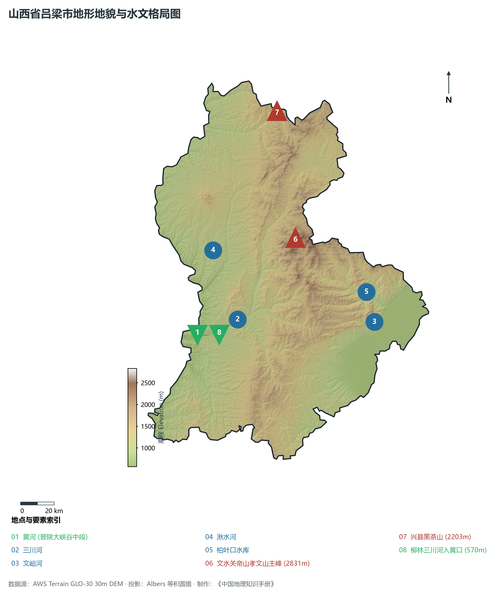
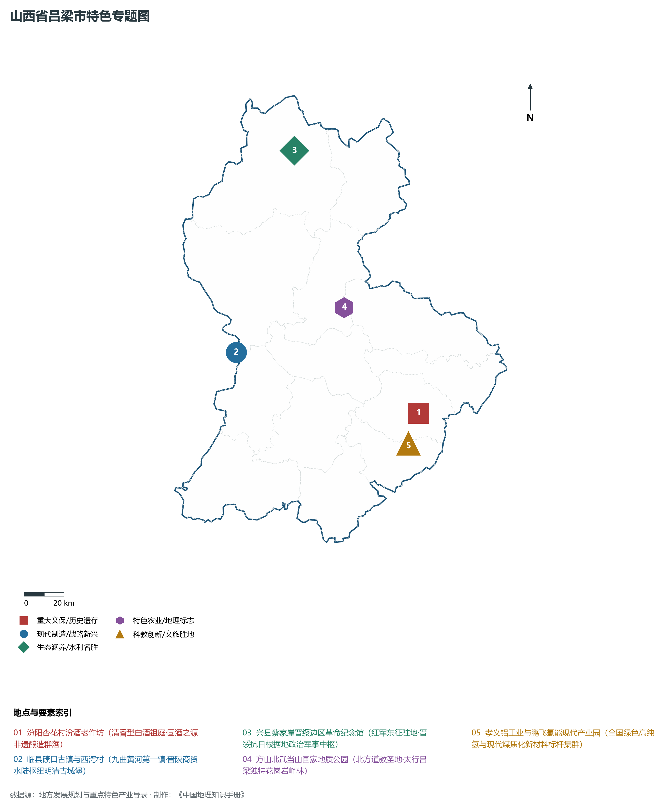
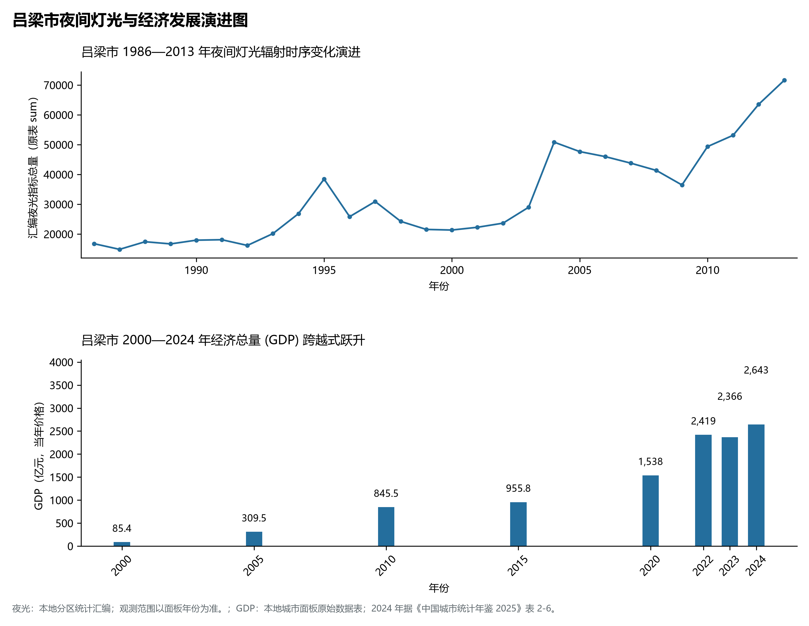
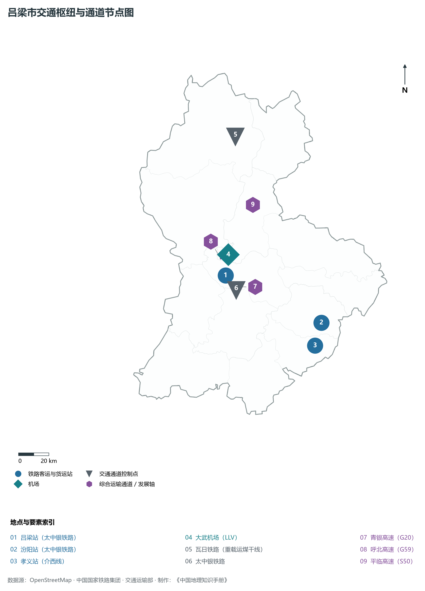

# 4.11 吕梁市

吕梁，山西省地级市，著名的革命老区与“吕梁精神”的发源地，全国重要的现代煤焦化工与铝镁新材料基地，世界清香型白酒祖庭杏花村所在地。地处华北黄土高原中部、吕梁山脉中段，地理坐标介于东经 110°22′—112°19′、北纬 36°43′—38°43′ 之间。西隔深邃奔腾的黄河与陕西省榆林市、延安市相望，东临汾河谷地与省会太原市、晋中市毗邻，南接临汾市，北连忻州市。2024 年常住人口 **332 万人**，常住人口城镇化率 **57.68%**，地区生产总值 **2,643 亿元**（当年价格），人均地区生产总值 **79,348 元**，三次产业构成为 **4.16 : 58.21 : 37.63**。

吕梁是一座英雄辈出、底蕴厚重的红土名城。这里是华夏早期文明交融的走廊，一代女皇武则天诞生于文水县；清代天下第一廉吏于成龙故里位于方山县；明清时期临县**碛口古镇**依黄河峡谷天险而建，成为晋陕峡谷水陆码头，北方商贾云集，享有“九曲黄河第一镇”之称；汾阳**杏花村**拥有千百年不绝的酿酒历史，唐代杜牧名句“借问酒家何处有，牧童遥指杏花村”流传千古，开创了中国清香型白酒之正宗源流。土地革命与抗日战争时期，毛泽东率领红军东征在此渡过黄河，贺龙元帅率领八路军一二零师转战吕梁山，在兴县蔡家崖建立中共中央晋绥分局与晋绥边区政府，成为延安革命圣地坚不可摧的东大门，孕育了光照千秋的“吕梁精神”。新中国成立后，吕梁建成了国家著名的离柳主焦煤与铝土矿基地；进入新时代，吕梁甩掉贫困帽子、破除重化路径依赖，孝义与兴县铝镁产业提档升级，鹏飞集团氢能全产业链全国领跑，现代白酒千亿产业航母扬帆起航，绘就了红土大地生态蝶变与高质量转型发展的新篇章。

---

## 一、市情速览

吕梁是全省仅次于省会太原的第二大经济强市，工业能级雄厚，能矿与现代新材料产值突出。

| 核心指标 | 全市数值与空间分布 | 全国/全省定位 |
|:---|:---|:---|
| **行政区划面积** | 21 140 km² | 黄土丘陵沟壑与中低山占 92.3%，河谷盆地阶地仅占 7.7% |
| **常住人口** | 332 万人 | 2024 年，全市；年鉴公布口径 |
| **常住人口城镇化率** | 57.68% | 2024 年，全市；年鉴公布口径 |
| **人口密度** | 159 人/km² | 孝义、汾阳平原达 400—500 人/km²，石楼、交口等深山区低于 70 人/km² |
| **地区生产总值 (GDP)** | 2,643 亿元 | 2024 年，全市；年鉴公布口径 |
| **人均 GDP** | 79,348 元/人 | 2024 年，全市；年鉴公布口径 |
| **产业三次结构** | 3.8 : 61.5 : 34.7 | 第二产业占比超六成，铝镁合金、氢能制造与清香型白酒全面崛起 |
| **行政架构** | 辖 1 区、10 县、代管 2 县级市 | 离石区，文水、交城、兴县、临县、柳林、石楼、岚县、方山、中阳、交口 10 县，代管孝义、汾阳 2 市 |
| **战略核心定位** | 革命老区转型示范地与中国清香型白酒之都 | 国家级煤电铝材气产业链示范区、黄河流域生态脱贫样板地 |

**图 04-11-1 山西省吕梁市行政区划与区位图**：图上编号与地点、要素索引对应。

---

## 二、自然地理：吕梁山脊、黄河峡谷与千沟万壑

吕梁地处华北黄土高原西翼隆起带，山峦起伏，沟壑纵横，地貌总格局为**中央吕梁山脊隆起、西部深切黄河峡谷、东部和缓倾入汾河谷地**。

### 1. 地形地貌：崇山阻隔与黄土深沟
全境地貌分为三大区域：

- **中央吕梁山脉主脊中山区（文水、交城、方山、中阳）**：山势雄奇险峻，主峰由寒武系石灰岩与前寒武纪变质杂岩构成，森林茂密。全境最高峰为位于文水县与方山交界处的**关帝山主峰孝文山**，海拔高达 **2 831.0 m**，峰峦叠翠，白桦与落叶松密布，为晋中与吕梁天然生态水塔；方山北武当山花岗岩峰林海拔达 1 985 m；
- **西部黄土丘陵沟壑区与黄河晋陕大峡谷（兴县、临县、柳林、石楼）**：为世界著名的黄土侵蚀最严重区域之一。黄河自北向南深切黄土高原与巨厚砂页岩层，形成断崖峭壁。全境最低点位于柳林县西南部孟门镇三川河汇入黄河处，海拔降至 **570.0 m**。全境最大垂直落差达 **2 261.0 m**；
- **东部汾河平原阶地（孝义、汾阳、文水、交城）**：属于太原盆地西南边缘，地表平展，土质肥沃，为吕梁市现代工业与高效农业的核心走廊。

**图 04-11-2 山西省吕梁市地形地貌与水文格局图**：图上编号与地点、要素索引对应。

### 2. 气候特征：暖温带大陆性半干旱季风气候
吕梁地处内陆黄土高原，山脉阻隔，气候四季分明，降水偏少，蒸发强烈：

- **气温特征**：全域年平均气温在 **8.5—11.5 ℃** 之间，平川盆地（孝义、汾阳）年均温约 11.0 ℃，西部深山区（兴县、岚县）年均温仅 7.5—8.5 ℃。冬季受极地冷气团控制，寒冷干燥，1 月平均气温 -5.5 ℃；夏季温热多雨，7 月平均气温 23.5 ℃；年无霜期在 140—180 天之间；
- **水土侵蚀与暴雨**：年均降水量约 **450—550 mm**，呈自东部山区向西部黄河沿岸递减态势。降水 65% 以上集中在 7、8 月，且常以历时短、强度大的暴雨形式倾泻，极易在黄土疏松坡面冲刷引发剧烈水土流失；经过数十年退耕还林与小流域综合治理，全域水土流失已得到根本性遏制。

### 3. 河流水系：黄河流域中游水系
吕梁全境完全属于黄河流域：

- **黄河干流（晋陕大峡谷中段）**：沿兴县、临县、柳林、石楼四县西界奔腾穿行达 **298 km**。峡谷险峻，碛口险滩激流奔涌，孟门关黄河巨石“中流砥柱”雄奇壮观；
- **三川河（吕梁市区母亲河）**：由北川河、东川河、南川河在离石交汇而成，向西穿柳林注入黄河，全长 168 km；
- **文峪河**：发源于关帝山，东流出山横贯文水、汾阳平原注入汾河，建有大型**柏叶口水库**（库容 9 800 万 m³），承担着东部平川生活与生态供水重任；
- **湫水河**：源于临县北部，纵贯临县在碛口注入黄河。

---

## 三、建置沿革与文化根脉

吕梁是红色革命圣火与中华传统酒文化的交汇之都。

### 1. 晋绥首府与吕梁精神

- **红军东征第一站**：1936 年 2 月，毛泽东、彭德怀率领中国工农红军抗日先锋军在石楼县辛关渡口东渡黄河，踏上吕梁山，转战山西 75 天，播撒了抗日救国的燎原火种，毛泽东在此创作了气壮山河的不朽诗篇《沁园春·雪》；
- **晋绥边区首府兴县蔡家崖**：抗战时期，贺龙、关向应在此开辟晋绥抗日根据地。蔡家崖成为晋绥边区政治、军事、经济中枢，毛泽东、周恩来、任弼时于 1948 年转战陕北后东渡黄河进驻蔡家崖，毛泽东在此发表了著名的《在晋绥干部会议上的讲话》，精辟阐述了新民主主义革命的总路线与土地改革总路线；
- **吕梁精神铸魂**：千千万万吕梁英雄儿女在艰苦卓绝的革命斗争中，铸就了“艰苦奋斗、顾全大局、自强不息、勇于奉献”的吕梁精神，成为全党宝贵的精神财富。

### 2. 杏花村：世界清香型白酒正宗祖庭
位于汾阳市杏花村镇的**汾酒老作坊**，是中国白酒酿造史的活态里程碑。

- **六千年酿造文脉**：杏花村遗址出土的小口尖底瓮证明，早在仰韶文化时期这里就已掌握谷物发酵酿酒技术；南北朝时期北齐武成帝曾荐汾清酒入宫廷；唐代杜牧《清明》诗“借问酒家何处有，牧童遥指杏花村”，使杏花村声名鹊起；
- **巴拿马万国博览会金奖**：1915 年，山西高粱汾酒荣获巴拿马万国博览会甲等大奖章，成为中国最早享誉世界的高端白酒品牌；其独特的“清蒸二次清、固态地缸发酵”传统酿造技艺，奠定了中国清香型白酒的国家标准。

### 3. 九曲黄河第一镇：碛口古镇
位于临县南端黄河与湫水河交汇处的**碛口古镇**，依吕梁山断崖绝壁梯次修建。

- **北方水陆商贸重镇**：明清至民国时期，黄河上游甘肃、宁夏、内蒙古大宗毛皮、药材、粮油顺流而下，至碛口因前方黄河巨礁险滩（大同碛）水势险恶、木船无法下行，货物必须在此转上陆路，由骡马驮运穿太行送达京津；碛口由此成为“水上商舟千艘，陆上驼马万队”的商贸枢纽，享有“水旱码头小都会”之誉；黑龙庙俯瞰大河奔流，西湾村城堡式明清民居依山垒砌，被吴冠中先生赞为“东方传统民居的华彩乐章”。

**图 04-11-4 山西省吕梁市特色专题图**：图上编号与地点、要素索引对应。

---

## 四、经济地理：全国煤电铝材高地、氢能现代先锋与白酒航母

吕梁市作为全省工业增加值最大的重镇，正以壮士断腕的决心推动传统煤焦冶炼向高精尖产业链跃迁，打造全国一流的现代综合能源基地与新兴绿色产业高地。

### 1. 离柳矿区优质焦煤与现代煤化工

- **世界级特级主焦煤宝库**：离柳矿区、霍西煤田蕴藏着极其稀缺的低硫低灰强粘结性主焦煤，是全国宝武、鞍钢等大型高炉不可或缺的配焦骨干；
- **煤焦化循环经济领跑**：孝义市推行焦炉煤气高价值综合利用，延伸出煤焦油精深加工、针状焦、锂电池负极材料等数百亿级现代精细化工集群。

### 2. 孝义与兴县：全国最大的煤电铝材一体化基地
依托中铝山西华兴铝业等特大型龙头企业，吕梁构建起“铝土矿采选—氧化铝精炼—电解铝—铝合金深加工—汽车轮毂板材”完整的一体化全产业链，氧化铝年产能超 1 300 万吨，居全国前列。

### 3. 鹏飞集团氢能现代产业与汾酒航母

- **中国氢能产业领军先锋**：本土民营龙头鹏飞集团在孝义建设了全球规模领先的焦炉煤气制高纯氢产业基地，构建起“高纯氢制备—加氢综合能源岛—氢燃料电池发动机—氢燃料重卡整车总装”全链条生态闭环，数百辆氢能重卡常态化穿梭于晋陕大通道；
- **千亿级汾阳清香型白酒产区**：以汾酒集团为航母，打造杏花村汾酒专业镇，清香型白酒年产能超 20 万吨，构建全省首屈一指的百亿级消费品特色工业支柱。

**图 04-11-5 吕梁市夜间灯光与经济发展演进图**：各面板按标注的观测年份、指标和单位列示。

---

## 五、交通网络与晋陕通衢

吕梁处于晋西交通核心，是大宗重载运煤出海与沟通大西北的重要陆路枢纽。

### 1. 瓦日重载铁路出海通道

- **瓦日铁路（晋中南铁路重载第一路）**：西起兴县瓦塘镇，穿吕梁山隧道群横贯三晋大地直通山东日照港，全长 1 260 km，是我国第一条 30 吨轴重重载煤运专线，年货运能力突破亿吨；
- **太中银铁路**：横穿交城、文水、汾阳、离石、柳林直达宁夏银川与陕西延安，设吕梁站、汾阳站，构建起连接华北平原与西北内陆的客货运大干线。

### 2. 国家干线高速公路骨架
青银高速（G20）横贯市区，穿吕梁山薛公岭隧道连通太原与陕北榆林；呼北高速（G59）纵贯南北连接忻州与临汾；配合静兴高速、汾石高速，构筑起横贯吕梁山通达黄河各渡口的快道网络。

### 3. 吕梁大武机场
**吕梁大武机场（LLV）**位于方山县大武镇，为 4C 级支线机场，航线直通北京、上海、广州、深圳、重庆、成都等国内主要中心城市，彻底终结了吕梁山革命老区无民航机场的历史。

**图 04-11-3 吕梁市交通枢纽与通道节点图**：图上编号与地点、要素索引对应。

---

## 六、未来展望：弘扬吕梁精神与建设现代化生态智造新城

站在新时代发展起点上，吕梁市坚定不移贯彻新发展理念，奋力在革命老区振兴与资源型经济转型中走在前列：

1. **挺起千亿级绿色氢能与铝镁新材料产业脊梁**：
   - 聚力发展鹏飞绿色氢能示范工程，扩大工业纯氢在钢铁冶炼与重卡交通中的规模化替代；做强做精铝镁合金与高端汽车轻量化板材，打造全国有影响力的现代材料基地；
2. **做大做强“世界清香型白酒核心产区”**：
   - 深入推进杏花村汾酒专业镇建设，统筹酒文旅一体化发展，全力打造千亿级清香白酒全产业链超级集群；
3. **厚植“黄河生态屏障·红色精神高地”名城底蕴**：
   - 持续实施沿黄生态保护与小流域水土保持工程，高质量修好黄河一号旅游公路，深度活化蔡家崖晋绥边区首府、碛口古镇与于成龙廉政文化，将吕梁建设成为红绿相映、山川秀美、充满生机的现代化生态幸福之城。

2024 年统计来源：《中国城市统计年鉴 2025》表 2-1、2-6、2-7（2024 年，全市）。其他年份 GDP 据本地城市面板“原始数据”表，单位为亿元、当年价格。
