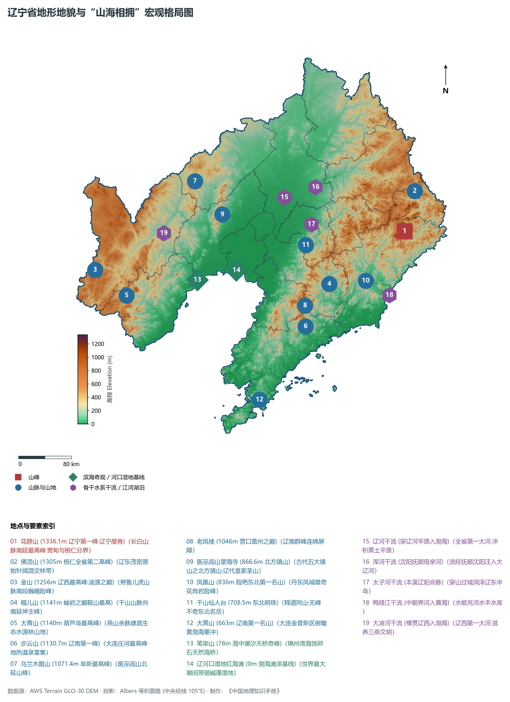
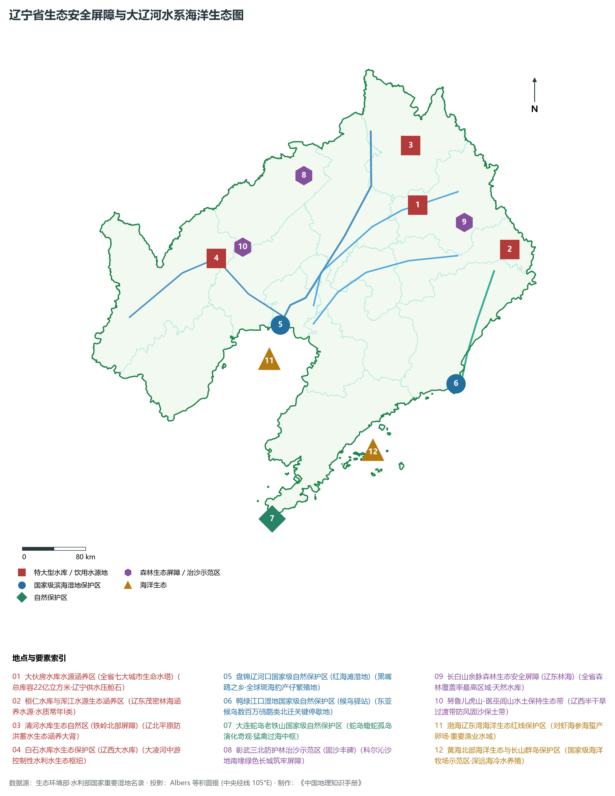
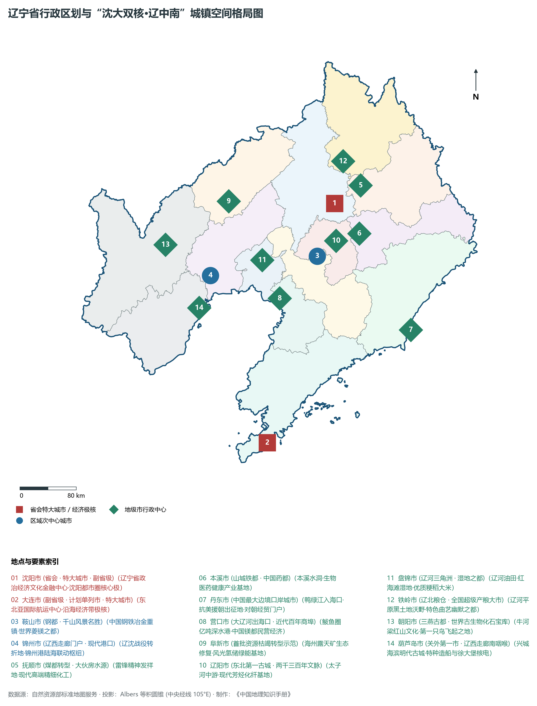
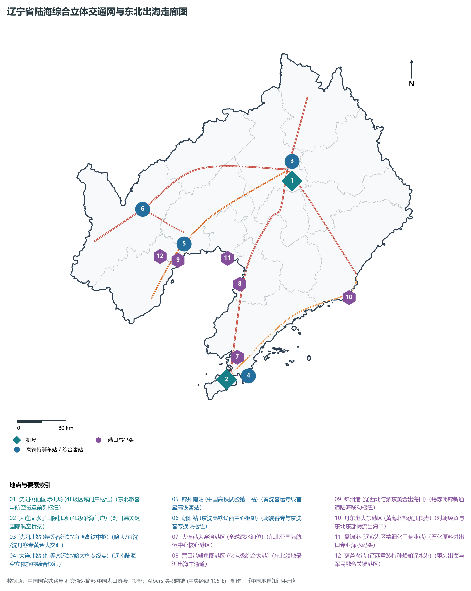
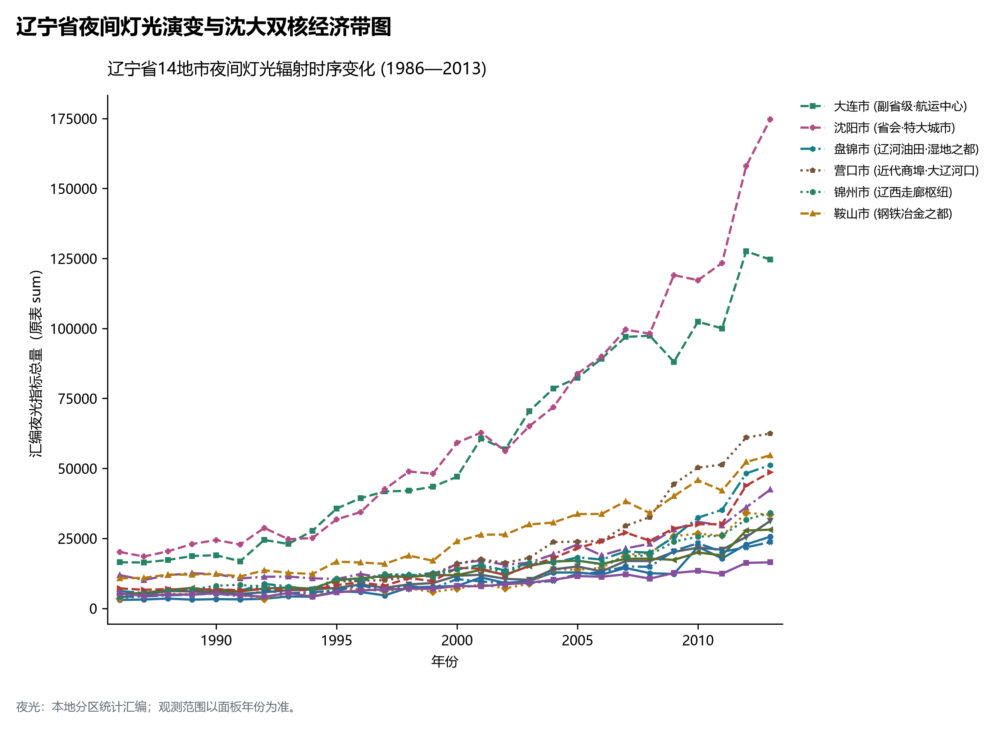

# 5.0 辽宁省地理统揽

辽宁省，简称“辽”，省会沈阳市，位于中华人民共和国东北地区南部，南临渤海与黄海，地处东经 118° 53' ～ 125° 46'、北纬 38° 43' ～ 43° 26' 之间。全省陆地面积达 14.86× 10⁴ km²，占全国陆地总面积的 1.55%；大陆海岸线东起鸭绿江口、西至山海关老龙头附近，全长达 2110 km，约占全国大陆海岸线的十二分之一；拥有海岛 633 个，海岛岸线长达 1041 km，海域面积达 6.45× 10⁴ km²。辽宁东北与吉林省接壤，西北与内蒙古自治区毗连，西南与河北省为邻，东南隔鸭绿江与朝鲜民主主义人民共和国相望，是我国东北地区唯一的沿海沿边省份，更是东北走向世界、融入“一带一路”向北开放的重要陆海门户与东北亚经济圈的核心枢纽。

全省地势宏观上呈现“六山一水三分田”的空间格局。千山山脉与努鲁儿虎山脉分别雄峙于东、西两翼，辽河平原沃野千里居中展布，辽东半岛宛如巨臂深入黄渤海浩波之中。全省现辖 14 个地级市（沈阳市、大连市、鞍山市、抚顺市、本溪市、丹东市、锦州市、营口市、阜新市、辽阳市、盘锦市、铁岭市、朝阳市、葫芦岛市），其中包括沈阳市、大连市 2 个副省级市（大连市同时为国家计划单列市）。截至 2024 年末，全省常住人口约 4180 万人，常住人口城镇化率达 73.5%，居全国前列。2024 年全省实现地区生产总值（GDP）达 3.12 万亿元，规模以上工业底蕴雄厚。作为闻名遐迩的“共和国工业长子”与东北老工业基地核心区，辽宁新中国成立以来为国家贡献了首枚国徽、首台机床、首艘国产航母、首架万能战鹰等数百项“新中国第一”，当前正全力实施全面振兴新突破三年行动，加速构建现代产业新高地与陆海开放新走廊。

---

## 一、地质构造演化与“山海相拥”宏观地貌格局

辽宁省在地质构造上位于中朝准地台（华北克拉通）的东北缘，地质演化跨越了近 38 亿年的漫长岁月。鞍山地区出土的白家坟杂岩同位素年龄达 38× 10⁸ a，是全球已知最古老的地壳古陆核之一。自中生代燕山运动以来，区域发生强烈的板块俯冲碰撞、岩浆侵入与强烈断陷，奠定了辽东隆起、辽西隆起与辽河裂陷下沉盆地的三联式骨架；新生代喜马拉雅运动伴随辽河断陷盆地巨厚沉积，并在古辽河泥沙冲积下形成了开阔平坦的辽河冲积平原。

辽宁全省地表高程极值跨度由海平面的 **0 m**（渤海与黄海基面）延伸至丹东宽甸境内长白山余脉花脖山顶峰的 **1336.1 m**（被称为“辽宁屋脊”）。依据地形起伏与成因，全省自东向西呈三列对称排列的纵向地貌单元：

1. **辽东低山丘陵区（东部）**：属于长白山脉向西南延伸的千山山脉与龙岗山脉体系，平均海拔在 500～ 800 m 之间。主要山峰包括花脖山（1336.1 m）、桓仁佛顶山（1305 m）、岫岩帽儿山（1141 m）、步云山（1130.7 m）及千山仙人台（708.5 m）。该区森林茂密、清泉奔涌，是全省重要的水源涵养地和生态安全水塔。
2. **辽中辽河平原区（中部）**：为我国东北平原在辽宁境内的向南延展部分，主要由辽河、浑河、太子河、绕阳河冲积下沉而成。地势由东北向西南平缓倾斜，平均海拔在 50 m 以下，土地平坦肥沃、黑土及草甸土广布。平原南部发育有全球罕见的辽河三角洲大湿地，是辽宁省乃至国家核心商品粮与高端果蔬基地。
3. **辽西低山丘陵区（西部）**：由内蒙古高原向沿海平原倾斜过渡，燕山余脉松岭山脉与努鲁儿虎山脉呈北东—南西向斜贯全境。平均海拔在 300～ 600 m 之间，最高峰为凌源金山（1256 m）、建昌大青山（1140m）与阜新乌兰木图山（1071.4 m）。山体表层受干旱风沙与流水切割，沟壑纵横，是辽宁防风固沙与水土保持的绿色防护带。
4. **环渤海与黄海滨海走廊（南部）**：辽东半岛向西南突入海洋，将渤海与黄海清晰分割，形成大连湾、大窑湾等天然深水避风良港；沿辽西延伸为长达数百公里的“辽西走廊”，依山傍海、地形险要，自古即为关内外陆路通行的咽喉要道。

**辽宁省宏观构造与地貌剖面示意表**

| 努鲁儿虎山脉 | 辽河平原黑土 | 长白山南延千山 |
| --- | --- | --- |
| (金山 1256m)；辽西风沙阻隔 | (地势低平沃野；辽河水系贯穿) | (花脖山1336m)；辽东水源水塔 |

西 (辽西低山丘陵) · 中 (辽河冲积平原) · → 东 (辽东低山丘陵)；过渡关系：山前台地洪积；河谷冲积低平；辽西走廊咽喉 · 渤海辽东湾滨海滩涂 · 黄海北部深水海港

---

## 二、温带季风气候与“辽河母亲”江河海洋水文

辽宁省地处中纬度亚欧大陆东岸，属于**温带季风气候**区。由于面临黄海、渤海，背靠东北内陆腹地，气候兼具海洋性与大陆性过渡特征：

- **水热时空配置**：全省四季分明、雨热同季，年平均气温在 7～ 11°C 之间。南部沿海大连地区受海洋调节，冬无严寒、夏无酷暑，年温差较小；北部铁岭、康平一带受西伯利亚冷空气控制，冬季寒冷漫长。全省年日照时数在 2500～ 2900 h 之间，光照资源十分充足。
- **降水梯度分异**：全省年降水量在 400～ 1100 mm 之间，呈现由东南沿海向西北内陆递减的鲜明空间梯度。东南部的丹东宽甸地处迎风坡，年降水量高达 1000～ 1200 mm，为东北地区“雨极”；而西北部的朝阳建平、阜新彰武年降水量仅 400～ 450 mm，蒸发量偏大，属半干旱季风气候。

辽宁省境内河流密布，流域面积在 100 km² 以上的河流达 300 余条，分属于辽河、鸭绿江、大凌河、小凌河、浑河、太子河及沿海独流入海水系：

- **辽河水系**：中国七大江河之一，也是辽宁的母亲河。西辽河与东辽河在铁岭昌图福德店汇合后始称辽河，干流经铁岭、沈阳、鞍山、盘锦等市注入渤海辽东湾。辽河全长 1390 km，在辽宁境内长达数百公里，滋养了辽河平原辽阔的黑土地大粮仓。双台子河为近代辽河盘锦入海主河道；大辽河则由浑河与太子河于三岔河汇流后自营口入海。
- **浑河与太子河**：发源于辽东山地，浑河上游建有总库容 22× 10⁸ m³ 的**大伙房水库**，作为全省最大的综合水利枢纽与水源地，通过大型引水隧洞向沈阳、抚顺、鞍山、本溪、辽阳、营口、盘锦等七大重点工业城市供给生命之水；太子河横穿本溪、辽阳，水力与工业价值极高。
- **鸭绿江**：中朝两国界河，发源于长白山天池，全长 795 km，在丹东东港注入黄海北部。水流充沛清冽，建有水丰、太平湾等特大型梯级水电站。
- **大凌河与小凌河**：辽西最大的外流水系，发源于努鲁儿虎山脉，横贯朝阳、锦州入渤海辽东湾，是孕育三燕文明与热河古生物化石地层的生命源泉。
- **海洋水文**：黄渤海在辽东半岛老铁山角形成明显海水分界。辽东湾为我国内海，水浅多滩涂，辽河三角洲红海滩翅碱蓬湿地举世闻名；黄海北部水深浪阔、受北黄海冷水团调控，是国家级现代海洋牧场与优质冷水海珍品繁育圣地。

---

## 三、行政区划、人口与“沈大双核·辽中南”空间架构

辽宁省现辖 14 个地级市，下辖 59 个市辖区、16 个县级市、17 个县、8 个自治县，共 100 个县级行政区。全省常住人口空间分布呈现“沈大双核引领、辽中南沿轴密集连片、辽东辽西绿屏疏朗”的显著集聚特征。

按照新时代推动东北全面振兴战略部署与《辽宁省国土空间规划（2021—2035年）》，辽宁构建了**“一圈一带两区”**的省域空间发展总格局：

1. **“一圈”：沈阳现代化都市圈**：以省会沈阳为核心，涵盖鞍山、抚顺、本溪、辽阳、铁岭，并辐射沈抚改革创新示范区和阜新部分区域。发挥沈阳国家中心城市创建极核功能，做强高端装备制造、机器人、集成电路装备及现代服务业，打造全国老工业基地转型创新先导区。
2. **“一带”：辽宁沿海经济带**：以大连为龙头，依托渤海辽东湾与黄海北部沿海线，串联丹东、营口、盘锦、锦州、葫芦岛六座沿海城市。做强东北亚国际航运中心、国际物流枢纽与现代海洋产业，构建具有全球竞争力的沿海绿色石化、精细化工与重型船舶制造基地。
3. **“两区”**：
   - **辽西融入京津冀协同发展战略先导区**：以锦州、葫芦岛、朝阳、阜新为支撑，借力辽西走廊与京沈高铁大动脉，承接京津冀先进制造、现代物流与绿色农产品供应链转移，建设千万千瓦级清洁能源基地与综合物流枢纽；
   - **辽东绿色经济区**：以丹东、本溪、抚顺山地林区为主体，涵盖桓仁、宽甸、新宾、清原等生态大县，守牢全省森林水塔与生态安全屏障，发展林下中药材、优质冰酒、温泉生态康养与特色文旅。

| 地级市 | 行政驻地 | 陆地面积 (km²) | 常住人口 (万人) | 城镇化率 (%) | 区域发展定位与核心产业 |
|:---|:---|:---|:---|:---|:---|
| **沈阳市** | 浑南区 | 12,860 | 924 | 85.55 | 省会、副省级市、特大城市、沈阳故宫世界遗产、高端装备与汽车智能制造 |
| **大连市** | 西岗区 | 12,574 | 754 | 83.04 | 副省级市、计划单列市、特大城市、东北亚国际航运中心、绿色石化与大型造船 |
| **鞍山市** | 铁东区 | 9,255 | 319 | 76.67 | 中国钢都、鞍钢大本营、千山风景名胜区、世界菱镁之都与岫岩玉之乡 |
| **抚顺市** | 顺城区 | 11,272 | 171 | 80.43 | 百年煤都转型、大伙房水源地、雷锋精神发祥地、现代石蜡高端精细化工 |
| **本溪市** | 明山区 | 8,411 | 123 | 80.7 | 山城铁都、本溪水洞地质奇观、太子河中国药都与枫叶之都 |
| **丹东市** | 振兴区 | 15,222 | 207 | 71.18 | 中国最大边境城市、鸭绿江口、对朝经贸门户、抗美援朝出征地、现代仪器仪表 |
| **锦州市** | 太和区 | 10,301 | 259 | 62.33 | 辽西走廊门户、笔架山潮汐天桥奇观、锦州港陆海联动枢纽、精细化工与光伏 |
| **营口市** | 西市区 | 5,427 | 224 | 68.65 | 大辽河入海口、近代百年开埠商埠、鲅鱼圈亿吨深水大港、中国镁都民营经济 |
| **阜新市** | 海州区 | 10,355 | 154 | 64.08 | 首批资源枯竭转型示范、海州露天矿生态修复、查海文化、风光氢储绿能基地 |
| **辽阳市** | 文圣区 | 4,743 | 151 | 68.63 | 东北第一古城、两千三百年文脉、太子河中游、现代芳烃化纤与特种铝型材 |
| **盘锦市** | 双台子区 | 4,147 | 138 | 80.29 | 辽河三角洲湿地之都、辽河油田主产区、红海滩生态奇观、优质粳稻大米 |
| **铁岭市** | 凡河新区 | 12,985 | 223 | 58.88 | 辽北粮仓、超级产粮大县昌图、辽河中游黑土地沃野、调兵山煤电、特色曲艺 |
| **朝阳市** | 双塔区 | 19,736 | 276 | 52.17 | 三燕古都、牛河梁红山文化圣地、古生物化石宝库、风光储清洁能源走廊 |
| **葫芦岛市** | 龙港区 | 10,415 | 232 | 57.32 | 关外第一市、兴城明代海滨古城、特种船舶重工、徐大堡核电清洁能源基地 |

---

## 四、陆海立体综合交通与东北亚黄金走廊

辽宁省自古为中原与东北各省交流的陆上咽喉，更坐拥东北通往大洋的天然黄金出海口，综合交通基础设施网络完备密集：

1. **高铁与高速客运网络**：
   - **哈大客运专线**：全国首条高寒高速铁路，纵贯辽宁南北，串联大连、营口、鞍山、辽阳、沈阳、铁岭，设计时速 350 km/h，是东北高负荷客运黄金主轴；
   - **京沈客运专线（京哈高铁）**：自北京朝阳经承德、朝阳、阜新直通沈阳，将沈阳至北京通行时间缩短至 2.5 小时以内，极大强化辽西融入京津冀；
   - **秦沈客运专线**：我国首条自主建设的快速铁路客运专线，经葫芦岛、锦州、盘锦连接沈阳；
   - **沈丹客运专线与丹大快速铁路**：沈丹高铁实现沈阳至边境丹东 1 小时通达；丹大快铁沿黄海北部滨海展布，构筑辽南半岛滨海快速客运环线。
2. **高速公路网大骨架**：全省高速公路通车总里程超过 4300 km。以 **G1 京哈高速** 与 **G15 沈海高速** 构成贯通南北大十字骨干；**G25 长深高速**、**G11 鹤大高速**、**G16 丹锡高速**、**G91 辽中环线高速** 紧密相织，实现全省县县通高速、半日通达黄渤海口岸。
3. **枢纽海港群（东北最近出海通道）**：
   - **大连港**：拥有大窑湾世界级特深水集装箱港区，年货物吞吐量数亿吨，集装箱直达全球数百个国际港口，为东北亚国际航运中心核；
   - **营口港**：鲅鱼圈港区依托沈大主干线，为东北内陆大宗散货、钢材与粮食最近出海口；
   - **锦州港、丹东港、盘锦港、葫芦岛港**：形成错位分工、协同运营的辽宁沿海现代化综合大港集群。
4. **现代化空港群**：以**沈阳桃仙国际机场（4E级）**与**大连周水子国际机场（4E级）**为核心门户枢纽，大连金州湾新机场（国内首个离岸式海上机场）全速推进；丹东浪头、锦州湾、朝阳、营口兰旗等支线机场全面覆盖。

---

## 五、1986—2013年夜间灯光演变与沈大双核辐射分析

本节夜光图的观测年份为 1986—2013 年，指标为行政区汇总值（原表 sum）。

---

## 六、生态文明安全屏障与人地可持续共生

面对长期重工业高强度开发带来的资源环境承载压力，辽宁省近年来坚决践行“两山”理念，实施生态立省战略，系统修复山水林田湖草沙海生命共同体：

- **辽东森林水塔保护**：在辽东低山丘陵区划定严格的生态保护红线，严格涵养大伙房水库、桓仁水库等全省关键饮用水源，全省森林覆盖率稳步保持在 40.5% 以上，本溪、抚顺、丹东森林覆盖率超过 70%，成为东北南部不可替代的天然水塔与空气净化器。
- **辽西防风固沙与科尔沁南侵阻击战**：阜新彰武县治沙七十余载，创造了将沙漠变绿洲的“彰武治沙精神”，构筑起抵御科尔沁沙地向南侵袭沈阳与华北平原的绿色长城；推进大凌河流域生态综合治理，让辽西荒山变风电光伏与生态林果富民山。
- **辽河口湿地与海洋生态保护红线**：盘锦辽河口国家级自然保护区全面实施“退养还湿”工程，恢复翅碱蓬与芦苇湿地数万亩，为世界珍稀濒危鸟类黑嘴鸥、丹顶鹤提供了全球关键繁殖庇护所；渤海辽东湾划定斑海豹产仔栖息国家级保护区，严格近海休渔制度，守护辽宁黄金海岸水清滩美的人地和谐典范。

地市统计来源：《中国城市统计年鉴 2025》表 2-1、2-6、2-7（2024 年，全市）。
