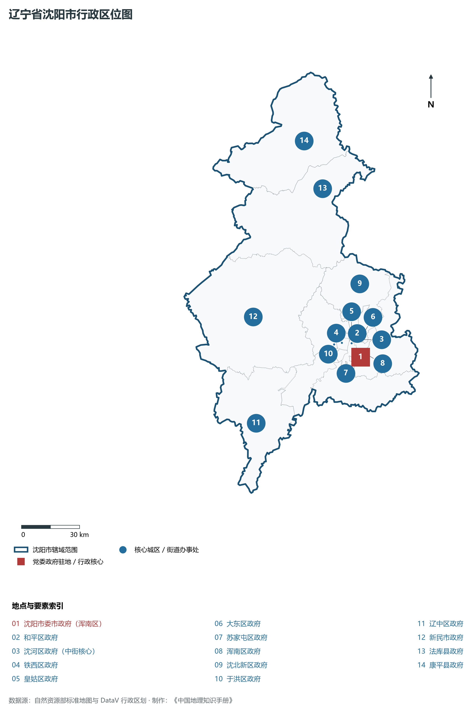
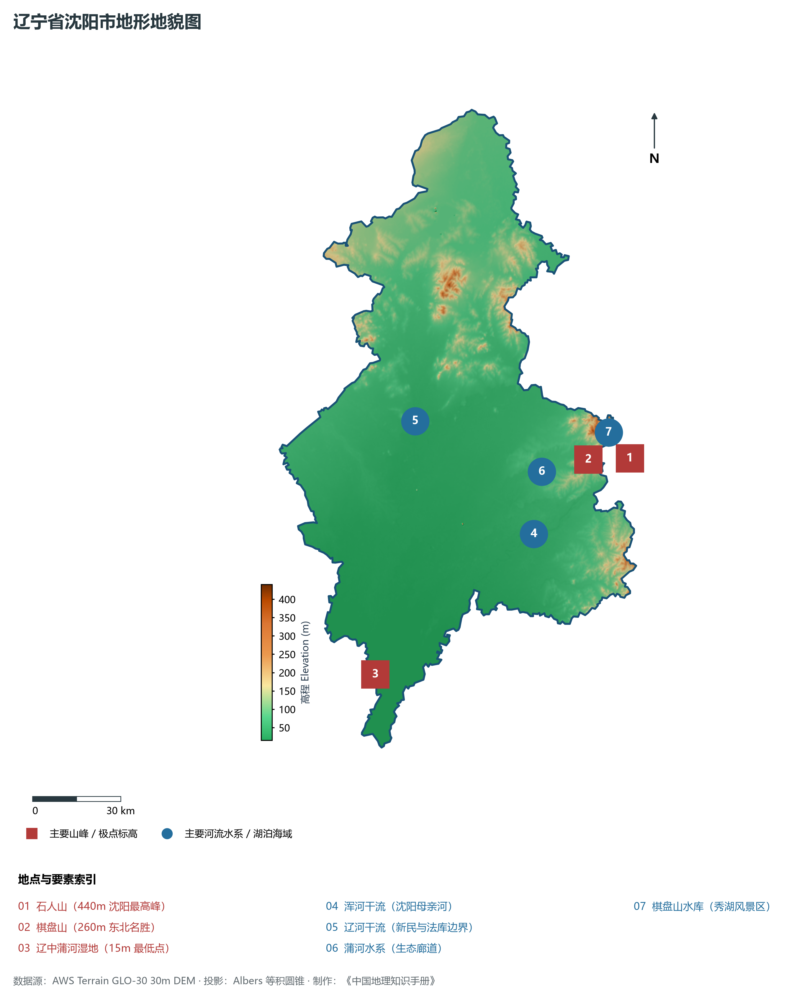
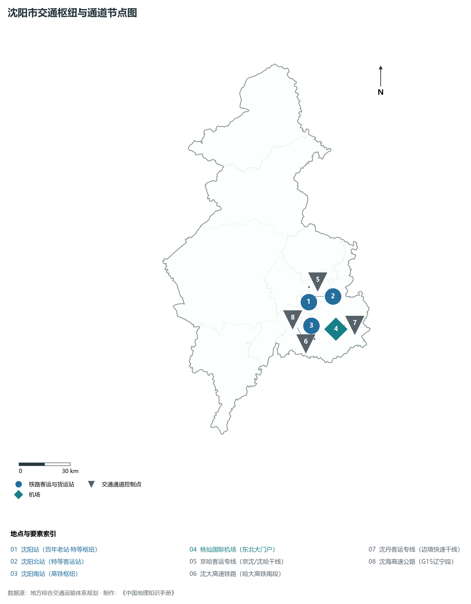
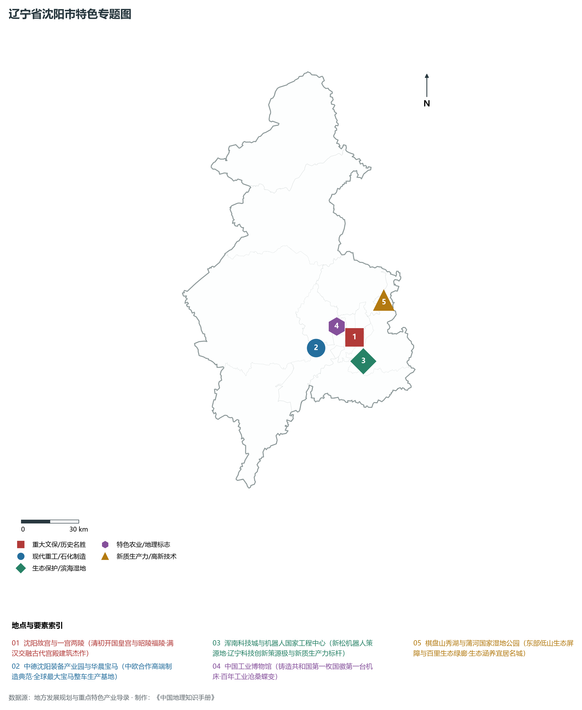
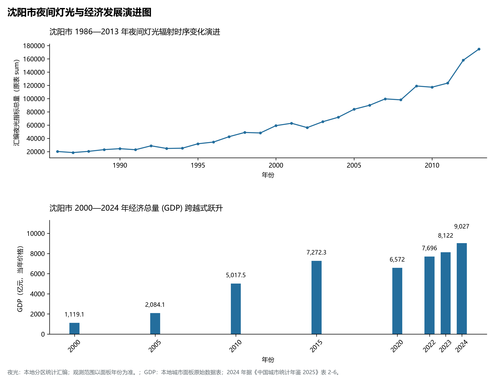

# 5.1 沈阳市
沈阳市，位于辽宁省，其战略定位与特色概括为：**省会·副省级市·特大城市·沈阳故宫世界文化遗产·共和国工业长子与现代高端装备基地**。辖区土地。2024 年常住人口 **924 万人**，常住人口城镇化率 **85.55%**，地区生产总值 **9,027 亿元**（当年价格），人均地区生产总值 **97,871 元**，三次产业构成为 **3.65 : 35.09 : 61.26**。

---
## 一、自然地理底盘与地貌水系机理
沈阳市在地质构造演化史上隶属于中朝准地台东北缘，基底古老深厚，经中生代燕山造山运动与新生代断裂下陷改造，形成了山脉雄峙、水网环绕、冲积阶地发育的优越自然地理底盘。全境地表高程最低为 **15.0 m**，最高隆起峰顶海拔达 **440.0 m**，地势落差与微地貌分异造就了多层次的生物多样性与空间资源承载力。

区域主要控制性山脉与地形极点包括：

- **石人山 (440m 沈阳最高峰)**（坐标约东经 123.850°、北纬 41.920°，高程约 440.0 m）；
- **棋盘山 (260m 东北名胜)**（坐标约东经 123.680°、北纬 41.940°，高程约 260.0 m）；
- **辽中蒲河湿地 (15m 最低点)**（坐标约东经 122.650°、北纬 41.420°，高程约 15.0 m）；

水系与水文网络方面，沈阳市地表水资源丰富，骨干河流纵横穿流：

- **浑河干流 (沈阳母亲河)**（流经约东经 123.400°、北纬 41.750° 水域）：对全市农业灌溉、城市工业供水及生态水网维持发挥核心调蓄作用；
- **辽河干流 (新民与法库边界)**（流经约东经 123.000°、北纬 42.150° 水域）：对全市农业灌溉、城市工业供水及生态水网维持发挥核心调蓄作用；
- **蒲河水系 (生态廊道)**（流经约东经 123.480°、北纬 41.930° 水域）：对全市农业灌溉、城市工业供水及生态水网维持发挥核心调蓄作用；
- **棋盘山水库 (秀湖风景区)**（流经约东经 123.690°、北纬 41.930° 水域）：对全市农业灌溉、城市工业供水及生态水网维持发挥核心调蓄作用；

---
## 二、行政区划沿革与城镇空间体系
沈阳市历史文脉源远流长，自先秦置郡以来行政建置历经变迁演进。新中国成立后，伴随老工业基地大规模建设与现代化城镇化推进，形成了结构完备、产城紧密融合的市辖区与县级行政单元空间组织体系：

- **沈阳市委市政府 (浑南区)**（驻地坐标：123.450°E, 41.720°N）：承担区域行政综合治理、公共资源配置与核心城镇组团功能；
- **和平区政府**（驻地坐标：123.410°E, 41.790°N）：承担区域行政综合治理、公共资源配置与核心城镇组团功能；
- **沈河区政府 (中街核心)**（驻地坐标：123.460°E, 41.800°N）：承担区域行政综合治理、公共资源配置与核心城镇组团功能；
- **铁西区政府**（驻地坐标：123.350°E, 41.800°N）：承担区域行政综合治理、公共资源配置与核心城镇组团功能；
- **皇姑区政府**（驻地坐标：123.420°E, 41.830°N）：承担区域行政综合治理、公共资源配置与核心城镇组团功能；
- **大东区政府**（驻地坐标：123.480°E, 41.810°N）：承担区域行政综合治理、公共资源配置与核心城镇组团功能；
- **苏家屯区政府**（驻地坐标：123.340°E, 41.660°N）：承担区域行政综合治理、公共资源配置与核心城镇组团功能；
- **浑南区政府**（驻地坐标：123.470°E, 41.740°N）：承担区域行政综合治理、公共资源配置与核心城镇组团功能；
- **沈北新区政府**（驻地坐标：123.530°E, 42.050°N）：承担区域行政综合治理、公共资源配置与核心城镇组团功能；
- **于洪区政府**（驻地坐标：123.300°E, 41.800°N）：承担区域行政综合治理、公共资源配置与核心城镇组团功能；
- **辽中区政府**（驻地坐标：122.730°E, 41.510°N）：承担区域行政综合治理、公共资源配置与核心城镇组团功能；
- **新民市政府**（驻地坐标：122.830°E, 41.990°N）：承担区域行政综合治理、公共资源配置与核心城镇组团功能；
- **法库县政府**（驻地坐标：123.410°E, 42.510°N）：承担区域行政综合治理、公共资源配置与核心城镇组团功能；
- **康平县政府**（驻地坐标：123.350°E, 42.740°N）：承担区域行政综合治理、公共资源配置与核心城镇组团功能；

在城镇空间发展战略上，沈阳市依托国土空间总体规划，聚力构建“极核集聚、多组团协同、轴带串联、生态穿插”的现代城镇空间体系，全力推进产城融合与区域一体化协同发展。

---
## 三、综合立体交通网络与交通走廊
沈阳市地处东北内陆与沿海交通关键走廊之上，依托高速铁路、干线普铁、国家高速公路与沿海航空/海港码头，构筑了现代化立体综合交通运输骨架：

**主要综合交通客运与货运物流枢纽节点：**

- **沈阳站 (百年老站·特等枢纽)**（位置坐标：123.398°E, 41.794°N）：区域客货运流量集散分拨中心；
- **沈阳北站 (特等客运站)**（位置坐标：123.435°E, 41.818°N）：区域客货运流量集散分拨中心；
- **沈阳南站 (高铁枢纽)**（位置坐标：123.385°E, 41.670°N）：区域客货运流量集散分拨中心；
- **桃仙国际机场 (东北大门户)**（位置坐标：123.483°E, 41.639°N）：区域客货运流量集散分拨中心；

**核心干线铁路与高等级公路交通走廊：**

- **京哈客运专线 (京沈/沈哈干线)**（廊道控制点：123.420°E, 41.870°N）：实现城市对外快速互联互通的高速客货运通道；
- **沈大高速铁路 (哈大高铁南段)**（廊道控制点：123.390°E, 41.600°N）：实现城市对外快速互联互通的高速客货运通道；
- **沈丹客运专线 (边境快速干线)**（廊道控制点：123.550°E, 41.650°N）：实现城市对外快速互联互通的高速客货运通道；
- **沈海高速公路 (G15辽宁段)**（廊道控制点：123.310°E, 41.620°N）：实现城市对外快速互联互通的高速客货运通道；

---
## 四、现代重点产业布局与特色功能组团
在新时代东北全面振兴指引下，沈阳市坚持高端化、智能化、绿色化发展方向，加快改造升级传统优势工业，积极培育壮大新兴未来产业，打造特色现代化产业集群：

**重点园区与现代化产业基地：**

- **中德(沈阳)高端装备制造产业园**（空间分布：123.180°E, 41.760°N）；
- **华晨宝马铁西工厂 (工业4.0样板)**（空间分布：123.230°E, 41.820°N）；
- **浑南科技城与沈阳高新区**（空间分布：123.480°E, 41.680°N）；
- **沈阳飞机工业集团 (沈飞·战鹰摇篮)**（空间分布：123.420°E, 41.860°N）；

**代表性特色地标与战略支撑维度：**

- **沈阳故宫与一宫两陵 (世界文化遗产名录)**（123.453°E, 41.796°N）：清初开国皇宫与昭陵福陵·满汉交融古代宫殿建筑杰作；
- **中德沈阳装备产业园与华晨宝马**（123.200°E, 41.780°N）：中欧合作高端制造典范·全球最大宝马整车生产基地；
- **浑南科技城与机器人国家工程中心**（123.480°E, 41.680°N）：新松机器人策源地·辽宁科技创新策源极与新质生产力标杆；
- **中国工业博物馆 (铁西老工业基地印记)**（123.340°E, 41.810°N）：铸造共和国第一枚国徽第一台机床·百年工业沧桑蝶变；
- **棋盘山秀湖与蒲河国家湿地公园**（123.680°E, 41.940°N）：东部低山生态屏障与百里生态绿廊·生态涵养宜居名城；

---
## 五、1986—2013年夜间灯光演变与经济变化分析

本节夜光图的观测年份为 1986—2013 年，指标为行政区汇总值（原表 sum）。

- **1996 年空间发展说明**：三环内中街与太原街核心商圈崛起；铁西传统工业区夜间密集生产；
- **2008 年空间发展说明**：东搬西建铁西老工业基地脱胎换骨；浑南高新区与沈北新区加速开发；
- **2021 年空间发展说明**：华晨宝马第三工厂投产；浑南科技城与沈阳临空经济区成网；

| 年份 | 地区生产总值（亿元，当年价格） |
|:---|---:|
| 2000 年 | 1,119.1 |
| 2005 年 | 2,084.1 |
| 2010 年 | 5,017.5 |
| 2015 年 | 7,272.3 |
| 2020 年 | 6,572 |
| 2022 年 | 7,696 |
| 2023 年 | 8,122 |
| 2024 年 | 9,027 |

---
## 六、文化旅游名胜、生态屏障与可持续人地共生
沈阳市高度注重统筹经济高质量发展与高水平生态环境保护，筑牢绿色生态底盘，弘扬优秀历史文化：

- **沈阳故宫 (世界文化遗产)**（位置坐标：123.453°E, 41.796°N）；
- **清昭陵 (北陵公园·世界文化遗产)**（位置坐标：123.425°E, 41.848°N）；
- **清福陵 (东陵公园·世界文化遗产)**（位置坐标：123.585°E, 41.825°N）；
- **张学良旧居陈列馆 (大帅府)**（位置坐标：123.456°E, 41.791°N）；

在人地协调机制方面，沈阳市统筹推进山水林田湖草沙海一体化保护与系统治理，坚决打好蓝天、碧水、净土保卫战，推进传统工矿区生态恢复治理，打造人与自然和谐共生的生态宜居美丽家园。

---
## 七、沈阳市关键地理统计指标速查矩阵

| 统计指标项 | 统计数值 / 口径标准 | 空间特征与全省位次说明 |
|:---|:---|:---|
| **行政区划代码** | `210100` | 国家民政部标准行政区划编号 |
| **辖区陆地面积** | **12,860.0** km² | 土地利用类型兼具山地、丘陵、平原与城镇工矿 |
| **常住人口规模** | 924 万人 | 2024 年，全市；年鉴公布口径 |
| **常住人口城镇化率** | 85.55% | 2024 年，全市；年鉴公布口径 |
| **地区生产总值 (2024)** | 9,027 亿元 | 2024 年，全市；年鉴公布口径 |
| **人均 GDP 水平** | 97,871 元/人 | 2024 年，全市；年鉴公布口径 |
| **三次产业结构比** | 3.65 : 35.09 : 61.26 | 2024 年，全市；年鉴公布口径 |
| **地表极限高程** | **15.0 m ～ 440.0 m** | 形成极具特色的立体地貌剖面格局 |

2024 年统计来源：《中国城市统计年鉴 2025》表 2-1、2-6、2-7（2024 年，全市）。其他年份 GDP 据本地城市面板“原始数据”表，单位为亿元、当年价格。
